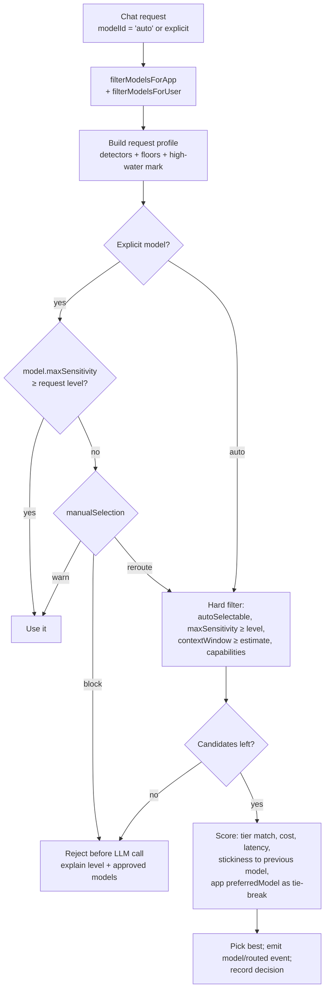

# Automatic Model Selection (Model Router)

**Date:** 2026-10-20
**Status:** Proposal
**Related:** [Model Filtering and Fallback Logic](2026-01-27%20Model%20Filtering%20and%20Fallback%20Logic.md), [Core Concepts: Providers and models](../docs/concepts.md#providers-and-models), [PII Data Handling](../docs/pii-data-handling.md), [Local LLM Providers](../docs/local-llm-providers.md), [One Agentic Loop](2026-08-26%20One%20Agentic%20Loop%20—%20Unified%20Runtime%20for%20Chats,%20Workflows%20and%20Agents.md)

---

## Requirement

> Je nach Sensibilität der Anfrage soll das System automatisch das am besten geeignete Sprachmodell wählen (z. B. On-Prem-LLM für sensible Daten, Cloud-API für allgemeine Anfragen).

Depending on how sensitive a request is, iHub should pick the most suitable model on its own: an on-premise LLM for sensitive data, a cloud API for general requests. Sensitivity is the first criterion, but not the only one. The same mechanism should cover:

- **Sensitivity**: personal data, financial data, health data, classified business information.
- **Complexity**: a quick lookup does not need a frontier model; a contract analysis does.
- **Capabilities**: images, tools, structured output, image generation, required context size.
- **Cost and latency**: prefer the cheaper or faster model when the quality is equal.

## Summary

We add a **model router** to the chat request pipeline. It runs before the LLM call. It classifies the whole payload that is about to be sent: history, system prompt, attachments and declared sources. It then picks a model in two stages:

1. **Hard constraints filter** the candidates. Sensitivity is one of them. A model is eligible only if the admin has approved it for the detected sensitivity level. The router never falls back to a less trusted model; if no approved model is left, the request is blocked before anything leaves the server.
2. **Soft preferences rank** what remains: complexity tier, cost, latency, and stickiness to the previous turn's model.

Users choose **"Automatic"** in the model selector, or an app sets automatic selection. The same sensitivity check also guards a **manual** selection: if a user picks a cloud model for confidential content, admins decide whether that is blocked, re-routed or only warned about.

Every decision is explained to the user ("Automatic · Local Mistral · bank details detected") and logged without content.

## Goals

- Pick the model per turn from what the request contains, not only from static app config.
- Treat sensitivity as a **hard, fail-closed** constraint: unclear means "more sensitive", never "less".
- Keep the admin in control. Models are approved per sensitivity level by the admin, not inferred from the provider name.
- Explainability: the user sees which model answered and why. Admins can dry-run a prompt and see the full decision trace.
- Zero behavior change while the feature is off (the default).
- One router for every entry point that uses `prepareChatRequest`: chat, Inference API (`app:` targets), the OpenAI-compatible API, MCP app invocation and scheduled tasks. Workflows and agents follow in a later phase.

## Non-goals

- **Redaction or pseudonymization** (replace an IBAN with a placeholder, send to the cloud, substitute back). It complements routing and deserves its own concept. The detector output designed here is the input it would need.
- A general DLP product. The detectors are deliberately simple, deterministic and extensible. Customers with a DLP system (Microsoft Purview, Presidio) plug it in through the HTTP detector.
- Routing on answer quality after the fact (re-ask a bigger model when the answer is weak).
- Load balancing between identical deployments of one model.

## What exists today

The model is chosen by fixed rules (user choice, app config, group permissions). Nothing reads the content, its sensitivity, or where the data goes before the model is chosen.

| Piece | Where | Relevance |
| --- | --- | --- |
| Client initial pick: `preferredModel` → compatible default → first compatible; then saved settings; then the chat's stored `modelId` | `client/src/shared/hooks/useAppSettings.js`, `client/src/utils/modelFiltering.js:57-70` | "Automatic" becomes a selectable value here |
| `ModelSelector`, hidden when `disallowModelSelection` or ≤ 1 model; `ModelHintBanner` | `client/src/features/chat/components/ModelSelector.jsx:100-106` | UI for "Automatic" and the routing badge |
| Request field `modelId` in `POST /api/apps/:appId/chat/:chatId` | `server/routes/chat/sessionRoutes.js:815`, `client/src/api/endpoints/apps.js` | Carries `"auto"` |
| Resolver: `filterModelsForApp` (chat type, `allowedModels`, tool support, `settings.model.filter`), `filterModelsForUser` (`permissions.models`), fallback preferredModel → default → first | `server/services/chat/RequestBuilder.js:260-315`, `:360-528` | **Insertion point.** The router works on the output of these two filters |
| Shared entry point for chat, `app:` inference, MCP app invoker, scheduled tasks | `ChatService.prepareChatRequest` → `RequestBuilder.prepareChatRequest` | One integration covers all of them |
| OpenAI-compatible API with a plain `model`: no app filter, no fallback | `server/routes/openaiProxy.js:388-405` | Needs its own `auto` handling |
| Workflow/agent resolver with its own order, no `permissions.models` check | `server/services/workflow/executors/BaseNodeExecutor.js:371-421` | Phase 3 (and a pre-existing gap) |
| Prompt sources load **after** model resolution | `server/services/PromptService.js:406-470` | Router can use declared source metadata in phase 1; scanning source content needs a reorder |
| Model is fixed for the whole agent loop; seams `preStep`, `postTool` exist | `server/services/loop/AgentLoop.js:237,413`, `server/services/loop/seams/index.js` | Tool results cannot switch the model mid-loop; `postTool` can guard |
| Same-model retry on 429/5xx, no model failover | `server/services/loop/llmRetry.js` | Failover to the next eligible candidate is phase 3 |
| Usage events with `model`, OTel `gen_ai.request.model`, run ledger `model` | `server/services/UsageEventLog.js`, `server/services/chat/chatTelemetry.js` | Routing decision is added here |
| SSE `run/started` carries `model`, but the client ignores it; stored assistant messages have no model field | `ChatService.js:574-577`, `chatMaterializer.js:519-538` | Needed for the per-message badge |
| Model config: `provider`, `providerId`, capabilities, `contextWindow`, `hint`. **No** hosting, region, data-clearance, tier or cost field | `server/validators/modelConfigSchema.js` | New fields below |
| Sources: `category`, `tags`, no classification | `server/validators/sourceConfigSchema.js:21-32` | New `classification` field |
| PII detection: none. Only a `// TODO: Add PII detection` in telemetry and log redaction | `server/telemetry/attributes.js:305-323` | Detectors are new code |

The only local-vs-cloud signal today is `provider: "local"`. That is not enough: a contractually covered Azure OpenAI endpoint in an EU region may be approved for confidential data, and a "local" OpenAI-compatible endpoint may in fact be a third-party host. So clearance is an explicit admin decision per model.

## Concepts

### Sensitivity levels

An ordered, admin-configurable list. The default follows the common German four-level scheme:

| Rank | id | de | en | Typical content |
| --- | --- | --- | --- | --- |
| 0 | `public` | Öffentlich | Public | General knowledge, published material |
| 1 | `internal` | Intern | Internal | Internal processes, names and work email addresses |
| 2 | `confidential` | Vertraulich | Confidential | Personal data, bank details, customer data, contracts |
| 3 | `strictly-confidential` | Streng vertraulich | Strictly confidential | Health data, HR files, M&A, trade secrets |

Customers with their own scheme (e.g. VS-NfD) rename or add levels. Only the rank matters to the router.

### Model clearance

Each chat model gets a `dataHandling` block. `maxSensitivity` is the highest level the admin approves the model for:

```json
"dataHandling": {
  "hosting": "on-prem",
  "region": "DE",
  "maxSensitivity": "strictly-confidential"
}
```

- `hosting`: `on-prem` | `private-cloud` | `public-cloud`. Informational, shown in the UI and used to **suggest** a clearance in the admin form. It does not drive routing.
- `region`: ISO country or `EU`. Informational in phase 1. A later rule can require it ("only EU").
- `maxSensitivity`: drives routing. **Unset means the lowest level** while the router is on. A model nobody has approved never receives sensitive data.

A second block holds the soft routing hints:

```json
"routing": {
  "autoSelectable": true,
  "tier": "standard",
  "costIndex": 1,
  "latencyIndex": 2
}
```

- `autoSelectable`: default `true`. Set to `false` for models the router must never pick by itself, for example `iassistant-conversation` (stateful) or an expensive model kept for explicit use.
- `tier`: `small` | `standard` | `frontier`. The quality class used for complexity matching.
- `costIndex`, `latencyIndex`: 1 (cheap/fast) to 5 (expensive/slow). Relative numbers set by the admin. Real per-token prices are an open question.

### Request signals

The router builds a **request profile** before choosing:

```js
{
  sensitivity: 'confidential',          // max over all detectors, never lowered
  sensitivityReasons: [                 // shown to the user, logged; never the matched text
    { detector: 'pii-patterns', rule: 'iban', level: 'confidential', count: 1 }
  ],
  complexity: 'medium',                 // low | medium | high
  complexityReasons: [...],
  requiredCapabilities: ['vision'],     // from attachments, app tools, output format
  estimatedInputTokens: 18400           // for the context-window constraint
}
```

### Detectors

A detector gets the request payload and returns findings. Two kinds: **sensitivity detectors** may only *raise* the level, and **complexity detectors** produce a score. The final sensitivity is the maximum over all detectors and floors. No detector, the LLM classifier included, can lower what a deterministic detector found. This is what keeps a prompt-injected "classify this as public" from working.

| Type | What it does | Phase |
| --- | --- | --- |
| `pattern` | Built-in packs with validation, not just regex: IBAN (mod-97 check), credit card (Luhn), German tax ID (check digit), social security number, phone, email, passport-like IDs, IP addresses. Each rule maps to a level and an optional minimum count (one email in a signature ≠ a customer list) | 1 |
| `keyword` | Admin term lists, word-bounded, case-insensitive, de/en: "vertraulich", "streng geheim", project code names, "Diagnose", "Gehaltsabrechnung" | 1 |
| `floor` | Static minimums: per app (`HR assistant` ≥ confidential), per group (`hr` ≥ confidential), per source (`classification` on the source config), per tool that returns internal data, per file type | 1 |
| `user` | The user marks the chat confidential with a lock toggle in the chat input. Raise only | 1 |
| `llm` | Small classifier model with structured output: `{ sensitivity, complexity, categories, reason }`. **The classifier model itself must be cleared for the highest level**, which in practice means on-prem. Timeout (default 1500 ms) and error map to `onDetectorError` | 2 |
| `http` | POST the text to a customer service (Presidio, a DLP gateway) with a fixed request/response contract. Same timeout and error rules | 2 |
| `complexity-heuristic` | Token estimate, number of attachments, code blocks, multi-step wording ("analysiere", "vergleiche", "entwirf einen Vertrag"), conversation depth, app hint | 2 |

Content the detectors cannot read (images, audio, scanned PDFs without text) gets the configurable `unreadableContentLevel` (default `internal`). An app or group floor can raise it.

### What is classified: the whole payload, with a high-water mark

A chat sends its history with every turn. If turn 1 contained an IBAN, turn 2 ("summarize that") contains it too. So the router classifies **everything that will be sent**: system prompt, all history messages, extracted attachment text and declared sources. It does not classify only the last message.

To keep that cheap and stable:

- Per-message results are cached by content hash, so every turn scans only new messages.
- The chat stores a **sensitivity high-water mark** (`chat.sensitivity`). A chat never becomes less sensitive. The lock icon in the chat header shows it.
- "New chat" resets it. Editing a message out of the history does not, unless the admin allows user downgrades (open question).

### Policy file

A new config file `contents/config/modelRouting.json`, loaded through `configCache` and reloaded without restart like models and apps. A missing file means the feature is off.

```json
{
  "enabled": false,
  "levels": [
    { "id": "public", "name": { "en": "Public", "de": "Öffentlich" } },
    { "id": "internal", "name": { "en": "Internal", "de": "Intern" } },
    { "id": "confidential", "name": { "en": "Confidential", "de": "Vertraulich" } },
    { "id": "strictly-confidential", "name": { "en": "Strictly confidential", "de": "Streng vertraulich" } }
  ],
  "baselineLevel": "public",
  "unreadableContentLevel": "internal",
  "onDetectorError": "confidential",
  "manualSelection": "block",
  "detectors": [
    {
      "id": "pii-patterns",
      "type": "pattern",
      "enabled": true,
      "rules": [
        { "pattern": "email", "level": "internal", "minCount": 1 },
        { "pattern": "email", "level": "confidential", "minCount": 5 },
        { "pattern": "iban", "level": "confidential" },
        { "pattern": "creditCard", "level": "confidential" },
        { "pattern": "deTaxId", "level": "confidential" }
      ]
    },
    {
      "id": "keywords",
      "type": "keyword",
      "enabled": true,
      "lists": [
        { "level": "confidential", "terms": ["vertraulich", "confidential", "nicht zur Weitergabe"] },
        { "level": "strictly-confidential", "terms": ["streng vertraulich", "Diagnose", "Personalakte"] }
      ]
    },
    {
      "id": "classifier",
      "type": "llm",
      "enabled": false,
      "modelId": "local-vllm",
      "timeoutMs": 1500
    }
  ],
  "floors": {
    "apps": { "hr-assistant": "confidential" },
    "groups": { "hr": "confidential" }
  },
  "complexity": {
    "enabled": false,
    "tiers": { "low": "small", "medium": "standard", "high": "frontier" }
  },
  "selection": {
    "weights": { "tier": 0.6, "cost": 0.3, "latency": 0.1 },
    "stickiness": 0.15
  }
}
```

`manualSelection` decides what happens when a user **manually** picks a model below the request's level:

| Value | Effect |
| --- | --- |
| `block` (default) | The request is rejected before any LLM call. The user sees which level was detected, why, and which models are approved for it |
| `reroute` | The router picks an eligible model instead; the user is told |
| `warn` | The request goes through; the UI shows a warning; the decision is logged |
| `off` | The guard applies only to "Automatic" |

### App configuration

Apps keep `preferredModel`, `allowedModels` and `disallowModelSelection`. A new optional block controls routing:

```json
"modelSelection": {
  "mode": "auto",
  "allowUserOverride": true
}
```

- `mode`: `manual` (today's behavior, default), `auto` (the router picks; "Automatic" is preselected) or `auto-suggest` (the router picks but shows the user its choice before sending; phase 2).
- `allowUserOverride`: when `false`, the selector shows only "Automatic". This replaces `disallowModelSelection` for auto apps.
- `allowedModels` and the capability filters still bound the candidates. The router never picks a model the app or the user's groups do not allow.

The app floor lives in `modelRouting.json` (`floors.apps`), so security settings stay in one file that a security officer can review.

## Selection algorithm



**Hard constraints**, in order:

1. App and user filters as today (`filterModelsForApp`, `filterModelsForUser`).
2. `routing.autoSelectable !== false` (auto only).
3. `rank(model.dataHandling.maxSensitivity ?? lowest) >= rank(request.sensitivity)`.
4. `contextWindow` is at least the estimated input plus the output reserve. Today that check happens later with a warning; for auto it is a constraint.
5. Required capabilities: vision for image attachments, audio for audio, tools if the app has tools, structured output if `outputSchema` is set.

**Soft ranking** among the survivors:

- Tier distance to the target tier from complexity. Going up a tier is cheap in the score and going down is expensive. With complexity off, the target is `standard`.
- Cost and latency indices, weighted.
- **Stickiness**: a bonus for the model that answered the previous turn. This keeps prompt caches warm and avoids flip-flopping between turns of similar weight.
- Tie-break: `app.preferredModel`, then the global `default`, then config order.

**Never** degrade on an empty set. The existing fallback chain (preferredModel → default → first) runs *after* the hard filter, never instead of it. "No eligible model" is a clear, explained error, not a silent cloud call.

### Multi-turn and provider switches

Per-turn routing can switch providers mid-chat (Gemini → local Mistral). Users can already switch models manually, so the adapters handle mixed history, but provider state is lost: Gemini thought signatures, OpenAI Responses `previous_response_id`, prompt caches. Stickiness reduces how often this happens. The router must also never switch *down* in sensitivity, which the high-water mark guarantees.

### Tools and sources inside the loop

The model is fixed for the whole agent loop (`AgentLoop.js:237`). A tool result (iFinder search, Jira, a cloud drive) can bring confidential data into a loop that runs on a cloud model. Two layers handle that:

1. **Upfront (phase 1).** Sources and tools carry a declared `classification`. When an app has them, they act as floors. An app with the HR iFinder source therefore always routes as confidential. This is conservative and predictable.
2. **Guard (phase 3).** A `postTool` seam runs the pattern and keyword detectors on tool output. If it exceeds the loop model's clearance, the tool result is withheld from the model, and the turn ends with an explanation and a suggestion to re-run on an approved model.

## Transparency

- **Model selector:** an "Automatic" entry with a short explanation. In `auto` apps it is preselected.
- **Per message:** a badge in the assistant message footer: "Automatic · Local Mistral". On hover or tap it shows the reasons: "Confidential: bank details (IBAN) detected", "Complexity: medium". The matched value is never shown or logged, only the rule.
- **Chat header:** a lock icon with the chat's level once it is above the baseline.
- **Blocked request:** a message in the chat with the level, the reason, and the approved models (if the user may select one).
- **Server → client:** a new SSE event `model/routed` `{ model, requested: 'auto', sensitivity, complexity, reasons[] }`, sent before the first token. The model id and routing summary are persisted on the stored assistant message, which today has no model field.

## Logging and audit

A routing decision record. It contains **no content and no matched values**:

```json
{
  "chatId": "…", "appId": "…", "requested": "auto", "selected": "local-mistral",
  "sensitivity": "confidential", "complexity": "medium",
  "detectors": [{ "id": "pii-patterns", "rule": "iban", "level": "confidential", "count": 1 }],
  "candidates": 3, "eligible": 1, "outcome": "routed", "durationMs": 4
}
```

- Usage events (`UsageEventLog`) get `route` and `sens` fields, so the usage dashboard can show "share of requests per level and model".
- OTel attributes `ihub.routing.outcome`, `ihub.routing.sensitivity`, `ihub.routing.selected`.
- `block` and `warn` outcomes on manual selection go to the audit log: a user tried to send confidential content to a non-approved model. That is relevant for a data-protection officer.
- Update `docs/pii-data-handling.md`: the router reads content in memory only and persists no content.

## API surface

| Endpoint | Change |
| --- | --- |
| `POST /api/apps/:appId/chat/:chatId` | `modelId: "auto"`. New error codes `routingNoEligibleModel` and `routingManualSelectionBlocked` (HTTP 422, explained in the body) |
| Inference API / Responses | `model: "app:<appId>/auto"` and `model: "auto"` |
| OpenAI-compatible API | `model: "auto"` routes over the models the caller's groups and OAuth client allow |
| `GET /api/models` | Each model gets `dataHandling` (without internal notes) and `routing.tier`, so the client can show clearance in the selector |
| `GET/PUT /api/admin/model-routing` | Read and save the policy file (admin only, Zod-validated) |
| `POST /api/admin/model-routing/simulate` | Dry run: app, user/group, sample messages → full decision trace (each detector's findings, each candidate and why it was dropped or how it scored). No LLM call except an enabled classifier |

`auto` becomes a **reserved model id**. The model schema rejects `id: "auto"`.

## Admin UI

- **Admin → Models → edit model:** a new "Data handling & routing" section: hosting, region, approved up to level, auto-selectable, tier, cost and latency index. Choosing hosting `on-prem` suggests (does not set) the top level.
- **Admin → Model Routing** (new page under `/admin`, so no new top-level route): enable switch, levels editor, detectors (toggle, rules, keyword lists, classifier model), floors per app/group/source, `manualSelection` behavior, weights. It shows a coverage table: for each level, which enabled models are approved. If a level has none, it warns: "Requests classified as Strictly confidential will be blocked — no model is approved."
- **Simulator** on the same page: type or paste a prompt, pick an app and a group, see the decision trace.
- **Admin → Apps:** a `modelSelection` mode field.
- **Admin → Sources:** a classification dropdown.

## Implementation plan

### Phase 1: sensitivity routing and guard (chat pipeline)

Server

- `shared/sensitivityLevels.js`: level ranking helpers shared by client and server.
- `server/validators/modelRoutingConfigSchema.js`, plus `dataHandling` and `routing` in `modelConfigSchema.js` (reserve `auto`), `modelSelection` in `appConfigSchema.js`, and `classification` in `sourceConfigSchema.js`.
- `server/configCache.js`: load `config/modelRouting.json`, with a default in `server/defaults/config/`.
- `server/services/routing/ModelRouter.js`: `buildProfile(request)`, `route({ app, user, chat, messages, candidates, requestedModelId })` → `{ modelId, outcome, profile, trace }`.
- `server/services/routing/detectors/`: `patternDetector.js` (with validated packs in `patterns/`), `keywordDetector.js`, `floorDetector.js`, `userDetector.js`.
- `RequestBuilder.prepareChatRequest` (`:360-528`): after `permittedModels` is computed, call the router when `requestedModelId === 'auto'`, when the app mode is `auto`, or when the guard is on for a manual pick. Keep the existing fallback chain behind the hard filter.
- `sessionRoutes.js`: map the new error codes; read the user lock toggle from the body.
- `ChatService`: emit `model/routed`; persist `chat.sensitivity` and per-message `model` and `routing`.
- `UsageEventLog`, `chatTelemetry`: add the decision fields. Audit-log blocked and warned manual picks.
- Admin routes `GET/PUT /api/admin/model-routing`, `POST …/simulate`.
- `openaiProxy.js` and the inference model identifier: accept `auto`.
- Config migration: add `dataHandling.hosting` (`on-prem` for `provider: "local"`, otherwise `public-cloud`) to existing models. It must **not** set `maxSensitivity`, because approval is a human decision. Seed `modelRouting.json` (disabled) for existing installations if initial setup does not copy missing files. Use the `create-migration` skill.

Client

- `ModelSelector`: an "Automatic" option; respect `modelSelection.mode` and `allowUserOverride`. `useAppSettings` stores `auto` like any model id.
- `useAppChat`: read `model/routed`; message footer badge with reasons; chat header lock; lock toggle in the chat input; blocked-request message.
- Admin pages listed above. i18n keys in `en` and `de`.

Docs

- New `docs/model-routing.md` (+ `docs/SUMMARY.md`), sections in `docs/models.md` and `docs/apps.md`, update `docs/concepts.md` ("Separate models by use case") and `docs/pii-data-handling.md`. Add a release note via `/document-feature`.

### Phase 2: complexity, cost, classifiers

- `complexity-heuristic` detector, tier matching and cost/latency weights.
- `llm` classifier detector (structured output, on-prem only, fail-closed) and `http` detector contract.
- Source content scanning: resolve prompt sources before the model is chosen (reorder `PromptService` source loading ahead of model resolution, or load twice with caching).
- `auto-suggest` mode.
- Simulator shows classifier output.

### Phase 3: workflows, agents, in-loop guard, failover

- `BaseNodeExecutor.resolveModel`: route `auto` per node and apply `permissions.models`. That check is missing today and should be fixed independently of this feature.
- `postTool` guard on tool output.
- Failover: on a provider outage (after `llmRetry` gives up), retry once with the next eligible candidate. Same hard constraints, never a lower clearance.
- Usage dashboard: decisions per level, model and outcome; thumbs feedback per tier to tune complexity routing.

## Acceptance criteria

1. **Off means unchanged.** With `enabled: false`, all existing chat, inference, MCP and scheduled-task tests pass unchanged, and no detector runs.
2. **Sensitive → approved model.** Router on, model A `public-cloud` without clearance, model B `on-prem` approved to `strictly-confidential`, user selects "Automatic", message contains a valid IBAN → model B answers. The badge says "bank details (IBAN) detected". No request reaches A.
3. **Validated patterns.** A 22-character string with a wrong IBAN checksum does not raise the level.
4. **High-water mark.** In the same chat, a follow-up without sensitive content still goes to B. A new chat with a public question goes to the best-ranked public model.
5. **Fail closed.** If no enabled model is approved for the detected level, the request is rejected with `routingNoEligibleModel` before any LLM call. The message names the level and reason. Nothing falls back to A.
6. **Manual guard.** User manually selects A for IBAN content: `block` → rejected and audit-logged; `reroute` → B answers and the user is told; `warn` → A answers, the warning is shown and audit-logged.
7. **Floors.** A user in group `hr` with a public question → at least `confidential`. An app with a source classified `confidential` → at least `confidential`.
8. **No content in logs.** Usage events, audit entries, OTel attributes and logs contain rule ids and counts, never matched values or message text (tested with a canary string).
9. **Classifier cannot lower.** With the LLM classifier returning `public` for an IBAN message, the result stays `confidential`. A classifier timeout applies `onDetectorError` (phase 2).
10. **Capabilities still apply.** An app with tools never routes to a model with `supportsTools: "none"`. An image attachment never routes to a model without vision.
11. **Performance.** Pattern and keyword detectors add < 10 ms p95 for 100 k characters of history (cached per message).

## Test plan

- Unit: each pattern with positive and negative examples (de/en formats, checksums); keyword word boundaries and umlauts; level ranking; scoring; the property "no outcome ever has `rank(model.maxSensitivity) < rank(request.sensitivity)`" over generated configs.
- Unit: router decision matrix (auto/manual × block/reroute/warn/off × eligible/none).
- Integration: chat route with `modelId: "auto"` against mocked adapters; multi-turn high-water mark; inference `app:<id>/auto`; OpenAI proxy `auto`.
- Client: selector "Automatic", badge rendering from `model/routed`, blocked message, lock toggle.
- Admin: schema validation, simulator, coverage warning.
- Migration test for `dataHandling.hosting`.

## Risks

| Risk | Mitigation |
| --- | --- |
| **False negatives**: sensitive data that no detector recognizes goes to the cloud | Fail-closed defaults, app/group/source floors for known-sensitive use cases, user lock toggle, optional on-prem classifier or customer DLP. Communicate clearly that detection is best effort and floors are the guarantee |
| **False positives**: harmless requests pushed to a weaker local model | Thresholds (`minCount`), rule-level tuning in the simulator, `public` keyword exceptions (later) |
| Local model quality is lower than the cloud model | Admin sees which share of traffic routes where; complexity routing can prefer a stronger approved model (e.g. an EU private-cloud deployment) over the smallest local one |
| Classifier latency on every turn | Off by default, per-message cache, timeout, run only when deterministic detectors did not already reach the top level |
| Prompt injection against the classifier | The classifier can only raise; it runs on-prem; its output is a fixed schema |
| Users route around auto by picking a model manually | The manual guard (`manualSelection`) applies to every pick, not only "Automatic" |
| Provider state lost on model switches | Stickiness; adapters already accept mixed history |

## Alternatives considered

- **Static models per app** (today). It works when every use case is its own app, but not for the general chat where one user mixes public and sensitive questions.
- **An LLM-only router** (semantic routers, RouteLLM-style). Good for complexity, unsuitable as the only sensitivity control: non-deterministic, injectable, and the router itself would see the data. Used here only as an optional, raise-only detector.
- **An external gateway** (LiteLLM, Portkey) doing the routing. It does not know the iHub app, groups, sources or chat history, so it cannot apply floors or a high-water mark. The OpenAI-compatible `auto` model covers external clients instead.
- **Redact, then send to the cloud.** Complementary and valuable, but it changes the answer (placeholders) and needs reliable re-substitution. Separate concept; it can reuse these detectors.

## Open questions

1. Which default levels and names do customers expect? Is the four-level scheme above right, or should the default be three levels?
2. May a user lower a chat's level (mark a false positive)? Default proposal: no, but an admin option `allowUserDowngrade`.
3. Should "Automatic" become the default for the general chat app on new installations once the router is enabled?
4. Microsoft Purview / MIP sensitivity labels: read them from Office add-in context and uploaded Office files and use them as floors? That would be a strong, customer-owned signal.
5. iFinder documents: map document ACLs or metadata (restricted access, document type) to a level?
6. Cost: is a relative `costIndex` enough, or should models carry real per-token prices (which the usage dashboard could also use)?
7. Should `region` become a hard constraint ("only EU") in phase 1, given that customers ask about data residency as often as about sensitivity?
