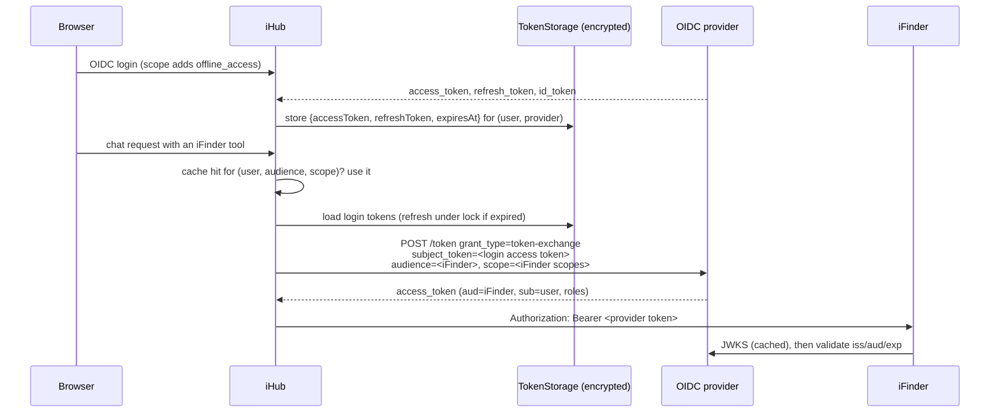

# Shared OIDC Provider for iFinder (Token Exchange)

Issue: [intrafind/ihub-apps#3029](https://github.com/intrafind/ihub-apps/issues/3029)
Status: research / proposal. Nothing is implemented yet.

## 1. Where we are today

Every call from iHub to iFinder or iAssistant gets its bearer token from a single function:
`getIFinderAuthorizationHeader(user, { scope })` in `server/utils/iFinderJwt.js`. It is
**synchronous** and always signs a token itself:

- With a key from the credential store or `IFINDER_PRIVATE_KEY` (manual key exchange), or
- With iHub's own OIDC RSA key pair when `iFinder.useOidcKeyPair` is set ("keyless" mode,
  `docs/ifinder-oidc-jwt.md`). iFinder then validates against iHub's
  `/.well-known/jwks.json`.

Claims: `iss` = `iFinder.issuer` or `platform.oauth.issuer`, `aud` = `iFinder.audience`,
`sub` = `resolveJwtSubject(user, jwtSubjectField)`, `scope` = `defaultScope` or the
caller's scope (iAssistant passes its own).

Callers (all of them already run inside `async` functions):

| Caller | Sites |
|---|---|
| `server/services/integrations/iFinderService.js` | 5 (search, document, content, `_apiRequest`, …) |
| `server/services/integrations/ConversationApiService.js` | 1 (`buildHeaders`, sync, used by 8 methods) |
| `server/adapters/iassistant-conversation.js` | 1 |
| `server/services/sources/providers/ifinder.js` | 1 |
| `server/routes/admin/integrationTest.js` | 1 + key checks for diagnostics |

**What iHub keeps from an OIDC login: nothing.** `server/middleware/oidcAuth.js` gets the
provider's `accessToken`, `refreshToken` and `id_token` in the passport verify callback.
It uses the access token once to fetch userinfo, gives the ID token to the logout-hint
cookie, and then discards all three. After login the browser holds only iHub's own session
JWT (`authToken` cookie). **So even interactive requests have no provider token on the
server to forward or exchange.** Any central-OIDC mode has to start by keeping one.

**Scheduled tasks** run as an owner principal rebuilt from a snapshot
(`server/services/scheduler/tasks/ownerPrincipal.js`: `userId`, `groups`, `authMode`,
`provider`, …). There is no session and no token. The same is true for personal API keys,
OAuth-client tokens (MCP, A2A, Copilot agent) and workflow triggers.

**What we can reuse:**

- `TokenStorageService.storeUserTokens / getUserTokens / deleteUserTokens` stores tokens
  per user, service and provider, encrypted with AES-256-GCM. Jira, Office 365, Google
  Drive, Nextcloud and MCP already use it.
- `OAuthIntegrationBase` handles refresh-on-expiry, tells a terminal refresh failure apart
  from a temporary one (`oauthRefreshError.js`), and deletes the tokens only on a
  terminal failure.
- `userDeletion.js` already removes a user's stored tokens.
- `withFileLock` (`server/utils/fileLock.js`) works across cluster workers.
- `httpFetch` (`server/utils/httpConfig.js`) applies the SSL whitelist and proxy
  settings. It is required for the token endpoint calls (see CLAUDE.md).

## 2. Target: two modes, selectable in the iFinder config

| | `ihubSigned` (today, default) | `oidcTokenExchange` (new) |
|---|---|---|
| Who issues the iFinder token | iHub (own key or OIDC key pair) | The central OIDC provider (Zitadel, Keycloak, Entra) |
| iFinder `issuer-uri` / `jwk-set-uri` | iHub | The provider |
| `sub` in the token | `jwtSubjectField` (email, `domain\user`, template) | The provider's subject, the same one iFinder already sees for its own logins (see §5) |
| Roles and scopes | `scope` claim set by iHub | Provider roles or scopes for the iFinder audience |
| Needs | Key or OIDC key pair | User signed in through that OIDC provider; client allowed to exchange |

`ihubSigned` stays byte-for-byte unchanged. That covers the acceptance criterion that
the trusted-by-iHub mode keeps working.

## 3. How `oidcTokenExchange` works

### 3.1 Interactive request



A token-exchange request (RFC 8693), authenticated as a confidential client:

```
POST {tokenURL}
grant_type=urn:ietf:params:oauth:grant-type:token-exchange
subject_token=<user's login access token>
subject_token_type=urn:ietf:params:oauth:token-type:access_token
requested_token_type=urn:ietf:params:oauth:token-type:access_token
audience=<iFinder client / project id>
scope=<mapped iFinder scopes>
```

The exchanged token is cached in memory per worker under the key `(userId, audience,
scope)` until `exp - 60s`. That avoids one call to the provider per iFinder request.
Scope matters for the key because iAssistant asks for `fa_iassistant` while search asks
for `fa_index_read`.

### 3.2 Background (scheduled tasks, API keys, workflows)

The same exchange runs; only the source of the subject token changes:

1. **Stored refresh token (default, works with every provider).** At login we ask for
   `offline_access` and keep the refresh token encrypted. A background run refreshes it
   to get a fresh login access token, then exchanges that as above. When the refresh
   fails terminally (`invalid_grant`, meaning revoked, expired or user disabled), the
   stored tokens are deleted and the run fails with "sign in again to re-authorize iFinder
   access". That signal is the same one the cloud-storage integrations use.
2. **Impersonation through a service user (optional, Zitadel only).** A service user with
   the `*_IMPERSONATOR` role sends `actor_token=<service user token>` and
   `subject_token=<user id>` with `subject_token_type=urn:zitadel:params:oauth:token-type:user_id`.
   No per-user refresh tokens are needed, but the credential can mint a token for **any**
   user. Offer it only as an explicit opt-in that an admin configures.

### 3.3 Provider differences

| Provider | Mechanism | Notes |
|---|---|---|
| **Zitadel** | RFC 8693 token exchange | Still a beta feature that has to be enabled through the feature API. Confidential client only. Supports impersonation (actor token + `*_IMPERSONATOR` role) and a `user_id` subject token type. Audience and roles are requested through Zitadel's reserved scopes (`urn:zitadel:iam:org:project:id:{id}:aud`, `urn:zitadel:iam:org:projects:roles`). |
| **Keycloak ≥ 26.2** | RFC 8693, "standard token exchange V2" | Enabled by default. Per client: switch on "Standard token exchange" (confidential client). Internal-to-internal only, and the subject token must be an access token. Impersonation exists only in the deprecated V1 preview, so don't build on it. |
| **Microsoft Entra ID** | On-Behalf-Of, **not** RFC 8693 | `grant_type=urn:ietf:params:oauth:grant-type:jwt-bearer`, `assertion=<access token>`, `requested_token_use=on_behalf_of`, `scope=api://<ifinder>/.default`. The login access token must be issued **for iHub's own API** (login scope `api://<ihub-client-id>/<scope>`). The default `openid profile email` gives a Graph token, which OBO rejects. Entra rejects the RFC 8693 grant with `AADSTS70003`. No impersonation. |

This means the exchange step needs a small `grantType` switch (`tokenExchange` |
`entraObo`). Everything around it (storage, refresh, cache, errors) is shared.

## 4. Implementation plan

### Phase 0: iFinder webapp (separate repository, can start now)

- Multi-issuer support via Spring `JwtIssuerAuthenticationManagerResolver`, so iHub-signed
  and provider-issued tokens are both accepted. This removes the config conflict
  described in the issue on its own and makes migration safe: iHub can flip modes
  without iFinder downtime.
- Configure the authorities claims for the provider issuer (see §5). The principal claim
  needs no change: it is the one iFinder already uses for its own logins.
- Fail loudly, or at least warn, when `issuer-uri` comes from several sources with
  different values.

### Phase 1: iHub, interactive mode

1. **Async token provider.** Add `server/services/integrations/iFinderTokenProvider.js`
   with `async getAuthorizationHeader(user, { scope })`. It dispatches on
   `iFinder.authMode`:
   - `ihubSigned` → today's `generateIFinderJWT` (moved, not changed).
   - `oidcTokenExchange` → stored login token → exchange → cache.

   Make the ~10 call sites `await` it (`ConversationApiService.buildHeaders` becomes
   async). Keep `iFinderJwt.js` as the signing helper.
2. **Keep the login tokens.** In the verify callback in `oidcAuth.js`, when the provider
   is the one referenced by `iFinder.tokenExchange.oidcProvider`, call
   `tokenStorageService.storeUserTokens(user.id, 'oidc-login', {accessToken, refreshToken,
   expiresIn}, provider.name)`. Do this only for that provider, so we don't start storing
   tokens for every OIDC deployment. Never put them on the user object, which can be
   written to `users.json`. The ID token is already handled the same way.
3. **Refresh.** Reuse the `OAuthIntegrationBase` pattern: refresh against `provider.tokenURL`
   with the provider's client credentials. Wrap it in `withFileLock` per user, because
   refresh-token rotation (Zitadel, Keycloak) plus two workers refreshing at once would
   otherwise burn the token (`invalid_grant`) and log the user out of iFinder.
4. **Exchange client.** All HTTP goes through `httpFetch`, so private-CA providers work.
   Add a test with a whitelisted and a non-whitelisted host.
5. **Config and migration** (`V{NNN}__add_ifinder_auth_mode.js`, defaults only):

   ```json
   "iFinder": {
     "authMode": "ihubSigned",
     "tokenExchange": {
       "oidcProvider": "",
       "grantType": "tokenExchange",
       "clientId": "",
       "clientSecretRef": "",
       "audience": "",
       "scopeMap": { "fa_index_read": "", "fa_iassistant": "" },
       "extraScopes": [],
       "background": "refreshToken",
       "actorClientId": "",
       "actorClientSecretRef": ""
     }
   }
   ```

   `clientId` and `clientSecretRef` default to the login client of `oidcProvider`. A
   separate client is allowed because some providers restrict exchange to dedicated
   clients. `scopeMap` translates the iHub-side scopes that callers already pass into
   whatever the provider expects (Zitadel role scopes, Entra `api://…/.default`). Secrets
   go through `credentialService`, like `privateKeyRef`.
6. **Admin UI** (`client/src/features/admin/components/IFinderConfig.jsx`): a mode selector
   with the two modes; in exchange mode, a provider picker filled from the configured OIDC
   providers, plus audience and scope map. Hide the key and subject fields in exchange
   mode.
7. **Diagnostics** (`integrationTest.js`, `integrationDiagnostics.js`): in exchange mode,
   run the exchange for the admin running the test, decode the result, and show `iss`,
   `aud`, `sub`, scopes and roles next to what iFinder expects. This replaces the
   key-pair checks in that mode.
8. **Users who can't exchange.** A local, LDAP or NTLM user, or an OIDC user from another
   provider, has no login token to exchange. Answer with a clear error ("iFinder requires
   sign-in via <provider>"). Optionally offer `fallbackToIhubSigned`, which only works
   once iFinder is multi-issuer (Phase 0).

### Phase 2: background runs

- Request `offline_access` (document it; the provider's `scope` array is already
  configurable). Background runs refresh, then exchange (§3.2).
- Lifecycle: on user deletion, call `userDeletion.js` → `deleteUserTokens(…, 'oidc-login')`.
  On a terminal refresh failure, delete the tokens and surface "re-authorize" on the
  task. Decide what logout does (open question 3).
- Optional: Zitadel impersonation via `actorClientId/actorClientSecretRef`, admin opt-in,
  audit-logged per exchange.

### Phase 3: provider variants and docs

- Add the Entra OBO grant variant. Document the Keycloak setup.
- Docs: extend `docs/ifinder-oidc-jwt.md` (or add a section to `docs/iFinder-Integration.md`)
  with both modes and the exact iFinder issuer settings for each. Add a changelog entry
  in `docs/releases/next/`.

### Tests

- Unit: mode dispatch; `ihubSigned` unchanged (existing JWT tests keep passing); exchange
  request shape for each grant type; cache keyed by scope; refresh under lock; mapping of
  terminal and temporary errors; SSL whitelist.
- Integration: a mock token endpoint (RFC 8693 + OBO) and a mock iFinder that validates
  the provider's JWKS.
- Manual: Zitadel with token exchange enabled, two products in one instance, a scheduled
  task that runs after the browser session expired.

## 5. Decisions needed before Phase 1

**Settled: the user identity.** When iHub and iFinder share the provider, the user
claim is already the same in both products: iFinder resolves users from the provider's
tokens for its own logins, and the exchanged token names the same user. So there is no
subject mapping to design, and `jwtSubjectField` does not apply in exchange mode. The
only thing to check, in the spike in §6, is that the exchanged token carries the claim
iFinder reads, the same way tokens from iFinder's own login do.

1. **Roles to iFinder authorities.** Provider roles arrive in provider-specific claims
   (Zitadel `urn:zitadel:iam:org:project:roles`, Keycloak `realm_access` / `resource_access`,
   Entra `roles` / `scp`), not in a flat `scope` claim with `fa_*`. Either iFinder maps
   those claims to authorities, or the provider gets a claim mapper or Action that emits
   `scope: "fa_index_read …"`. Prefer the provider-side mapper, so that iFinder's
   authority logic stays the same in both modes.
2. **Refresh-token retention.** Should we keep them after logout so scheduled tasks keep
   working (convenient), or delete them on logout so tasks need a recent login (stricter)?
   Proposal: keep them, delete on user deletion or deactivation and on terminal refresh
   failure, and show in the user's profile under "connected" that a background
   authorization exists, with a revoke button (the same pattern as the integrations).
3. **Exchange policy on the provider.** Which client may exchange for the iFinder audience,
   and with which scopes. Configured in the provider (Zitadel project grants, Keycloak
   client policies, Entra API permissions plus admin consent). We document it; iHub cannot
   enforce it.
4. **Impersonation.** Offer the Zitadel service-user path at all? It removes per-user
   refresh tokens but creates a "mint a token for anyone" credential.

## 6. Suggested first steps

1. Settle the role mapping (§5.1) with the iFinder team. It decides whether the provider
   token is usable for iFinder at all, independent of any iHub code.
2. Spike (half a day, no product code): in a Zitadel test instance, enable token exchange,
   log in to iHub with `offline_access`, run the exchange with curl against the iFinder
   project audience, and check that iFinder (multi-issuer) accepts the result and returns
   ACL-filtered hits.
3. Phase 0 in iFinder (multi-issuer) in parallel. It unblocks the workaround in the issue.
4. Phase 1 in iHub, then Phase 2.

## References

- [RFC 8693, OAuth 2.0 Token Exchange](https://www.rfc-editor.org/rfc/rfc8693)
- [Zitadel: Impersonation and delegation using Token Exchange](https://zitadel.com/docs/guides/integrate/token-exchange)
- [Keycloak: Configuring and using token exchange](https://www.keycloak.org/securing-apps/token-exchange)
  and [Standard Token Exchange in 26.2](https://www.keycloak.org/2025/05/standard-token-exchange-kc-26-2)
- [Microsoft identity platform: OAuth 2.0 On-Behalf-Of flow](https://learn.microsoft.com/en-us/entra/identity-platform/v2-oauth2-on-behalf-of-flow)
- Spring Security: `JwtIssuerAuthenticationManagerResolver` (multi-tenancy for resource servers)
