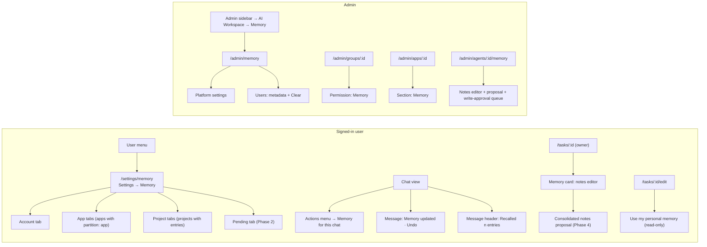

# UI/UX Brief: Agent Memory (personal, task and agent memory)

**Date:** 2026-11-07
**Status:** Design brief for the approved plan in [`README.md`](README.md); binding decisions of 2026-11-06 (§8 there) are taken as given
**Scope:** Every user-, owner- and admin-facing surface of Phases 1–4. No code changes; this document is the guide a developer implements from.
**Accessibility target:** WCAG 2.2 AA / BITV 2.0 (the `a11y-audit` skill's baseline in `tests/e2e/accessibility.spec.js` must stay green)
**Reads before this one:** `README.md` §6.5, §6.6, §6.10, §7, §8; `research/user_memory_in_chat_apps.md` § "UI patterns"

---

## Executive summary

Personal memory is a list of short, individually editable entries a person lets the assistant keep about them. The UI has one job: make that list **visible, reversible and calm**. Everything the model saves is shown where it happened (a chip under the answer), can be undone in one click, and can be managed in one place (Settings → Memory). Admins configure limits and see counts, never content. Scheduled tasks and agents keep their markdown notes as they do today, and Phase 4 adds a reviewable "consolidated notes" proposal with a diff.

The brief reuses the client's existing vocabulary rather than adding a design language: the Settings page shell of `UsagePage`/`IntegrationsPage`, `Switch` for on/off, `Badge` for categories and provenance, `AdminTabs` (WAI-ARIA tabs) for partitions, `ConfirmDialog` for destructive actions, the `ScheduledTaskNotifier` toast for undo, the `menuitemcheckbox` rows of `ChatInputActionsMenu` for the per-chat toggle, `ToolActivity` rows for "Memory updated", `AnswerSourceBadge`-style pills for "Recalled n memories", the app-form section layout of `ProjectsConfigSection`, the group permission checkbox of `GroupFormEditor`, and the settings form and metadata table of `AdminScheduledTasksPage`. `MemoryEditor.jsx` is **not** used for personal memory (Decision 3: entries, not one body); it stays the editor for task and agent notes and gains the Phase 4 proposal card above it.

Key design decisions in this brief, each traceable to README.md:

| Decision | Source |
|---|---|
| Save first, show a chip, offer Undo; never a confirmation dialog in chat | §8 Q1 |
| Enable and Pause are two separate controls with different semantics (Enable off = tool and block absent; Pause = kept but neither read nor written) | §6.5 (Claude's Pause ≠ Reset) |
| Account / per-app / per-project partitions as tabs, with the account tab first | §8 Q5 |
| Temporary chats read but never write; the UI says so once, quietly | §8 Q2 |
| Admin pages show counts, chars, dates, paused state — never entry text | Decision 12 |
| Sensitive topics are an explicit opt-in card with a notice; four categories are never stored and the notice says which | Decision 13 |
| "Memory updated" is a server-sent `activityKind: 'memory'` row; the client renders, never infers | Decision 14 |
| Consolidation is a proposal with a diff; Apply/Discard; never in place | Decision 11 |

---

## 1. Design principles for memory UI

1. **Transparency: nothing is remembered that the person cannot see.** Every write the model makes produces a visible row under the answer, with the saved text verbatim. The Settings page lists every entry with where it came from (`source`) and when. There is no "summary the model keeps for itself"; the block the model sees is exactly the list the person sees (minus budget overflow, which the counter and the `shown < entries` note make visible).

2. **Reversibility: every write has an Undo within reach.** Save → Undo deletes. Update → Undo restores the previous text. Delete in Settings → Undo toast for 8 seconds. Delete all → confirm dialog with the count in the button label. Pause keeps the data; only "Delete all" and account deletion remove it, and the dialog says so.

3. **Calm notifications.** Memory activity is provenance, not news. It renders in the same muted `text-xs text-gray-600` row the chat already uses for "Searched the web", collapsed once the answer is complete. No modal, no banner, no sound. Background extraction (Phase 2) adds a row to the message it came from and nothing else; the Settings page gets a count badge on the Pending tab. The only toast in the whole feature is the undo toast after a delete the person initiated.

4. **Privacy parity with Claude and ChatGPT, stated in the product's own words.** The Settings page carries the three sentences every mature product states: the global toggle does not delete; deleting a chat does not delete memories learned from it (and clearing memory does not delete chats); sensitive topics are off by default and some are never stored. Admins see metadata only, and the admin page says so on screen.

5. **Enterprise restraint.** Formal "Sie" in German, no playful copy ("I'll remember that!"), no anthropomorphic icons. The feature is named **Memory / Gedächtnis**, consistent with the existing scheduled-task strings (`scheduledTasks.memory.title` = "Gedächtnis"). Entries are "entries / Einträge", never "memories" in German. Counters, versions and dates are shown as plain text, as `TaskBadges` and `MemoryEditor` already do.

6. **One mental model across scopes.** A person meets memory three times: their own (entries), a task's (notes), an agent's (notes, admin only). The same words (Memory, updated, paused, cleared), the same pill tones (`MEMORY_PILL_TONES` in `TaskBadges.jsx`: sky = used/recalled, indigo = updated, amber = full/not updated), the same "data, not instructions" posture.

7. **Keyboard and screen reader first.** Every list is a real list, every toggle a real `role="switch"`, every chip text-first (the icon only repeats the text), every async result announced through a live region that stays mounted (the `IntegrationsPage` pattern). No hover-only affordances: row actions are always visible at ≥ `sm`, and in an overflow menu below it.

---

## 2. Information architecture



### 2.1 Where each surface lives, by phase

| Surface | Route / location | Component (new unless noted) | Phase |
|---|---|---|---|
| User menu entry "Memory" | `UserAuthMenu.jsx`, between Usage and Integrations | existing menu, one `Link role="menuitem"` | 1 |
| Settings → Memory | `settings/memory` (already covered by `KNOWN_ROUTES` `settings/*`; no `index.html` change) | `features/settings/pages/MemoryPage.jsx` | 1 |
| Per-chat toggle | Chat actions menu (`ChatInputActionsMenu.jsx`), section "Memory" | row in existing menu | 1 |
| "Memory updated" row | `ToolActivity.jsx` `ActivityItem` for `kind === 'memory'` | `MemoryActivityItem` | 1 (tool), 2 (extraction) |
| "Recalled n entries" chip | Message header next to `AnswerSourceBadge` | `RecalledMemoriesChip` | 1 |
| Admin → Memory | `/admin/memory`, sidebar section **AI Workspace** after Agents | `features/admin/pages/AdminMemoryPage.jsx` | 1 |
| Group permission | `GroupFormEditor.jsx` permissions grid, after Scheduled Tasks | existing checkbox pattern | 1 |
| App editor section | `app-form/MemoryConfigSection.jsx`, placed after `ProjectsConfigSection` | new section | 1 |
| Task editor opt-in | `TaskEditorPage.jsx` memory section, under "Remember between runs" | checkbox | 1 |
| Task run badge "Used personal memory" | `TaskBadges.jsx` `RunMemoryBadges` | new pill kind | 1 |
| Pending tab | `MemoryPage.jsx` tab `pending` | `PendingMemoryList` | 2 |
| Consolidation proposal card | `TaskMemoryPanel.jsx` and `AdminAgentMemoryPage.jsx`, above `MemoryEditor` | `ConsolidationProposalCard` (shared) | 4 |
| Agent write-approval queue | `AdminAgentMemoryPage.jsx`, tab or card | `MemoryWriteApprovalQueue` | 4 |

**Admin navigation placement.** `AdminSidebarNavData.js` groups pages in eight sections. Memory is a workspace capability (like Projects, Skills, Agents), not an observability page, so it goes into **AI Workspace** after Agents with `key: 'memory'`, `href: '/admin/memory'`, visible when the `userMemory` feature exists (`showAdminPage('memory')`). The command palette (`AdminCommandPalette.jsx`) reads the same data, so it needs no extra entry.

**User menu placement.** `UserAuthMenu.jsx` lists Usage, Integrations (conditional), Admin Panel, Sign out. "Memory" goes after Usage, before Integrations, with `Icon name="light-bulb"` (exists in `Icon.jsx`; no brain or sparkle metaphors), visible when `featureFlags.isEnabled('userMemory')` **and** the user has `permissions.memory`. Platform-disabled → entry hidden (not disabled): a menu item that cannot be used is noise.

---

## 3. Screen specifications

Conventions used below: `[ ]` checkbox, `( )` radio, `(o)` switch on, `( )` switch off, `[Button]`, `{Badge}`, `…` truncation. Tailwind class references are to classes the client already uses; no new tokens.

### 3a. Settings → Memory (Phase 1)

#### Layout

Same shell as `UsagePage`: `mx-auto w-full max-w-4xl px-4 py-8 sm:px-6`, `h1 text-2xl font-bold`, subtitle `text-sm text-gray-600`, cards as `section rounded-lg border border-gray-200 bg-white p-5 shadow-sm dark:…` (the local `Card` of `UsagePage` should move to `shared/components/SettingsCard.jsx` and be reused; no visual change).

```
+----------------------------------------------------------------------------+
| Memory                                                        [Export v]  |
| What the assistant may remember about you between chats.                  |
+----------------------------------------------------------------------------+
| (role=status live region, empty until something happens)                  |
+----------------------------------------------------------------------------+
| [card] Memory                                                             |
|   Use memory                                              (o)             |
|   The assistant can save and use entries in apps that allow it.           |
|   Pause                                                   ( )             |
|   Keeps your entries but stops reading and saving them until you resume.  |
|   ------------------------------------------------------------------      |
|   Deleting a chat does not delete entries learned from it, and deleting   |
|   entries does not delete chats. Administrators see how many entries you  |
|   have, never their content.  [Learn more]                                |
+----------------------------------------------------------------------------+
| [card] Sensitive topics                                                   |
|   Include sensitive topics                                ( )             |
|   Health, ethnicity, religion, political views and gender identity are    |
|   not saved unless you switch this on. Government ID numbers, criminal    |
|   history, financial account numbers and immigration status are never     |
|   saved, even if you ask. Switching this off removes entries already      |
|   saved in these topics.                                                  |
+----------------------------------------------------------------------------+
| Account | Chat (app) | Legal review (app) | Q4 migration (project) | Pending 3 |
+----------------------------------------------------------------------------+
| [Search entries…           ] [Category: All v]        12 / 100   [+ Add]  |
|                                                                           |
| o {preference} Prefers answers in German, formal "Sie".                   |
|   From chat "Onboarding" · 2 Oct 2026            [Edit] [Delete]          |
| o {project} Leads the Q4 migration of the DMS to iFinder 6.9.             |
|   Added by you · 1 Nov 2026                      [Edit] [Delete]          |
| o {feedback} Wants bullet points, not tables, in summaries.               |
|   From chat "Weekly digest" · 28 Oct 2026        [Edit] [Delete]          |
| …                                                                         |
|                                                   [Load more]            |
+----------------------------------------------------------------------------+
| Delete all entries in this tab                              [Delete all]  |
+----------------------------------------------------------------------------+
```

#### Header card: Enable and Pause — exact semantics

| Control | On | Off | What the UI does | Server |
|---|---|---|---|---|
| **Use memory** (`enabled`) | Tools attached in apps with `mode !== 'off'`; block injected; entries listed | Tools absent, block absent, extraction skipped. Entries are **kept**. The list below stays visible and editable (the person can clean up before switching back on). | Switch is the first focusable control after Export. Turning it off shows an inline note under the switch (not a dialog): "Your entries are kept. Switch on again to use them." | `PATCH /api/memory-preferences { enabled }` |
| **Pause** (`paused`) | Entries kept; **neither read nor written** by any chat; tools absent; extraction skipped and pending timers cancelled (`controlsVersion` increments) | Normal operation | Disabled (and visually dimmed) while *Use memory* is off, with `aria-describedby` "Memory is switched off." The list header shows `{Paused}` Badge (tone `warning`) while paused. | `PATCH /api/memory-preferences { paused }` |

Why two controls: Claude distinguishes Pause (temporary, keeps everything, resumable in one click) from switching memory off (a durable choice). In iHub the difference matters for admins too: the admin metadata view shows `paused`, so a support question "why does it not remember X" has an answer without content access.

Both switches are `Switch` with `labelPosition="start"`, `label` and `description` props (gives `aria-describedby` for free). Optimistic toggle; on failure the switch flips back and the live region announces the `apiErrors.*` message.

#### Partition tabs

`AdminTabs` (move to `shared/components/Tabs.jsx`, keep the API) with `ariaLabel="Memory partitions"`. Tabs come from `GET /api/memories/_partitions`:

- First tab is always **Account** (`partition: 'account'`).
- Then one tab per app with `memory.partition: 'app'` the user may still access and has entries in, labelled with the app's localized name and the suffix "(app)" so an app and a project of the same name do not collide.
- Then one tab per project with entries, suffix "(project)".
- Last, in Phase 2, **Pending** with `count` (the badge `AdminTabs` already renders).

Each tab is a `role="tabpanel"` with `id="tabpanel-<id>"` and `aria-labelledby="tab-<id>"`. The active tab is kept in the URL (`?partition=app:<appId>` / `?partition=project:<projectId>` / `?tab=pending`) so a link from the chip or from a project page can deep-link. Fewer than two tabs (account only) → the tab bar is hidden and the list renders directly; the page then reads as the simple Claude/ChatGPT list.

A partition the user has entries in but no longer may access (app removed from their groups, project membership revoked) is not listed by the server (fails closed with `MEMORY_PARTITION_NOT_FOUND`); the UI does not try to show a "locked" tab.

#### Toolbar

- **Search** (`input type="search"`, `aria-label="Search entries"`): client-side filter over the loaded page; the server is asked again with `?q=` only if the API grows it (open question 4). Debounced 250 ms, results announced via the list's `aria-live="polite"` summary "12 entries shown".
- **Category** select: All, Profile, Preference, Project, Feedback, Reference. Maps to `GET /api/memories?category=`.
- **Counter** `12 / 100`: `maxEntries` from `GET /api/memory-preferences` (the route should return the effective limits `{ maxEntries, maxEntryLength, promptBudgetChars }` next to the preferences, as `fetchScheduledTaskMemory` returns `maxChars`). Colour turns `text-amber-700` at ≥ 90 % and `text-red-600 font-medium` at 100 % with a `title` "Memory is full. Delete entries to save new ones." Mirrors `memoryEditor.size`.
- **Add** button (`PRIMARY_BUTTON` from `integrationButtons.js`, label "Add entry"): opens the inline form at the top of the list (not a modal — the list is the context).

#### Entry row (`MemoryEntryRow`)

```
o {preference}  Prefers answers in German, formal "Sie".                [Edit] [Delete]
                From chat "Onboarding" · 2 Oct 2026 · updated 5 Nov 2026
```

- The row is an `li` in `ul role="list"`; no checkbox in Phase 1 (bulk actions arrive with the Pending tab).
- Category `Badge` tone mapping: profile `neutral`, preference `accent`, project `info`, feedback `warning` (a correction the person made), reference `neutral` outline. Text carries the meaning; the colour repeats it (Badge's rule).
- Provenance line (`text-xs text-gray-500`): source `user` → "Added by you"; `tool` → "From chat “{title}”" (link to the chat when `sourceRef.chatId` is set and the chat still exists; plain text otherwise); `extraction` → "Learned from chat “{title}”"; `import` → "Imported"; `consolidation` → "Consolidated". Date `formatDateTime` from `taskFormat.js` (already locale-aware).
- Invalidated entries (`invalidatedBy` set) are not listed by default; a "Show superseded" link at the bottom of the list reveals them with a `{Superseded}` Badge (neutral) and a "Replaced by: …" line; they can be deleted but not edited.
- Actions always visible as `SECONDARY_BUTTON`-styled small text buttons at ≥ `sm`; below `sm` a single "…" button with `aria-haspopup="menu"` (the `role="menu"` pattern of `ChatInputActionsMenu`).

**Inline edit.** Edit swaps the text into a `textarea` (auto-grown, `maxLength` = `maxEntryLength`, counter `312 / 500` below, same classes as `MemoryEditor`'s textarea without `font-mono`) plus a category select and Save / Cancel. Escape cancels; Ctrl/Cmd+Enter saves. Save → `PATCH /api/memories/{id}`; the row re-renders with the server's entry and the live region says "Entry saved." Only one row edits at a time; starting a second asks nothing — it simply moves focus and keeps the first row's draft in state (the person comes back to it; a `{Unsaved}` Badge on the collapsed row tells them).

**Delete with undo toast.** Delete removes the row immediately (optimistic), focus moves to the next row's first action (or to the Add button when the list is now empty), and an undo toast appears bottom-right in the `ScheduledTaskNotifier` style:

```
+-----------------------------------------------+
| (i) Entry deleted.        [Undo]        [x]   |
+-----------------------------------------------+
```

The DELETE is **deferred**, not sent, until the toast closes (8 s timer, paused while the toast is hovered or holds focus; WCAG 2.2.1 timing adjustable) or the person leaves the page (then sent at once with `fetch(..., { keepalive: true })`). Undo re-inserts the row at its position and cancels the request. This needs no restore endpoint, cannot leave the server in a state the person did not see, and matches what Gmail does. Several deletes stack into one toast "3 entries deleted. [Undo all]". The toast container is `role="status" aria-live="polite"`; the Undo button is in the tab order; Escape closes the newest toast (committing the delete). See §5.1 for the full undo matrix and open question 1.

**Add entry form.** Opens above the list:

```
+--------------------------------------------------------------------------+
| New entry                                                                |
| [textarea: What should the assistant remember?                     ]     |
|                                                              0 / 500     |
| Category [Preference v]   Save to [Account v]      [Cancel] [Save entry] |
+--------------------------------------------------------------------------+
```

"Save to" is shown only when the active tab is a project or app partition and offers "This project / This app" and "Account" (the model's `scope: 'account'` escape hatch, exposed to the person too). `POST /api/memories` → `201`; the new row is inserted at the top with a 1.5 s background highlight (`bg-indigo-50`, `motion-reduce:` none), focus moves to the new row's Edit button, live region "Entry saved."

**Export.** A `SECONDARY_BUTTON` "Export" with `aria-haspopup="menu"` offering **Download JSON** (`POST /api/memories/_export { format: 'json' }`, saved as `ihub-memory-<date>.json`) and **Copy as text** (`format: 'text'`; opens a `Modal` "Your memory as text" with a read-only `textarea` of the paste-able prompt text, a Copy button and the hint "Paste this into another assistant's memory import, or keep it as a backup. Edit out anything you do not want to share."). Export covers all partitions the user may access, labelled per partition in the text format.

**Delete all.** Scoped to the active tab (the button says so: "Delete all 12 entries in Account"). `ConfirmDialog` with `danger`, title "Delete all entries in Account?", message "This removes 12 entries permanently. Your chats are not affected. Memory stays switched on.", confirm "Delete 12 entries", deny "Cancel" (focused first, the dialog's default). Success → list empty state, live region "12 entries deleted." No undo (the dialog is the safeguard; a 100-entry undo buffer is not worth the complexity).

**Sensitive topics card.** `Switch` "Include sensitive topics" with the notice as `description`. Switching on → `PATCH /api/memory-preferences { sensitiveOptIn: true }`, the description gains a second sentence "Entries in these topics are marked {Sensitive}." and such entries show a `Badge tone="warning"` "Sensitive". Switching off → `ConfirmDialog` "Stop saving sensitive topics?" with message "Entries already saved in these topics are removed. This cannot be undone." (Claude's rule: turning off removes). The card is rendered only when `platform.memory.sensitiveCategories === 'allowOptIn'`; with `'exclude'` a one-line note replaces it ("Sensitive topics are never saved on this platform."); with `'allow'` the card is hidden and no badge is shown.

#### Empty, loading and error states

| State | Rendering |
|---|---|
| Loading (first load) | The header card renders immediately with switches disabled; the list area shows `LoadingSpinner` in a `role="status"` with text "Loading entries…" (never a spinner alone). |
| Empty, memory on | Illustration-free empty state in the list area: `Icon light-bulb` 32 px gray, heading "Nothing saved yet", text "Ask the assistant to remember something — for example “Remember that I prefer short answers” — or add an entry here.", `[+ Add entry]`. |
| Empty, memory off | Same, text "Memory is switched off. Switch it on above to let the assistant save entries." |
| Empty, paused | Text "Memory is paused. Entries you add here are kept but not used until you resume." |
| Partition empty | "No entries for {name} yet." |
| Load failed | `role="alert"` red box (the `UsagePage` pattern) "Your entries could not be loaded." with `[Retry]`. Switches stay usable. |
| Platform disabled / no permission | The route renders the `IntegrationsPage` "auth required" style centred message: `Icon lock-closed`, "Memory is not available", "An administrator has not enabled memory for your account." No settings are shown. The user-menu entry is hidden in this case anyway; the page exists for bookmarks. |
| Feature flag off | Route not registered (same as `tools/*` behind `toolsService`); `NotFound`. |

#### Component breakdown

| Component | Purpose | States | Props (type) | Accessibility |
|---|---|---|---|---|
| `MemoryPage` | Page shell, data loading, tab routing | loading, ready, error, unavailable | — (reads `useAuth`, `usePlatformConfig`, `featureFlags`) | `h1` once; `DocumentTitle` "Memory"; skip link target (`Layout` provides) |
| `MemoryPreferencesCard` | Enable, Pause, privacy statement | idle, saving, error | `prefs: {enabled, paused}`, `onChange(patch)`, `busy: boolean` | Two `Switch` (`labelPosition="start"`); Pause `disabled` when off with `aria-describedby`; privacy text is plain `p` |
| `SensitiveTopicsCard` | Opt-in | hidden (policy), on, off, confirming off | `policy: 'exclude'|'allowOptIn'|'allow'`, `optIn`, `onChange` | `Switch` + `ConfirmDialog` on off |
| `Tabs` (ex `AdminTabs`) | Partition tabs | — | `tabs[{id,label,count}]`, `activeId`, `onChange`, `ariaLabel` | WAI-ARIA tabs; arrow keys; `tabpanel` ids |
| `MemoryToolbar` | Search, category, counter, Add | — | `query`, `onQuery`, `category`, `onCategory`, `count`, `max`, `onAdd` | search `aria-label`; counter `aria-live="polite"` region, `title` at full |
| `MemoryEntryList` | Virtual-free list with Load more | loading, ready, empty, error | `items`, `nextCursor`, `onLoadMore`, `editingId`, callbacks | `ul role="list"`; summary `p` with `aria-live="polite"` "12 entries shown" |
| `MemoryEntryRow` | One entry | view, editing, saving, deleting (removed), superseded | `entry`, `editing`, `onEdit`, `onSave`, `onCancel`, `onDelete`, `maxLength` | `li`; actions are `button`s with visible text; edit textarea `aria-label="Entry text"` + `aria-describedby` counter; Esc cancels |
| `MemoryEntryForm` | Add form | idle, submitting, error (`MEMORY_FULL`, `MEMORY_TOO_LONG`, `MEMORY_SENSITIVE_BLOCKED`) | `partition`, `maxLength`, `onSubmit`, `onCancel` | `form` with `aria-labelledby` heading; errors `role="alert"` beneath the field and `aria-invalid` |
| `UndoToast` (shared) | Deferred-delete undo | visible, paused (hover/focus), closing | `items[{id,label}]`, `onUndo`, `onCommit`, `timeoutMs=8000` | `role="status" aria-live="polite"`; Undo in tab order; Esc closes newest |
| `MemoryExportMenu` | Export menu + text modal | closed, open, loading, modal | `onExport(format)` | `role="menu"`; modal is `Modal` with focus trap, `textarea readOnly` |
| `DeleteAllRow` | Delete all for the tab | idle, confirming, deleting | `count`, `partitionLabel`, `onConfirm` | `DANGER_BUTTON`; `ConfirmDialog danger` |

#### Keyboard navigation and screen-reader labels

- Tab order: Export → Use memory → Pause → Include sensitive topics → tab list (one stop) → Search → Category → Add entry → row 1 Edit → row 1 Delete → … → Load more → Delete all.
- Within the tab list: Arrow Left/Right, Home/End (already in `AdminTabs`).
- Row: Enter on Edit opens inline edit with focus in the textarea; Esc returns focus to the Edit button; Ctrl/Cmd+Enter saves.
- Delete: focus moves to the next row's Edit button (or Add entry); the toast does not take focus.
- Screen reader names: switches "Use memory, switch, on"; rows read "Preference. Prefers answers in German. From chat Onboarding, 2 October 2026. Edit, button. Delete, button."; counter region announces "12 of 100 entries" only when it changes.

### 3b. Pending tab — "Review before saving" (Phase 2)

When `platform.memory.extraction.reviewMode` is `optional`, the preferences card gains a third `Switch` **Review before saving** ("New entries the assistant learns from chats wait for your approval."). With `required` the switch is shown on but disabled with the description "Required by your administrator." With `off` nothing is shown and the Pending tab does not exist.

```
| Account | … | Pending 3 |
+---------------------------------------------------------------------------+
| 3 entries are waiting for your review.          [Reject all] [Accept all] |
|                                                                           |
| [ ] {preference} Prefers meeting notes as bullet points.                  |
|     From chat "Weekly digest" · 6 Nov 2026                                |
|     Evidence: "please always give me bullets, not prose"                  |
|     Would update: "Wants bullet points, not tables, in summaries."        |
|                                        [Edit and accept] [Reject] [Accept]|
| [ ] {project} Moved the DMS cut-over to 15 December.                      |
|     From chat "Migration status" · 6 Nov 2026                             |
|     Evidence: "we pushed the cut-over to Dec 15"                          |
|                                        [Edit and accept] [Reject] [Accept]|
| …                                                                         |
| [ ] Select all     With selected: [Reject] [Accept]                       |
+---------------------------------------------------------------------------+
```

- Each pending item shows the **provenance** ("From chat “{title}” · {date}", linked), the **evidence** line (the quoted message fragment the extractor cited; quoted verbatim, truncated at 160 chars with `title` for the full text, the `DETAIL_VALUE_CHARS` rule of `toolActivity.js`), and for `op: 'update'` / `'invalidate'` the entry it would replace ("Would update: …" / "Would mark as outdated: …").
- Accept → `POST /api/memories/_pending/{id}/_accept` (200, returns the entry); the item animates out (`motion-reduce` off) and the live region says "Accepted. 2 remaining." Reject → `_reject` (204). "Edit and accept" opens the inline textarea of 3a, then accepts with the edited text (the accept body carries `text`).
- Bulk: per-row checkboxes with a "Select all" checkbox in the footer; "With selected: Accept / Reject". "Accept all / Reject all" in the header act on the whole queue and use `ConfirmDialog` when more than 5 items ("Accept all 12 pending entries?").
- Tab count badge updates after each action; when the tab empties it shows the empty state "Nothing to review." and the count badge disappears (the tab stays while the switch is on).
- Pending items older than 30 days are shown with a `{Expiring}` Badge (warning) and are dropped by the retention sweep; the empty state footnote says "Pending entries are removed after 30 days." (needs a `pendingRetentionDays` default; open question 6).

### 3c. In chat

#### "Memory updated" row with Undo (hot path, Phase 1)

The server emits `tool/started` with `activityKind: 'memory'` and a `title` for every `memory_save/update/delete` call; `tool/completed` carries the result `{ entry: { id, text, category }, previous?: { text, category }, op }`. `shared/run/toolActivity.js` maps `activityKind === 'memory'` to `kind: 'memory'` (today only `search` and `fetch` are mapped; `tool` is the fallback). `ToolActivity.jsx` renders a new `ActivityItem` branch:

```
v Searched the web · 2 searches · Memory updated
  |- (globe) Searched for "iFinder 6.9 release notes" · 5 sources
  |- (light-bulb) Memory updated · "Prefers answers in German, formal Sie."   [Undo]
  |- (light-bulb) Memory updated · "Leads the Q4 migration…" (replaced "Works on DMS") [Undo]
  |- (light-bulb) Memory removed · "Uses Jira for tickets"                     [Undo]
```

- Headline contribution (`finishedHeadline`): "Memory updated" once per turn regardless of count, placed last; with a count when > 1: "Memory updated (3)".
- Row text: op `save` → "Memory updated · “{text}”"; `update` → "Memory updated · “{text}” (replaced “{previous}”)" with the previous text truncated to 60 chars; `delete` → "Memory removed · “{text}”". Text in quotes is the verbatim entry; truncated at 160 chars with `title`.
- Icon `light-bulb`, colour `text-indigo-600 dark:text-indigo-400` (the `updated` tone of `MEMORY_PILL_TONES`); error state (`MEMORY_FULL` etc.) shows `exclamation-circle` red as `StatusIcon` does, and the row text is the error message (see error table below).
- **Undo** is a small text button (`text-indigo-600 hover:underline`, `aria-label="Undo: memory updated, Prefers answers in German"`). It is present when the message carries the activity record with the entry id and the chat is not read-only (shared chats render the row without Undo, as `ScheduledTaskProposalCard` does with `readOnly`). Behaviour per op in §5.1. After Undo the row text changes to "Undone · “{text}”" in gray and the button disappears; the live region (the chat's existing `aria-live` for tool progress) announces "Memory change undone."
- When the entry was changed since (server replies `409 MEMORY_VERSION_CONFLICT` or `404`), the row shows "Changed since · Manage in Settings" with a link to `/settings/memory?highlight={id}`.
- The row is also written into the stored `activity` of the assistant message (`runActivity.js` fold), so a reopened chat shows the same row — with Undo still offered, server-verified.

#### Background extraction row (Phase 2)

Extraction finishes after `run/ended`. The server writes `{ added, updated, invalidated, pending }` into the stored activity of that assistant message; the client polls `GET /api/memories/_activity?chatId=&since=` (cadence §5.4) and, when a summary arrives for a rendered message, appends the same row kind with text "Memory updated from this chat · 2 added, 1 updated" and, in review mode, "2 entries waiting for your review · [Review]" (link to `/settings/memory?tab=pending`). Each entry is listed on expand with its own Undo. No toast, no banner: the row appears where the learning happened.

#### "Recalled n entries" header chip

`run/started` carries `memory: { recalled: 12, shown: 12, partition: ['account','project:q4'] }`. The client renders, in the message header next to `AnswerSourceBadge`, a pill in the same shape (`inline-flex items-center gap-1.5 px-2 py-0.5 rounded-full text-xs border`) with the `used` tone of `TaskBadges` (`bg-sky-100 text-sky-800 …`): `Icon light-bulb` + "Recalled 12 entries". `title`: "12 of your memory entries were part of this answer's context." Click → `/settings/memory`. Shown on the **first** assistant message of a chat and again on any message where the count changed (an entry was saved or deleted in between); otherwise suppressed to keep the header calm. When `shown < recalled` the chip reads "Recalled 12 of 40 entries" and the title adds "The rest fits the budget only on request; ask ‘what do you know about me?’".

#### Per-chat "Memory for this chat" toggle

Lives in `ChatInputActionsMenu.jsx` as a new section **Memory** between "Message context" and the integration picker, rendered as the existing `menuitemcheckbox` row with `SwitchIndicator` (never a nested `Switch`):

```
+-- Actions menu ------------------------------------+
| Quick actions                                      |
|   Attach file · Magic prompt · Undo               |
| Message context                                    |
|   Current e-mail                            (o)    |
| Memory                                             |
|   Use memory in this chat                   (o)    |
|   Saves and uses your entries. Off: this chat      |
|   neither reads nor saves memory.                  |
| Tools                                              |
|   …                                                |
+----------------------------------------------------+
```

- Default on. Stored in chat `settings.memory: false` like `enabledTools` (`useAppSettings.js`). Honoured before the first turn; sticky afterwards.
- Off → the actions-menu trigger shows the same small dot indicator it shows when tools are off (`offCount` pattern), and the chat header area gets no extra chrome; the description in the row says what "off" means.
- Only rendered when the app's `memory.mode !== 'off'`, the user has the permission and memory is enabled and not paused. When paused, the row is shown disabled (`aria-disabled="true"`) with description "Memory is paused. Resume it in Settings → Memory." and a link.
- Switching it off after the first turn does not delete anything; it stops reads and writes from the next turn. The row description then says "Off since your last message."

#### Temporary / ephemeral chats

Reads happen, writes never (Q2). What the person sees:

- The "Recalled n entries" chip is shown as usual (their preferences apply).
- The actions-menu row is replaced by a static line (not a checkbox): "Memory is read-only in temporary chats. Nothing from this chat is saved." with the `eye-slash` icon.
- If the model nevertheless tries to save (it only has `memory_list`; a save attempt cannot happen through tools), nothing renders. If the person asks "remember this", the model answers in text; the system prompt (server side) tells it to point to Settings → Memory. No UI affordance is needed beyond the static line.

#### Error states as the model or system reports them

Errors from `memory_*` tools are returned as `{ error: true, code }` to the model and mirrored as an error row in `ToolActivity` (the server sets `status: 'error'` and `error.code` on `tool/completed`). The row text is the `apiErrors.*` string; the model's own explanation follows in the answer.

| Code | Where it shows | Row text (EN) | Action offered |
|---|---|---|---|
| `MEMORY_FULL` (400) | activity row, Settings add form | "Memory is full (100 of 100 entries). Delete entries to save new ones." | link "Manage memory" → Settings |
| `MEMORY_TOO_LONG` (400) | add/edit form inline | "The entry is too long ({{chars}} of {{max}} characters)." | field stays focused, `aria-invalid` |
| `MEMORY_SENSITIVE_BLOCKED` (400) | activity row, add form | "This was not saved because it concerns a sensitive topic." (opt-in available: "… You can allow sensitive topics in Settings → Memory.") | link when policy is `allowOptIn` |
| `MEMORY_BUDGET_EXCEEDED` (429) | **not** shown in chat (extraction is background); Settings Pending/Account tab footer note when `GET /api/memories/_activity` reports `budgetExceeded` | "Automatic saving paused until tomorrow: today's limit was reached. You can still add entries yourself." | none |
| `MEMORY_DISABLED` (403) | the tool is not attached, so it never reaches the chat; Settings page unavailable state | "Memory is not enabled for your account." | none |
| `MEMORY_UNAVAILABLE` (503) | activity row, Settings load error | "Memory is not available right now. Try again later." | Retry on Settings |
| `MEMORY_VERSION_CONFLICT` (409) | Undo and inline edit | "This entry was changed in the meantime." | Reload row (§5.3) |
| `MEMORY_PARTITION_NOT_FOUND` (404) | Settings deep link | "This memory section no longer exists or you no longer have access to it." → falls back to the Account tab | none |

### 3d. Admin → Memory settings page (Phase 1)

Route `/admin/memory`, `AdminBreadcrumb` Admin → Memory. Layout as `AdminScheduledTasksPage`: a settings card first, the per-user table second, `max-w-6xl`.

```
Admin > Memory
Memory                                                       [Save settings]
Personal memory for users: limits, sensitive topics, automatic saving.

[card] Platform settings
  [x] Enable personal memory                     (feature flag: userMemory on)
      Users with the "Memory" group permission can let the assistant save
      entries about them. Apps must switch memory on individually.
  Max. entries per user            [100 ]   (1–1000)
  Max. characters per entry        [500 ]   (50–4000)
  Prompt budget (characters)       [4000]   (500–32000)
      How much memory text is put into a prompt. Entries beyond it are
      listed on request only.
  Retention (days)                 [0   ]   0 = keep until deleted
      Entries not updated for this long are removed.
  Sensitive topics                 ( ) Never save  (o) Users may opt in  ( ) Always allowed
      Health, ethnicity, religion, political views, gender identity.
      Government IDs, criminal history, financial account numbers and
      immigration status are never saved in any setting.

  Automatic saving (extraction)  — Phase 2
  [ ] Learn entries from chats automatically
  Model                            [— app's model — v]
  Calls per user per day           [50  ]
  Max. input tokens per call       [12000]
  Delay after the last message (s) [30  ]
  Review before saving             ( ) Off  (o) Users may choose  ( ) Required

  Consolidation — Phase 4
  [ ] Consolidate task and agent notes nightly
  Model                            [— same as the run — v]
  Runs before a proposal           [5   ]
  Runs read per proposal           [10  ]

  Automatic-saving and consolidation calls count against the user's quota
  and appear under "memory" in Usage Reports.

[card] Users                                              [Search user…]
  User            Entries   Chars   Updated          Paused   
  m.meier         12        3,812   5 Nov 2026 14:02  —        [Clear]
  a.schmidt       0         0       —                 Yes      —
  …                                                   [Load more]
  Entry content is never shown to administrators. Clearing is recorded in
  the audit log.
```

**Validation and help text.** Numbers use `input type="number"` with `min`/`max` (the `AdminScheduledTasksPage` `[key, min, max]` table pattern), inline error `text-xs text-red-600` under the field and `aria-invalid`; the Save button is disabled while any field is invalid and shows the first error in a `role="alert"` banner on submit. Cross-field rule: `promptBudgetChars` must be ≥ `maxEntryLength` ("The prompt budget must hold at least one entry."). Changing `maxEntries` below a user's current count does not delete anything; the help text says "Users above a lowered limit keep their entries but cannot add more." Setting `retentionDays` from 0 to a value shows a one-time inline warning "Entries older than {{days}} days will be removed on the next nightly run." (not a dialog; the Save is the confirmation).

Save → `PUT /api/admin/memory/settings` → the same `role="status"` message banner as `IntegrationsPage` ("Settings saved."). Platform/auth sections of `platform.json` need a restart, but `platform.memory` reloads automatically through `configCache` per CLAUDE.md; the page says nothing about restarts.

**Per-user metadata view.** `GET /api/admin/users/{id}/memory` per row, listed through the users API with a `memory` summary like `memorySummary` on tasks. Columns: user (name, username under it), entries (valid count; superseded in `title`), chars, updated, paused (`Badge warning "Yes"` or "—"), actions. **Clear** uses `ConfirmDialog danger` with the `admin.scheduledTasks.memory.confirmClear` wording adapted: "Clear the memory of {{user}}? The user loses all {{count}} entries in every section. This is recorded in the audit log." Confirm label "Clear memory". After success the row shows 0 and the banner says "Memory of {{user}} cleared." The table footer carries the explicit statement: **"Entry content is never shown to administrators. Clearing is recorded in the audit log."** (Decision 12; also the place where `docs/memory.md`'s ledger caveat is linked: "Until the run-ledger placeholder ships, memory text injected into a run is visible in that run's ledger to its owner and to admins.")

No per-user "pause" action for admins: pausing is the user's control; an admin who needs to stop memory for one user removes the group permission.

| Component | Purpose | States | Props | Accessibility |
|---|---|---|---|---|
| `AdminMemoryPage` | page, load/save | loading, ready, saving, error | — | `h1`, breadcrumb, `role="status"` banner |
| `MemorySettingsForm` | the form | pristine, dirty, invalid, saving | `settings`, `onChange`, `errors`, `onSubmit` | `fieldset`/`legend` per group (Platform, Automatic saving, Consolidation); radios in `fieldset` with `legend`; `aria-describedby` hints |
| `MemoryUsersTable` | metadata table | loading, ready, empty, error | `items`, `nextCursor`, `onClear`, `busyId` | `table` with `th scope="col"`; Clear is a text button; confirm dialog |

### 3e. App editor: `memory` section (Phase 1)

New `app-form/MemoryConfigSection.jsx`, the three-column card of `ProjectsConfigSection` (title + description left, controls right), placed after Projects:

```
Memory                      [x] Use personal memory in this app
Let the assistant use what       When off, this app neither reads nor saves
users let it remember about      a user's memory. The platform setting and
them. Users control their        the user's own switch must also be on.
own entries in Settings →
Memory.                     Mode
                              ( ) Read only — uses entries, never saves
                              (o) Read and write — may also save, update
                                  and remove entries (users see every
                                  change and can undo it)
                            Where entries are kept
                              (o) The user's account memory (shared with
                                  all apps)
                              ( ) Only in this app — entries saved here are
                                  used only here, and account entries are
                                  not used
                            Note: chats of this app that are bound to a
                            project additionally use that project's
                            entries, never another project's.
```

- `enabled` checkbox (the `app-projects-enabled` pattern); Mode and Partition radios live in a `fieldset disabled={!enabled}` with `opacity-50`, kept on screen so the stored choice is visible (the Projects section's rule).
- Mode `off` is not a radio: `enabled: false` is "off". The schema keeps `mode: 'off'` for the API; the editor writes `enabled: false, mode: 'read'` when unchecked and preserves the last mode (open question 5 explains the choice).
- Changing partition from account to app when the app already has users shows an inline amber note "Users keep their account entries; this app will start with an empty memory for each user." No migration of entries is offered.
- The section is rendered only when the `userMemory` feature exists; when the platform setting is off, a one-line note under the checkbox says "Personal memory is switched off platform-wide (Admin → Memory). This setting takes effect when it is switched on." — the `scheduledTasks.memory.platformOff` pattern.
- Tool approval interplay: a short line "To ask the user before every save, set “Approval before tool calls” to “writes” above." (the `ToolsConfigSection` option), so admins find the confirm-before-save behaviour without a second memory setting.

### 3f. Scheduled task editor and run view (Phase 1)

In `TaskEditorPage.jsx`, inside the existing memory section beneath "Remember between runs":

```
[x] Remember between runs
    The task keeps notes and updates them after each run …
[ ] Use my personal memory (read-only)
    Runs read your memory entries the way a chat does, so the task knows your
    preferences. Runs never save anything to your memory. Needs memory to be
    on in your settings.
```

- `task.memory.usePersonal`, default off. Independent of "Remember between runs" (a task may read personal memory without keeping notes).
- Disabled with a hint when the user's memory is off or paused: "Switch memory on in Settings → Memory first." (link); when the platform disables memory: the `platformOff` amber note.
- The task detail page's summary list (`dt` Memory: On/Off) gains a second row "Personal memory: Read-only / Off".

Run view: `RunMemoryBadges` gains a pill kind `personal` with the `used` tone: "Used personal memory", `title` "This run read your memory entries ({{count}}). It cannot write to them." driven by a new marker field `memory.personal: { read: true, entries: 12 }` on the run document. It is listed after "Used notes vN". The run's chat (opened with "Open chat") shows the "Recalled n entries" chip on the first message like any chat.

### 3g. Phase 4: consolidation review and write approval

#### "Review consolidated notes" card (tasks and agents)

Shown above `MemoryEditor` in `TaskMemoryPanel.jsx` (owner) and `AdminAgentMemoryPage.jsx` (admin) when the memory document carries a `proposal`:

```
+---------------------------------------------------------------------------+
| (light-bulb) Consolidated notes ready                      {Proposal}     |
| Based on the last 10 runs and your follow-ups · created 7 Nov 2026 03:10  |
| 3,120 → 2,480 characters · 4 entries merged · 2 outdated · 1 new lesson   |
|                                                                           |
| [ Diff ] [ Result ] [ Lessons 1 ]                                         |
| +-----------------------------------------------------------------------+ |
| | - Weekly report sent 2026-10-28 (seen 2026-10-28)                     | |
| | - Weekly report sent 2026-11-04 (seen 2026-11-04)                     | |
| | + Weekly reports sent every Tuesday since 2026-10-28 (seen 2026-11-04)| |
| | …                                                                     | |
| +-----------------------------------------------------------------------+ |
| Applying replaces version 7 with these notes; the previous version is    |
| kept and can be restored.               [Discard]   [Apply as version 8] |
+---------------------------------------------------------------------------+
```

- Three tabs (`Tabs`): **Diff** (line diff of the current notes vs proposed, `+`/`−` rows with `bg-green-50`/`bg-red-50` and a visually hidden "added"/"removed" prefix for screen readers — colour alone must not carry the meaning), **Result** (the full proposed notes, read-only `MemoryEditor`-styled `pre`), **Lessons** (the proposed `lessons[]` as a checklist; each lesson has `[ ] Keep` checked by default, so the owner can apply the notes and drop a lesson).
- The stat line comes from the proposal's `operations` (merge / supersede / drop / add-lesson counts) and the `maxPriorEntryLossFraction` guard; if the guard trimmed the proposal, a note says "Some removals were held back to keep at least 75 % of the previous entries."
- **Apply** → `POST …/memory/proposal/_apply { baseVersion, keepLessons: [ids] }`; `409 MEMORY_VERSION_CONFLICT` when the notes changed since (the owner edited them) → the card shows "The notes changed since this proposal was made. Discard it; a new proposal is created after the next runs." with Discard only. **Discard** → `_discard` (204) after a `ConfirmDialog` ("Discard this proposal? A new one is created after the next {{n}} runs.").
- While a proposal exists the `MemoryEditor` below stays editable; its `reloadKey` already handles the stale case.
- Task list and admin table: a `{Proposal}` Badge (tone `info`) next to the memory summary so owners find pending proposals; the Tasks page "new" indicator is not reused (a proposal is not a run).
- `consolidation.autoApply: 'notes-only'` → the card is shown after the fact as "Notes consolidated automatically to version 8 · [View diff] · [Restore version 7]" for 7 days; lessons still wait for review.

#### Hermes-style write-approval queue for agents (admin)

When an agent profile sets `memory.writeApproval: true`, `memory_write` calls stage into `pending[]`. `AdminAgentMemoryPage.jsx` gets a second tab **Pending writes {n}** next to **Notes**:

```
Pending writes 2
  7 Nov 2026 02:14 · run #a1f3 · mode: replace-section "Corpus map"    [Diff v]
    + 12 lines, − 3 lines                              [Reject] [Approve]
  6 Nov 2026 19:02 · run #9c0e · mode: append                          [Diff v]
    + 4 lines                                           [Reject] [Approve]
  [ ] Select all     With selected: [Reject] [Approve]
```

Each item expands to the same diff component as the proposal card; Approve applies with `expectedVersion` (409 → "The notes changed since; review again"), Reject drops it with an optional one-line reason stored on the run (`ask_user`-style text field). The run page of the agent shows "Memory write pending approval" as a pill (amber `tooLong` tone) in its memory badges, mirroring `TaskBadges`.

### 3h. Group permission checkbox (Phase 1)

In `GroupFormEditor.jsx`, after Scheduled Tasks and before Projects, the identical markup:

```
[ ] Memory
    Allow members to let the assistant remember entries about them (needs
    the Memory feature and an app with memory on). Inherited by groups that
    inherit this one.
```

`id="group-permission-memory"`, key `permissions.memory`. The migration grants `admins|users|authenticated` and leaves `anonymous` false; the checkbox for `anonymous` is shown disabled with `title` "Anonymous users cannot have memory." (there is nothing to key the store on).

---

## 4. Microcopy: i18n keys

Namespace `memory.*` in `shared/i18n/en.json` and `de.json`; chat rows under `toolActivity.memory.*` (the existing `toolActivity` namespace); admin under `admin.memory.*`; errors under `apiErrors.MEMORY_*`. German uses formal "Sie" and the established term **Gedächtnis** (entries = Einträge). Interpolations follow i18next (`{{count}}` with `_one`/`_other` plurals where noted).

### 4.1 User menu and page

| Key | English | Deutsch |
|---|---|---|
| `auth.menu.memory` | Memory | Gedächtnis |
| `memory.page.title` | Memory | Gedächtnis |
| `memory.page.subtitle` | What the assistant may remember about you between chats. | Was sich der Assistent zwischen Chats über Sie merken darf. |
| `memory.page.loading` | Loading entries… | Einträge werden geladen… |
| `memory.page.loadFailed` | Your entries could not be loaded. | Ihre Einträge konnten nicht geladen werden. |
| `memory.page.retry` | Retry | Erneut versuchen |
| `memory.page.unavailableTitle` | Memory is not available | Gedächtnis nicht verfügbar |
| `memory.page.unavailableBody` | An administrator has not enabled memory for your account. | Ein Administrator hat das Gedächtnis für Ihr Konto nicht freigeschaltet. |
| `memory.page.learnMore` | Learn more | Mehr erfahren |

### 4.2 Preferences card

| Key | English | Deutsch |
|---|---|---|
| `memory.prefs.title` | Memory | Gedächtnis |
| `memory.prefs.enable` | Use memory | Gedächtnis verwenden |
| `memory.prefs.enableHelp` | The assistant can save and use entries in apps that allow it. | Der Assistent kann in Apps, die es erlauben, Einträge speichern und verwenden. |
| `memory.prefs.disabledNote` | Your entries are kept. Switch memory on again to use them. | Ihre Einträge bleiben erhalten. Schalten Sie das Gedächtnis wieder ein, um sie zu verwenden. |
| `memory.prefs.pause` | Pause | Pausieren |
| `memory.prefs.pauseHelp` | Keeps your entries but stops reading and saving them until you resume. | Behält Ihre Einträge, liest und speichert aber nichts mehr, bis Sie fortsetzen. |
| `memory.prefs.pauseDisabledHint` | Memory is switched off. | Das Gedächtnis ist ausgeschaltet. |
| `memory.prefs.pausedBadge` | Paused | Pausiert |
| `memory.prefs.privacy` | Deleting a chat does not delete entries learned from it, and deleting entries does not delete chats. Administrators see how many entries you have, never their content. | Das Löschen eines Chats löscht keine daraus gelernten Einträge, und das Löschen von Einträgen löscht keine Chats. Administratoren sehen, wie viele Einträge Sie haben, nie deren Inhalt. |
| `memory.prefs.review` | Review before saving | Vor dem Speichern prüfen |
| `memory.prefs.reviewHelp` | New entries the assistant learns from chats wait for your approval. | Neue Einträge, die der Assistent aus Chats lernt, warten auf Ihre Freigabe. |
| `memory.prefs.reviewRequired` | Required by your administrator. | Von Ihrem Administrator vorgegeben. |
| `memory.prefs.saved` | Setting saved. | Einstellung gespeichert. |
| `memory.prefs.saveFailed` | The setting could not be saved. | Die Einstellung konnte nicht gespeichert werden. |

### 4.3 Sensitive topics

| Key | English | Deutsch |
|---|---|---|
| `memory.sensitive.title` | Sensitive topics | Sensible Themen |
| `memory.sensitive.optIn` | Include sensitive topics | Sensible Themen einbeziehen |
| `memory.sensitive.notice` | Health, ethnicity, religion, political views and gender identity are not saved unless you switch this on. Government ID numbers, criminal history, financial account numbers and immigration status are never saved, even if you ask. Switching this off removes entries already saved in these topics. | Gesundheit, ethnische Herkunft, Religion, politische Ansichten und Geschlechtsidentität werden nur gespeichert, wenn Sie dies einschalten. Ausweisnummern, Vorstrafen, Kontonummern und Aufenthaltsstatus werden nie gespeichert, auch nicht auf Wunsch. Beim Ausschalten werden bereits gespeicherte Einträge zu diesen Themen entfernt. |
| `memory.sensitive.markedNote` | Entries in these topics are marked “Sensitive”. | Einträge zu diesen Themen sind mit „Sensibel“ markiert. |
| `memory.sensitive.badge` | Sensitive | Sensibel |
| `memory.sensitive.confirmOffTitle` | Stop saving sensitive topics? | Sensible Themen nicht mehr speichern? |
| `memory.sensitive.confirmOffBody` | Entries already saved in these topics are removed. This cannot be undone. | Bereits gespeicherte Einträge zu diesen Themen werden entfernt. Das lässt sich nicht rückgängig machen. |
| `memory.sensitive.confirmOff` | Remove and switch off | Entfernen und ausschalten |
| `memory.sensitive.neverNote` | Sensitive topics are never saved on this platform. | Sensible Themen werden auf dieser Plattform nie gespeichert. |

### 4.4 Tabs, toolbar, list

| Key | English | Deutsch |
|---|---|---|
| `memory.tabs.label` | Memory sections | Gedächtnisbereiche |
| `memory.tabs.account` | Account | Konto |
| `memory.tabs.app` | {{name}} (app) | {{name}} (App) |
| `memory.tabs.project` | {{name}} (project) | {{name}} (Projekt) |
| `memory.tabs.pending` | Pending | Ausstehend |
| `memory.list.search` | Search entries | Einträge durchsuchen |
| `memory.list.category` | Category | Kategorie |
| `memory.list.allCategories` | All categories | Alle Kategorien |
| `memory.category.profile` | Profile | Profil |
| `memory.category.preference` | Preference | Präferenz |
| `memory.category.project` | Project | Projekt |
| `memory.category.feedback` | Feedback | Rückmeldung |
| `memory.category.reference` | Reference | Referenz |
| `memory.list.counter` | {{count}} / {{max}} entries | {{count}} / {{max}} Einträge |
| `memory.list.counterFull` | Memory is full. Delete entries to save new ones. | Das Gedächtnis ist voll. Löschen Sie Einträge, um neue zu speichern. |
| `memory.list.shown` | {{count}} entries shown | {{count}} Einträge angezeigt |
| `memory.list.add` | Add entry | Eintrag hinzufügen |
| `memory.list.loadMore` | Load more | Mehr laden |
| `memory.list.edit` | Edit | Bearbeiten |
| `memory.list.delete` | Delete | Löschen |
| `memory.list.more` | More actions | Weitere Aktionen |
| `memory.list.showSuperseded` | Show superseded entries | Ersetzte Einträge anzeigen |
| `memory.list.hideSuperseded` | Hide superseded entries | Ersetzte Einträge ausblenden |
| `memory.list.supersededBadge` | Superseded | Ersetzt |
| `memory.list.replacedBy` | Replaced by: “{{text}}” | Ersetzt durch: „{{text}}“ |
| `memory.list.unsavedBadge` | Unsaved | Nicht gespeichert |
| `memory.source.user` | Added by you | Von Ihnen hinzugefügt |
| `memory.source.tool` | From chat “{{title}}” | Aus Chat „{{title}}“ |
| `memory.source.toolNoTitle` | From a chat | Aus einem Chat |
| `memory.source.extraction` | Learned from chat “{{title}}” | Aus Chat „{{title}}“ gelernt |
| `memory.source.import` | Imported | Importiert |
| `memory.source.consolidation` | Consolidated | Zusammengeführt |
| `memory.list.updatedAt` | updated {{at}} | aktualisiert {{at}} |
| `memory.empty.title` | Nothing saved yet | Noch nichts gespeichert |
| `memory.empty.body` | Ask the assistant to remember something — for example “Remember that I prefer short answers” — or add an entry here. | Bitten Sie den Assistenten, sich etwas zu merken – zum Beispiel „Merke dir, dass ich kurze Antworten bevorzuge“ – oder fügen Sie hier einen Eintrag hinzu. |
| `memory.empty.off` | Memory is switched off. Switch it on above to let the assistant save entries. | Das Gedächtnis ist ausgeschaltet. Schalten Sie es oben ein, damit der Assistent Einträge speichern kann. |
| `memory.empty.paused` | Memory is paused. Entries you add here are kept but not used until you resume. | Das Gedächtnis ist pausiert. Einträge, die Sie hier hinzufügen, bleiben erhalten, werden aber erst nach dem Fortsetzen verwendet. |
| `memory.empty.partition` | No entries for {{name}} yet. | Noch keine Einträge für {{name}}. |

### 4.5 Entry form, edit, delete, export

| Key | English | Deutsch |
|---|---|---|
| `memory.form.title` | New entry | Neuer Eintrag |
| `memory.form.placeholder` | What should the assistant remember? | Was soll sich der Assistent merken? |
| `memory.form.textLabel` | Entry text | Text des Eintrags |
| `memory.form.length` | {{chars}} / {{max}} characters | {{chars}} / {{max}} Zeichen |
| `memory.form.saveTo` | Save to | Speichern in |
| `memory.form.saveToHere` | This {{kind}} | Dieses {{kind}} |
| `memory.form.saveToAccount` | Account | Konto |
| `memory.form.save` | Save entry | Eintrag speichern |
| `memory.form.saving` | Saving… | Wird gespeichert… |
| `memory.form.cancel` | Cancel | Abbrechen |
| `memory.form.saved` | Entry saved. | Eintrag gespeichert. |
| `memory.form.saveFailed` | The entry could not be saved. | Der Eintrag konnte nicht gespeichert werden. |
| `memory.edit.save` | Save | Speichern |
| `memory.edit.cancel` | Cancel | Abbrechen |
| `memory.edit.conflict` | This entry was changed in the meantime. | Dieser Eintrag wurde zwischenzeitlich geändert. |
| `memory.edit.reload` | Show the latest version (discard my edits) | Aktuelle Version anzeigen (meine Änderungen verwerfen) |
| `memory.delete.toast_one` | Entry deleted. | Eintrag gelöscht. |
| `memory.delete.toast_other` | {{count}} entries deleted. | {{count}} Einträge gelöscht. |
| `memory.delete.undo` | Undo | Rückgängig |
| `memory.delete.undoAll` | Undo all | Alles rückgängig |
| `memory.delete.undone` | Entry restored. | Eintrag wiederhergestellt. |
| `memory.deleteAll.button` | Delete all | Alle löschen |
| `memory.deleteAll.row` | Delete all {{count}} entries in {{partition}} | Alle {{count}} Einträge in {{partition}} löschen |
| `memory.deleteAll.title` | Delete all entries in {{partition}}? | Alle Einträge in {{partition}} löschen? |
| `memory.deleteAll.body` | This removes {{count}} entries permanently. Your chats are not affected. Memory stays switched on. | Dadurch werden {{count}} Einträge dauerhaft entfernt. Ihre Chats sind nicht betroffen. Das Gedächtnis bleibt eingeschaltet. |
| `memory.deleteAll.confirm` | Delete {{count}} entries | {{count}} Einträge löschen |
| `memory.deleteAll.done` | {{count}} entries deleted. | {{count}} Einträge gelöscht. |
| `memory.export.button` | Export | Exportieren |
| `memory.export.json` | Download JSON | JSON herunterladen |
| `memory.export.text` | Copy as text | Als Text kopieren |
| `memory.export.textTitle` | Your memory as text | Ihr Gedächtnis als Text |
| `memory.export.textHint` | Paste this into another assistant's memory import, or keep it as a backup. Edit out anything you do not want to share. | Fügen Sie diesen Text in den Gedächtnis-Import eines anderen Assistenten ein oder bewahren Sie ihn als Sicherung auf. Entfernen Sie alles, was Sie nicht weitergeben möchten. |
| `memory.export.copy` | Copy | Kopieren |
| `memory.export.copied` | Copied. | Kopiert. |
| `memory.export.failed` | The export failed. | Der Export ist fehlgeschlagen. |

### 4.6 Pending tab (Phase 2)

| Key | English | Deutsch |
|---|---|---|
| `memory.pending.summary_one` | {{count}} entry is waiting for your review. | {{count}} Eintrag wartet auf Ihre Prüfung. |
| `memory.pending.summary_other` | {{count}} entries are waiting for your review. | {{count}} Einträge warten auf Ihre Prüfung. |
| `memory.pending.evidence` | Evidence: “{{text}}” | Beleg: „{{text}}“ |
| `memory.pending.wouldUpdate` | Would update: “{{text}}” | Würde aktualisieren: „{{text}}“ |
| `memory.pending.wouldInvalidate` | Would mark as outdated: “{{text}}” | Würde als veraltet markieren: „{{text}}“ |
| `memory.pending.accept` | Accept | Übernehmen |
| `memory.pending.editAccept` | Edit and accept | Bearbeiten und übernehmen |
| `memory.pending.reject` | Reject | Ablehnen |
| `memory.pending.acceptAll` | Accept all | Alle übernehmen |
| `memory.pending.rejectAll` | Reject all | Alle ablehnen |
| `memory.pending.selectAll` | Select all | Alle auswählen |
| `memory.pending.withSelected` | With selected: | Mit Auswahl: |
| `memory.pending.confirmAcceptAll` | Accept all {{count}} pending entries? | Alle {{count}} ausstehenden Einträge übernehmen? |
| `memory.pending.confirmRejectAll` | Reject all {{count}} pending entries? | Alle {{count}} ausstehenden Einträge ablehnen? |
| `memory.pending.accepted` | Accepted. {{count}} remaining. | Übernommen. {{count}} verbleibend. |
| `memory.pending.rejected` | Rejected. {{count}} remaining. | Abgelehnt. {{count}} verbleibend. |
| `memory.pending.empty` | Nothing to review. | Nichts zu prüfen. |
| `memory.pending.expiring` | Expiring | Läuft ab |
| `memory.pending.retentionNote` | Pending entries are removed after {{days}} days. | Ausstehende Einträge werden nach {{days}} Tagen entfernt. |
| `memory.pending.budgetNote` | Automatic saving paused until tomorrow: today's limit was reached. You can still add entries yourself. | Automatisches Speichern bis morgen pausiert: Das heutige Limit ist erreicht. Sie können weiterhin selbst Einträge hinzufügen. |

### 4.7 Chat: activity rows, header chip, per-chat toggle

| Key | English | Deutsch |
|---|---|---|
| `toolActivity.memory.headline` | Memory updated | Gedächtnis aktualisiert |
| `toolActivity.memory.headlineCount` | Memory updated ({{count}}) | Gedächtnis aktualisiert ({{count}}) |
| `toolActivity.memory.saved` | Memory updated · “{{text}}” | Gedächtnis aktualisiert · „{{text}}“ |
| `toolActivity.memory.updated` | Memory updated · “{{text}}” (replaced “{{previous}}”) | Gedächtnis aktualisiert · „{{text}}“ (ersetzt „{{previous}}“) |
| `toolActivity.memory.removed` | Memory removed · “{{text}}” | Gedächtniseintrag entfernt · „{{text}}“ |
| `toolActivity.memory.listed` | Looked up memory | Gedächtnis nachgeschlagen |
| `toolActivity.memory.undo` | Undo | Rückgängig |
| `toolActivity.memory.undoLabel` | Undo: {{action}}, “{{text}}” | Rückgängig: {{action}}, „{{text}}“ |
| `toolActivity.memory.undone` | Undone · “{{text}}” | Rückgängig gemacht · „{{text}}“ |
| `toolActivity.memory.undoneAnnounce` | Memory change undone. | Gedächtnisänderung rückgängig gemacht. |
| `toolActivity.memory.changedSince` | Changed since · Manage in Settings | Zwischenzeitlich geändert · In den Einstellungen verwalten |
| `toolActivity.memory.extracted` | Memory updated from this chat · {{added}} added, {{updated}} updated | Gedächtnis aus diesem Chat aktualisiert · {{added}} hinzugefügt, {{updated}} aktualisiert |
| `toolActivity.memory.pending_one` | {{count}} entry waiting for your review | {{count}} Eintrag wartet auf Ihre Prüfung |
| `toolActivity.memory.pending_other` | {{count}} entries waiting for your review | {{count}} Einträge warten auf Ihre Prüfung |
| `toolActivity.memory.review` | Review | Prüfen |
| `toolActivity.memory.manage` | Manage memory | Gedächtnis verwalten |
| `chatMessage.memory.recalled_one` | Recalled {{count}} entry | {{count}} Eintrag abgerufen |
| `chatMessage.memory.recalled_other` | Recalled {{count}} entries | {{count}} Einträge abgerufen |
| `chatMessage.memory.recalledPartial` | Recalled {{shown}} of {{count}} entries | {{shown}} von {{count}} Einträgen abgerufen |
| `chatMessage.memory.recalledTitle` | {{count}} of your memory entries were part of this answer's context. | {{count}} Ihrer Gedächtniseinträge waren Teil des Kontexts dieser Antwort. |
| `chatMessage.memory.recalledPartialTitle` | The rest fits the budget only on request; ask “what do you know about me?”. | Die übrigen passen nur auf Anfrage ins Budget; fragen Sie „Was weißt du über mich?“. |
| `chat.memory.section` | Memory | Gedächtnis |
| `chat.memory.toggle` | Use memory in this chat | Gedächtnis in diesem Chat verwenden |
| `chat.memory.toggleHelp` | Saves and uses your entries. Off: this chat neither reads nor saves memory. | Speichert und verwendet Ihre Einträge. Aus: Dieser Chat liest und speichert kein Gedächtnis. |
| `chat.memory.offSince` | Off since your last message. | Aus seit Ihrer letzten Nachricht. |
| `chat.memory.pausedHelp` | Memory is paused. Resume it in Settings → Memory. | Das Gedächtnis ist pausiert. Setzen Sie es unter Einstellungen → Gedächtnis fort. |
| `chat.memory.temporaryNote` | Memory is read-only in temporary chats. Nothing from this chat is saved. | In temporären Chats ist das Gedächtnis schreibgeschützt. Aus diesem Chat wird nichts gespeichert. |

### 4.8 API errors

| Key | English | Deutsch |
|---|---|---|
| `apiErrors.MEMORY_DISABLED` | Memory is not enabled for your account. | Das Gedächtnis ist für Ihr Konto nicht freigeschaltet. |
| `apiErrors.MEMORY_FULL` | Memory is full ({{count}} of {{max}} entries). Delete entries to save new ones. | Das Gedächtnis ist voll ({{count}} von {{max}} Einträgen). Löschen Sie Einträge, um neue zu speichern. |
| `apiErrors.MEMORY_TOO_LONG` | The entry is too long ({{chars}} of {{max}} characters). | Der Eintrag ist zu lang ({{chars}} von {{max}} Zeichen). |
| `apiErrors.MEMORY_SENSITIVE_BLOCKED` | This was not saved because it concerns a sensitive topic. | Das wurde nicht gespeichert, weil es ein sensibles Thema betrifft. |
| `apiErrors.MEMORY_SENSITIVE_BLOCKED_OPTIN` | This was not saved because it concerns a sensitive topic. You can allow sensitive topics in Settings → Memory. | Das wurde nicht gespeichert, weil es ein sensibles Thema betrifft. Sie können sensible Themen unter Einstellungen → Gedächtnis erlauben. |
| `apiErrors.MEMORY_BUDGET_EXCEEDED` | Today's limit for automatic saving was reached. | Das heutige Limit für automatisches Speichern ist erreicht. |
| `apiErrors.MEMORY_UNAVAILABLE` | Memory is not available right now. Try again later. | Das Gedächtnis ist gerade nicht verfügbar. Versuchen Sie es später erneut. |
| `apiErrors.MEMORY_VERSION_CONFLICT` | This entry was changed in the meantime. Reload and try again. | Dieser Eintrag wurde zwischenzeitlich geändert. Laden Sie neu und versuchen Sie es erneut. |
| `apiErrors.MEMORY_PARTITION_NOT_FOUND` | This memory section no longer exists or you no longer have access to it. | Dieser Gedächtnisbereich existiert nicht mehr oder Sie haben keinen Zugriff mehr darauf. |

Note: the existing `apiErrors.MEMORY_TOO_LONG` ("The notes are too long.") and `MEMORY_UNAVAILABLE` ("Task notes are not available right now.") are task-specific. Since the codes are shared, the texts above are neutral; `TaskMemoryPanel.formatError` already overrides `MEMORY_TOO_LONG` with its own detailed string, so nothing regresses for tasks.

### 4.9 Admin

| Key | English | Deutsch |
|---|---|---|
| `admin.nav.memory` | Memory | Gedächtnis |
| `admin.memory.title` | Memory | Gedächtnis |
| `admin.memory.subtitle` | Personal memory for users: limits, sensitive topics, automatic saving. | Persönliches Gedächtnis für Benutzer: Limits, sensible Themen, automatisches Speichern. |
| `admin.memory.save` | Save settings | Einstellungen speichern |
| `admin.memory.saved` | Settings saved. | Einstellungen gespeichert. |
| `admin.memory.settings.title` | Platform settings | Plattformeinstellungen |
| `admin.memory.settings.enabled` | Enable personal memory | Persönliches Gedächtnis aktivieren |
| `admin.memory.settings.enabledHint` | Users with the “Memory” group permission can let the assistant save entries about them. Apps must switch memory on individually. | Benutzer mit der Gruppenberechtigung „Gedächtnis“ können den Assistenten Einträge über sich speichern lassen. Apps müssen das Gedächtnis einzeln einschalten. |
| `admin.memory.settings.maxEntries` | Max. entries per user | Max. Einträge pro Benutzer |
| `admin.memory.settings.maxEntriesHint` | Users above a lowered limit keep their entries but cannot add more. | Benutzer über einem gesenkten Limit behalten ihre Einträge, können aber keine weiteren hinzufügen. |
| `admin.memory.settings.maxEntryLength` | Max. characters per entry | Max. Zeichen pro Eintrag |
| `admin.memory.settings.promptBudgetChars` | Prompt budget (characters) | Prompt-Budget (Zeichen) |
| `admin.memory.settings.promptBudgetHint` | How much memory text is put into a prompt. Entries beyond it are listed on request only. | Wie viel Gedächtnistext in einen Prompt aufgenommen wird. Darüber hinausgehende Einträge werden nur auf Anfrage aufgelistet. |
| `admin.memory.settings.budgetBelowEntry` | The prompt budget must hold at least one entry. | Das Prompt-Budget muss mindestens einen Eintrag fassen. |
| `admin.memory.settings.retentionDays` | Retention (days) | Aufbewahrung (Tage) |
| `admin.memory.settings.retentionHint` | Entries not updated for this long are removed. 0 keeps them until deleted. | Einträge, die so lange nicht aktualisiert wurden, werden entfernt. 0 behält sie bis zum Löschen. |
| `admin.memory.settings.retentionWarning` | Entries older than {{days}} days will be removed on the next nightly run. | Einträge, die älter als {{days}} Tage sind, werden beim nächsten nächtlichen Lauf entfernt. |
| `admin.memory.settings.sensitive` | Sensitive topics | Sensible Themen |
| `admin.memory.settings.sensitiveExclude` | Never save | Nie speichern |
| `admin.memory.settings.sensitiveAllowOptIn` | Users may opt in | Benutzer dürfen zustimmen |
| `admin.memory.settings.sensitiveAllow` | Always allowed | Immer erlaubt |
| `admin.memory.settings.sensitiveHint` | Health, ethnicity, religion, political views, gender identity. Government IDs, criminal history, financial account numbers and immigration status are never saved in any setting. | Gesundheit, ethnische Herkunft, Religion, politische Ansichten, Geschlechtsidentität. Ausweisnummern, Vorstrafen, Kontonummern und Aufenthaltsstatus werden in keiner Einstellung gespeichert. |
| `admin.memory.extraction.title` | Automatic saving | Automatisches Speichern |
| `admin.memory.extraction.enabled` | Learn entries from chats automatically | Einträge automatisch aus Chats lernen |
| `admin.memory.extraction.model` | Model | Modell |
| `admin.memory.extraction.modelDefault` | — the app's model — | – Modell der App – |
| `admin.memory.extraction.maxCallsPerUserPerDay` | Calls per user per day | Aufrufe pro Benutzer und Tag |
| `admin.memory.extraction.maxInputTokens` | Max. input tokens per call | Max. Eingabe-Tokens pro Aufruf |
| `admin.memory.extraction.debounceSeconds` | Delay after the last message (seconds) | Verzögerung nach der letzten Nachricht (Sekunden) |
| `admin.memory.extraction.reviewMode` | Review before saving | Prüfung vor dem Speichern |
| `admin.memory.extraction.reviewOff` | Off | Aus |
| `admin.memory.extraction.reviewOptional` | Users may choose | Benutzer dürfen wählen |
| `admin.memory.extraction.reviewRequired` | Required | Vorgeschrieben |
| `admin.memory.consolidation.title` | Consolidation | Zusammenführung |
| `admin.memory.consolidation.enabled` | Consolidate task and agent notes nightly | Aufgaben- und Agentennotizen nächtlich zusammenführen |
| `admin.memory.consolidation.minRunsSinceLast` | Runs before a proposal | Läufe vor einem Vorschlag |
| `admin.memory.consolidation.maxRunsRead` | Runs read per proposal | Gelesene Läufe pro Vorschlag |
| `admin.memory.costNote` | Automatic-saving and consolidation calls count against the user's quota and appear under “memory” in Usage Reports. | Aufrufe für automatisches Speichern und Zusammenführung zählen zum Kontingent des Benutzers und erscheinen in den Nutzungsberichten unter „Gedächtnis“. |
| `admin.memory.users.title` | Users | Benutzer |
| `admin.memory.users.search` | Search user | Benutzer suchen |
| `admin.memory.users.columns.user` | User | Benutzer |
| `admin.memory.users.columns.entries` | Entries | Einträge |
| `admin.memory.users.columns.chars` | Characters | Zeichen |
| `admin.memory.users.columns.updatedAt` | Updated | Aktualisiert |
| `admin.memory.users.columns.paused` | Paused | Pausiert |
| `admin.memory.users.clear` | Clear | Leeren |
| `admin.memory.users.confirmClearTitle` | Clear the memory of {{user}}? | Das Gedächtnis von {{user}} leeren? |
| `admin.memory.users.confirmClearBody` | The user loses all {{count}} entries in every section. This is recorded in the audit log. | Der Benutzer verliert alle {{count}} Einträge in allen Bereichen. Dies wird im Audit-Log festgehalten. |
| `admin.memory.users.confirmClear` | Clear memory | Gedächtnis leeren |
| `admin.memory.users.cleared` | Memory of {{user}} cleared. | Gedächtnis von {{user}} geleert. |
| `admin.memory.users.privacyNote` | Entry content is never shown to administrators. Clearing is recorded in the audit log. | Der Inhalt von Einträgen wird Administratoren nie angezeigt. Das Leeren wird im Audit-Log festgehalten. |
| `admin.memory.users.ledgerNote` | Until the run-ledger placeholder ships, memory text injected into a run is visible in that run's ledger to its owner and to admins. | Bis der Platzhalter im Run-Ledger ausgeliefert ist, ist in einen Lauf eingefügter Gedächtnistext im Ledger dieses Laufs für den Eigentümer und Administratoren sichtbar. |
| `admin.groups.memory` | Memory | Gedächtnis |
| `admin.groups.memoryHint` | Allow members to let the assistant remember entries about them (needs the Memory feature and an app with memory on). Inherited by groups that inherit this one. | Mitgliedern erlauben, den Assistenten Einträge über sich merken zu lassen (benötigt die Funktion „Gedächtnis“ und eine App mit eingeschaltetem Gedächtnis). Wird von Gruppen geerbt, die diese Gruppe erben. |
| `admin.groups.memoryAnonymous` | Anonymous users cannot have memory. | Anonyme Benutzer können kein Gedächtnis haben. |

### 4.10 App editor and task editor

| Key | English | Deutsch |
|---|---|---|
| `admin.apps.edit.memory` | Memory | Gedächtnis |
| `admin.apps.edit.memoryDesc` | Let the assistant use what users let it remember about them. Users control their own entries in Settings → Memory. | Lassen Sie den Assistenten verwenden, was Benutzer ihn über sich merken lassen. Benutzer verwalten ihre Einträge unter Einstellungen → Gedächtnis. |
| `admin.apps.edit.memoryEnabled` | Use personal memory in this app | Persönliches Gedächtnis in dieser App verwenden |
| `admin.apps.edit.memoryEnabledNote` | When off, this app neither reads nor saves a user's memory. The platform setting and the user's own switch must also be on. | Wenn aus, liest und speichert diese App kein Gedächtnis eines Benutzers. Die Plattformeinstellung und der Schalter des Benutzers müssen ebenfalls eingeschaltet sein. |
| `admin.apps.edit.memoryMode` | Mode | Modus |
| `admin.apps.edit.memoryModeRead` | Read only — uses entries, never saves | Nur lesen – verwendet Einträge, speichert nie |
| `admin.apps.edit.memoryModeReadWrite` | Read and write — may also save, update and remove entries (users see every change and can undo it) | Lesen und schreiben – darf Einträge auch speichern, aktualisieren und entfernen (Benutzer sehen jede Änderung und können sie rückgängig machen) |
| `admin.apps.edit.memoryPartition` | Where entries are kept | Wo Einträge abgelegt werden |
| `admin.apps.edit.memoryPartitionAccount` | The user's account memory (shared with all apps) | Das Kontogedächtnis des Benutzers (mit allen Apps geteilt) |
| `admin.apps.edit.memoryPartitionApp` | Only in this app — entries saved here are used only here, and account entries are not used | Nur in dieser App – hier gespeicherte Einträge werden nur hier verwendet, Kontoeinträge nicht |
| `admin.apps.edit.memoryProjectNote` | Chats of this app that are bound to a project additionally use that project's entries, never another project's. | Chats dieser App, die an ein Projekt gebunden sind, verwenden zusätzlich die Einträge dieses Projekts, nie die eines anderen. |
| `admin.apps.edit.memoryPartitionChangeNote` | Users keep their account entries; this app will start with an empty memory for each user. | Benutzer behalten ihre Kontoeinträge; diese App beginnt für jeden Benutzer mit einem leeren Gedächtnis. |
| `admin.apps.edit.memoryPlatformOff` | Personal memory is switched off platform-wide (Admin → Memory). This setting takes effect when it is switched on. | Das persönliche Gedächtnis ist plattformweit ausgeschaltet (Admin → Gedächtnis). Diese Einstellung wirkt, sobald es eingeschaltet wird. |
| `admin.apps.edit.memoryApprovalHint` | To ask the user before every save, set “Approval before tool calls” to “writes” above. | Um vor jedem Speichern nachzufragen, setzen Sie oben „Freigabe vor Tool-Aufrufen“ auf „Schreibzugriffe“. |
| `scheduledTasks.memory.usePersonal` | Use my personal memory (read-only) | Mein persönliches Gedächtnis verwenden (nur lesen) |
| `scheduledTasks.memory.usePersonalHelp` | Runs read your memory entries the way a chat does, so the task knows your preferences. Runs never save anything to your memory. Needs memory to be on in your settings. | Läufe lesen Ihre Gedächtniseinträge wie ein Chat, damit die Aufgabe Ihre Präferenzen kennt. Läufe speichern nie etwas in Ihrem Gedächtnis. Das Gedächtnis muss in Ihren Einstellungen eingeschaltet sein. |
| `scheduledTasks.memory.usePersonalOff` | Switch memory on in Settings → Memory first. | Schalten Sie zuerst das Gedächtnis unter Einstellungen → Gedächtnis ein. |
| `scheduledTasks.memory.personal` | Personal memory | Persönliches Gedächtnis |
| `scheduledTasks.memory.personalReadOnly` | Read-only | Nur lesen |
| `scheduledTasks.runs.personalMemoryUsed` | Used personal memory | Persönliches Gedächtnis verwendet |
| `scheduledTasks.runs.personalMemoryUsedHint` | This run read your memory entries ({{count}}). It cannot write to them. | Dieser Lauf hat Ihre Gedächtniseinträge gelesen ({{count}}). Er kann sie nicht ändern. |

### 4.11 Phase 4 proposal card and approval queue

| Key | English | Deutsch |
|---|---|---|
| `memoryProposal.title` | Consolidated notes ready | Zusammengeführte Notizen bereit |
| `memoryProposal.badge` | Proposal | Vorschlag |
| `memoryProposal.basis` | Based on the last {{runs}} runs and your follow-ups · created {{at}} | Basierend auf den letzten {{runs}} Läufen und Ihren Rückmeldungen · erstellt {{at}} |
| `memoryProposal.stats` | {{before}} → {{after}} characters · {{merged}} entries merged · {{outdated}} outdated · {{lessons}} new lessons | {{before}} → {{after}} Zeichen · {{merged}} Einträge zusammengeführt · {{outdated}} veraltet · {{lessons}} neue Lektionen |
| `memoryProposal.tabs.diff` | Diff | Änderungen |
| `memoryProposal.tabs.result` | Result | Ergebnis |
| `memoryProposal.tabs.lessons` | Lessons | Lektionen |
| `memoryProposal.added` | added | hinzugefügt |
| `memoryProposal.removed` | removed | entfernt |
| `memoryProposal.lossGuard` | Some removals were held back to keep at least {{percent}} % of the previous entries. | Einige Entfernungen wurden zurückgehalten, um mindestens {{percent}} % der bisherigen Einträge zu behalten. |
| `memoryProposal.keepLesson` | Keep | Behalten |
| `memoryProposal.applyNote` | Applying replaces version {{version}} with these notes; the previous version is kept and can be restored. | Beim Übernehmen wird Version {{version}} durch diese Notizen ersetzt; die vorherige Version bleibt erhalten und kann wiederhergestellt werden. |
| `memoryProposal.apply` | Apply as version {{version}} | Als Version {{version}} übernehmen |
| `memoryProposal.discard` | Discard | Verwerfen |
| `memoryProposal.confirmDiscard` | Discard this proposal? A new one is created after the next {{runs}} runs. | Diesen Vorschlag verwerfen? Nach den nächsten {{runs}} Läufen wird ein neuer erstellt. |
| `memoryProposal.conflict` | The notes changed since this proposal was made. Discard it; a new proposal is created after the next runs. | Die Notizen haben sich seit diesem Vorschlag geändert. Verwerfen Sie ihn; nach den nächsten Läufen wird ein neuer erstellt. |
| `memoryProposal.applied` | Notes updated to version {{version}}. | Notizen auf Version {{version}} aktualisiert. |
| `memoryProposal.autoApplied` | Notes consolidated automatically to version {{version}} | Notizen automatisch zu Version {{version}} zusammengeführt |
| `memoryProposal.viewDiff` | View diff | Änderungen ansehen |
| `memoryProposal.restore` | Restore version {{version}} | Version {{version}} wiederherstellen |
| `admin.agents.memory.pendingTab` | Pending writes | Ausstehende Schreibzugriffe |
| `admin.agents.memory.notesTab` | Notes | Notizen |
| `admin.agents.memory.pendingItem` | {{at}} · run {{runId}} · mode: {{mode}} | {{at}} · Lauf {{runId}} · Modus: {{mode}} |
| `admin.agents.memory.approve` | Approve | Freigeben |
| `admin.agents.memory.reject` | Reject | Ablehnen |
| `admin.agents.memory.rejectReason` | Reason (optional) | Grund (optional) |
| `admin.agents.memory.pendingBadge` | Memory write pending approval | Gedächtnisänderung wartet auf Freigabe |

---

## 5. Interaction details

### 5.1 Undo semantics

| Where | Action undone | What Undo sends | Window | After the window / on conflict |
|---|---|---|---|---|
| Chat row, op `save` | A new entry | `DELETE /api/memories/{id}?expectedUpdatedAt=<activity.updatedAt>` | No timer. Available while the row is rendered and the entry is unchanged since the tool wrote it. | Server returns `409 MEMORY_VERSION_CONFLICT` (entry edited since) or `404` (already deleted) → row shows "Changed since · Manage in Settings". |
| Chat row, op `update` | A text/category change | `PATCH /api/memories/{id} { text: previous.text, category: previous.category, expectedUpdatedAt }` | Same | Same |
| Chat row, op `delete` | A removal by the model | `POST /api/memories { ...previous entry fields, restoreOf: id }` — the entry comes back with a new id but its original `source`, `sourceRef` and `createdAt`, marked `source` unchanged | Same | `MEMORY_FULL` → "Memory is full; the entry could not be restored." with link |
| Chat row, extraction (Phase 2) | Each listed operation | As above per op; the row expands to one Undo per entry | Same | Same |
| Settings, single delete | A delete the person made | Nothing until the toast closes; then `DELETE`. Undo cancels. | 8 s, paused on hover/focus; committed at once on navigation (`keepalive`) and on a second delete beyond the stack limit of 5 | Once committed, no undo; the toast is gone. |
| Settings, Delete all | — | — | None: `ConfirmDialog` is the safeguard | — |
| Pending accept/reject | — | Reject has no undo (the proposal is gone; the next extraction may propose it again). Accept produces an ordinary entry; delete it like any other. | — | — |
| Proposal Apply (Phase 4) | — | "Restore version N" on the auto-applied card; manual apply keeps the previous version in the document's history (`restore` = `PUT` the previous body with `expectedVersion`) | 7 days for the card; the history stays | — |

The `expectedUpdatedAt` query parameter is a small API addition to §6.9 of README.md (an `If-Unmodified-Since`-style guard). Without it an Undo could delete an entry the person has since edited in Settings — the one outcome a "reversible" feature must not have.

### 5.2 Optimistic updates versus server confirmation

| Operation | Optimistic? | Rollback on failure |
|---|---|---|
| Enable / Pause / Sensitive / Review switches | Yes (flip at once) | Flip back; announce `apiErrors.*` in the status region |
| Add entry | No — the server assigns id, `createdAt`, validity, and may reject (`MEMORY_FULL`, `MEMORY_SENSITIVE_BLOCKED`); the form shows "Saving…" and stays open on error | — |
| Inline edit save | No (the server may 409); the row shows "Saving…" on the button and keeps the draft | On 409 see §5.3 |
| Delete | Yes (row removed, deferred DELETE) | On a failed commit the row returns at its position and a `role="alert"` line under the list says the entry could not be deleted |
| Pending accept/reject | Yes (row removed) | Row returns with an inline error |
| Chat Undo | No — the row shows a spinner on the button; the result text replaces it | 409/404 → "Changed since" |
| Per-chat toggle | Yes (the menu row flips); persisted with the chat settings like `enabledTools` | Flip back; the menu row shows the error as its description for 5 s |

Counters (`n / max`, tab badge) follow the list state, so an optimistic delete lowers the count immediately and a rollback restores it.

### 5.3 Conflict (409) handling in the editor

Personal memory rows carry `updatedAt`; `PATCH` sends `expectedUpdatedAt` (the same guard as Undo). On `409 MEMORY_VERSION_CONFLICT`:

1. The row stays in edit mode with the person's draft intact.
2. A `role="alert"` line appears under the textarea: "This entry was changed in the meantime." with one button "Show the latest version (discard my edits)" — the wording of `memoryEditor.reload`.
3. The latest server text is shown read-only in a gray box above the textarea ("Current version: …") so the person can merge by hand before saving again. Save then sends the new `expectedUpdatedAt`.
4. Focus stays in the textarea; the alert is announced because it is a new `role="alert"` node.

Task and agent notes keep `MemoryEditor`'s existing conflict behaviour (conflict banner + "Reload (discard my edits)"); Phase 0 converts the task routes to `MEMORY_VERSION_CONFLICT` and `isVersionConflict` gains that code.

Concurrent deletes: a delete of an already-deleted entry (`404`) is treated as success in the toast commit (idempotent, nothing to tell the person).

### 5.4 Polling cadence for background activity (Phase 2)

- The chat view polls `GET /api/memories/_activity?chatId=&since=` only when the app has `memory.mode === 'readwrite'`, extraction is on platform-wide, memory is on and not paused for the user, the chat is not temporary, and the tab is visible (`document.visibilityState === 'visible'`).
- Burst after `run/ended`: 15 s, 30 s, 60 s (extraction is debounced 30 s plus one model call), then stop. A new turn resets the burst. If `run/started` of the next turn carries the summary, the poll stops early.
- Baseline outside bursts: none. The `ScheduledTaskNotifier` 60 s poll is not extended with memory data; memory activity has no toast.
- The Settings page polls nothing; the Pending tab count is loaded with `_partitions` on mount and refreshed when the person returns to the tab (`focus` event, at most once per 30 s).
- Multi-worker: the summary is attached to the stored message by the server (`chatMaterializer` path), so a poll from any worker returns the same record.

### 5.5 Mobile layout (< `sm`, 640 px)

- Settings page: cards stack; the two switches keep `labelPosition="start"` (label left, switch right, 44×24 md size — WCAG 2.5.8 target size is met by `Switch`).
- Tabs: `AdminTabs` already scrolls horizontally (`overflow-x-auto`); add `scroll-snap` not required. Fade on the right edge is decoration only.
- Toolbar wraps: search full width, category and counter on the second line, Add as a full-width primary button below.
- Entry rows: text, provenance line, then a right-aligned "…" button (`aria-haspopup="menu"`) with Edit / Delete. Inline edit expands the row to full width; Save/Cancel stay visible above the keyboard by scrolling the row into view (`scrollIntoView({ block: 'nearest' })`).
- Undo toast: `max-w-[calc(100vw-2rem)]` as in `ScheduledTaskNotifier`, anchored bottom-right above the safe area.
- Export text modal: `Modal` becomes full-height; the textarea gets `rows=12` and the Copy button sits in a sticky footer.
- Chat: the activity row truncates the quoted text with `line-clamp-2`; Undo wraps to its own line under the text rather than shrinking the quote.
- Admin → Memory: the users table becomes a card list below `md` (the admin tables already do this per page; follow `AdminScheduledTasksPage`'s responsive wrapper).
- 200 % zoom (1280 → effective 640): the same breakpoint rules apply; no horizontal scroll at 320 CSS px (WCAG 1.4.10) because every row wraps and the only `whitespace-nowrap` elements are the small pills.

---

## 6. Accessibility checklist per screen

Global (all screens): colour contrast ≥ 4.5:1 for text and ≥ 3:1 for the switch track and focus ring (the `Badge` tones and `Switch` classes are already verified); visible focus (`focus-visible:ring-2 ring-indigo-500` everywhere, never `outline-none` without a ring); `motion-reduce:transition-none` on every animation (highlight fade, toast slide, diff expand); no information by colour alone (every pill and diff line carries text or a visually hidden prefix); language of the page set by i18next; reflow to 320 px; no time limits other than the undo toast (adjustable: pausing on hover/focus, and the deletion is the person's own action).

**Settings → Memory**
- [ ] One `h1` ("Memory"); cards use `h2`; the list region has `aria-labelledby` the active tab.
- [ ] Focus order as in §3a; the tab list is one tab stop; arrow keys inside.
- [ ] `role="status" aria-live="polite" aria-atomic="true"` banner stays mounted (results of toggles, saves, deletes, delete-all, export copy).
- [ ] Switches are `role="switch"` with `aria-checked`, visible labels, `aria-describedby` to their help text; disabled Pause explains why via `aria-describedby`.
- [ ] Counter region announces only on change; the "full" state has `title` and an `sr-only` "Memory is full".
- [ ] Rows are `li` in `ul role="list"`; action buttons have visible text; the "…" menu uses `role="menu"` with arrow-key navigation (the `ChatInputActionsMenu` pattern).
- [ ] Inline edit textarea has `aria-label`, `aria-describedby` counter, `aria-invalid` + `role="alert"` on error; Esc cancels and returns focus.
- [ ] After delete, focus moves to the next actionable element; the toast never steals focus; Undo is reachable by Tab; Esc closes.
- [ ] `ConfirmDialog` traps focus and focuses Cancel first (built in).
- [ ] Export text modal: focus trap, `textarea readOnly` with a label, Copy result announced.
- [ ] Empty states are text, not icons alone; the illustration icon is `aria-hidden`.
- [ ] Deep-linked `?highlight=` row gets `tabIndex=-1` and focus on load, and a 1.5 s background highlight that respects reduced motion.

**Pending tab**
- [ ] Each pending item is an `li` with a checkbox labelled by the entry text (`aria-labelledby`).
- [ ] "Select all" is a real checkbox with `aria-controls` the list; bulk buttons announce "Accepted 3 entries."
- [ ] Evidence quote is in `<q>`; truncation keeps the full text in `title` and in an `sr-only` span.

**Chat**
- [ ] The memory row is part of the existing `ol` in `ToolActivity` (list semantics preserved); its icon is `aria-hidden`.
- [ ] Undo button has an `aria-label` that names the action and the entry (`toolActivity.memory.undoLabel`); result announced via the chat's progress live region.
- [ ] "Recalled n entries" chip: the pill is a `Link` with its text; `title` duplicates, never replaces, the text.
- [ ] Per-chat row is `role="menuitemcheckbox"` with `aria-checked`, Space/Enter toggle (existing pattern); disabled state uses `aria-disabled` and keeps the explanatory description.
- [ ] Temporary-chat note is plain text in the menu (not focusable), read in sequence.
- [ ] Error rows use `StatusIcon` red + the error text; the text alone conveys the failure.

**Admin → Memory**
- [ ] Groups of fields are `fieldset` + `legend` (Platform settings, Automatic saving, Consolidation, Sensitive topics radios).
- [ ] Every number input has a `label`, `min`/`max`, `aria-describedby` hint, `aria-invalid` and an error `p` with `id` on invalid.
- [ ] Save disabled state is explained: the first error is in a `role="alert"` on submit attempt (do not rely on `disabled` alone).
- [ ] Users table: `caption` (visually hidden) "Memory of users: counts only", `th scope="col"`, the Clear button names the user in `aria-label`.
- [ ] Privacy note is in the DOM after the table, inside the `section`, so screen readers reach it.

**App editor section**
- [ ] Checkbox + label pairs by `htmlFor`; radio groups in `fieldset` with `legend` ("Mode", "Where entries are kept"); disabled `fieldset` keeps text readable (`opacity-50` passes 3:1 on gray-900 → check in dark mode: use `text-gray-400` explicitly instead of opacity for the labels).
- [ ] Notes (platform off, partition change) are `p` with `role="note"` or plain text, not `alert`.

**Task editor and run view**
- [ ] The new checkbox follows the existing `task-memory` markup with `aria-describedby`.
- [ ] The "Used personal memory" pill has `title` and visible text; the run table's memory column header already exists.

**Phase 4 cards**
- [ ] Diff lines: `+`/`−` and colour plus `sr-only` "added"/"removed"; the diff container is `role="region"` with `aria-label` "Proposed changes" and is keyboard scrollable (`tabIndex=0`).
- [ ] Tabs are `Tabs`; lessons checklist uses labelled checkboxes.
- [ ] Apply/Discard results announced in the page's status region; conflict is a `role="alert"`.
- [ ] Approval queue items: expand/collapse buttons with `aria-expanded`; Approve/Reject name the item in `aria-label`.

**Group permission**
- [ ] Same markup as Scheduled Tasks; the disabled anonymous checkbox has `aria-describedby` the explanation.

---

## 7. Telemetry events (names only, no PII)

Emitted through the client's existing telemetry hook; properties are enumerations and counts only — never entry text, chat titles, user ids or app names beyond the app id already present in every chat event.

| Event | Properties |
|---|---|
| `memory.settings.viewed` | `partitions` (count), `entries` (count), `enabled`, `paused` |
| `memory.settings.enabled_changed` | `enabled` |
| `memory.settings.paused_changed` | `paused` |
| `memory.settings.sensitive_optin_changed` | `optIn` |
| `memory.settings.review_changed` | `review` |
| `memory.settings.tab_changed` | `partition` (`account`/`app`/`project`/`pending`) |
| `memory.entry.added` | `partition`, `category`, `length` (bucketed) |
| `memory.entry.edited` | `partition`, `category`, `conflict` (bool) |
| `memory.entry.deleted` | `partition`, `source` |
| `memory.entry.delete_undone` | `partition` |
| `memory.entries.deleted_all` | `partition`, `count` |
| `memory.export` | `format` (`json`/`text`), `count` |
| `memory.list.searched` | `resultCount` (bucketed) |
| `memory.list.filtered` | `category` |
| `memory.pending.viewed` | `count` |
| `memory.pending.accepted` | `op`, `edited` (bool), `bulk` (bool) |
| `memory.pending.rejected` | `bulk` (bool) |
| `memory.chat.toggle_changed` | `appId`, `enabled`, `beforeFirstTurn` (bool) |
| `memory.chat.activity_shown` | `appId`, `op` (`save`/`update`/`delete`/`extracted`), `count` |
| `memory.chat.undo` | `appId`, `op`, `result` (`ok`/`conflict`/`gone`/`full`) |
| `memory.chat.recalled_chip_shown` | `appId`, `recalled`, `shown` |
| `memory.chat.error_shown` | `appId`, `code` (`MEMORY_*`) |
| `memory.admin.settings.saved` | changed keys (names only), `extractionEnabled`, `consolidationEnabled` |
| `memory.admin.user.cleared` | `count` (also audited server-side) |
| `memory.app.section_changed` | `appId`, `enabled`, `mode`, `partition` |
| `memory.task.use_personal_changed` | `enabled` |
| `memory.proposal.viewed` | `scope` (`task`/`agent`), `tab` |
| `memory.proposal.applied` | `scope`, `lessonsKept`, `lessonsDropped` |
| `memory.proposal.discarded` | `scope` |
| `memory.approval.decided` | `decision` (`approve`/`reject`), `bulk` |

Success metrics these support: share of saves undone (target < 10 %, the junk signal), pending accept rate (target > 60 %, otherwise the extraction prompt is too eager), chip click-through to Settings, and `error_shown` by code.

---

## 8. Open design questions

1. **Deferred delete or a restore endpoint for Undo in Settings?** The brief uses a client-side deferred DELETE (8 s) because §6.9 has no restore endpoint and a tombstone adds storage rules. *Recommendation:* ship deferred delete in Phase 1; revisit in Phase 2 if `memory.entry.delete_undone` is frequent and the `keepalive` commit on navigation proves unreliable on mobile.

2. **Guarding Undo and edits with `expectedUpdatedAt`.** Without it, an Undo from an old chat could delete an entry edited later in Settings. *Recommendation:* add the optional query/body parameter to `DELETE` and `PATCH /api/memories/{id}` in Phase 1 (409 `MEMORY_VERSION_CONFLICT` when it does not match); it is additive and cheap.

3. **Where the "Recalled n entries" chip appears.** Every message is noisy; never is opaque. *Recommendation:* first assistant message of a chat plus any message where the count changed, as specified; make it a per-user preference only if feedback asks for it.

4. **Server-side search over entries.** With `maxEntries: 100` the whole list fits one page and client filtering is enough. *Recommendation:* no `?q=` in Phase 1; add it only if `maxEntries` is raised above the first page size (the list API's `limit`).

5. **`mode: 'off'` versus `enabled: false` in the app editor.** The schema has both; two "off" states confuse admins. *Recommendation:* the editor exposes one checkbox (`enabled`) and two modes (`read`, `readwrite`); it writes `mode: 'off'` only when `enabled` is false, so the stored config always matches the screen. Ask the schema owner to make `enabled: false ⇔ mode: 'off'` an invariant in `appConfigSchema.js`.

6. **Retention of pending proposals and the `budgetExceeded` note.** README.md fixes retention for entries but not for `pending[]` or for telling the user that the daily extraction cap was hit. *Recommendation:* `pendingRetentionDays: 30` (not admin-configurable in Phase 2), and expose `budgetExceeded` on `GET /api/memories/_activity` so the Settings footer note in §4.6 can be shown; keep it out of the chat.

---

## Appendix A. Component inventory

**Reused as-is:** `Switch`, `SwitchIndicator`, `Badge`, `ConfirmDialog`, `Modal`, `Drawer` (not needed in Phase 1; kept for the admin user detail if a per-user metadata drawer is wanted), `Icon` (`light-bulb`, `eye-slash`, `lock-closed`, `exclamation-circle`, `check-circle`, `x-mark`), `LoadingSpinner`, `AdminBreadcrumb`, `DocumentTitle`, `PRIMARY_BUTTON` / `SECONDARY_BUTTON` / `DANGER_BUTTON` (`features/settings/components/integrationButtons.js`), `MemoryEditor` (tasks, agents), `TaskBadges.RunMemoryBadges` (new pill kind), `ToolActivity` (new item kind), `AnswerSourceBadge` pill classes, `ChatInputActionsMenu` row pattern, `GroupFormEditor` checkbox pattern, `ProjectsConfigSection` card layout, `AdminScheduledTasksPage` settings/table patterns, `apiErrorMessage.js`, `taskFormat.formatDateTime`.

**Promoted to shared (no visual change):** `AdminTabs` → `shared/components/Tabs.jsx`; `UsagePage`'s local `Card` → `shared/components/SettingsCard.jsx`; the toast markup of `ScheduledTaskNotifier` → `shared/components/UndoToast.jsx` (the notifier keeps its own logic).

**New:** `MemoryPage`, `MemoryPreferencesCard`, `SensitiveTopicsCard`, `MemoryToolbar`, `MemoryEntryList`, `MemoryEntryRow`, `MemoryEntryForm`, `MemoryExportMenu`, `DeleteAllRow`, `PendingMemoryList` (Phase 2), `MemoryActivityItem` (inside `ToolActivity.jsx`), `RecalledMemoriesChip`, `AdminMemoryPage`, `MemorySettingsForm`, `MemoryUsersTable`, `app-form/MemoryConfigSection`, `ConsolidationProposalCard` + `NotesDiff` (Phase 4, shared by tasks and agents), `MemoryWriteApprovalQueue` (Phase 4).

**API client:** `client/src/api/endpoints/memories.js` with `fetchMemories`, `fetchMemoryPartitions`, `createMemory`, `updateMemory`, `deleteMemory`, `deleteAllMemories`, `exportMemories`, `fetchMemoryPreferences`, `updateMemoryPreferences`, `fetchPendingMemories`, `acceptPendingMemory`, `rejectPendingMemory`, `fetchMemoryActivity`; admin calls in `adminApi` (`fetchMemorySettings`, `saveMemorySettings`, `fetchUserMemoryMetadata`, `clearUserMemory`).

## Appendix B. How to continue this work

- Implement screens in the order of §2.1's phase column; each screen's component table is the acceptance checklist for its PR.
- Add every key of §4 to `shared/i18n/en.json` and `de.json` in the same PR as the screen that uses it; keep the German "Sie" and the term "Gedächtnis".
- Run the `a11y-audit` skill on the Settings page and the chat row before marking Phase 1 done; the checklist in §6 is the acceptance list.
- When README.md changes (for example a new error code), update §3c's error table and §4.8 first; they are the only places where codes are spelled out for users.
- Decisions taken on the open questions of §8 go into README.md §8 as items 8–13 and are then removed from this file.
