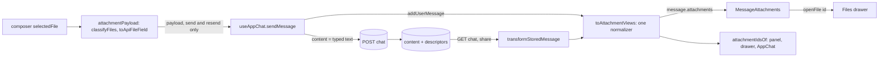

# Message attachments: structured data, never message content

Date 2026-11-07 · Status: **Implemented in part**, see §G · Issue #1786 · Draft PR #1933 (superseded)

Written as a read-only analysis before the build. §A to §F are that analysis; §G records what was
verified against the code, what the real run found, and where the build deviated.

## A. Verified current state

**Producers**

| # | Where | What |
|---|---|---|
| P1 | `AppChat.jsx:2493-2557` | `messageContent` = typed text + inline-styled HTML (multi 2495-2540, single 2541-2556). `fileName` and `base64` are interpolated unescaped (2507, 2518, 2529, 2544, 2548, 2552). |
| P2 | `AppChat.jsx:2640-2681`, `:224-231` | Three IIFEs for the "0 to null, 1 to object, many to array" rule. The same rule is repeated in `chatFileUpload.js:180`, `ChatInput.jsx:518/532/640`, `ChatStartForm.jsx:135`, `OfficeChatPanel.jsx:473-476`, `useOfficeChatAdapter.js:27-50`. |
| P3 | `useAppChat.js:686-696`, `:701-715` | `addUserMessage(content, {rawContent, imageData, fileData, audioData})`. The wire carries `content: typed`, so the HTML never leaves the tab. |
| P4 | `ComparePanel.jsx:127-163` | Resend sends pure text plus payload, so the bubble shows no attachment at all. |
| P5 | `OfficeChatPanel.jsx:477-541`, `useOfficeChatAdapter.js:182-239` | Pure text plus host item and mail files as payload. No `meta.rawContent`. |
| P6 | `AppChat.jsx:2074-2090`, `transcriptionTurn.js:127-139` | Transcription turn: content is the file name, and the stored turn also has a descriptor, so the name shows twice after reload. |
| P7 | `sessionRoutes.js:1184-1199`, `ChatFileService.js:467-651`, `chatMaterializer.js:95-114` | Stored descriptor `{id?, type=mime, name, bytes, origin?, hasOriginal?, canUseAsTemplate?}`. Images and audio have no id and their bytes are never kept. |

**Consumers**

| # | Where | What |
|---|---|---|
| C1 | `ChatMessage.jsx:632-641`, `:779-802` | `hasHTMLContent` leads to splitter or `dangerouslySetInnerHTML` (790, 799). |
| C2 | `ChatMessage.jsx:1067-1101`, `:1106-1148`, `:1160-1198` | Shared list, stored chips and the audio card. |
| C3 | `ChatMessage.jsx:333-364`, `:382-459`, `:467-508` | Copy, copy-link and edit all read `message.content`. |
| C4 | `ChatMessageList.jsx:17-25`, `:161` | `hasUserAttachments` keeps file-only turns visible. |
| C5 | `ArtifactsPanel.jsx:64-76`, `uploadedFiles.js:175-191`, `AppChat.jsx:971-979` | Three copies of `[...attachments, ...[fileData].flat()]`. |
| C6 | `SharedChatPage.jsx:44-52`, `:309-311` | Maps `attachments` to a second field, `sharedAttachments`. |
| C7 | `ExportDialog.jsx:118-165`, `chatExport.js:131-137`, `:646-651`, `exportNaming.js:42`, `:111` | Export uses `m.content`. JSON and JSONL dump whole message objects, including base64 and document text. |
| C8 | `shared/contextUsage.js:42-65` | Reads `rawContent` and `fileData` (payload, must stay). |
| C9 | `useChatMessages.js:207-226`, `:423-429`, `:476-496`, `:506-519` | `addUserMessage`, `editMessage` (overwrites content, so the badge vanishes), `loadServerMessages` (replace-all), `getMessagesForApi`. |
| C10 | `useAppChat.js:763-818`, `AppChat.jsx:1832-1861` | Resend restores the payload. A reopened turn has no payload: documents come back through server inheritance (`ChatFileService.js:489-500`), images and audio are silently dropped. |

**Claims 1, 2, 5: correct** (the line numbers in 2 are 686-715). **Wrong or incomplete:**
- **Claim 3.** `message.meta` is assigned nowhere (`displayMessage.meta` is spread into the message), so the audio card (`:1160`) is unreachable. `docs/AUDIO_UI_GUIDE.md:96-112` documents a player that never renders. Copy-link reads `message.meta?.rawContent` (`:389`), always undefined, so a live file turn puts the HTML into `prefill`.
- **Claim 4.** There are four states, not two. AppChat live shows the badge. Office, Compare resend and an edited message show nothing. Office is worse: with no `rawContent` and any file (the open email counts when storage is on) the typed text goes through `innerHTML`, which collapses newlines. Reopened shows chips. The shared viewer shows its own list.
- **HTML persistence:** never persisted. The wire, the store, titles, search, share snapshots and server exports see typed text only. Legacy sessionStorage copies are purged at boot (`index.jsx:20`). The HTML does **leak** from a live turn into copy, copy-link, PDF and Markdown export, export file names and titles, and JSON export.
- **Claim 6.** Nextcloud embed and the browser extension add no producer of their own: the first goes through `handleSubmit`, the second through the Office adapter. The issue's line numbers (1330-1382) are stale; `AppChat.jsx` is now 3617 lines.

**New findings**
1. A reopened user message containing the text `&send=true` link can therefore load a remote image in the victim's bubble.
2. `UploadedFilesTab.jsx:194-198`: a chip of a deleted file silently opens `items[0]`, a different file.
3. Probable server bug, static reading only (dependencies are not installed, so I could not run it): `prepareTurnFiles` already returns image and audio descriptors (`ChatFileService.js:637-651`), and `sessionRoutes.js:1196-1199` appends them again. A reopened image turn would show two chips. Verify first.
4. `ChatMessage` is not memoized, so each streamed chunk re-runs `DOMPurify.sanitize` on the user turn, base64 included. The image bytes also sit twice in state (content and payload).

## B. Target architecture



**Rules.** `content` is exactly the string sent on the wire (`typed`, untrimmed) and is rendered as text with `whitespace-pre-wrap`. There is no HTML in any message and no `dangerouslySetInnerHTML` for user turns. Payload fields (`imageData`, `fileData`, `audioData`) are send, resend and token-estimate inputs only. Display never reads them.

**View model** (`client/src/features/chat/messageAttachments/attachmentViews.js`, pure JS, no React):

```js
/** @typedef {Object} AttachmentView
 * key         string   React key: id, else `${index}:${name}`
 * id          string|null  chat-file id (Files drawer); null = nothing to open
 * kind        'image'|'audio'|'document'  from composer `type`, else mime prefix, else 'document'
 * origin      'upload'|'attachment'|'email'|'meeting'|'page'
 * name        string   plain text, '' if unknown (component supplies the fallback)
 * mimeType    string|null
 * bytes       number|null
 * pages       number|null
 * previewSrc  string|null  live images only; must match ^data:image/(png|jpeg|gif|webp);base64,
 * source      'live'|'stored'
 * shared      boolean|null  shared-chat viewer only: may the viewer open it
 */
export function toAttachmentViews({ live, stored }) // live: {fileData,imageData,audioData}; stored: descriptor[]
export const attachmentIdsOf = message => ...       // replaces the three C5 copies
```

One normalizer reads the same field spellings the server does (`name|fileName`, `bytes|fileSize|size`, `fileType|mimeType|type`, `id|fileId`; compare `chatMaterializer.js:95-114`). Canonical order is documents, images, audio, matching the server's `messageAttachments`. A parity test feeds one fixture through the live and the stored path and expects equal views apart from `previewSrc`.

**Where it is derived, once, at the two ingestion points:** `addUserMessage` (live: AppChat, Compare, Office, edit-resend) and `transformStoredMessage` (reopened and shared). The result lives on `message.attachments`, which keeps `.id` for the existing readers. Deriving at ingestion gives a referentially stable array, so `React.memo` works. `sharedAttachments` is deleted; the server already adds `shared` per descriptor (`chatShares.js:271-276`).

**Component** `client/src/features/chat/components/MessageAttachments.jsx` (memoized). Props: `attachments`, `onOpenFile?` (ChatMessage passes `useChatFiles()?.openFile`), `compact` (forwarded; Office and Compare already pass it, 280 px), `viewer` (= `readOnly`).
- **Per item.** Openable when `id && onOpenFile && shared !== false`, rendered as a `<button>` that calls `onOpenFile(id)`. Otherwise a static chip. `shared === false` renders the existing "Attachment not included: {name}" copy. `previewSrc` gives a thumbnail whose `alt` is the name, falling back to `common.uploadedImage`. Names are text nodes only.
- **Layout.** Names truncate (`min-w-0`, `title`), chips wrap, `<ul aria-label>`, targets at least 24 px.
- **Audio.** A chip only, no player (playback would be live-only).
- **Visual design and placement** (above or below the text, collapse threshold) are the UX pass's; `origin` lets it hide or mark host items.

**Mapping**

| Source | id | previewSrc | Behavior |
|---|---|---|---|
| Document, pre-uploaded stub (live) | stub `fileId` (equals descriptor `id`) | no | openable |
| Document, inline only (quota, upload error, store off) | null | no | static chip, `title` "sent with this message, not kept in the chat" |
| Document, stored | `id` | no | openable |
| Image | null (never stored) | live only | thumbnail now, name chip after reload |
| Audio | null | no | chip |
| Host item (Office) | `id` | no | `origin` email/meeting/page |
| Shared viewer | `id` plus `shared` | no | open or "not included" |

**Discarded or unavailable.** The bubble never claims a storage state: `hasOriginal` in a descriptor is a send-time snapshot. The Files drawer is the authority (`uploadedStorageState`, `chatFiles.stateExpired`, `originalDiscarded`). A deleted file needs the drawer fix from finding 2 (notice "This file is no longer in the chat" instead of `items[0]`).

**Identity.** Files are matched by chat-file id (stub `fileId` equals stored `id`, verified in `withStoredFile` and `describeStored`). Turns are replaced wholesale on hydrate, so no merge is needed. Optional hardening: hoist `clientMessageId` in `transformStoredMessage` (not copied today) and match on it in the `preserveLocal` filter (`useChatMessages.js:490-494`).

**Server.** No change needed. Today's contract: `messages[].attachments` (`ChatRepository.js:168`) plus `shared` on shares. Optional additive field: `pages` in `describeStored` (`ChatFileService.js:409-419`) if UX wants it, covered by `docs/api-guidelines.md` (additive, no envelope). Image previews after reload need stored image bytes: a product and storage decision (quotas, retention), not part of this work.

## C. Options and ADR

| Option | Idea | Pros | Cons |
|---|---|---|---|
| **A (recommended)** | View model at ingestion, `message.attachments`, one component | Stable references, memoizable, one derivation, small diff, payload untouched | Two ingestion points to keep in sync (parity test guards it) |
| B | Render-time accessor `attachmentViewsOf(message)` | No state-shape change | New array each render (memo needed), five call sites, display still coupled to payload |
| C | Message `parts[]` (text, attachment, image, artifact) | Cleanest long-term, could unify with generated files | Touches streaming, export, token estimate, resend; far too large for this issue |

Complement D (separate product decision): store user images server-side so previews survive reload.

**ADR (Accepted).** *Context:* HTML in `content`, four render states, unescaped interpolation. *Decision:* Option A; `content` is text, attachments are structured data rendered by one component, payload and display are separate. *Positive:* one code path for live and reloaded turns; copy, export and titles become correct without edits; both `dangerouslySetInnerHTML` sites go. *Negative:* image thumbnails still vanish on reload; `rawContent` stays redundant until slice 5.

## D. Compatibility

Nothing stored or in flight contains the badge HTML: the wire and store carry typed text (`useAppChat.js:702-715`, `sessionRoutes.js:1246`) and no storage keeps display content. A tab open across the deploy keeps its old bundle until reload and the wire is unchanged. So **no shim is needed**.

Decision for you (CLAUDE.md: ask first), recommending a clean break:
1. **Legacy tolerance** for old badge HTML: recommend no. There is nothing to tolerate. Only files users already downloaded (JSON, MD, HTML exports) contain it.
2. **Export change.** JSON and JSONL of a live chat stop dumping `imageData` (base64), `fileData` (document text) and `audioData`; they carry `attachments` views instead, as reopened chats already do. Text, Markdown, HTML and PDF exports get a plain "Attached: a.pdf, b.png" line. Recommend yes. The JSON dump is an accidental contract, but a consumer parsing it would break.
3. Typed text that contains `` text, copy and copy-link pure, edit keeps chips, Office text keeps newlines | revert; view model stays |
| 3 | Drawer notice for an unknown file id; remove dead `message.meta?.*` reads; JSON export strips payload and adds the "Attached" line (after your decision); optional `clientMessageId` hoist | `UploadedFilesTab.jsx`, `ChatMessage.jsx`, `ExportDialog.jsx`, `chatExport.js` | drawer test, `chat-export` | revert |
| 4 | Server: fix the probable duplicate image and audio descriptors (verify first), with a test. Independent, can ship first | `sessionRoutes.js` or `ChatFileService.js`, `server/tests/chat-files-*.test.js` | server test | revert |
| 5 | Retire `rawContent` (`ChatMessage`, `useChatMessages`, resend, `shared/contextUsage.js` and its tests) | several | existing tests adapted | revert |

**From PR #1933** keep `classifyFiles` and `toApiFileField` (slice 1), with documents as "not image and not audio" so a single untyped `file` still counts, as in the old single-file branch. Drop `render*Badge` and `buildMessageFromFiles` (they entrench HTML), and its stale `apiMessage.content: input` (main has `typed`). Its 2026-09-22 triage comment recommended a rebase, which predates the product owner's direction.
**Issue #1786:** keep open and re-scope with a comment linking this concept and a slice checklist. Its line numbers are stale. Close after 1 and 2b. **PR #1933:** close as superseded, crediting slice 1.

**Docs and changelog.** Slice 2b adds `docs/releases/next/fixes.md` ("Attached files look the same before and after a reload; copying, linking and exporting a message no longer includes file markup"), updates `docs/chat-files.md` (the bubble chip), `docs/audio-file-support.md:373-377` and `docs/AUDIO_UI_GUIDE.md:96-112` (the player was never reachable). Slice 4 gets a fixes entry if confirmed. Slices 1, 3 (internal) and 5 get none (refactors). New files carry the SPDX header.

## F. Risks

- **Security.** Names and `previewSrc` are the only untrusted strings. Names render as React text; `previewSrc` is allow-listed (no SVG, no `javascript:`) and only ever built from composer bytes, never from a server field. Add a test that a name or typed text of `` produces no element. The old code is exposed through external names (integration document titles, Nextcloud paths): DOMPurify keeps `<a>` and remote ``. Removing the sniffing closes finding 1.
- **Performance.** The base64 is no longer duplicated into `content` or sanitized on every stream chunk; the memoized component and stable array keep it so. Keep payload bytes out of display props.
- **Accessibility.** WCAG 1.1.1 (meaningful alt), 1.3.1 (list with a label), 2.1.1 (`<button>` for openable chips), 2.5.8 (24 px targets), 4.1.2. A non-openable chip must say why (`title`), and `<audio>` is not used. Check chips at 280 px and in the shared page (axe fixture).
- **i18n (en and de).** Reuse `chatMessage.attachmentsLabel`, `chatFiles.openInDrawer`, `chatSharing.viewer.attachmentNotIncluded` and `attachmentUnnamed`, `common.uploadedImage`. New: `chatMessage.attachments.notKept`, `chatFiles.fileGone`, and optionally `chatMessage.attachments.more`.
- **Blockers and open points.** Image thumbnails cannot survive a reload without server storage (decision D). The Office host-item chip would appear on every live turn, matching what reopened chats show today, so UX should decide on hiding by `origin`. The transcription turn shows its name twice (P6). Adjacent and unverified: in compare mode, pre-uploaded stubs go out as `fileIds` to `compare-<uuid>` chats whose file scope differs; confirm the model receives the document. `tests/e2e/chat.spec.js:178-195` uses test ids that do not exist, so that test never runs.

## G. Implementation notes (2026-11-07)

**Verified before building.** From the code: `message.meta` is read in three places and assigned
nowhere, so the audio card never rendered and copy-link fell back to `content`; the drawer falls
back to `items[0]`; `prepareTurnFiles` and the route both add the images and audio of a turn.

**Found only by running the app** (Playwright against the dev server, a model with vision and audio):

- A turn with two documents, an image and a sound came back after a reload as **six** descriptors
  (slice 4's "probable server bug" is real). The route's second append is removed.
- A stored file's `bytes` is its text and its original together, so a reloaded card showed 4 KB for
  a 2 KB file. `describeStored` now gives the original's size while the original is kept.
- Two cards for the same stored file (identical files are kept once) collided on a React key. The
  key is position plus id.
- Measuring the block's parent for "narrow" is circular: a message row is as wide as its content.
  Narrow is the window width (below 480 px) or the `compact` flag.

**Deviations from §B and §E.**

| Plan | Built | Why |
| --- | --- | --- |
| `attachmentViews.js` reads `describeAttachment` from `attachmentContent.js` | It reads it from a new `attachmentDescription.js` that `attachmentContent.js` re-exports | `attachmentContent.js` loads the download and API code; `useChatMessages` is imported by many suites and by every chat surface |
| The modules live in `client/src/features/chat/attachments/` | They live in `client/src/features/chat/messageAttachments/` | `.gitignore` ignores every directory named `attachments/`; the first version of the directory was silently left out of `git status` |
| `content` is `typed`, untrimmed | `content` is `typed.trimEnd()` | The first line keeps its indentation and trailing whitespace goes, as the old splitter displayed it |
| Thumbnail `alt` is the file name | `alt=""` | The name is in the card's own text; both would be read twice |
| Key is the file id | Key is `index:id` | The same stored file can be attached twice |
| Slice 5: retire `rawContent` | Not done | `shared/contextUsage.js` and resend still read it; no reason to widen this change |
| Slice 3: JSON export drops the payload | Not done | A change to an accidental export contract; it needs a decision |
| Slice 4: "verify first" | Reproduced in the real app, fixed, tested | See above |

`AttachmentView` gained `originalKept`, `read`, `unsaved` and `shared` beyond §B's shape: the card
needs them for the state line and for the size it must not show once only the text is kept.

**Tests.** Client: `attachment-payload`, `attachment-views`, `message-attachments`,
`message-attachments-flow` (new); `app-chat-voice-mode` (a vision model for the image case, a new
case for the image guard) and `chat-files-drawer` (a file that is gone) extended; the splitter's test
is deleted with the splitter. Server: `chat-attachment-descriptors` (new). A mutation check of the
fold cap confirmed the component tests fail when the cap is wrong.
