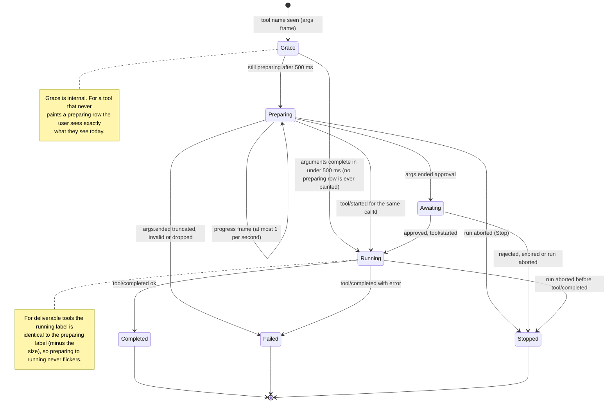
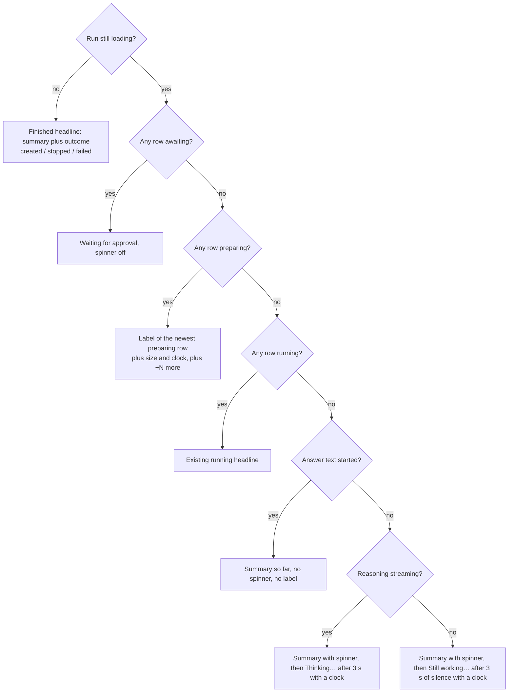
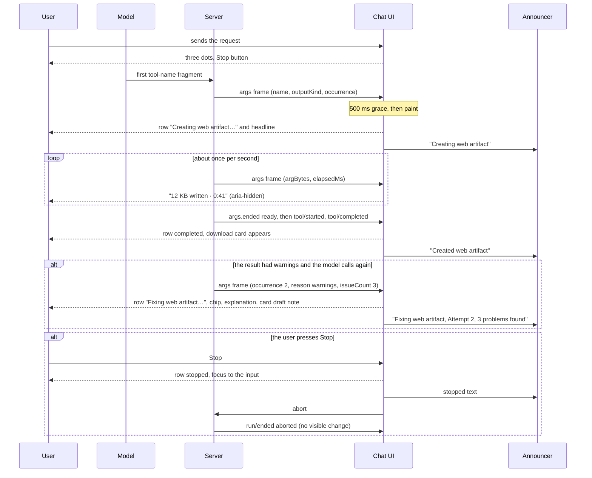

# UI/UX Brief: Artifact Creation Progress

Issue: [intrafind/ihub-apps#3534](https://github.com/intrafind/ihub-apps/issues/3534) "Chat: show tool
call progress while the model streams tool arguments". Request that started this work: "improve our
artifact creation".

| | |
|---|---|
| Document | 02 UX brief (interaction, flow, feedback, copy, accessibility behaviour) |
| Author role | UX design |
| Date | 2026-11-09 |
| Status | Draft for product-owner and UI-designer review. No source code was read for editing or changed. |
| Reads with | `01-product-brief.md` (scope, release slices, wire format). The UI designer's visual spec sits next to this file; this brief does not repeat colours or icons. |
| Numbering note | The product brief reserves `02-technical-design.md` for the architect. This file is `02-ux-brief.md` because that is what was requested. Whoever adds the technical design should number it `03` or renumber the folder. |

How to read this: sections 1 and 2 are the decisions and the facts they rest on. Section 3 defines the
row's states. Sections 4 to 12 answer the nine design questions in the order they were asked (question
1 is section 4, question 9 is section 12). Sections 13 to 17 are the component specification, flows and
implementation notes for whoever builds it. Section 18 lists where this brief differs from the product
brief, section 19 the open questions. If you have five minutes, read section 1, the timeline in
section 4 and the copy table in section 12.

## 1. Executive summary

The failure is a wrong conclusion, not a slow model: for about two minutes the chat showed a bare
spinner, so a healthy run looked hung and the user pressed Stop. The design makes four things always
visible: **what** the assistant is doing, **that it is progressing**, **how long it has been going**,
and **what happens if you stop**.

Key decisions (each is argued in the section named in brackets):

1. **One data source, two views, both inside the existing activity list (`ToolActivity`).** A row for
   the call, and the same text in the list's one-line headline. The headline carries the full status
   when the user has collapsed the list. No placeholder in the Artifacts drawer, nothing extra in the
   input area. [section 5]
2. **Six row states, one word each:** `preparing`, `awaiting`, `running`, `completed`, `failed`,
   `stopped`. Flags (attempt, problems, stalled, ready) refine a state; they are not new states.
   [section 3]
3. **Progress is size plus clock, never tokens and never a percentage.** "12 KB written · 0:41".
   The total is unknown, so there is no determinate bar. If the provider cannot say how much was
   written, the clock alone is shown. [section 6]
4. **A repeat is explained only when the server can state the reason.** If the previous call returned
   warnings, the row says "Fixing web artifact… Attempt 2" and "The previous version had 3 problems".
   If the reason is unknown, the row is a normal row with a neutral "No. 2" chip. The word "again" is
   never used because the client cannot verify it. [section 7]
5. **A bare spinner is never shown for more than 3 s.** After 3 s without output the line says "Still working… 0:12";
   while reasoning streams it says "Thinking… 0:07". Both live in the same headline slot as tool
   rows, so there is one status line, not three. [section 8]
6. **Stop explains itself afterwards, not before.** No confirmation dialog. The row turns to `stopped`
   immediately (optimistic for rows that were only `preparing`), says what was and was not saved,
   and focus returns to the message input. [section 9]
7. **Screen readers hear a short script, not a ticker.** One dedicated polite announcer outside the
   chat log announces: start, completion, failure, stop, a stall, a long idle. The numbers and the
   clock are `aria-hidden`. The whole activity list is excluded from the surrounding live region.
   [section 11]
8. **A corrected re-creation replaces the earlier download card; it never silently swaps what the user
   is looking at.** The earlier card is marked "Draft, being fixed" while the fix runs; the open
   viewer offers "Show newer version". Follow-up scope, not release 1. [section 7.3]
9. **The best progress indicator for the second wait is not needing it.** The 66 s second call in the
   incident is most likely a full regeneration because the tool returned warnings. A patch-style fix
   would remove that wait. This is the product brief's P15; this brief raises its priority from
   "decide later" to "write the brief now". [section 19]

## 2. What the code does today (facts that drive the design)

Read on 2026-11-09. The product brief section 4 lists the server side; this table lists what matters
for interaction and accessibility, including three places where the issue's premise needs correcting.

| # | Fact | Where | Consequence for the design |
|---|---|---|---|
| F1 | The activity list is open while the answer streams (`expanded ?? loading`) and collapses to a one-line summary when it completes. A click pins the user's choice. | `ToolActivity.jsx` | The "auto-expand" requirement is already met. We must keep the pinned-collapsed case honest: the headline must carry the progress. |
| F2 | `runningHeadline` knows `reading`, `search`, `fetch`, integration and plain tools. Between two tool calls (nothing running, run still loading) the headline falls back to the finished summary ("Searched the web · 1 search") with a "done" icon and no spinner. | `ToolActivity.jsx`, `finishedHeadline` | That is the moment the user sees "done" while the model starts a 60 s call. The summary keeps a spinner while the turn is still going, and the new idle states take over after 3 s. |
| F3 | `ToolActivity` returns `null` when there are no items. | `ToolActivity.jsx` line 29 | A plain turn with hidden reasoning has nowhere to show "Thinking…". The component must render a headline-only mode. |
| F4 | **Premise correction.** The Artifacts *drawer* is not opened automatically, is a modal (`aria-modal`, backdrop) and refreshes its list only when an answer that produced files has finished (`producedRuns` requires `!message.loading`). What the user actually sees after the first `create_web_artifact` call is the **download card in the message** (live file with base64 `data`, openable in the immersive viewer). | `ArtifactsPanel.jsx`, `ChatMessage.jsx`, `artifactFiles.js` | "The Artifacts panel already shows the faulty artifact" is true of the card and the viewer, not the drawer. Design consequences in section 7. |
| F5 | Each call gets a new file id (`holdGeneratedFile` uses a random UUID) and `generatedFilesOf` de-duplicates by id only. A corrected re-creation therefore produces a **second card with the same file name**. | `generatedFiles.js` (server and shared) | Two identical cards unless we decide otherwise (section 7). |
| F6 | The tool result for warnings tells the model: "the user already sees the faulty version. Do NOT answer yet: fix every warning and call again." The server holds the `warnings` array. | `webArtifactTools.js` | The number of problems and the fact that a retry follows are server-known facts, so the "why" can be stated without guessing. |
| F7 | `filename` and `title` come before `content` in the tool schema, so a model usually writes the file name in the first few tokens. | `webArtifactToolDefinitions.js` | The file name can be shown early (product brief P8). |
| F8 | `ChatMessageList` is `role="log" aria-live="polite"`. Everything inside it is a live region, including `ToolActivity`. Today each headline change is already announced, and a ticking number would be announced every tick. | `ChatMessageList.jsx` | The activity list must opt out of the surrounding live region and a dedicated announcer takes over (section 11). |
| F9 | The toggle button in `ToolActivity` has `text-xs` and no minimum height (target size below the 24 px of WCAG 2.5.8), no explicit focus style, and its text is `truncate`, which would cut a progress suffix on a phone. `animate-spin` and the three-dot `animate-pulse` loader have no reduced-motion variant. | `ToolActivity.jsx`, `ChatMessage.jsx` | Concrete fixes in section 15. |
| F10 | The send button is the stop button: one `<button>` toggled by `isProcessing`, accessible name "Cancel" (`common.cancel`), icon X. `handleCancel` does not move focus. After Stop the button becomes a disabled "Send" (the input is empty) while it still has focus. | `ChatInput.jsx` lines 632 and 1089 to 1110 | "Cancel" does not say what is cancelled. Focus is stranded on a disabled control. Fixes in section 9. |
| F11 | `buildToolActivity` turns only `running` rows into `stopped` once the run is finished. A `preparing` row would stay a spinner forever. | `shared/run/toolActivity.js` line 262 | Must be extended; this is the client side of the product brief's "no orphan rows" (P3). |
| F12 | The reducer's `tool/started` case removes the row with that call id and appends a new one. A row that existed earlier would jump to the end and lose its progress. | `shared/run/runReducer.js` | Progress state is kept separately and merged by call id; the row never moves. |
| F13 | German `toolActivity.*` mixes "du" (`von dir gestartet`) and "Sie" (`bitten Sie`). The approval card uses "Sie". | `shared/i18n/de.json` | New strings are impersonal (no du, no Sie). |
| F14 | Existing German term for the feature is "Artefakt" (`chatArtifacts.title`). Tool titles: "Interaktives Web-Artefakt erstellen", "Präsentation erstellen", "Excel-Arbeitsmappe erstellen". | `shared/i18n/de.json`, tool definitions | New nouns match these. |

## 3. The row's states

### 3.1 State list

| State | One-line meaning | Spinner | Shown | Source |
|---|---|---|---|---|
| `preparing` | The model is writing the call's arguments; nothing has run. | yes | after the 500 ms grace | `tool/progress` phase `args` (product brief section 8.3) |
| `awaiting` | Arguments are complete and the call needs the user's approval. | no | immediately | `args.ended` with outcome `approval`, then the approval interaction |
| `running` | The server is executing the tool. | yes | immediately | `tool/started` (as today) |
| `completed` | The tool finished without error. | no | immediately | `tool/completed` |
| `failed` | The call cannot or did not complete: cut off, malformed, tool error, dropped. | no (error icon) | immediately | `args.ended` outcome `truncated`, `invalid` or `dropped`, or `tool/completed` with `error` |
| `stopped` | The run ended (user Stop or other abort) or the user declined, before the call completed. | no | immediately | `run/ended` aborted, or approval rejected or expired |

Flags that refine a state (rendered, never new states):

| Flag | Applies to | Meaning |
|---|---|---|
| `occurrence` (2, 3, ...) | any | The same tool ran before in this turn. Shown as the chip "No. 2". |
| `reason` (`warnings`, `error`) plus `issueCount`, `previousCallId` | `occurrence` 2 or more | The server says why this call is a repeat. Switches the label to "Fixing" or "Retrying" and adds the "Attempt n" chip and the explanation line. |
| `ready` | `preparing` | Arguments are complete but other parallel calls are still being written; the call has not started. Shown as "ready to run", spinner off. |
| `stalled` | `preparing` | The size has not grown for 20 s. Adds the stall caption. |
| `problems` (n) | `completed` | The server reported warnings. Chip "3 problems found". |

The 500 ms grace is not a state. It is a delay before the first paint (section 10, "Very fast calls").

### 3.2 State diagram



Truth wins over optimism: a row set to `stopped` locally (because the user pressed Stop while it was
`preparing`) is overwritten if a `tool/completed` for it arrives afterwards (a race when Stop lands
while the tool is already running). Only `preparing` rows are stopped optimistically.

### 3.3 Which label the headline shows

The headline is the button text of the activity list. When the list is collapsed it is all the user
sees, so it carries the same status as the active row. First match wins:



The summary-with-spinner branches are the fix for F2: while the turn is still going the headline never
shows a "done" icon, and it never shows a stale "Searching…" either, because the text is the true list
of what has been done so far.

The three-dot loader in `ChatMessage` stands down whenever the headline shows a spinner or a label,
exactly as it already does for `SearchStatusIndicator` ("two loaders on one message" is a bug the code
comments call out). It shows only before the first activity exists (the first seconds of a turn).

## 4. Question 1: Timeline replay of the incident

Assumptions: the log of chat `chat-83b0fdd3-...`; `t` is seconds from the turn start (15:38:30). The
second long call is treated as a repeat of `create_web_artifact` returning from warnings; section 4.2
shows the other possibilities. Sizes are illustrative (about 33 KB of arguments over 63 s, roughly
0.5 KB/s); real values will differ. "Frame" means a server frame from the product brief (`args`,
`args.ended`, `model.waiting`, `tool/started`, `tool/completed`).

### 4.1 Main line

| t (s) | Server and stream | What the user sees | What a screen reader hears |
|---|---|---|---|
| 0.0 | Turn starts. | New assistant bubble with the three-dot loader. The send button is now the red Stop button. | Nothing new. |
| 0.0 to 2.0 | Model call 1 (decides to search). | Three dots only. Under 3 s, no label yet. | Nothing. |
| 2.0 | `tool/started` for `braveSearch` (not a deliverable tool, so no early frame). | The activity list appears, open. Headline "Searching for “…”" with a spinner. The dots stand down. | "Searching for “…”" (first appearance of a row). |
| 6.0 | `tool/completed` for the search. Model call 2 starts. | Search row reads "Searched for [query] · 5 results". The headline reads the summary "Searched the web · 1 search · 5 results" and **keeps its spinner**, because the turn is not over. | Nothing. |
| 6.4 | The stream shows the name `create_web_artifact`. The server sends the first `args` frame (system-skill tool, so immediately). `outputKind: webArtifact`, `occurrence` 1. | Still nothing new (grace). | Nothing. |
| 6.9 | 500 ms grace ends. | A new row at the end of the list. Headline "Creating web artifact…" with a spinner. | "Creating web artifact" (once). |
| 7.5 | Optional: the model has written `filename` (product brief P8). | A chip with the file name next to the row label: [roi-calculator.html]. | Nothing. |
| 8.5 | `argBytes` passes 1000. | "1 KB written · 0:02" appears in the row and as the suffix of the headline. | Nothing (the numbers are `aria-hidden`). |
| 9 to 68 | `args` frames about once a second. | The size and the clock grow: about 7 KB at t=20, 16 KB at t=36, 28 KB at t=60. No caption appears, because the size is growing. | Nothing. |
| 69.0 | Arguments complete. `args.ended` outcome `ready`. `tool/started` (running), 17 ms later `tool/completed` with `files: [f1]`. | The row jumps to `completed` in place: "Created web artifact · 33 KB". Spinner off. **The download card for f1 appears in the message**, openable in the viewer, showing the faulty version. The headline shows the summary with a spinner until the next row appears. | "Created web artifact" (completion of a deliverable row). |
| 69.5 | Model call 3 starts. The server sends an `args` frame for a second `create_web_artifact`: `occurrence` 2, `reason: warnings`, `issueCount: 3`, `previousCallId` = call 2. | Still grace. | Nothing. |
| 70.0 | Grace ends. | **Row 3** at the end of the list: "Fixing web artifact…", chip "Attempt 2", spinner, and under it "The previous version had 3 problems. The assistant is rewriting the whole file, which can take as long as the first time." **Row 2** gains a warning chip "3 problems found · being fixed". The f1 card gains the note "Draft — being fixed". The headline reads "Fixing web artifact…". | "Fixing web artifact, Attempt 2, 3 problems found" (once). |
| 71 to 134 | Frames about once a second. | Size and clock grow again. No "large files" caption (the explanation line already set expectations). If the user opens f1 in the viewer now, the viewer's notice says "Draft — the assistant is fixing 3 problems." | Nothing. |
| 135 | The real user pressed Stop here. | See next row. | |
| 135.1 | The client aborts the stream (100 ms after the click). | **Row 3** turns `stopped` at once: "Stopped — the unfinished version was not saved. The previous version is still available." **Row 2**'s chip loses "being fixed" and reads "3 problems found". The f1 card note reads "3 problems found". The list collapses; the headline reads "Searched the web · 1 search · 5 results · Created web artifact · Stopped". The red Stop button becomes Send. **Focus moves to the message input.** The existing "[Generation cancelled]" note is appended to the answer text. | "Stopped. The unfinished version was not saved. The previous version is still available." (once). |
| 135 + | `run/ended` aborted arrives and changes nothing visible. | Nothing for the stopped call exists anywhere. The Artifacts drawer, if the user opens it, lists f1 only. | Nothing. |

### 4.2 Variants of the same incident

| Variant | What changes |
|---|---|
| **A. The user waits until t=135** (the call completes, tool returns no warnings). | Row 3 becomes `completed` "Created web artifact". Row 2's chip becomes "3 problems found · fixed in attempt 2". The f1 card is replaced by the f2 card **in the same position** (no second card). The announcer says "Created web artifact". The answer text streams, the list collapses, and the headline reads "Searched the web · 1 search · 5 results · Created web artifact · revised once". |
| **B. The viewer is open on f1 when f2 completes.** | The viewer never swaps content under the reader. Its notice becomes "A newer version is ready." with a button "Show newer version". |
| **C. The size stops growing for 20 s** (a stalled model or a provider that buffers bursts). | A caption appears under row 3: "No new output for a while. The model may be busy — you can wait or stop." Announced once, politely. It disappears when growth resumes. |
| **D. The provider gives no early signal** (Gemini, Mistral, a buffering vLLM parser). | No `args` frames. At t=9 (3 s after the model call started) the headline shows "Still working… 0:03", counting up. When the tool finally runs the row appears directly as `completed`. Nothing is announced about a file until it exists. This is the strictly-better-than-today fallback. |
| **E. The model needs more than 3 s to start writing** (long prompt, cold model). | "Still working… 0:03" appears at 3 s and is replaced by the "Creating web artifact…" row when the name arrives. |
| **F. The first call returned no warnings but the model creates a second file anyway.** | Row 3 is a normal "Creating web artifact…" row with the chip "No. 2" (no `reason`). No "Fixing", no explanation line, nothing on row 2 or the cards. |
| **G. The model ignores the warnings and answers.** | Row 2 stays `completed` with no problems chip (the client does not know about the problems without the optional `issueCount` on `tool/completed`; see section 16). The answer text is the explanation. |

## 5. Question 2: Where does progress live?

**Decision: in the activity list of the message, as a row plus the same text in the list's headline.
Nowhere else gets a live progress display.**

| Place | Gets progress? | Reason |
|---|---|---|
| Activity list rows (`ToolActivity`) | **Yes, the detail view** | The activity list is where the user already looks for what the turn is doing. A row survives the run as provenance. |
| Activity list headline | **Yes, the summary view** | The headline is all that shows when the user collapsed the list, and it is the right place for "Thinking…" and "Still working…" when there is no row at all. The headline and the active row show the same facts; that duplication already exists for searches. |
| Message header (skills, workflow indicator) | No | It is for who and what the message is, not for what is happening. A second place for the same status would double what a screen reader and the eye must reconcile. |
| Artifacts drawer, placeholder tab ("Artifact is being written…") | **No** | The drawer is a modal that covers the Stop button. A user who opens it to watch progress cannot stop the run without closing it. Its list refreshes only when the answer completes (F4), so a placeholder would stay up for minutes after the file exists. It would also promise a preview we do not have in release 1 (product brief section 3). |
| Chat input area | **No** (only the Stop button's name and description change, section 9) | The input is where the user types; a progress line there competes with the draft. |
| Download card | Notes only | "Draft — being fixed" and "3 problems found" on the card of a version that is being replaced (section 7). |
| Viewer notice | Notes only | Same facts, shown where the user is looking if they opened the artifact. |

**Is the list auto-expanded while a tool is preparing?** It already is open while the run is loading
(F1). Keep that. If the user pinned it closed, leave it closed: the headline carries label, size and
clock, so nothing is lost and we never override a deliberate choice.

**Collapse-on-complete.** The rule stays (collapse when the run stops loading), with three additions:

1. The finished headline names the **outcome** of deliverable rows: "Created web artifact", "Created
   web artifact · revised once", "Stopped", "Failed" (existing keys `toolActivity.stopped` and
   `toolActivity.failed`). A stopped or failed turn must not collapse into a headline that reads like
   success.
2. **Focus guard.** If keyboard focus is inside the list (a source link, say) when it auto-collapses,
   move focus to the toggle button first. Otherwise focus falls to the page.
3. Between two tool calls, while the run is still loading, the list stays open (the run has not
   completed), so the first deliverable row remains visible while the second wait runs.

Deliverable rows are not counted in "N tool calls"; they are named by kind ("Created web artifact"),
because "1 tool call" says nothing about the thing the user asked for.

## 6. Question 3: How to express progress honestly

**Decision: amount written in KB, plus elapsed time as m:ss. Never tokens, never a percentage, never
a determinate bar. Indeterminate (clock only) when the size is unknown.**

| Candidate | Verdict | Why |
|---|---|---|
| Tokens ("~8k tokens") | Rejected | Servers rarely know real token counts mid-stream (Anthropic reports usage at the end; Gemini sends the call whole), so it would be an estimate that differs per model. "Tokens" is jargon for most iHub users, and a token count cannot be compared with the size on the download card that appears later. The issue's example wording is replaced. |
| Characters received | Used as the source, shown as KB | The server counts the characters of the argument text it received. That is exact, model-independent and monotonic. Shown as KB (one character is treated as one byte). |
| KB | **Chosen** | Matches the number on the download card afterwards (`formatBytes`), so the progress and the result line up. A user understands "12 KB". |
| Percentage or a determinate bar | Rejected | The total is unknown, so any percentage would be invented and would stall or move backwards. |
| Elapsed time (m:ss) | **Chosen, always with the size** | The only liveness signal that exists even when the size is unknown, and it calibrates patience. It is a client stopwatch anchored on the server's `elapsedMs`, so it stays right after a reconnect. |
| Indeterminate | The fallback | When no size arrives, the row shows the label, the spinner and the clock. |

Rules:

| Rule | Value |
|---|---|
| Format | `{{size}} written · {{time}}`, joined with " · ". The word "written" says it is a running total of what the model produced, not the file size. |
| Size source | `argBytes` from the `args` frame; one character counts as one byte; reuse `formatBytes` from `client/src/features/chat/utils/artifactFiles.js`. Format with `Intl.NumberFormat(i18n.language)` so German shows a decimal comma at 1 MB and above. |
| Rounding | Under 1 KB: show no size (the row has only the label and the clock). 1 KB to 999 KB: whole KB. From 1 MB: one decimal. Never "~". Never shown smaller than a value already shown (clamp to the maximum seen). |
| Update rate | The server sends at most one frame per second. The client re-renders the visible numbers at most once per second. Both numbers are `tabular-nums` so the line does not jitter. |
| Clock | `m:ss` below one hour (0:07, 1:05). Measured from the call's first `args` frame (server timestamp), with the client/server clock offset taken from the first frame and negative values clamped to 0. |
| Written versus card size | They can differ by a few percent: the written count includes the JSON escaping of the arguments (`\n`, `\"`). That is why the label says "written", not "size". Do not "fix" it by showing the card size early. |
| Unknown size (fallback providers, or before 1 KB) | Label, spinner, and the clock after the 3 s liveness threshold. For a deliverable row that exists, the clock shows from the start. |
| `ready` (arguments complete, call not yet started) | Spinner off, the line reads "12 KB written · ready to run". |
| Honesty about the end | The final `args` frame carries the true total, so the last number shown is the real amount written. |

The headline suffix is the same text. On a phone the label truncates and the suffix does not
(`shrink-0 whitespace-nowrap`), so the numbers are never the part that is cut off.

## 7. Question 4: Repeated calls, grouping and the "why"

### 7.1 Wording and grouping

**Decision: each call is its own row (the issue's "distinct second entry"), rows stay in call order,
and the earlier row remains visible with its final state. Rows are not nested or merged.**

How a repeat is labelled depends on what the server can state:

| Server knows | Row label | Chips and lines | Headline |
|---|---|---|---|
| Same tool called before **and** the previous result had warnings (`reason: warnings`, `issueCount`) | "Fixing web artifact…" | Chip "Attempt 2" (3 for the third). Explanation line: "The previous version had 3 problems. The assistant is rewriting the whole file, which can take as long as the first time." | "Fixing web artifact… · 4 KB written · 0:05" |
| Same tool called before **and** the previous call failed (`reason: error`) | "Retrying web artifact…" | Chip "Attempt 2". Line: "The previous attempt did not finish. The assistant is trying again." | "Retrying web artifact… · …" |
| Same tool called before, **no reason** | "Creating web artifact…" (unchanged) | Chip "No. 2" | Unchanged |
| First call | "Creating web artifact…" | No chip | Unchanged |

Why not "again (2nd)" from the issue: "again" asserts a retry. A second call of the same tool can be a
second, different file the user asked for ("make me a dashboard and a calculator"). At announcement
time the client cannot tell, and the server cannot tell either until the `filename` has streamed (it
may be written after `content`). Ordinals ("2nd", "3rd") also do not translate: German writes "2.".
"Attempt 2" and "No. 2" are numbers with a word, so they are correct in both languages, and
"Fixing" is only used when the server knows the previous result carried warnings.

### 7.2 Should the UI explain why, and can it be known?

**Yes, and it can be known server-side with certainty, because the server produced the cause.** The
web artifact tool returns `warnings`, the server seam sees that result before the next model call, and
it already instructs the model to fix and call again (F6). The next announcement for the same tool in
the same turn can therefore carry `reason: warnings`, `issueCount` and `previousCallId`.

User-facing explanation, in order of weight:

1. **The row label** says what is happening: "Fixing web artifact…".
2. **The explanation line** says why and sets the expectation for the wait: "The previous version had
   3 problems. The assistant is rewriting the whole file, which can take as long as the first time."
   The second sentence is the important one: the user's anxiety in the incident was the second minute,
   not the first.
3. **The previous row** carries "3 problems found · being fixed", then "· fixed in attempt 2" when the
   fix completes, or just "3 problems found" if the run stops first.

The warnings themselves are not shown to the user: they are written for the model ("Relative
`<script src>` will not load inside the sandboxed srcDoc preview…") and would read as noise. A count is
enough. If a later release wants to show them, they belong behind a "Details" disclosure.

Where the facts come from, for the architect: `reason`, `issueCount` and `previousCallId` on the
`args` frame of the repeated call; optionally `issueCount` on `tool/completed` of the first call so
its chip can appear before the model reacts (section 16).

### 7.3 Download cards and the viewer (new scope, P1 items)

Because of F5 a corrected re-creation would show two identical cards. Decisions:

| Situation | Behaviour |
|---|---|
| A call completes with a file and a **later** call whose `previousCallId` is this call completes with a file | The earlier card is **replaced in place** by the new one (the server-sent link decides, never a name match). The earlier version stays in the stored artifacts and therefore in the drawer; whether the drawer should label versions is open question 3. |
| The replacement is **in progress** | The earlier card shows "Draft — being fixed" under its name. It stays openable: watching a draft during a 60 s wait is a good use of the wait. |
| The run is **stopped** or the replacement fails | The earlier card shows "3 problems found" and nothing about fixing. |
| The user has the earlier version **open in the viewer** when the replacement completes | Never swap the content under the reader (WCAG 3.2.5 spirit, and a reader loses their place). The viewer's existing status area shows "A newer version is ready." with a button "Show newer version". While the fix runs it shows "Draft — the assistant is fixing 3 problems." |
| The Artifacts drawer | Unchanged in release 1. Product brief P-level: refresh the drawer's list when a file-producing call completes, not only when the answer completes. This is a small adjacent fix (F4), not required for this release. |

## 8. Question 5: Reasoning and "Thinking…"

**Decision: a single idle line, shown only when nothing else is active, with two labels.**

| Situation | Label | Appears | Clock |
|---|---|---|---|
| Reasoning fragments are streaming, no answer text, no active row | "Thinking…" | After 3 s of continuous reasoning (avoids a flash for a brief thought before a quick tool call) | From the moment it appears ("Thinking… 0:03") |
| Nothing at all is arriving (no reasoning, no text, no row), the run is loading | "Still working…" | After 3 s without any visible output, from the server's `model.waiting` frame | Same |
| Tool rows exist and one is active | Neither: the row's label owns the headline | | |

How it coexists:

- **With a tool row.** The row wins as soon as it exists. The sequence inside one model step is
  reasoning, then possibly text, then the tool name; each hands over to the next in the same headline
  slot, so there is never more than one spinner line.
- **With the answer text.** When the first answer text arrives the idle line disappears. The text is
  its own proof of life. The headline then shows the summary of what was done, with no spinner.
- **When the model's thinking is displayed.** Reasoning is already on the stream; the existing small
  link "Show thinking analysis" appears above the answer while the model thinks, and expands to the
  streaming text. That link is not an activity indicator (no motion, no label of state), so the
  "Thinking…" line still shows. When the user expands the thoughts, the line stays; the thoughts text
  is not announced (it is a very long stream). When thinking ends, the line goes and the link remains.
- **With no tool items at all.** `ToolActivity` renders in a headline-only mode (no list, no chevron,
  not a button) so a plain chat turn gets the same line (F3).
- **Screen readers.** The idle line is announced once per model step, after it has been visible for
  5 s: "Thinking" or "Still working". Not on every tick. It is a status message (WCAG 4.1.3) that would
  otherwise be silent for the screen-reader user, which is the bare-spinner problem again.

An engineering check the architect should confirm: that a turn whose thinking is not displayed to the
user (the `thinkingThoughts` option) still delivers `thinking` deltas to the client. If it does not,
"Thinking…" cannot show for that turn and "Still working…" covers it; the design does not change.

## 9. Question 6: Stop, cancel, and "this is taking long"

### 9.1 Should stopping during `preparing` be explained?

**Yes, after the fact, in the row. No confirmation dialog, no "Stopping…" interstitial.**

A confirmation dialog on a stop control defeats it; stopping costs the user one re-ask and is the
action they chose. What the user needs is to know what they have afterwards.

| Moment | What the user sees | Notes |
|---|---|---|
| Before pressing | The Stop button's accessible name is "Stop generating" (it is "Cancel" today, which does not say what is cancelled). While a deliverable is `preparing` it also has an accessible description: "A file that is still being written will not be saved." Screen-reader users hear it on focus; sighted users are not burdened. | Applies to the existing combined send/stop button. |
| 0 to 100 ms after pressing | A row that was `preparing` turns `stopped` at once (optimistic, safe: nothing of an unfinished call was ever executed). Text: "Stopped — the unfinished file was not saved." If an earlier version exists in this message: "Stopped — the unfinished version was not saved. The previous version is still available." | A row that was already `running` waits for the server's `tool/completed`; truth wins. |
| Same instant | The list collapses, the headline reads "… · Stopped" (existing key), the Stop button returns to Send, focus moves to the message input, and the existing "[Generation cancelled]" note is appended to the answer text. | The note and the row must not both be announced: the announcer says the row text once; the note is part of the log and is read as normal text. |
| If `run/ended` has not arrived 3 s after pressing | The headline shows "Stopping…" until it does. | Covers a slow server close. No new state on rows. |
| Afterwards | Nothing for the stopped call in the Artifacts drawer or in any download card. The earlier completed version, if any, remains. | See the engineering check below. |

Engineering check that affects the copy (the product brief also lists it): does a Stop keep a file that
an earlier call in the same turn already created? In the live UI the earlier card stays, so "still
available" is true for the session. If an aborted answer does not persist its files, the card is gone
after a reload; the sentence is still true when it is shown, but the architect should confirm and tell
design if the behaviour is to change.

### 9.2 "This is taking long" hints

**Decision: hint on a stall (Should), not on duration alone (Could). Hints are calm captions inside the
row, never toasts or dialogs.**

| Hint | When | Where | Announced? | Release |
|---|---|---|---|---|
| **Stalled**: "No new output for a while. The model may be busy — you can wait or stop." | `argBytes` unchanged for 20 s while frames keep arriving, on a `preparing` row | Caption under the row. Removed the moment growth resumes. | Yes, once per row, polite | Should (release 1) |
| **Long wait**: "Complex requests can take a minute or two." | Idle line ("Still working…" or "Thinking…") visible for 60 s | Caption under the headline's row | No | Could (release 2, with the product brief's P11) |

Why not a duration hint on a healthy, growing row: the growing number is the proof of life; a caption
that says "this takes long" when the numbers move tells the user to worry about something that is fine.
The expected-duration sentence on a repeat ("can take as long as the first time") is part of the
explanation line (section 7.2), where it is true and useful. A "large files can take a couple of
minutes" caption on a first call was considered and dropped for the same reason.

The stall hint says "wait or stop" without a button. The Stop control is already on screen in the
input; a second, inline destructive control would only add a way to stop by accident.

## 10. Question 7: Failures and edge cases

| Case | Behaviour |
|---|---|
| **Arguments cut off** (the model hit its max output tokens, finish reason `length`, JSON incomplete) | Row `failed`, error icon, label from the call, text "Incomplete — the model reached its output limit before the file was finished." The message footer already carries the existing admin hint about "Max Output Tokens" (`message.finishReason`). The model may retry; the retry is `Retrying…` with the reason `error`. Announced once as a failure. |
| **Arguments malformed** (invalid JSON for another reason) | Row `failed`, "Incomplete — the file data from the model could not be read." |
| **Dropped call** (a name that matches no tool, the synthetic structured-output call) | If its row was never painted (under the grace), nothing is shown. If it **was** painted, it is not left to vanish silently: it turns `failed` with "Not created — the model's request could not be used." (Deviates from the product brief, which lets the row disappear; a screen-reader user was told "Creating web artifact" and a silent removal leaves them waiting. See section 18.) |
| **Approval-required tool** | Show `preparing` normally (the user needs to know the model is working, and it has no side effect). When the arguments complete the server says `args.ended` outcome `approval`: the row becomes `awaiting` (no spinner, label "Waiting for approval") and the existing `ApprovalCard` appears with its own copy ("Nothing is sent until you choose."). Approved: `running`. Rejected or expired: `stopped` with the text "Not run". The announcer says "Waiting for approval" once. Focus is not moved (unchanged from today). |
| **Parallel calls in one model turn** | Each call is its own row with its own progress. Cap: two rows are shown as `preparing` at once (product brief section 9); the headline shows the newest and appends "+1 more" (the count of other active rows). A row whose arguments are complete while another call is still being written shows `ready` ("ready to run", spinner off) so a frozen number does not look like a hang. Only the newest preparing row owns the headline; the announcer announces each row once. |
| **Tool-search and MCP tools** | The server rule decides who gets an early row (product brief section 6); the UI renders what it is sent. MCP tools with small arguments never reach the grace and look as today. An MCP tool with a slow argument stream gets the generic label "Preparing {{name}}…" with the title and integration chip the server sent (`toolDisplayOf`). |
| **Tool with no friendly title** | Label "Preparing {{name}}…" using the `name` the server sent; `title` is preferred when present. After `tool/started` the existing "Running {{name}}" applies. |
| **Very fast calls** (flicker) | Three delays: a row is first painted only after a **500 ms** grace (a tool that finishes its arguments in less never paints a preparing state); the idle lines (Thinking, Still working) wait **3 s**; and a painted row is **never removed or re-ordered**, it only changes state in place. For deliverable tools the `running` label is identical to `preparing` (minus the size), and `completed` is a label change in the same row, so a 17 ms tool run causes one change, not three. |
| **Hidden and non-server calls** (`activate_skill`, `ask_user`, `execution` other than `server`) | Never shown at any state, as today. The client keeps its own guard in `buildToolActivity` in case a frame arrives for them. |
| **Reconnect or reload while preparing** | The row shows its last known state; the clock is correct because it is anchored on server time. Progress frames are not stored in the ledger, so a reload of a **finished** turn shows only final states; a call that never finished is shown `stopped`, never `preparing`. |
| **Two tabs, one run** | Each tab renders from its own stream; both are identical. Only the tab that hosts the input announces (the announcer lives with the chat list). |
| **A first-ever slow model** | Covered by the idle line: no early frame, "Still working… 0:03" and counting. |

## 11. Question 8: Accessibility

Target: WCAG 2.2 AA (`docs/accessibility.md`). Method follows the `a11y-audit` skill: automated checks
cannot prove screen-reader behaviour, so the manual script in section 17.4 is part of the definition of
done.

### 11.1 Live-region strategy

The chat message list is already `role="log" aria-live="polite"` (F8). Two consequences: ticking text
inside it would be read every second, and text that changes state is read twice if we also add an
announcer. The strategy:

1. **Silence the activity list.** The root element of `ToolActivity` gets `aria-live="off"`. A nested
   `off` ends the surrounding region for that subtree in current browsers. This is the primary
   mechanism.
2. **Belt and braces.** Every ticking fragment (the size, the clock) is also `aria-hidden="true"`. If a
   screen reader ignores the nested `off`, the failure mode is a missed number, not a chatter of
   numbers. The numeric detail is supplementary: the essential status (what is happening, whether it is
   done) stays in the exposed label and in the announcements. Record this decision in the PR.
3. **One dedicated announcer.** A persistent `<div role="status" aria-live="polite" aria-atomic="true"
   class="sr-only">` is rendered when the message list mounts (live regions that are injected together
   with their content are unreliable), as a **sibling of** the log, not inside it. It is owned by
   `ChatMessageList`, so every host (chat page, embed, Office pane) gets it.
4. **A script, not a stream.** Announced exactly once each:

| Event | Announcement (composed from the visible strings) | Priority |
|---|---|---|
| First paint of any row | The row label without the ellipsis: "Creating web artifact" / "Searching for “…”" | normal |
| A repeat row is first painted | Label, chip and problems: "Fixing web artifact, Attempt 2, 3 problems found" | normal |
| A deliverable row completes | "Created web artifact" (plus ", 3 problems found" when known) | high |
| A row fails | "{Kind}: Failed. {reason text}" | highest |
| The run is stopped | The stopped text of the row | highest |
| Row becomes `awaiting` | "Waiting for approval" | high |
| Stalled caption appears | The caption | normal |
| Idle line visible 5 s | "Thinking" or "Still working", once per model step | low |
| **Never** | Size and clock ticks, reasoning text, the long-wait caption, the headline changing | |

   Mechanics: a minimum gap of 1.5 s between messages; at most three queued, the lowest priority
   dropped first; a key of `callId:event` prevents repeats; the text is cleared after 5 s so an
   identical later message announces again; the queue resets per run.
5. **Strip the ellipsis** from labels before announcing (screen readers read "…" inconsistently) and
   capitalise the first letter of a composed noun.

### 11.2 Progress semantics

Do **not** use `role="progressbar"`: there is no determinate value, and an indeterminate progressbar
with changing text is noisy in several screen readers. Do **not** make the row a `role="status"`: that
is a live region and would read the ticks. The row is a plain `<li>`. The list wrapper carries
`aria-busy="true"` while any row is `preparing`, `awaiting` or `running` (consistent with the existing
loading-state guidance in `docs/accessibility.md`).

### 11.3 Keyboard and focus

| Behaviour | Rule |
|---|---|
| No focus change on state change | Rows appearing, changing state or collapsing never move focus. |
| Toggle button | One tab stop, `aria-expanded`, `aria-controls` (as today). Enter and Space toggle. Its accessible name is the label **without** the ticking suffix, so the name does not change every second while the button is focused. Minimum target 24 by 24 CSS px (`min-h-6`), visible `focus-visible` ring (WCAG 2.4.7, 2.5.8). |
| Auto-collapse while focus is inside the list | Move focus to the toggle button first (section 5). |
| After Stop | Focus moves to the message input. The stop and send control is one element that turns disabled when the input is empty; leaving focus on it would strand the user (F10). |
| Approval | Unchanged: the card appears, focus stays where it is. |
| Escape | Not bound to Stop in release 1: Escape already closes dialogs and the voice mode, and a second meaning invites accidental stops. |

### 11.4 Motion, contrast, reflow, timing

| Concern | Requirement |
|---|---|
| `prefers-reduced-motion` | The spinner does not rotate (`motion-safe:animate-spin`, a static glyph otherwise) and the three-dot pulse does not pulse (`motion-reduce:animate-none`). The text and the clock carry the liveness; a number changing is not motion. |
| Pause, stop, hide (2.2.2) | The clock and size update automatically for longer than 5 s. They are the essential feedback of an operation the user started (the exception for essential content), the numbers change at most once a second and do not move or blink, and the user can end the operation with the Stop button. Documented as a deliberate reading of 2.2.2, not an oversight; a reviewer should confirm it. |
| Contrast | Text 4.5:1 in light and dark (table in `docs/accessibility.md`): gray-600 / dark gray-400 for the status text, **amber-700** (never 600) for the problems chip text, red-600 / dark red-400 for failed. The problems chip carries text and an icon, not colour alone (1.4.1). |
| Reflow (1.4.10) | 320 px width without horizontal scroll: label truncates, the numeric suffix does not (`shrink-0`), chips and explanation wrap (the list already uses `flex-wrap`). |
| Text size | `rem`-based sizes only (`text-xs`, never `text-[11px]`). |
| Tooltips | No new information in `title` attributes (the existing code notes that touch screens cannot reach them). |
| Status messages (4.1.3) | Met by the announcer; the idle line closes the former silent wait. |
| Language | Each string is in `en` and `de`; the page language is set already. |

## 12. Question 9: Copy

Style: short, present participle for activity, past participle for results; German is impersonal (no
"du" or "Sie", see F13) and uses the passive for composed labels so one template works for every noun
(German articles and cases would otherwise need seven forms per sentence). Placeholder values come
from the server (`name`, `title`), from `formatBytes` and from a clock helper; no sentence contains an
ordinal.

### 12.1 Strings for `shared/i18n/en.json` and `de.json`, under `toolActivity.*`

| Key | en | de |
|---|---|---|
| `creating` | Creating {{what}}… | {{what}} wird erstellt… |
| `created` | Created {{what}} | {{what}} erstellt |
| `fixing` | Fixing {{what}}… | {{what}} wird korrigiert… |
| `retrying` | Retrying {{what}}… | {{what}} wird erneut erstellt… |
| `preparingTool` | Preparing {{name}}… | {{name}} wird vorbereitet… |
| `outputWebArtifact` | web artifact | Web-Artefakt |
| `outputDocument` | document | Dokument |
| `outputPresentation` | presentation | Präsentation |
| `outputWorkbook` | Excel workbook | Excel-Arbeitsmappe |
| `outputPdf` | PDF | PDF |
| `outputFile` | file | Datei |
| `outputArchive` | ZIP archive | ZIP-Archiv |
| `written` | {{size}} written | {{size}} geschrieben |
| `readyToRun` | ready to run | bereit zur Ausführung |
| `attempt` | Attempt {{count}} | Versuch {{count}} |
| `occurrence` | No. {{count}} | Nr. {{count}} |
| `problemsFound_one` | {{count}} problem found | {{count}} Problem gefunden |
| `problemsFound_other` | {{count}} problems found | {{count}} Probleme gefunden |
| `beingFixed` | being fixed | wird korrigiert |
| `problemsFixed` | fixed in attempt {{count}} | behoben in Versuch {{count}} |
| `fixingWhy_one` | The previous version had {{count}} problem. The assistant is rewriting the whole file, which can take as long as the first time. | Die vorherige Version hatte {{count}} Problem. Der Assistent schreibt die ganze Datei neu, was so lange dauern kann wie beim ersten Mal. |
| `fixingWhy_other` | The previous version had {{count}} problems. The assistant is rewriting the whole file, which can take as long as the first time. | Die vorherige Version hatte {{count}} Probleme. Der Assistent schreibt die ganze Datei neu, was so lange dauern kann wie beim ersten Mal. |
| `retryingWhy` | The previous attempt did not finish. The assistant is trying again. | Der vorherige Versuch wurde nicht abgeschlossen. Der Assistent versucht es erneut. |
| `thinking` | Thinking… | Denkt nach… |
| `working` | Still working… | Arbeitet noch… |
| `awaitingApproval` | Waiting for approval | Wartet auf Freigabe |
| `stopping` | Stopping… | Wird gestoppt… |
| `stalled` | No new output for a while. The model may be busy — you can wait or stop. | Seit einiger Zeit keine neue Ausgabe. Das Modell ist möglicherweise ausgelastet – warten oder stoppen ist möglich. |
| `longWait` | Complex requests can take a minute or two. | Komplexe Anfragen können ein bis zwei Minuten dauern. |
| `stoppedUnfinished` | Stopped — the unfinished file was not saved. | Abgebrochen – die unfertige Datei wurde nicht gespeichert. |
| `stoppedKeptPrevious` | Stopped — the unfinished version was not saved. The previous version is still available. | Abgebrochen – die unfertige Version wurde nicht gespeichert. Die vorherige Version ist weiterhin verfügbar. |
| `notRun` | Not run | Nicht ausgeführt |
| `cutOff` | Incomplete — the model reached its output limit before the file was finished. | Unvollständig – das Modell hat sein Ausgabelimit erreicht, bevor die Datei fertig war. |
| `invalidArguments` | Incomplete — the file data from the model could not be read. | Unvollständig – die Dateidaten des Modells konnten nicht gelesen werden. |
| `dropped` | Not created — the model's request could not be used. | Nicht erstellt – die Anfrage des Modells war nicht verwendbar. |
| `revisions_one` | revised once | einmal überarbeitet |
| `revisions_other` | revised {{count}} times | {{count}}-mal überarbeitet |
| `alsoActive_one` | +{{count}} more | +{{count}} weiterer |
| `alsoActive_other` | +{{count}} more | +{{count}} weitere |

Existing keys reused unchanged: `toolActivity.failed` ("Failed" / "Fehlgeschlagen"),
`toolActivity.stopped` ("Stopped" / "Abgebrochen").

The clock is not in any string: it is appended by the component as " · 0:12". The size line is
`{{size}} written` and the clock is appended after it.

### 12.2 Strings elsewhere

| Key | en | de |
|---|---|---|
| `chat.stopGenerating` | Stop generating | Generierung stoppen |
| `chat.stopGeneratingFileHint` | A file that is still being written will not be saved. | Eine Datei, die gerade geschrieben wird, wird nicht gespeichert. |
| `chatMessage.generatedFiles.draftBeingFixed` | Draft — being fixed | Entwurf – wird korrigiert |
| `chatArtifacts.draftFixing_one` | Draft — the assistant is fixing {{count}} problem. | Entwurf – der Assistent korrigiert {{count}} Problem. |
| `chatArtifacts.draftFixing_other` | Draft — the assistant is fixing {{count}} problems. | Entwurf – der Assistent korrigiert {{count}} Probleme. |
| `chatArtifacts.newerVersionReady` | A newer version is ready. | Eine neuere Version ist fertig. |
| `chatArtifacts.showNewerVersion` | Show newer version | Neuere Version anzeigen |

The card note "3 problems found" reuses `toolActivity.problemsFound`.

### 12.3 Where each string appears (summary)

| Moment | Headline | Row |
|---|---|---|
| Preparing, first call | Creating web artifact… · 12 KB written · 0:41 | Creating web artifact… [file name] and the line "12 KB written · 0:41" |
| Preparing, repeat with warnings | Fixing web artifact… · 4 KB written · 0:05 | Fixing web artifact… [Attempt 2], line, explanation |
| Preparing, repeat without reason | Creating web artifact… · … | Creating web artifact… [No. 2] |
| Many parallel calls | Creating file… · 8 KB written · 0:20 · +1 more | One row each |
| Awaiting approval | Waiting for approval | Waiting for approval |
| Idle | Still working… · 0:12, or Thinking… · 0:07 | none |
| Finished | Searched the web · 1 search · 5 results · Created web artifact · revised once | Created web artifact [3 problems found · fixed in attempt 2] |
| Stopped | … · Stopped | Stopped — the unfinished version was not saved. The previous version is still available. |

## 13. Component hierarchy

Existing components are changed, not replaced. Props are the new or changed ones only.

### 13.1 `ToolActivity` (changed)

- **Purpose**: the one place that says what the turn is doing and did. Row list plus headline. Now also
  carries the idle line.
- **States**: collapsed (user or auto), expanded (auto while loading, or user), headline-only (no rows
  but an idle label), hidden (no rows and no idle label).
- **Props**:
  - `activity` (`{ items: Item[], reading: string|null, idle: Idle|null }`): `idle` is `null` or
    `{ kind: 'thinking'|'waiting', elapsedMs: number, receivedAt: number }`.
  - `loading` (boolean): the run is still streaming.
  - `now` (number, optional, for tests): clock injection.
- **Accessibility**:
  - ARIA: root `aria-live="off"`; the list wrapper `aria-busy` while any row is active; toggle
    `aria-expanded` and `aria-controls`, an accessible name that excludes the ticking suffix.
  - Keyboard: Tab, Enter and Space on the toggle; focus guard on auto-collapse.
  - Screen reader: silent by itself; the announcer speaks (section 11).

### 13.2 `ActivityItem` (changed): the row

- **Purpose**: one call, in one of the six states.
- **States**: `preparing`, `awaiting`, `running`, `completed`, `failed`, `stopped`, with the flags of
  section 3.1.
- **Props** (the `Item` shape from `buildToolActivity`, additions only):
  - `status` (`'preparing'|'awaiting'|'running'|'completed'|'failed'|'stopped'`)
  - `outputKind` (`'webArtifact'|'document'|'presentation'|'workbook'|'pdf'|'file'|'archive'|null`):
    chosen by the server. An unknown value renders the generic label.
  - `subject` (string|null): file name, at most 80 characters, optional.
  - `argBytes` (number|null), `elapsedMs` (number), `receivedAt` (number): for the progress line.
  - `ready` (boolean), `stalled` (boolean)
  - `occurrence` (number), `reason` (`'warnings'|'error'|null`), `issueCount` (number|null),
    `previousCallId` (string|null), `fixedByCallId` (string|null, derived by `buildToolActivity`)
  - `errorCode` (`'truncated'|'invalid'|'dropped'|null`)
- **Accessibility**:
  - ARIA: plain `<li>`, no live role. Icons `aria-hidden`; the error icon is paired with the text
    "Failed" / the reason text.
  - Keyboard: none of its own (links inside, as today).
  - Screen reader: reads the label and the reason text in browse mode; numbers are hidden.

### 13.3 `ArgumentProgress` (new, small)

- **Purpose**: renders "12 KB written · 0:41" with the stopwatch.
- **States**: no size yet (clock only), size and clock, `ready` (size, no clock tick), stopped (static).
- **Props**: `argBytes` (number|null), `elapsedMs` (number), `receivedAt` (number), `running`
  (boolean), `showClockAfterMs` (number, default 0 for rows and 3000 for idle lines).
- **Accessibility**: the whole output is `aria-hidden="true"`; `tabular-nums`; no `title`.
- **Implementation**: one shared `useNow(1000)` hook that ticks only while some row is active, so a
  finished chat has no timers.

### 13.4 `ActivityHint` (new, small)

- **Purpose**: the stall and long-wait captions.
- **States**: hidden, `stalled`, `longWait`.
- **Props**: `kind` (`'stalled'|'longWait'|null`).
- **Accessibility**: plain `<p>` inside the aria-live-off list; announced by the announcer, not by
  itself.

### 13.5 `RunAnnouncer` (new) plus `deriveAnnouncements` (pure function)

- **Purpose**: the single polite live region and the logic that decides what is announced.
- **Props**: `messages` (the displayed messages of the list). `deriveAnnouncements(prev, next)` returns
  `[{ key, text, priority }]` and is unit-tested without React.
- **Accessibility**: persistent, sibling of `role="log"`, `role="status" aria-live="polite"
  aria-atomic="true"`, `sr-only`. Queue rules in section 11.1.

### 13.6 `GeneratedFiles` card (changed, P1)

- **Purpose**: the download card; gains a status note.
- **States**: default, "Draft — being fixed", "3 problems found", replaced (hidden in favour of the
  newer card).
- **Props**: `file.note` (`'beingFixed'|'problems'|null`) and `file.issueCount`, set by the projection
  from the rows' server-sent links.
- **Accessibility**: the note is part of the card's visible text (not a tooltip) and is read with the
  card's name; the card's open button keeps its name.

### 13.7 `ArtifactViewer` status area (changed, P1)

- **Purpose**: tells the reader about a newer version without changing what they read.
- **States**: none, "Draft — the assistant is fixing {{count}} problems.", "A newer version is ready."
  with a button.
- **Accessibility**: uses the existing `role="status" aria-live="polite"` area; the button is a normal
  focusable button, never auto-activated.

### 13.8 `ChatInput` stop button (changed)

- **Purpose**: one control that is Send or Stop.
- **States**: send, send disabled, stop (and stop with a file preparing).
- **Props**: `fileInProgress` (boolean, from the message list's active rows).
- **Accessibility**: accessible name "Stop generating" while processing; `aria-describedby` pointing to
  a visually hidden hint when a deliverable is `preparing`; focus moves to the input after Stop.

### 13.9 `ChatMessage` loader (changed)

- The three-dot loader stands down while any labelled headline is visible; under reduced motion it does
  not pulse.

## 14. User flow

### 14.1 Flow of one deliverable call



### 14.2 Wireframes (behaviour, not visual design)

Active, list open, first call:

```
[spin] Creating web artifact… · 12 KB written · 0:41                   [v]
  |  [ok]   Searched for [pelican cafe pricing] · 5 results
  |  [spin] Creating web artifact  [roi-calculator.html]
  |         12 KB written · 0:41
```

Repeat, with the reason:

```
[spin] Fixing web artifact… · 4 KB written · 0:05                      [v]
  |  [ok]   Searched for [pelican cafe pricing] · 5 results
  |  [ok]   Created web artifact  [roi-calculator.html] · 33 KB
  |         (warn) 3 problems found · being fixed
  |  [spin] Fixing web artifact  [roi-calculator.html]  [Attempt 2]
  |         4 KB written · 0:05
  |         The previous version had 3 problems. The assistant is rewriting the
  |         whole file, which can take as long as the first time.

[doc] roi-calculator.html   33 KB · Draft — being fixed        Open >  [Download]
```

Idle, no rows:

```
[spin] Thinking… · 0:07
```

Stopped, list collapsed (the list reopens on click):

```
[doc] Searched the web · 1 search · 5 results · Created web artifact · Stopped   [v]
...answer text... [Generation cancelled]
[doc] roi-calculator.html   33 KB · 3 problems found           Open >  [Download]
```

Phone width: the label truncates with an ellipsis, the "· 12 KB written · 0:41" suffix never does; chips
and the explanation wrap under the label.

## 15. Design specifications (behaviour-relevant constraints only)

The UI designer owns colour, icon and spacing detail. These are the constraints the interaction needs.

- **Spacing**: the existing list grid (4 px multiples: `space-y-2`, `mt-1`, `ms-5`, `gap-1.5`). The
  explanation line and hint use the same `ms-5` indent as `ItemDetails`.
- **Typography**: the existing `text-xs` for the list. Numbers `tabular-nums`. Rem sizes only.
- **Targets**: the headline toggle `min-h-6` (24 px) and a visible `focus-visible` ring like the
  download card's button.
- **Colour**: existing tokens only. Problems chip text amber-700 (dark: amber-400); failed red-600
  (dark: red-400); everything else gray-600 (dark: gray-400). Chips carry text.
- **Motion**: `motion-safe:animate-spin`, `motion-reduce:animate-none` on the dots. No new animation.
- **Truncation**: label `min-w-0 truncate`; suffix `shrink-0 whitespace-nowrap`.
- **Order**: rows in call order, never re-sorted after first paint; a painted row is never removed
  except by a replaced card (cards only, not rows).

## 16. What the UI needs from the server

Aligned with the product brief section 8.3 (`tool/progress` phases, additive, not stored). Items marked
(new) are additions this brief asks the architect to consider; items marked (decision) are choices the
architect confirms.

| Frame | Fields the UI uses |
|---|---|
| `tool/progress` phase `args` | `callId` (equal to the later `tool/started` call id), `name`, `title`, `integration`, `activityKind`, `argBytes`, `elapsedMs`, `occurrence`. **(new)** `outputKind` (`webArtifact`, `document`, `presentation`, `workbook`, `pdf`, `file`, `archive`; mapped on the server in `utils/toolDisplay.js`, because the client must not infer it from a tool id). **(new)** `reason`, `issueCount`, `previousCallId` on a repeat. **(new, optional)** `subject` (file name, up to 80 characters). |
| `tool/progress` phase `args.ended` | `outcome`: `ready`, `dropped` (product brief) plus **(new)** `approval`, `truncated`, `invalid`. |
| `tool/progress` phase `model.waiting` | `elapsedMs` since the last visible output. |
| `tool/completed` | **(new, optional)** `issueCount`, so the first row can show "3 problems found" before the model reacts. |
| Reasoning | Already on the stream as `step/delta` kind `thinking`. |

Notes for the architect:

- The call id must be stable across the early frame, `tool/started` and `tool/completed`, or the row
  jumps. This is the product brief's own rule; it is the single most important one for the UI.
- `subject` is a few characters of argument text, which the product brief's AC-1 and AC-15 forbid in
  release 1. P8 therefore needs those two criteria relaxed to "no argument content except the file
  name" (open question 4).
- The reducer keeps a separate per-call map for the early state and merges it with `run.tools` by call
  id inside `buildToolActivity`; it must not use the existing `tool/started` replace-and-append path
  (F12). The merged row keeps the position of its first frame.
- `buildToolActivity` must treat `preparing` and `awaiting` as `stopped` once the run is finished (F11),
  and must keep hiding `activate_skill`, `ask_user` and non-server executions.

## 17. Implementation notes

### 17.1 Order of work, mapped to the product brief's slices

| Slice | UX content |
|---|---|
| A (liveness) | Idle line ("Still working…" and "Thinking…") with the clock; headline-only mode; the three-dot loader stands down; `RunAnnouncer` and the `aria-live="off"` on the list (so rows today stop being read twice); reduced motion; target size and focus ring on the toggle; Stop button name, description and focus return; strings for these. |
| B (early signal) | The six states, the `preparing` row with size and clock, `ready`, `awaiting`, `failed` reasons, `stopped` text, the stall caption, parallel cap and "+N more", finished headline outcome and kind, the focus guard on auto-collapse. |
| C (polish) | Repeat rows (`reason`, "Attempt n", "No. n"), the explanation line, the previous row's chip, the file name chip. |
| Follow-up (not in release 1) | Card replacement and draft note, viewer notices, drawer refresh on file-producing completion, long-wait caption, version labels in the drawer. |

### 17.2 Files a developer will touch

Client: `shared/run/runReducer.js`, `shared/run/toolActivity.js`,
`client/src/features/chat/components/ToolActivity.jsx`, `ChatMessage.jsx`, `ChatMessageList.jsx`,
`ChatInput.jsx`, and (follow-up) `GeneratedFiles.jsx`, `ArtifactViewer.jsx`. New:
`ArgumentProgress.jsx`, `ActivityHint.jsx`, `RunAnnouncer.jsx` and `deriveAnnouncements.js` in
`client/src/features/chat/`. Strings in `shared/i18n/en.json` and `de.json`.

### 17.3 Constants (one module, so product can tune them)

| Constant | Value | Meaning |
|---|---|---|
| `PREPARING_GRACE_MS` | 500 | Before the first paint of a preparing row |
| `IDLE_LABEL_AFTER_MS` | 3000 | Before "Thinking…" or "Still working…" (matches product brief P4) |
| `STALL_AFTER_MS` | 20000 | `argBytes` unchanged, frames still arriving |
| `LONG_WAIT_AFTER_MS` | 60000 | Long-wait caption (release 2) |
| `IDLE_ANNOUNCE_AFTER_MS` | 5000 | Before an idle label is announced |
| `ANNOUNCE_MIN_GAP_MS` | 1500 | Between two announcements |
| `ANNOUNCE_CLEAR_AFTER_MS` | 5000 | Empty the live region so a repeat announces |
| `STOPPING_LABEL_AFTER_MS` | 3000 | Show "Stopping…" if the run has not ended |
| `PROGRESS_RENDER_MS` | 1000 | Visible numbers re-render at most once per second |
| `MAX_PREPARING_ROWS` | 2 | Product brief section 9 |

### 17.4 Tests

Extend `tests/unit/client/tool-activity.test.jsx` (labels per state and kind, repeat variants, headline
precedence, finished headline, `stopped` coercion of `preparing`, hidden tools), the reducer tests (one
entry per call, no re-ordering), and add unit tests for `deriveAnnouncements` (once-only, throttle,
priority, reset per run, strings without the ellipsis).

End to end with the stub model in `tests/config/e2e-llm-stub.mjs`: stream a tool call slowly and assert
that the row is visible within 1 s of the name, that no progress tick changes a `role="status"` node,
that Stop turns the row to `stopped` and focuses the input, and that axe finds nothing with a
`preparing` row on screen (add the state to `tests/e2e/accessibility.spec.js` according to the
ratchet rules in the `a11y-audit` skill). Emulate `prefers-reduced-motion: reduce` and assert no
`animate-spin` rotation.

Manual screen-reader script (not provable by axe; record results in `docs/accessibility.md`
"Known Limitations" if not run): NVDA with Chrome and Firefox, JAWS with Chrome, VoiceOver with Safari.
Run the incident with a slow stub. Pass if: "Creating web artifact" is heard once, no numbers are
heard, "Created web artifact" is heard once, Stop is heard once, the nested `aria-live="off"` really
silences the list in each reader, and focus lands in the input after Stop.

### 17.5 Documentation and release note

`docs/sse-v2.md` (the phases and fields in section 16), `docs/accessibility.md` (a short "Run activity
and live regions" paragraph describing the announcer, because the pattern will be reused), and a
`docs/releases/next/` entry through the `/document-feature` skill (a user-visible change). No new doc
file, so `docs/SUMMARY.md` is untouched.

## 18. Where this brief differs from the product brief and the issue

| Topic | Issue or product brief | This brief | Why |
|---|---|---|---|
| Unit of progress | Issue: "~8k tokens" | KB and a clock (the product brief already chose this) | Section 6. |
| Repeat label | Issue: "again (2nd)". Product brief P6 and AC-4: "again (2)" | "Fixing…" plus "Attempt n" when the server gives the reason; otherwise a neutral "No. n" chip | "Again" asserts a retry the client cannot verify, and ordinals do not translate. AC-4 is met by the numbered chip. |
| Why a repeat happened | Not covered (P15 is a separate brief) | Shown when the server knows (`reason`, `issueCount`) | The reason is a server-held fact and the explanation removes the second anxiety. |
| Duration hint | P11: after about 90 s, Could | Stall hint at 20 s of no growth (Should); duration caption only for the idle line, at 60 s (Could) | A growing number is proof of life; a stall is what the user needs to hear about. |
| A dropped call whose row was painted | Row disappears | Row turns `failed` "Not created…" | Silent removal after "Creating…" was announced leaves a screen-reader user waiting. |
| `args.ended` outcomes | `ready`, `dropped` | Plus `approval`, `truncated`, `invalid` | The row needs to tell these cases apart. |
| File name (P8) | Conditional in R1; AC-1 and AC-15 say no argument text | Same, but those criteria need a one-line exception | Section 16. |
| Premise: "the Artifacts panel already shows the artifact" | Issue | It is the download card and viewer; the drawer refreshes only at answer end | Section 2 F4. |
| Card and viewer behaviour for a repeat | Not covered | Replacement in place, draft notes, "Show newer version" | F5; otherwise two identical cards appear once the repeat is explained. |
| Client grace of 500 ms | Not covered | Added | Avoids flicker for tiny `create_file` calls the server announces immediately. |
| Stop control | Not covered | Name "Stop generating", description, focus return | F10. |

## 19. Open questions

1. **The second wait itself (for the product owner).** If spike S0 confirms the 66 s call was a warning
   retry, every such retry regenerates the whole file while the user already looks at the faulty
   version. A patch-style tool, or server-side repair of mechanical warnings (missing `viewBox`,
   unguarded `localStorage`), would remove that wait. This brief makes the wait legible; it does not
   remove it. Recommendation: write that brief now (product brief P15), do not wait for the baseline.
2. **Persistence on Stop (architect).** Does a stopped answer keep a file an earlier call created? The
   copy "the previous version is still available" is true in the live UI either way; confirm what
   happens after a reload.
3. **Versions in the drawer (product owner).** When a card is replaced, should the Artifacts drawer
   show both versions, labelled "Version 1" and "Version 2", or only the latest? This brief assumes
   both stay stored and that labelling is a follow-up.
4. **File name versus "no argument text" (product owner, architect).** Showing the file name early
   needs AC-1 and AC-15 to allow up to 80 characters of argument text, the file name only.
5. **Hidden-thinking signal (architect).** Confirm that `thinking` deltas reach the client when the
   thoughts are not displayed to the user.
6. **Numbering (whoever opens the folder next).** The product brief reserves `02` for the technical
   design; this UX brief took `02-ux-brief.md` as requested.
