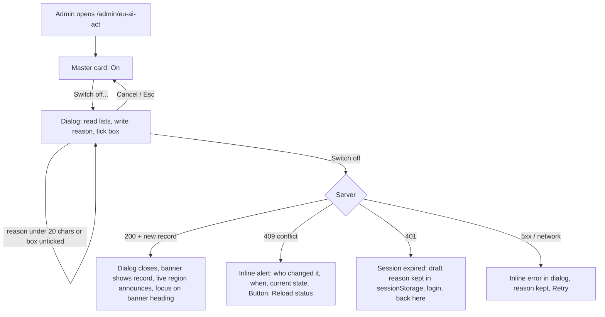

# EU AI Act master switch: UX and UI design

Scope: a deployer can switch off ALL EU AI Act features, with a recorded who/when/why, stored on the server. Fits the page `/admin/eu-ai-act` (`AdminEuAiActPage.jsx`, cards on `EuAiActCard`), the Advanced cards (`AiNoticeSettingsCard`, `AiAcknowledgementSettingsCard`), the users page (column + `AiAcknowledgementActions`) and `ModelFormEditor` (`contentMarking`). Paths relative to `client/src/`. German uses formal "Sie". Not legal advice; wording marked [LEGAL] needs legal review.
Naming decision: call it "EU AI Act features", not "conformity". iHub cannot confer conformity, and the page already says green means "configured as designed", not "compliant". "Conformity" stays in the concept docs only (Q1).

# PART A: UX

## A1. Decisions
| Topic | Decision |
|---|---|
| Home of the switch | First card on `/admin/eu-ai-act`, above "Configuration check". One place for switch, dialog, record, history. |
| Advanced | NOT a second switch. The two Advanced cards get a status note + link "Manage on the EU AI Act page" (both states). One dialog, one record, no divergent copies. |
| Disable friction | Modal with (1) exact list of what turns off / stays, (2) mandatory reason, min 20 / max 1000 chars with counter, (3) one required checkbox "I understand the legal duty stays with my organisation". No typed phrase (Q3). |
| Enable friction | Same Modal, no checkbox, reason optional (max 1000). Safe direction, but still a recorded event. |
| While off | Persistent banner card with who/when/why; other cards stay visible but paused (read-only, explained). No green anywhere on the page. |
| Record | Append-only events (disabled / enabled), newest first, never editable or deletable in the UI. Current state = latest event. |
| End users / integrators | Nothing visible. Features simply do not run (A8). |
Rule for other surfaces: hide = never (hidden settings read as deleted); disable = things that write or run something; explain = every settings surface.

## A2. Placement and navigation
1. `/admin/eu-ai-act` order: Master switch, Configuration check, Acknowledgements, Watermark keys, Provenance settings, Verification. h1 and honesty line unchanged.
2. Admin nav item "EU AI Act" gets a small `Badge` "Off" (warning tone) only while off, so the state is visible from every admin page. Nothing while on (no permanent noise).
3. Advanced: note at the top of both cards. On: "EU AI Act features are on. Switch them on or off on the EU AI Act page." Off: "EU AI Act features are switched off. These settings are saved but have no effect." Fields stay EDITABLE (preparing text is harmless; locking looks like lost settings).
4. Anchor `#conformity` on the card (existing `scroll-mt-4` pattern) for every "Manage" link.

## A3. Flow: disable

The "Switch off..." button (outline danger, ellipsis because it opens a dialog) opens the Modal. Initial focus = reason textarea (first interactive element; this is a form, not a yes/no, so Cancel is not the initial focus). "Switch off" is `aria-disabled` until valid; a visible hint beside it says what is missing, linked via `aria-describedby`. On success: dialog closes, state flips without reload, focus moves to the banner heading (`tabindex=-1`), live region announces.

## A4. Flow: enable again
Banner button "Switch on again..." opens a Modal: what resumes, optional reason (counter only), Cancel / "Switch on". After success the banner becomes the On card, history gets a row, and the card shows a neutral line "Nothing was recorded or marked from {from} to {to}" (the gap, for auditors). Acknowledgements are NOT re-requested automatically (Q5).

## A5. What the dialog lists (exact, from the requirement)
Turns off: AI guardrail in prompts (assistants no longer state they are an AI); first-turn notice; acknowledgement dialog and enforcement (users are neither asked nor blocked); provenance records and response metadata; text watermarking; image and audio marking; verification; configuration check (not evaluated).
Stays: acknowledgements already given; provenance records already written; watermark keys and encryption; all settings and texts (nothing is deleted); the history of this switch.
[LEGAL] "Switching off does not remove your organisation's obligations under the EU AI Act. The duty stays with you as the deployer. This is not legal advice."

## A6. Page while off
Banner (B2): status "Switched off", who, when (local time, UTC in `title`), reason (full text, 4 lines then "Show full reason"; plain text, `white-space: pre-wrap`, never HTML), buttons "Switch on again..." and a History disclosure.
| Card | While off |
|---|---|
| Configuration check | Replaced by "Checks are paused" + neutral "Not evaluated" badge. No traffic lights, no counts, no "All checks passed". Re-check hidden. |
| Acknowledgements | Counts stay (data is kept), caption "as of the day it was switched off"; CSV export stays (evidence). "Request again" and "Remove all" disabled (Q4). |
| Watermark keys | Table readable. Create/reveal/delete/self-test disabled. |
| Provenance settings | Fields `disabled`, values readable. |
| Verification | Input and file picker disabled, "Verification is switched off". |
Every paused card starts with the same note: icon + "Paused while EU AI Act features are switched off." + link "Switch on again" (anchors to the master card).
Other surfaces:
- Users page: column "AI acknowledgement" stays (historic data). A note above the filter: "AI acknowledgement is not asked while EU AI Act features are switched off. Values shown are from before." with link. The actions menu and the row action "Remove AI acknowledgement" are not rendered (the component already renders nothing when `settings.enabled` is false: drive it from the effective value, master AND own flag).
- Model editor `contentMarking` fields and app editor `AiNoticeSection`: stay editable, note at the top of the section "Marking is switched off platform-wide. This setting is saved and applies again when you switch the features on." plus link.
- Acknowledgements card's own "Acknowledgement is switched off" state (feature flag off) must be worded differently from master off: master off says "Paused while EU AI Act features are switched off".

## A7. History and record display
- `<details>` "History (3)" under the status, closed by default. `<table>` with caption: Event | Who | When | Reason. Newest first, 5 rows, "Load more" (cursor). Reason clamps at 2 lines with "Show full".
- Who = display name + login id ("Dana Meyer (dmeyer)"); stored as text, so a deleted user still reads. When = `<time datetime>` local, UTC in `title`.
- Reason: 20 to 1000 characters after trim for "off"; 0 to 1000 for "on" (empty shows muted "No reason given"). Visible to every admin, including the author. Hint under the textarea: "Visible to all admins and kept in the audit trail. Do not enter personal data or secrets."

## A8. End users and integrators
- Nothing visible changes: no banner, no message. The notice just no longer appears in new empty chats.
- Dialog open at the moment of disabling (cached "enabled"): the acknowledge call must succeed as a harmless no-op (engineer: accept it, normal success), dialog closes, held message is sent as today (existing UX brief 2.3). Never show an error for this.
- Pane cached "enabled" (open chat, Office add-in, embed): nothing breaks; sends no longer hit 428; stale UI vanishes at the next platform-config refresh (max staleness = existing cache; document it).
- Switched ON while a pane cached "disabled": the next send returns the normal 428 `ack_required`; the existing flow shows the dialog and keeps the typed text. No new handling.
- Integrators (`/v1`, embed, Office): no 428, no provenance metadata fields (absent, not null; engineer to confirm and document), no watermark. One line in the release note.
- Conversation in progress: the guardrail is dropped from the next request on; nothing is shown.

## A9. States
- Loading: skeleton in the master card (`aria-busy`, sr-only "Loading status"); other cards load independently as today.
- Saving: confirm shows spinner + "Saving...", `aria-disabled`; textarea `readonly`; Esc/Cancel inactive during the call.
- Load error: `AdminLoadError` with Retry inside the card; the other cards render but state is UNKNOWN, so no paused/active claim, only the badge "Status unknown".
- Save error: inline `role="alert"` in the dialog, reason kept, Retry.
- Conflict (409, two admins): server returns the current record; alert "Another admin changed this at 14:02 (Lena K.). It is now switched off." Buttons "Reload status" (default, closes dialog, shows current state) and "Copy my reason" so typed work is not lost. Never create a second record for an already-reached state.
- Session expired (401): existing admin handling redirects to login; the draft reason is kept in `sessionStorage` (try/catch, per tab) and prefilled after return.
- Live region: one persistent `role="status" aria-live="polite"` on the page for success text; dialog errors use `role="alert"`.

## A10. Copy (EN / DE), keys `admin.euAiAct.master.*`
| Key | EN | DE |
|---|---|---|
| title | EU AI Act features | EU AI Act-Funktionen |
| on / off | On / Switched off | Eingeschaltet / Ausgeschaltet |
| onText | All EU AI Act features are active as configured below. | Alle Funktionen zum EU AI Act sind wie unten konfiguriert aktiv. |
| offTitle | EU AI Act features are switched off | Die Funktionen zum EU AI Act sind ausgeschaltet |
| offText | No guardrail, notice, acknowledgement, record, marking or verification is applied. Existing data is kept. | Es werden keine Schutzregel, kein Hinweis, keine Bestätigung, keine Nachweise, keine Kennzeichnung und keine Prüfung angewendet. Vorhandene Daten bleiben erhalten. |
| legal [LEGAL] | Switching off does not remove your organisation's obligations under the EU AI Act. The duty stays with you as the deployer. This is not legal advice. | Das Ausschalten entbindet Ihre Organisation nicht von ihren Pflichten nach dem EU AI Act. Die Pflicht bleibt bei Ihnen als Betreiber. Dies ist keine Rechtsberatung. |
| by / when / reason | Switched off by / When / Reason | Ausgeschaltet von / Wann / Begründung |
| showFull / showLess | Show full reason / Show less | Vollständige Begründung anzeigen / Weniger anzeigen |
| btnOff / btnOn | Switch off... / Switch on again... | Ausschalten... / Wieder einschalten... |
| dlgOffTitle | Switch off EU AI Act features | Funktionen zum EU AI Act ausschalten |
| dlgOffIntro | Please read what changes before you continue. | Bitte lesen Sie, was sich ändert, bevor Sie fortfahren. |
| offListTitle | This will be switched off | Dies wird ausgeschaltet |
| offList | AI rule in prompts (assistants no longer state they are an AI); first-turn notice; acknowledgement dialog and enforcement; provenance records and response metadata; text watermarking; image and audio marking; verification; configuration check | KI-Regel in Prompts (Assistenten nennen sich nicht mehr als KI); Hinweis vor der ersten Nachricht; Bestätigungsdialog und Durchsetzung; Nachweise und Metadaten in Antworten; Text-Wasserzeichen; Bild- und Audio-Kennzeichnung; Prüfung; Konfigurationsprüfung |
| keepTitle | This stays | Dies bleibt erhalten |
| keepList | Acknowledgements already given; records already written; watermark keys; all settings and texts; the history of this switch | Bereits erteilte Bestätigungen; bereits geschriebene Nachweise; Wasserzeichen-Schlüssel; alle Einstellungen und Texte; der Verlauf dieses Schalters |
| reasonField | Why are you switching this off? | Warum schalten Sie dies aus? |
| reasonHint | Visible to all admins and kept in the audit trail. Do not enter personal data or secrets. | Für alle Admins sichtbar und im Audit-Protokoll gespeichert. Geben Sie keine personenbezogenen Daten oder Geheimnisse ein. |
| counter | {{count}} of 1000 characters, at least 20 | {{count}} von 1000 Zeichen, mindestens 20 |
| needMore | Enter at least {{n}} more characters. | Geben Sie mindestens {{n}} weitere Zeichen ein. |
| ack | I understand that the legal duty stays with my organisation. | Ich verstehe, dass die rechtliche Pflicht bei meiner Organisation bleibt. |
| needAck | Tick the box to continue. | Setzen Sie den Haken, um fortzufahren. |
| confirmOff / cancel | Switch off / Cancel | Ausschalten / Abbrechen |
| dlgOnTitle | Switch EU AI Act features on again | Funktionen zum EU AI Act wieder einschalten |
| dlgOnIntro | Everything listed as switched off becomes active again immediately, with your saved settings. If enforcement is on, users who have not confirmed the current statement are asked at their next message. | Alles, was ausgeschaltet war, wird sofort mit Ihren gespeicherten Einstellungen wieder aktiv. Ist die Durchsetzung aktiv, werden Nutzende, die die aktuelle Erklärung nicht bestätigt haben, bei der nächsten Nachricht gefragt. |
| reasonOptional | Reason (optional) | Begründung (optional) |
| confirmOn | Switch on | Einschalten |
| savedOff | EU AI Act features switched off. Recorded for {{name}}. | Funktionen zum EU AI Act ausgeschaltet. Erfasst für {{name}}. |
| savedOn | EU AI Act features switched on. | Funktionen zum EU AI Act eingeschaltet. |
| gap | Nothing was recorded or marked from {{from}} to {{to}}. | Von {{from}} bis {{to}} wurde nichts aufgezeichnet oder gekennzeichnet. |
| paused | Paused while EU AI Act features are switched off. | Pausiert, solange die Funktionen zum EU AI Act ausgeschaltet sind. |
| checksPaused | Checks are paused. Nothing is evaluated while the features are off. | Prüfungen pausiert. Solange die Funktionen aus sind, wird nichts bewertet. |
| notEvaluated | Not evaluated | Nicht bewertet |
| history | History ({{count}}) | Verlauf ({{count}}) |
| evOff / evOn | Switched off / Switched on | Ausgeschaltet / Eingeschaltet |
| noReason / noHistory | No reason given / No changes recorded yet. | Keine Begründung angegeben / Noch keine Änderungen erfasst. |
| conflict | Another admin changed this at {{time}} ({{name}}). It is now {{state}}. | Ein anderer Admin hat dies um {{time}} geändert ({{name}}). Der Zustand ist jetzt: {{state}}. |
| reload / copyReason | Reload status / Copy my reason | Status neu laden / Meine Begründung kopieren |
| saveError | Could not save. Your reason is kept. Please try again. | Speichern nicht möglich. Ihre Begründung bleibt erhalten. Bitte erneut versuchen. |
| unknown | Status unknown | Status unbekannt |
| advOn | EU AI Act features are on. Switch them on or off on the EU AI Act page. | Die Funktionen zum EU AI Act sind eingeschaltet. Ein- oder Ausschalten auf der EU-AI-Act-Seite. |
| advOff | EU AI Act features are switched off. These settings are saved but have no effect. | Die Funktionen zum EU AI Act sind ausgeschaltet. Diese Einstellungen werden gespeichert, wirken aber nicht. |
Tone: factual; no "warning!", no "recommended" or "compliant", no encouragement either way.

## A11. A11y (WCAG 2.2 AA)
- Dialog: `Modal` (`role=dialog`, `aria-labelledby` title, `aria-describedby` intro, focus trap); focus returns to the trigger, or to the banner heading when the trigger is gone. `closeOnBackdropClick={false}` so a typed reason is not lost; Esc closes only when not saving.
- Destructive pattern: danger styling plus words ("Switch off"), never colour alone; confirm is the last tab stop, Cancel precedes it in DOM order.
- Lists are real `<ul>` under `<h3>`. The visual counter is `aria-hidden`; a sr-only twin updates only when crossing 20 or 900 chars (no per-key chatter). Hints are text linked by `aria-describedby`; `aria-invalid` only after a first attempt (3.3.1, 3.3.3).
- Banner is a labelled `<section>` with `<h2>`, not `role=alert` (persistent). Results via `role=status`, failures via `role=alert`.
- Targets at least 24px (2.5.8), visible focus (2.4.11, existing `focus-visible:ring-2`), no time limits. History `<table>` has `<caption>`, `scope`, `<time>`. Everything operable with native controls only.
- 360 px: no horizontal scroll, reflow at 320 px (1.4.10), 200% text resize safe (no fixed heights).

## A12. Open questions for the product owner
1. Q1 Name "EU AI Act features" instead of "conformity"? [LEGAL]
2. Q2 Who may switch: any admin, or a separate permission / four-eyes? Design assumes any admin.
3. Q3 Typed confirmation phrase? Not used (reversible; hostile to dictation and translation). Add if an audit-grade ceremony is wanted.
4. Q4 While off, may admins delete acknowledgements (erasure requests) and export CSV? Design: export yes, delete no. DPO to confirm.
5. Q5 On re-enable, re-request acknowledgements (version bump) or keep them? Design: keep.
6. Q6 Notify anyone on change (email, log export)? Not designed.
7. Q7 Is a 20-character minimum enough? No quality check is possible on free text.
8. Q8 "Off" badge also on the admin home, or only nav + page?
9. Q9 Time-boxed switch-off with auto re-enable? Not designed.

# PART B: UI

## B1. Reuse map
| Need | Reuse |
|---|---|
| Card shell | `euAiAct/EuAiActCard` (`id="conformity"`), classes `bg-white dark:bg-gray-800 border-gray-200 dark:border-gray-700 rounded-lg` |
| State chip | `shared/components/Badge` (`tone`, `icon`): on = `info` + `power`; off = `warning` + `exclamation-triangle`. `CheckStatus` is for per-check levels, not for this |
| Dialogs | `shared/components/Modal` (form content). `ConfirmDialog` has no form slot, so not used here |
| Fields | label/textarea/checkbox classes from `AiAcknowledgementSettingsCard` (`rounded-lg`, `focus-visible:ring-2 focus-visible:ring-indigo-500`) |
| Buttons | indigo `BUTTON` for "Switch on"; danger `bg-red-600 hover:bg-red-700 text-white`; outline `border-gray-300 dark:border-gray-600` |
| Errors | `AdminLoadError`; inline alert = the note style in B7 |
| StatusDot | not used (dot only; the state needs icon and word) |
New: `euAiAct/ConformityCard.jsx`, `ConformityDialog.jsx` (`mode="off"|"on"`), `ConformityHistory.jsx`, `ReasonField.jsx` (textarea + counter), `PausedNote.jsx`, shared `EuAiActStateNote.jsx`, hook `useEuAiActConformity.js`.

## B2. Status card
- On: normal white card. Header: h2 "EU AI Act features" + `Badge info "On"` + right-aligned `Switch off...` (outline red). Body: one grey line (`text-sm text-gray-600 dark:text-gray-400`). No green: green stays with real check results.
- Off: same card, `border-l-4 border-amber-500 dark:border-amber-400`, header `bg-amber-50 dark:bg-amber-900/20`, 24px `exclamation-triangle` + h2 "EU AI Act features are switched off" (`text-amber-900 dark:text-amber-100`) + `Badge warning "Switched off"`. Body `<dl>` (term column 7rem from `sm`, stacked at 360): Switched off by | When | Reason, then the legal note and buttons.
- Never use `opacity` on text in paused states (kills contrast).

## B3. Wireframe: page while ON
```
EU AI Act (Art. 50)
Is this installation set up for ... A green check means "configured as designed"...
+--------------------------------------------------------------------------+
| EU AI Act features  [(o) On]                          [ Switch off...  ] |
| All EU AI Act features are active as configured below.                   |
| > History (2)                                                            |
+--------------------------------------------------------------------------+
| Configuration check ... | Acknowledgements | Watermark keys | Provenance |
| settings | Verification   (all unchanged)                                |
```

## B4. Wireframe: disable dialog (desktop `max-w-lg`; body scrolls, footer fixed)
```
+----------------------------------------------------------+
| Switch off EU AI Act features                            |
| Please read what changes before you continue.            |
|----------------------------------------------------------|
| This will be switched off        This stays              |
|  - AI rule in prompts             - Acknowledgements given|
|  - First-turn notice              - Records written      |
|  - Acknowledgement dialog         - Watermark keys       |
|  - Records and metadata           - All settings, texts  |
|  - Text watermarking              - History of this switch|
|  - Image and audio marking                               |
|  - Verification, config check                            |
| (i) Switching off does not remove your organisation's    |
|     obligations ... This is not legal advice.            |
| Why are you switching this off? *                        |
| +------------------------------------------------------+ |
| |                                                      | |
| +------------------------------------------------------+ |
| Visible to all admins ...             12 of 1000, min 20 |
| [ ] I understand that the legal duty stays with my org.  |
|----------------------------------------------------------|
| Enter at least 8 more characters.                        |
|                          [ Cancel ]  [ Switch off ]      |
+----------------------------------------------------------+
```
At 360 px: `mx-4 max-h-[90dvh]`, the two list columns stack ("This stays" below), counter moves under the hint, footer buttons stack full width (Cancel then Switch off, DOM order kept, no visual reordering). Textarea 4 rows (`min-h-24`, `resize-y`), no `maxLength` (a hard limit silently swallows pasted text): over 1000 the counter gets an icon + text "over limit" and confirm stays disabled. The legal note is an `info` block (blue, `information-circle`), not amber (it is not an alarm).

## B5. Wireframe: page while OFF with the record
```
+==[amber bar]===========================================================+
| (!) EU AI Act features are switched off        [(!) Switched off]       |
| No guardrail, notice, acknowledgement, record, marking or verification   |
| is applied. Existing data is kept.                                       |
| Switched off by   Dana Meyer (dmeyer)                                    |
| When              11 Nov 2026, 14:02 CET                                 |
| Reason            Pilot with internal data only, no output reaches       |
|                   third parties. Decision by CISO, ticket ABC-123.       |
|                   [Show full reason]                                     |
| (i) Switching off does not remove your organisation's obligations ...    |
| [ Switch on again... ]    > History (3)                                  |
+==========================================================================+
| Configuration check                           [ - Not evaluated ]        |
|  (i) Checks are paused. Nothing is evaluated while the features are off. |
| Acknowledgements    - Paused while ... switched off. [Switch on again]   |
|  12 confirmed (as of 11 Nov)   [Export CSV]                              |
|  [Request again] (disabled)  [Remove all] (disabled)                     |
| Watermark keys / Provenance settings / Verification: same note, readonly |
```
Paused card: `bg-gray-50 dark:bg-gray-900/40`, headings and text keep normal colours (gray-900 / gray-700 on gray-50, about 9:1 and better); only the disabled control gets `disabled:opacity-50` and a dashed border (inactive controls are exempt from 1.4.3). `PausedNote` = `minus-circle` icon + text + link at the top of the card body.

## B6. Wireframe: history
```
v History (3)
+--------------------------------------------------------------------------+
| Event            Who                  When               Reason          |
| (!) Switched off Dana Meyer (dmeyer)  11 Nov 2026 14:02  Pilot with ...  |
|                                                          [Show full]     |
| (o) Switched on  Lena K. (lkoch)      3 Nov 2026 09:10   No reason given |
| (!) Switched off Dana Meyer (dmeyer)  28 Oct 2026 16:45  Test import ... |
+--------------------------------------------------------------------------+
                                           [ Load more ]  (cursor, 5 per page)
```
Event cell = `Badge` with word always shown. Below `sm` the table becomes stacked `<dl>` cards per event (same data, no horizontal scroll). Empty: "No changes recorded yet."

## B7. Shared note (Advanced, model editor, app editor, users page)
`EuAiActStateNote`: `rounded-lg border px-4 py-3 text-sm flex gap-3`. On: `bg-gray-50 border-gray-200 dark:bg-gray-900/40 dark:border-gray-700` + `information-circle`. Off: `bg-amber-50 border-amber-300 text-amber-900 dark:bg-amber-900/20 dark:border-amber-700 dark:text-amber-100` + `exclamation-triangle`. One component keeps wording and styling from drifting. Data from `useEuAiActStatus` and the effective `enabled` flag in `PlatformConfigContext`.

## B8. Dark mode, contrast, motion
- Dark: card `dark:bg-gray-800`, amber header `dark:bg-amber-900/20`, text `dark:text-amber-100`, links `dark:text-indigo-300`, red button `dark:bg-red-700`. Verify every pair with the `a11y-audit` skill and the axe baseline (`tests/e2e/accessibility.spec.js`): text 4.5:1, borders/icons/focus rings 3:1.
- Light: amber-900 on amber-50 about 9:1; white on red-600 about 4.8:1.
- Reduced motion: no animated state change; skeleton `animate-pulse motion-reduce:animate-none`; focus move to the banner is instant (no smooth scroll); dialog without scale/slide under `prefers-reduced-motion`.
- Colour is never the only signal: icon shape, the word "Switched off"/"On", and position (amber bar on the first card).

## B9. Test hooks for the implementer
`data-testid`: `conformity-card`, `conformity-state` (on/off), `conformity-reason`, `conformity-confirm`. Unit: confirm stays `aria-disabled` under 20 trimmed chars or without the box; paused cards render the note and no enabled action; no success-tone element while off; conflict keeps the dialog open and the reason; EN/DE keys exist (`translation-keys-exist`). E2E: switch off, reload, banner still shows who/when/why; chat send gets no 428; switch on, 428 flow works again.
