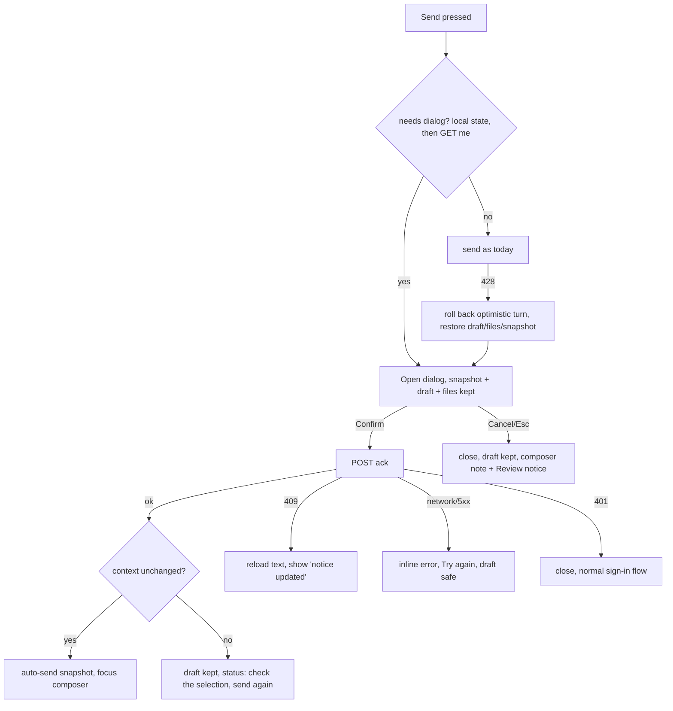

# AI-use acknowledgement in the client integrations: UX and UI design (epic #3324, step 2 follow-up)

Read against `origin/claude/ai-act-3329-admin-page` (contains #3326). Nothing in the checkout was changed. Web dialog = `features/chat/components/AiAcknowledgementDialog.jsx` + `shared/contexts/AiAcknowledgementContext.jsx`.

## 0. What the code actually does today (decides the scope)

| Surface | Real UI | Same React tree as | `AiAcknowledgementProvider` mounted? | Send path |
|---|---|---|---|---|
| Office task pane (`client/office/taskpane-entry.jsx`) | `OfficeApp` in `MemoryRouter`, no `AuthProvider`, no `Layout` (so no `DisclaimerPopup`). Outlook shipped; Word/Excel/PowerPoint only planned (`concepts/office-hosts-and-tools`). `docs/outlook-add-in.md` lists Outlook mobile as supported. Pane 280-600 px, root font 13-16 px (`office.css`), pop-out chat in an Office dialog | extension side panel | **No** | `OfficeChatPanel.submitMessage` -> `useOfficeChatAdapter` -> `useAppChat` |
| Browser extension (`browser-extension/`) | **Side panel only** (toolbar click opens it) + options page in a tab. No popup, no context menu, no content-script UI | Office pane (`sidepanel-entry.jsx` renders `OfficeApp`) | **No** | same as Office |
| Teams (`teams/`, `features/teams`) | Personal static tab = the full web app at `/teams/tab`, `TeamsWrapper` adds a container class | web app | **Yes** (`App.jsx` wraps `TeamsWrapper`) | `AppChat` (already gated) |
| Nextcloud (`nextcloud-app/`, `client/nextcloud/full-app-entry.jsx`) and `?embed=true` | NC page is only an iframe host (`height:100vh;min-height:600px`, no sandbox). Inside: full `<App/>` behind an OAuth gate. Embed mode = same app, chrome hidden | web app | **Yes** | `AppChat` |

Consequences:
- **Office pane + extension are the real build** (one change covers both, plus the pop-out). **Teams, Nextcloud and embed already reach the dialog**; their work is hardening (link opening, theme, short frames). Tell the PO: "not shown" is true for Office/extension only; verify the other three on the branch.
- Hand to the engineer (they change the experience, so listed here): (1) `isMachinePrincipal` exempts every token with `clientId`; Office, extension and Nextcloud users hold delegated OAuth tokens, so they are exempt today and never see 428. They must count as human clients. (2) `policyUrl` may be a path (`/page/ai-policy`): in the extension it resolves to `chrome-extension://...`, in a sub-path deployment it drops the base path. Return an absolute URL. (3) `anonymous = !auth?.isAuthenticated` is `true` when there is no `AuthProvider` (Office): the "browser session only" line would show to signed-in users. (4) If `GET /me` fails and a 428 follows, `handleAcknowledgementRequired` opens a dialog that never renders (`state` is null): the send hangs silently. Needs a "could not load" state (A5). (5) `submitMessage` clears input, files and strip before the 428 comes back and `onSendRefused` is not wired in Office: Cancel would lose the draft.

---

# PART 1: UX

## 1.1 Principles for every host
1. Same behaviour as the web: gate proactively on Send (nothing sent, nothing cleared), reactive on 428 as safety net, then auto-send once after Confirm.
2. The acknowledgement belongs to the **user** on the server, not to the client. Confirming in the web app, Teams, Word or the extension counts everywhere; no per-client record, no per-client text.
3. Before opening, re-ask the server once (`GET /me`): if another client confirmed meanwhile, skip silently. Also refetch when the pane regains focus (`visibilitychange`/`focus`) while a notice is pending. `BroadcastChannel` only syncs same-origin tabs (Office pane <-> web tab on the iHub origin; extension panels among themselves), so it is a bonus, not the mechanism.
4. Capture at Send press, not at Confirm. The pane does not block the host: the user can click another email, type in the document, switch tab while the dialog is open. Keep the snapshot the Send press produced (`mailSnapshot.buildSnapshotOverride()`, selection, page text). After Confirm auto-send **only if the context fingerprint is unchanged** (Outlook item id, page URL, document selection hash). Otherwise return to the composer with the draft and the strip updated, plus the status "What you selected changed while you were confirming. Check it, then send again." Never send email B's body under the question typed about email A.



## 1.2 Office task pane (Outlook; Word/Excel/PowerPoint when they ship)
- **Where to hook**: mount the provider in `taskpane-entry.jsx` around `OfficeApp` (and the pop-out root). Gate inside `submitMessage` *before* `adapter.sendMessage`/`setInputValue('')`. All entry points use it: Send, starter prompt with `autoSend`, resend, start-page handoff, so one gate covers them. Wire `onSendRefused` to restore text, uploaded files and the mail strip (the 428 path).
- **Start page handoff** (user typed on the start page, collected emails): the gate runs when the chat panel is ready. Cancel falls back to the existing "text placed in the input" behaviour; collected emails stay pinned.
- **Typed text, mail context, attachments**: untouched until the send really starts. The strip's edits (dropped attachments, "Include body" off) live in `mailSnapshot` and survive; they are part of the snapshot in 1.1.4.
- **Cancel / Esc**: close, focus the composer textarea, show the note above the composer "Please confirm the AI-use notice to send messages. [Review notice]" (`role=status`). Send again reopens. Review later without having cancelled: add "AI-use notice" to the pane menu (next to Settings, shown only when the feature is on). Opening it when already confirmed shows the same text read-only with one "Close" button.
- **Ask-only** (enforcement off): footer "Continue without confirming" instead of Cancel, remembered for the pane session (`sessionStorage`, try/catch as elsewhere in the pane); nothing stored on the server.
- **Anonymous**: not possible, the pane requires the OAuth sign-in. Never show the anonymous line.
- **Policy link**: `openExternalUrlSettled()` (Outlook: `Office.context.ui.openBrowserWindow` = system/new browser tab). Wording "opens in your browser", not "new tab". If it returns false, or in the pop-out (`canConfirmExternalOpen()` false), show the address below the link as selectable text with a Copy button (same pattern as `office.openInWeb.fallback`). The dialog stays open. Outlook mobile: unverified whether `openBrowserWindow` exists, the fallback covers it.
- **Keyboard/SR**: Modal's trap and Escape work in WebView2; F6/Ctrl+F6 host navigation is not captured by the trap. Focus starts on the h2, so Narrator/JAWS/NVDA read name then text; the text region is focusable (`tabIndex=0`) for scrolling. On close, focus goes to the composer textarea explicitly (the Send button is disabled while processing, so "return to opener" would drop focus to `body`). Success is announced through the existing polite `role=status` ("Confirmed. Sending your message.").
- **Pop-out chat** (Office dialog): same dialog inside the dialog window; the policy address is always shown (the pane opens the browser without a gesture); `GET /me` runs with the shared tokens.

## 1.3 Browser extension side panel
- Same panel code, same behaviour as 1.2. Differences:
  - Context is the active tab ("Include page" toggle, selection). The tab can change while the dialog is open: fingerprint = tab URL plus selection text; changed -> no auto-send (1.1.4).
  - Policy link: `chrome.tabs.create` via `openExternalUrlSettled` (a new tab next to the panel; the wording "opens in a new tab" is right here). A refused tab resolves false -> show address + Copy.
  - Panels in two windows: one `BroadcastChannel` on the extension origin closes the other panel's dialog when one confirms (see 1.1.3).
  - Options page (tab) gets no dialog; it has no chat. If the notice is pending, the panel shows the composer note only after a Cancel, nothing in options.
- No toolbar popup or context menu exists, so no other entry points need handling. If "Phase 2" adds a context-menu "Ask iHub about selection", it must call the same `ensureAcknowledged` before sending.

## 1.4 Microsoft Teams tab
- Already gated by `AppChat`. Behaviour = web (1.1). Users are always signed in (SSO) so no anonymous line.
- Link: `<a target=_blank>` works in the Teams desktop client (opens the default browser) but may be blocked on some mobile/web shells. Prefer `app.openLink` from teams-js when the tab runs in Teams (`isTeamsEnvironment()`), falling back to the anchor. `package.json` has teams-js 2.x while `TeamsWrapper` uses v1 call names: verify `openLink` is reachable before relying on it. Add the policy host to the manifest `validDomains` (documented in the Teams deployment guide), otherwise Teams may refuse the navigation.
- If the link is blocked show the address + Copy (same fallback component).
- Teams themes: see 2.4. Mobile Teams: tab is a full-screen WebView, the dialog goes full screen (<=480 px rule already exists).

## 1.5 Nextcloud iframe and `?embed=true`
- Already gated by `AppChat` inside the frame; the dialog is modal **only inside the iframe**. Nextcloud's own chrome stays clickable: if the user leaves via the Files app the page unloads and the draft is lost like any navigation. Not solvable here; the composer draft is not persisted by the embed. Note in docs.
- Files selected in Nextcloud (hash/postMessage -> `useNextcloudEmbedAttachments`) stay attached while the dialog is open; a selection change under the dialog adds/removes attachments, the auto-send uses the list at Confirm time (visible in the composer after the dialog closes, so no surprise).
- Link: iframe without `sandbox`, so `target=_blank` opens a normal tab. A host that sandboxes without `allow-popups` (embed mode in other portals) gets the address + Copy fallback; detect by `window.open` returning null with a user gesture.
- Anonymous guests are possible only in `?embed=true` with `anonymousAuth`: show "This confirmation applies to this browser session only." Third-party-cookie blocking can drop the guest cookie: then the user is asked again on every start, which is acceptable (the chat itself needs that cookie, `GUEST_COOKIE_MISSING`). Nextcloud embed users are OAuth-signed-in, so never anonymous.

## 1.6 Microcopy (EN/DE) and keys
Reuse unchanged: `aiAcknowledgement.title, confirm, confirmAndSend, skip, saving, retry, error, stale, anonymousNote, composerNote, review, confirmed, sending, policyLink`, `common.cancel/close/copy/copied`. Texts come from the server (`/me`, localized text + policy label), so host and language switch (Office uses `officeLocale`; make sure `GET /me?language=` gets the pane language).

New keys (each with a default string, add to `shared/i18n/en.json` and `de.json`):

| Key | EN | DE |
|---|---|---|
| `aiAcknowledgement.opensInBrowser` | (opens in your browser) | (öffnet im Browser) |
| `aiAcknowledgement.policyBlocked` | The policy could not be opened. Copy the address and open it in your browser. | Die Richtlinie konnte nicht geöffnet werden. Kopieren Sie die Adresse und öffnen Sie sie im Browser. |
| `aiAcknowledgement.contextChanged` | What you selected changed while you were confirming. Check it, then send again. | Ihre Auswahl hat sich geändert, während Sie bestätigt haben. Bitte prüfen Sie sie und senden Sie erneut. |
| `aiAcknowledgement.loadFailed` | The notice could not be loaded. Check your connection and try again. | Der Hinweis konnte nicht geladen werden. Prüfen Sie Ihre Verbindung und versuchen Sie es erneut. |
| `aiAcknowledgement.confirmedOn` | You confirmed this notice on {{date}}. | Sie haben diesen Hinweis am {{date}} bestätigt. (only if `/me` returns the date; else omit) |
| `office.menu.aiNotice` | AI-use notice | KI-Hinweis |

## 1.7 States (all hosts)
| State | Behaviour |
|---|---|
| loading text | Dialog opens at once with title and skeleton lines (`aria-busy`); never an empty dialog |
| submitting | Confirm shows spinner + "Saving...", both buttons disabled, Esc ignored until the round trip ends |
| error (network, 5xx, offline in Office) | inline `role=alert` `error` text, button becomes "Try again", draft safe |
| 409 stale text/version | reload text, show `stale` (`role=status`), user reads and confirms again; focus back on the h2 |
| `loadFailed` | dialog with `loadFailed` + "Try again" (re-runs `GET /me`) + Cancel; the send stays pending until one of them |
| 401 | close, hand over to the host's existing sign-in (`handleSessionExpired` in Office, `SESSION_EXPIRED_EVENT` in Nextcloud, silent refresh in the extension); draft kept; after sign-in the next Send gates again |
| confirmed elsewhere | close silently, continue the send |

## 1.8 Edge cases
- **Session expiry during the dialog**: Confirm gets 401 -> as above; never show the dialog to a signed-out pane (the pane's login screen wins).
- **Enforcement turned off meanwhile**: Confirm still stores; server stops sending 428. A pending dialog switches to ask-only buttons on the next `GET /me`; no error shown. Feature turned off: close silently and send.
- **Request again while the pane is open**: next Send gates on the 428 path; the optimistic turn is rolled back, draft restored, dialog shows the new text.
- **Two panes** (Outlook pane + pop-out, two extension windows, pane + web tab): one dialog per surface, each submits once; the second sees the first's result via refetch/BroadcastChannel and closes silently. A double POST of the same version is a server no-op, so a race is harmless.
- **Multiple pending sends** (double-click, starter prompt then Enter): one dialog, one resend per distinct message, none duplicated (provider already queues waiters).
- **Active generation in progress** when 428 hits a second send: do not touch the running turn; only the rejected one is rolled back.

---

# PART 2: UI

## 2.1 Recommendation: one responsive component, three small host adapters
Keep **one** `AiAcknowledgementDialog` (presentational, already responsive: stacked footer, full-width buttons, scrolling body). Do not fork per host. Add only:
- `tone`: `'indigo'` (web, Teams, Nextcloud, embed) or `'slate'` (Office pane + extension). The pane shell is slate (`bg-slate-900` primary buttons in `OfficeLogin`/`SettingsDialog`); an indigo button would be the only indigo in the pane.
- `compact` (boolean): smaller paddings, derived from the host kind, not from viewport media queries: the pane's viewport is the pane (media queries do work, but a 280-600 px resizable pane and iframes of any height are better served by `@container`; `.office-task-pane` already declares `container-type: inline-size`).
- `openPolicy(url) -> Promise<boolean>` injected by the host (`openExternalUrlSettled` for Office/extension, `app.openLink` for Teams, anchor default), plus a `PolicyFallback` (address + Copy) rendered when it resolves false.
- `readOnly` for "Review notice" after confirming (single Close button).
Same strings, same states, same a11y structure everywhere, which also keeps the audit story simple.

## 2.2 Layout and tokens (4 px grid)
- Built on `Modal` (`max-w-lg`, `closeOnBackdropClick={false}`, portal-free, `role=dialog aria-modal`). The pane overlay `bg-gray-600/50` is fine; the Office settings dialog uses `bg-black/40`: use the Modal default for consistency with the web (one consent look).
- Pane: panel `w-full`, outer `p-2` (8 px) instead of `p-4` below 400 px so the panel is ~344 px wide at 360. Header `px-4 pt-4`, body `px-4 py-3 text-sm leading-6`, footer `px-4 py-3`. Desktop/frames >= 480 px: web values (`px-6`, `py-4`).
- <= 480 px container or 400 % zoom: panel `max-h-[100dvh]`, `rounded-none`, full screen; `dvh` (not `vh`) so mobile browser bars and Outlook mobile do not clip the footer. The body keeps `max-h-[50vh]` only on tall viewports; in short frames (Nextcloud iframe, landscape phone) use `min-h-0 flex-1 overflow-y-auto` so header and footer stay visible and only the text scrolls.
- Buttons: stacked, full width, primary on top (`flex-col-reverse`), `min-h-11`. At the pane's 13 px root `min-h-11` is ~36 px (still above WCAG 2.5.8's 24 px); in compact mode use `min-h-[44px]` in px so touch (Outlook mobile, Teams mobile) stays 44. Buttons wrap, no fixed widths, no truncation.
- Icon disc `w-10 h-10` -> `w-8 h-8` in compact; hidden under 320 px.

## 2.3 Wireframes
360 px Office pane (dialog over the dimmed chat; composer and chat strip stay behind, inert):
```
┌────────────────────────────────────┐ 360
│ (dimmed chat: mail strip, messages)│
│  ┌──────────────────────────────┐  │
│  │ (i) Confirm your use of AI   │  │ h2, focus target
│  ├──────────────────────────────┤  │
│  │ This platform uses AI        │  │ scrolling region
│  │ systems. Their answers can   │  │ role=region, tabindex 0
│  │ be incorrect or incomplete…  │  │
│  │ Read the AI policy ↗ (opens  │  │
│  │ in your browser)             │  │
│  │ [policy address + Copy] *    │  │ * only when open failed
│  │ [!] error line, role=alert * │  │
│  ├──────────────────────────────┤  │
│  │ [   Confirm and send      ]  │  │ primary, full width
│  │ [   Cancel                ]  │  │ secondary
│  └──────────────────────────────┘  │
│ ┌────────────────────────────────┐ │
│ │ composer (inert while open)    │ │
└────────────────────────────────────┘
```
Desktop (web, Teams, Nextcloud frame >= 480 px):
```
        ┌─────────────────────────────────────────────┐ max-w-lg 512
        │ (i) Confirm your use of AI                  │
        ├─────────────────────────────────────────────┤
        │ text … (scrolls past ~50 % of the height)   │
        │ Read the AI policy ↗   This confirmation    │
        │ applies to this browser session only. *     │ * guests only
        ├─────────────────────────────────────────────┤
        │                  [ Cancel ] [ Confirm and send ] │
        └─────────────────────────────────────────────┘
```
Composer note after Cancel (pane, above the input, same slate text style as the pane notices, not red):
```
│ Please confirm the AI-use notice to send messages. [Review notice] │
```

## 2.4 Per-host look and theming
- **Office pane / extension**: tokens from the pane (`slate`): panel `bg-white dark:bg-slate-800`, text `text-slate-700 dark:text-slate-200`, borders `slate-200/700`, primary `bg-slate-900 text-white` / dark `bg-slate-100 text-slate-900`, link `text-indigo-700 dark:text-indigo-300` underlined (keep the link colour accent, it is the only affordance that must read as a link). Dark follows the pane's `data-theme="dark"` (Settings -> Appearance, "Automatic" follows the Outlook theme); no extra code, the `dark:` variant already keys on it. Pane is **light by default**: the dialog must look right on both. Outlook's own high-contrast mode: rely on `forced-colors` (below). The extension side panel gets the browser's colour scheme only through "Automatic".
- **Teams**: the dialog is rendered by the provider **outside** `.teams-container`, so the `.teams-container .bg-white` overrides do not reach it. Dark/contrast set the `dark` class and the `--teams-bg/--teams-text` variables on `<html>`, so `dark:` tokens work; for the contrast theme add a 2 px `--teams-border` outline on the panel and a visible focus ring (no reliance on fills). Do not recolour to Teams purple: only the page background/text variables are Teams-driven today. Teams theme changes after sign-in are not tracked (the handler lives in `TeamsTab`, which unmounts): known limitation, out of scope.
- **Nextcloud / embed**: the frame has its own theme (`mode=` / system), independent of Nextcloud's chrome; do not try to match NC colours. The host iframe background is `#fff`, so in a dark embed the first paint flashes white (host fix, one line, mention to the NC app owner). Overlay stays `gray-600/50`.
- Reduced motion: no transitions on the modal; spinner `motion-reduce:animate-none`, the "Saving..." text carries the state. Do not add fade/slide in any host.
- Forced colors (Windows high contrast in Office/Teams/Edge): add `forced-colors:border forced-colors:border-[CanvasText]` on the panel and buttons, `forced-colors:outline` on focus; do not use icons or fills alone to mark the primary button.

## 2.5 Contrast and focus (computed WCAG ratios)
| Pair | Ratio | Use |
|---|---|---|
| white on indigo-600 | 6.3 | web primary |
| indigo-700 on white / indigo-300 on gray-800 | 7.9 / 7.4 | policy link light / dark |
| gray-700 on white / gray-300 on gray-800 | 10.3 / 10.0 | body text |
| slate-100 on slate-900 / white on slate-900 | 16.3 / 17.9 | pane primary dark / light |
| slate-500 on white / slate-400 on slate-800 | 4.8 / 5.7 | secondary notes (AA text) |
| indigo-500 ring on white / on gray-800 | 4.5 / 3.3 | focus ring (needs 3:1, 2.4.11/1.4.11 met) |
- Focus: `focus-visible:ring-2 ring-indigo-500 ring-offset-2` (offset colour per surface: white, `gray-800`, `slate-800`). The h2 target has no ring (programmatic focus only), the scroll region shows the ring when tabbed. Min 2 px, never `outline: none` without the ring.
- The error box is text + border + icon, not colour only. "Review notice" is a real button styled as a link.

## 2.6 Long strings and long policy text
- German runs ~30 % longer ("Bestätigen und senden", "Ohne Bestätigung fortfahren"): two-line buttons are normal; `text-balance` on the h2, `break-words` on the body and on the policy address (URLs have no break points; `[overflow-wrap:anywhere]` in the fallback box).
- Admin text of 5-10 k characters: scroll region, no truncation, no "read more", no scroll-to-end gate (a disabled primary is a known trap). Scroll shadow or a top border on the footer shows that more text exists; keep the footer visible at all times (flex layout, only the body scrolls). Paragraphs keep `whitespace-pre-line`; the text is rendered as text, never HTML.
- Pane at 280 px: policy link and address wrap, Copy button drops under the address, nothing scrolls horizontally (the pane sets `overflow-x:hidden`, so overflow would silently clip: test it).

## 2.7 Placement relative to the Office chat panel
- Mounted at the root next to `OfficeApp` (a sibling, like the web provider next to `Layout`), `position:fixed; inset:0`, `z-50`, above the pane's header menu, notice strip and composer. No other pane dialog (settings, variables, apps) can be open when Send is pressed; if a 428 arrives while one is open (long-running send), queue the acknowledgement behind it, one modal at a time.
- The background is `inert` (Modal's trap); the composer note and the "AI-use notice" menu entry are the only persistent traces. The note sits in the same slot as the existing notice strip above `.office-chat-input` (it is a notice, not an error: neutral tone, no dismiss button, it disappears on confirmation).
- The pane header's progress/"processing" state is cleared on rollback, so no stuck spinner behind the dialog.

## 2.8 Open questions for the PO
1. Confirm that Office/extension/Nextcloud OAuth users count as human principals (server change, otherwise this design never triggers).
2. Review-later entry: pane menu item (proposed) acceptable, or composer note only?
3. Auto-send after Confirm when the context changed: proposed "do not send, keep draft" (safer; costs one click). OK?
4. Word/Excel/PowerPoint are not built yet: this brief covers them through the shared panel; confirm no host-specific copy is wanted ("document" vs "email").
5. The legacy `DisclaimerPopup` does not exist in Office/extension; Teams, Nextcloud and embed still show it first (queue logic already in the provider): confirm the stacking is acceptable for first-time Teams users.
