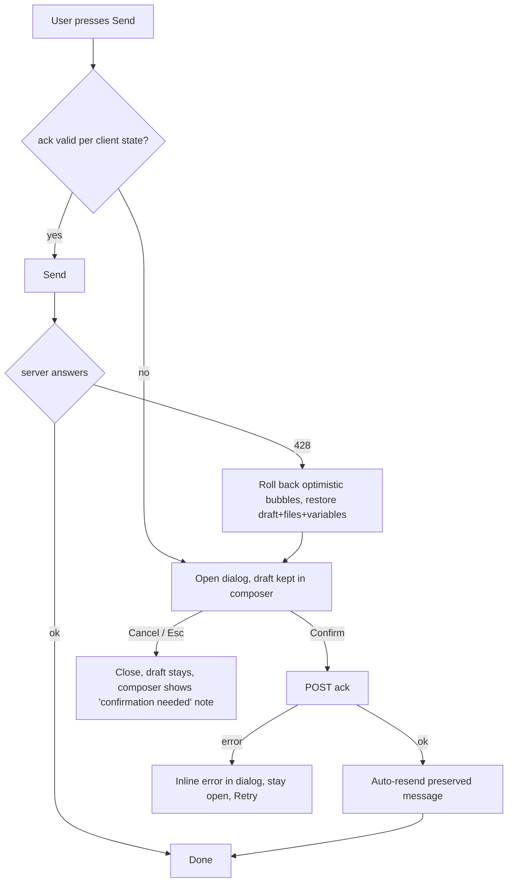

# UX brief: EU AI Act Art. 50 (epic #3324): #3325, #3326, #3329

Scope: interaction, flow, content, a11y (WCAG 2.2 AA, BFSG). Visual styling is left to the UI designer; token names below only reuse what exists. Paths are relative to `client/src/`. i18n keys go in `shared/i18n/{en,de}.json` (German uses formal "Sie").

## 0. What exists today (the design must fit this)
- `AppChat.jsx` `startupView()` (l.~170) picks ONE empty-state view: `StarterPromptsView` -> `GreetingView` -> `NoMessagesView`. A notice must be a sibling around this switch, or it vanishes whenever an app has starter prompts.
- `AIDisclaimerBanner` already shows after the first message, under the composer (AppChat l.~3012, text from `uiConfig.disclaimer.hint`). The new notice is its "before the first message" twin. Two texts, two config keys: keep distinct, but check wording does not contradict (Q1).
- `shared/components/DisclaimerPopup.jsx` is a blocking `alertdialog` mounted in `Layout.jsx` (l.~234), stored in localStorage. The #3326 dialog is a second blocking dialog: they must never stack (see 2.7).
- Dialog primitives: `shared/components/Modal.jsx` (`role=dialog`, focus trap, Esc, `initialFocusRef`, `closeOnBackdropClick`, `labelledBy`), `ConfirmDialog.jsx` (`alertdialog`, focuses Cancel, `danger`, portal to body), `shared/hooks/useFocusTrap.js`.
- Send path: `handleSubmit` (AppChat l.2438) is the single gate; send errors are caught in `features/chat/hooks/useAppChat.js` l.~348-385 and today are APPENDED to the assistant placeholder (`CHAT_REFUSAL_MESSAGES` table keyed by `error.code`). That behaviour is wrong for 428 (see 2.3).
- Admin: `features/admin/pages/AdminUsersPage.jsx` (`DataTable` columns/actions l.~129-165, `FilterSelect`, `ConfirmDialog` via `setConfirmDialog`), `AdminAuditLogPage.jsx` `handleExport` (blob CSV download, `exporting` state), nav in `features/admin/components/AdminSidebarNavData.js` (Security item l.~347), `AdminLoadError`, `AdminEmptyState`, `AdminFormErrorSummary`, `AdminPageSkeleton`, `shared/components/StatusDot.jsx` (ok/warn/error/off, never colour alone), `Badge`, `Switch`, `Drawer`, copy-with-"Copied" pattern in `features/admin/components/integrations/editors/InstallationEditorParts.jsx` l.~284-329.
- Error codes: new `AI_ACKNOWLEDGEMENT_REQUIRED: 428` goes in `shared/apiErrors.js`; message key `apiErrors.AI_ACKNOWLEDGEMENT_REQUIRED`.
- Surfaces that send a turn: AppChat main composer, `ChatStartForm`, `ComposerDock`/workspace pane (`renderComposerDock`), compare mode, voice/transcription turns, `embedded` AppChat (Office/Nextcloud/Teams hosts, `useEmbeddedHostKind`), canvas page, workflow chat. `AppRouterWrapper.jsx` also has `redirect` and `iframe` app types that never reach AppChat. (Not verified: whether canvas and Office embeds mount `Layout`; check before placing the provider, Q2.)

---
## 1. #3325 First-turn AI notice

### 1.1 Decisions
- Passive, inline, in the empty-chat content, above the composer, ALWAYS visible (not a toast, not dismissible, no "don't show again": Art. 50(1) is about being informed, a dismissal control invites hiding it and adds a stored preference the issue excludes).
- UI chrome, not a message: never added to `messages`, never sent as context, never in export/share/print (`ExportDialog`, `ChatSharePanel`), never in the chat list preview. Shown iff `messages.length === 0`; a reopened chat with messages shows none (the existing banner takes over). A reopened empty chat shows it again (nothing was stored).
- Render beside, not instead of, the starter/greeting/no-messages view. Mobile: text sits directly above the composer so it is on screen with the keyboard closed.
- Visual weight: low-key info panel (icon + 1-3 lines), body text size (>= 14px), 4.5:1 in light and dark; not small print.
- Config: global `enabled` + localized text; per app three-way choice **Inherit / Custom text / Off** (radio group in the app editor, custom text uses `DynamicLanguageEditor`). Off per app needs an admin-visible hint on the #3329 page ("2 apps have the notice off", link to filtered apps list). Short inline markdown (links) allowed, same sanitising as `GreetingView` (DOMPurify + `marked.parseInline`). Soft limit 300 chars in the editor with a counter.

### 1.2 Flow
Open app/new chat -> empty state: notice + greeting/starters + composer. Type/click starter -> send -> first message exists -> notice unmounts (no animation needed; if animated, respect `prefers-reduced-motion`) -> banner appears under the composer. New chat ("reset") -> notice returns. If the ack dialog (#3326) is due, it opens on that same first send; the notice stays visible behind it.

### 1.3 States
Visible (global text) | visible (app text) | hidden (global off) | hidden (app off) | hidden (chat has messages) | loading (config not loaded: render nothing, never flash a wrong text; no skeleton) | text missing for current language: fall back to `en`, then to the built-in default (never render empty).

### 1.4 Microcopy
| | EN | DE |
|---|---|---|
| Default notice | You are chatting with an AI system, not a person. Answers can be wrong, so please check important information. | Sie chatten mit einem KI-System, nicht mit einem Menschen. Antworten können fehlerhaft sein, bitte prüfen Sie wichtige Informationen. |
| Icon label | (decorative, `aria-hidden`) | |
| Editor: global toggle | Show an AI notice before the first message | KI-Hinweis vor der ersten Nachricht anzeigen |
| Editor: app choice | Use platform notice / Custom notice / No notice for this app | Hinweis der Plattform verwenden / Eigener Hinweis / Kein Hinweis für diese App |
| Editor help | The notice is shown only in an empty chat. It is not saved and not sent to the AI. | Der Hinweis erscheint nur in einem leeren Chat. Er wird nicht gespeichert und nicht an die KI gesendet. |

### 1.5 A11y
- Container `<section aria-label="AI notice">` or plain `
` with icon `aria-hidden`; NOT `role=alert`/`status` (it is page content on load, an announcement on every navigation is noise). Placed before the composer in DOM order so browse mode reaches it first.
- Composer textarea gets `aria-describedby=<noticeId>` only while the notice is mounted: autofocus on load then reads it once for screen-reader users who go straight to the input (WCAG 3.3.2, 1.3.1). Removed with the notice.
- Links keep underline, visible focus (2.4.7, 2.4.11), 24x24 target (2.5.8). Reflow at 320px/400% zoom: text wraps, no truncation.
- Embedded narrow panes (Outlook task pane ~320px): same markup, no fixed widths.

### 1.6 Edge cases
- Starter prompt click auto-sends: ack dialog (if due) opens first; notice remains until a message exists.
- Compare mode (two panes): one notice for the page, not per pane.
- Apps with `type: redirect` / `iframe`: not our UI; out of reach (Q3). Chat-less apps (start-form-only, workflow runs): show the notice above the start form / run button, the "first turn" there is the form submit.
- Canvas/workspace pane: notice belongs to the chat column; if the chat column is collapsed (`ComposerDock` only), render the notice in the dock's empty state too.
- Voice conversation: a visual notice is not enough when the user only listens; Q4.
- Print/PDF/screenshot: no requirement, none.

### 1.7 Open questions
Q1 Merge with `uiConfig.disclaimer` or keep two keys? Q3 What do we claim for iframe/redirect apps (document as customer responsibility?). Q4 Spoken first turn in voice mode? Q5 Per-app "Off" allowed for all apps, or only non-conversational ones?

---
## 2. #3326 AI-use acknowledgement dialog

### 2.1 Architecture decision (UX-relevant)
One `AiAcknowledgementProvider` (mounted next to `DisclaimerPopup`) exposes `requestAcknowledgement({ reason }) -> Promise<boolean>`. Two triggers feed it, so every surface behaves identically:
1. **Proactive**: auth/status or UI config tells the client `{ enabled, enforcement, requiredVersion, acknowledgedVersion }`; `handleSubmit` calls the gate BEFORE adding the optimistic message. No wasted request, no error flash.
2. **Reactive (safety net)**: the API layer maps `428 AI_ACKNOWLEDGEMENT_REQUIRED` (stale tab, "Request again" while the page was open, other surfaces) to the same promise; the caller retries once on `true`.
Server stays the source of truth; client cache is only an optimisation (clear it on any 428).

### 2.2 Flow (enforcement mode)

### 2.3 What happens to the typed message (key point)
- Proactive path: nothing was sent, draft/attachments/variables/quote untouched; after Confirm, send them (the user pressed Send, that intent still stands). Button says "Confirm and send" when a message is waiting, plain "Confirm" when opened otherwise.
- 428 path: do NOT append an error text to an assistant bubble (today's `useAppChat` catch). Remove the optimistic user message + empty assistant placeholder, put text, attachments, variables, workspace quote back into the composer (same refs `handleResendMessage` already uses, `pendingVariablesRef`), then open the dialog. On Confirm: resend automatically, same chat id. If the chat was a fresh one, it must not appear in the chat list as an empty chat.
- Cancel: dialog closes, draft is intact, focus back to the composer textarea; a polite inline note above the composer: "Please confirm the AI-use notice to send messages. [Review notice]" (button reopens). Sending again simply reopens the dialog. No dead end, no data loss.
- Failure after Confirm (ack saved but resend fails): normal chat error handling; ack is not asked again.

### 2.4 Modes
| | Enforcement ON (default) | Enforcement OFF ("ask only") |
|---|---|---|
| Server | 428 without valid ack | never 428 |
| Dialog buttons | Confirm (primary), Cancel | Confirm (primary), "Continue without confirming" |
| Decline stored? | no | UI-only: remember for this browser session (sessionStorage, try/catch) so it is not re-asked on every message. Spec is silent, Q6 |
Feature OFF: no dialog, no notes. Anonymous: identical dialog, ack is per session; add one line "This confirmation applies to this browser session only." (not shown to signed-in users). Reload within the session does not re-ask (server session is truth).

### 2.5 States
Closed | open, idle | submitting (primary shows spinner + "Saving…", `aria-busy`, other controls inert, Esc ignored for ~1 s round trip) | success (closes; SR status "Confirmed." plus "Sending your message." if auto-resend) | error (network/5xx: inline `role=alert` in dialog, stays open, Confirm becomes "Try again", draft safe) | session expired 401 (existing session-expired flow, dialog closes) | stale version (ack POST rejected because `requiredVersion` moved: re-render with new text, notice "The notice was updated. Please read and confirm again.") | text load failure (show built-in default text + policy link; never block with an empty dialog) | multi-tab (confirmed elsewhere: `storage`/BroadcastChannel event closes the dialog silently, resends).

### 2.6 Dialog anatomy and a11y
- Use `Modal` (not `ConfirmDialog`: long content, not a destructive confirm). `role=dialog`, `aria-modal`, `aria-labelledby` = h2. `closeOnBackdropClick={false}` (accidental click must not discard the moment); Esc and Cancel close it (no keyboard trap, 2.1.2). Portal to `document.body` (as `ConfirmDialog`) so sticky/iframe ancestors cannot clip it.
- Order: h2 title -> text region -> policy link -> (anonymous note) -> footer (Cancel, Confirm). Header and footer fixed, only the text region scrolls (`max-h-[90dvh]`); on <=480px or 400% zoom the panel is full-screen. Footer buttons stack on narrow widths, no fixed widths (German is ~30% longer); every button label wraps.
- Initial focus: the h2 (`tabIndex=-1`, via `initialFocusRef`), so a screen reader announces name + starts the text, rather than landing on Confirm and skipping the content. Confirm is first in tab order after the link. Enter on Confirm confirms.
- Scrolling text region: `tabIndex=0`, `role=region`, `aria-labelledby` title (scrollable-region-focusable). NO scroll-to-end gating and NO required checkbox: a disabled primary button is a known a11y trap and adds a step; the explicit Confirm click is the affirmative act (Q7 for legal sign-off).
- Policy link: text "AI policy (opens in a new tab)" with `rel=noopener`, always a new tab (a same-tab navigation would lose the draft). In embeds use `openInNewTab` (as AppChat does) instead of `window.open`. Link URL is localized together with the text.
- Return focus: to the composer textarea (not the Send button, which is disabled while processing). Background gets `inert`/aria-hidden via the trap; page scroll locked.
- Text content: sanitised markdown (paragraphs, lists, bold, links), same renderer as `MarkdownRenderer`. Contrast and focus ring as elsewhere; dark mode via existing `dark:` tokens, no colour-only meaning.
- Screen-reader announcement on open: dialog name only ("Confirm your use of AI"); on success a polite `role=status` outside the dialog.
- Reduced motion: no slide/fade required.
- Never stack with `DisclaimerPopup`: if both are due, show Disclaimer first (it is global, on page load), the ack on the first send; if the disclaimer is open when a 428 arrives, queue the ack (single modal host).

### 2.7 Microcopy
| | EN | DE |
|---|---|---|
| Title | Confirm your use of AI | Nutzung von KI bestätigen |
| Default text | This platform uses AI systems. Their answers can be incorrect or incomplete. Please use them responsibly and follow your organisation's AI policy. | Diese Plattform nutzt KI-Systeme. Deren Antworten können falsch oder unvollständig sein. Bitte nutzen Sie sie verantwortungsvoll und beachten Sie die KI-Richtlinie Ihrer Organisation. |
| Policy link | Read the AI policy (opens in a new tab) | KI-Richtlinie lesen (öffnet in neuem Tab) |
| Confirm | I understand / Confirm and send | Ich habe verstanden / Bestätigen und senden |
| Cancel | Cancel | Abbrechen |
| Ask-only skip | Continue without confirming | Ohne Bestätigung fortfahren |
| Anonymous note | This confirmation applies to this browser session only. | Diese Bestätigung gilt nur für diese Browsersitzung. |
| Composer note | Please confirm the AI-use notice to send messages. | Bitte bestätigen Sie den KI-Hinweis, um Nachrichten zu senden. |
| Review button | Review notice | Hinweis ansehen |
| Saving / success | Saving... / Confirmed. Sending your message. | Wird gespeichert... / Bestätigt. Ihre Nachricht wird gesendet. |
| Error | Your confirmation could not be saved. Your message is still here. Try again. | Ihre Bestätigung konnte nicht gespeichert werden. Ihre Nachricht ist noch vorhanden. Bitte versuchen Sie es erneut. |
| Updated | The notice was updated. Please read it and confirm again. | Der Hinweis wurde aktualisiert. Bitte lesen und erneut bestätigen. |

### 2.8 Admin: platform settings
Fields: Feature on/off (`Switch`), Enforcement (radio: "Block sending until confirmed" / "Ask only, do not block"), title + text (localized, with live preview button opening the real dialog), policy URL + label (localized), read-only "Current version: N" + "Request again". Inline hint under the text field once confirmations exist: "Existing confirmations stay valid when you edit this text. Use 'Request again' to ask everyone again." (answers the typo case before the admin asks). Warn when enforcement is off: "Users can use the AI without confirming."

### 2.9 Admin: users page (`AdminUsersPage.jsx`)
- New column "AI confirmation" (only when feature on). Cell text, never colour only: `Confirmed, v2, 12 Nov 2026` / `Pending` / `Outdated (v1, v2 required)`; text hash only in CSV and the user view page, not in the table. Sortable (confirmed date). New `FilterSelect`: All / Confirmed / Pending (same values drive the CSV).
- Page-header actions next to the existing buttons, in one `MoreActionsMenu` "AI confirmation": Export CSV..., Request again, Remove all. Export has a small dialog: filter (All / Confirmed / Pending), helper "The file contains personal data.", button "Download CSV" (reuse `AdminAuditLogPage.handleExport`; busy state; failure shown with `AdminLoadError framed={false}`). German Excel: UTF-8 BOM, `;` vs `,` is an open point (Q8). Dates ISO 8601 in the file.
- Row action (kebab, priority secondary): "Remove AI confirmation" (only when the user has one). `ConfirmDialog`, not `danger`-red? It deletes evidence: use `danger`. Text: "Remove the AI-use confirmation of {{name}}? They will be asked again at their next message. The audit log keeps the history." Confirm "Remove confirmation".
- Request again (all): `ConfirmDialog`, neutral. Title "Ask everyone again?" Message "All users will be asked to confirm again at their next message (version {{n}} -> {{n+1}}). Existing confirmations are kept as history." Confirm "Ask everyone again". Result: polite status "Version is now {{n}}. Users are asked at their next message."
- Remove all: `ConfirmDialog` `danger`, shows the count ("{{count}} confirmations"), consequence and an "Export CSV first" text button inside the message; Cancel focused (already the component default). Q9 type-to-confirm?
- Anonymous confirmations are not in this table: add a one-line note under the filter "Confirmations of anonymous sessions appear only in the audit log." + link to `AdminAuditLogPage` filtered.
- States: loading (existing `DataTableLoadingRows`), empty (feature on, nobody confirmed: `AdminEmptyState` "No confirmations yet"), error on action (alert, table unchanged), success (status message, row updates in place without focus loss: after a row action focus moves to the row's kebab trigger, after "Remove" to the table caption).

### 2.10 Edge cases
428 on a non-chat endpoint (inference-like call from a tool page): same provider; if no UI context, show the error text via normal error path ("AI use must be confirmed first"). Parallel sends (double click, two panes in compare mode): single dialog, one resend per pending message, none duplicated. Admin acting while users are mid-chat: handled by 428 reactive path. Deleted/inactive user has stale ack: n/a. Slow policy site: link only. Very long text (5-10k chars): scrolls, no truncation, no "read more". Language switch while dialog open: text re-renders in the new language; the hash stored is of what was SHOWN at confirm time (server concern, flag Q10).

### 2.11 Open questions
Q2 Where is the provider mounted for Office/Nextcloud embeds? Q6 Ask-only decline memory. Q7 Is a checkbox demanded by customers' legal? Q8 CSV delimiter/locale. Q9 Type-to-confirm for Remove all. Q10 Which language's text is hashed/stored (the shown one)? Q11 Do inactive/locked users count in "pending"?

---
## 3. #3329 Admin page `/admin/eu-ai-act`

### 3.1 Page structure
`AdminLayout` page, `h1` "EU AI Act (Art. 50)", intro one-liner, then four `<section aria-labelledby>` cards with `h2`: **1 Configuration check, 2 Acknowledgements, 3 Watermark keys, 4 Verification**. Nav item in the Security group (`AdminSidebarNavData.js`, new key `eu-ai-act`, `showAdminPage('system')`, `ShieldCheckIcon`). No tabs. Cards load independently (status endpoint, acks, keys): one failing card shows `AdminLoadError framed={false}` with Retry and the rest stay usable; first load uses `AdminPageSkeleton`. Page title announces via `DocumentTitle`. Max width like other admin pages (`max-w-7xl`); cards stack on mobile, tables scroll horizontally inside a focusable wrapper (reflow exception).

### 3.2 Card 1: Configuration check
- Summary line (`role=status`, updated after each re-check): "5 of 8 checks OK, 2 need attention, 1 off." plus "Check again" button and "Last checked 10:12". Re-check re-runs live pings; button shows busy, rows show "Checking..." (skeleton text), results are announced ONCE as the summary, not per row.
- Rows (`<ul>`, one row each): `StatusDot showLabel` + check name + one-line finding + fix link naming its target ("Edit notice text", "Open model Llama 3.3", not "Fix"). Statuses and their meaning: **OK** works; **Needs attention (warn)** works but incomplete (enforcement off, provider-marked model without `statementRef`, retention not set, self-test not run since key change); **Problem (error)** broken (vLLM model without active key, detector unreachable, self-test failed); **Off (hollow ring)** deliberately disabled, neutral (feature off, marking `none`: spec says a hint, not a gate, so `none` is NOT yellow/red).
- Checks and wording (EN / DE):
  - Guardrail: "AI-identity rule is active in every channel" / "KI-Kennzeichnungsregel ist in allen Kanälen aktiv" (always OK; shown so the admin sees it cannot be disabled).
  - Notice: "First-message notice is set" / "Hinweis vor der ersten Nachricht ist gesetzt"; off -> "First-message notice is off" / "...ist ausgeschaltet"; fix link to platform settings.
  - Acknowledgement: one row, finding as text: "On, enforced, version 3" / "Ein, erzwungen, Version 3"; "On, ask only (not enforced)" -> warn; "Off" -> off.
  - Retention: "Provenance records are kept {{n}} days" / "Herkunftsnachweise werden {{n}} Tage aufbewahrt".
  - Models: collapsed table "Models (12)": Model | Marking (iHub / Provider / None) | Key | Detector | Self-test | Fix. Default shows models with marking != none first; "Show {{n}} models without marking" disclosure (`aria-expanded`). Row problems: "No active key" / "Kein aktiver Schlüssel"; "Detector not reachable (timeout after 5 s)" / "Detektor nicht erreichbar (Zeitüberschreitung nach 5 s)"; "Statement missing" / "Erklärung fehlt".
- `th scope`, caption, sortable not needed. Row-level status text is in the cell, the traffic light is decoration plus text.

### 3.3 Card 2: Acknowledgements
Three figures as a `<dl>` (Confirmed / Pending / Total; "Pending" = users below `requiredVersion`, including never asked; tooltip-free, definition line under it), current mode and version as text ("Enforced, version 3"). Actions: Export CSV (same dialog as users page), Request again, Remove all (identical dialogs and copy as 2.9; shared component), link "Open users list". Feature off -> empty state "AI-use confirmation is off" + link to settings; actions are not rendered. Counts exclude anonymous sessions (say so in the definition line). After an action, counts refresh and a polite status confirms; failures use an inline alert.

### 3.4 Card 3: Watermark keys
**Empty** (no key, no model marked "iHub"): "No watermark key yet. Keys are only needed for models marked 'iHub'." + "Generate key". **Table**: Key ID | Created | Status (text badge Active / Retired) | Actions. Exactly one Active row, listed first. Active: Reveal. Retired: Reveal, Delete. The Active row has no Delete (not a disabled button; a line under the table: "Retired keys can be deleted. The active key cannot."). Primary buttons above: "Generate key" and "Add own key...".
- **Generate / add flow**: (1) pre-dialog (neutral `ConfirmDialog`, only when a key is already active): "The new key becomes active. {{keyId}} becomes retired and is used for detection only. You must update vLLM afterwards." Confirm "Generate key". "Add own key" is a `Modal` form: key value (integer, `inputMode=numeric`, show/hide toggle, help "Must match the key in vLLM's --watermark-config"), key ID (prefilled suggestion `wm-2026-3`, editable, pattern + uniqueness checked inline); errors with `AdminFormErrorSummary`, `aria-invalid`, `aria-describedby`. (2) result `Modal` (`role=dialog`, focus on title): key ID, status line "Active", the snippet block, Copy button, reminder "Restart vLLM with this option, then run the self-test." and a caution "Anyone with this key can forge or strip the watermark. Do not paste it into tickets or chats." Buttons: Copy snippet (primary), Done. Esc/Done close; no forced "I saved it" checkbox (the key can be revealed again). (3) after close: focus on the new row, row has a text "New" badge, status message "Key {{id}} is now active. {{old}} is retired."; Card 1 re-checks and self-test of vLLM models shows "Not run since key change" (warn).
- **Snippet** in `<pre tabindex=0>` read-only (wraps; horizontal scroll focusable), light text on dark in both themes; content `--watermark-config '{"algorithm":"gumbel","key":123456789,"enforce":true}'`. **Copy**: button "Copy snippet" -> label "Copied" + `role=status` "Snippet copied to clipboard" (pattern in `InstallationEditorParts.jsx`), reverts after 3 s; if `navigator.clipboard` is missing/blocked (plain HTTP admin URLs are common on-prem), select the text and say "Copy failed. The snippet is selected: press Ctrl+C." Never log or toast the secret.
- **Reveal**: inline in the row, no confirm dialog (friction without protection; the admin already can see it). Visible helper above the table: "Showing a key is recorded in the audit log." Click "Reveal" -> fetched on demand (never in DOM while hidden), row expands with value + Copy snippet + "Hide"; auto-hides after 60 s and on leaving the page; status "Key shown. This was recorded in the audit log." Q12 if security wants a confirm.
- **Delete retired**: `ConfirmDialog danger`, names the key: "Delete retired key {{id}}? Text generated with this key can no longer be recognised as watermarked by this installation. This cannot be undone." / "Ausgemusterten Schlüssel {{id}} löschen? Mit diesem Schlüssel erzeugte Texte können von dieser Installation nicht mehr als markiert erkannt werden. Das lässt sich nicht rückgängig machen." Confirm "Delete key" / "Schlüssel löschen"; Cancel focused. After: focus to table caption, status message.
- **Detectors per model** (sub-table inside the card): Model | Detector URL | Token ("Set" / "Not set", never shown) | Self-test (last result + date) | Actions "Edit", "Run self-test". Edit opens a `Drawer` or `Modal`: URL (help: "Keys are sent to this URL. Use HTTPS or an internal network."; `http://` on a non-private host shows a warning), token (password field, write-only: "A token is set. Leave empty to keep it."), Save, "Save and test". TLS errors map to a fix hint: "The certificate is not trusted. Add the host to the SSL whitelist" + link (honours `ssl.domainWhitelist`).
- **Self-test**: button "Run self-test" (note "Uses about 300 tokens"). Running: button disabled with `aria-busy`, inline progress text in `role=status`: "1 of 2: generating sample text..." then "2 of 2: checking detector..."; can take tens of seconds; time-out at ~90 s -> error. Result block per model: **Passed** ("Detector recognised the watermark with key wm-2026-3"), **Failed: not detected** ("The sample text was generated but the detector did not find the active key. vLLM is probably running with another key or without --watermark-config. Update vLLM with the current snippet and run again."), **Failed: detector** (unreachable / 401 token rejected / TLS), **Failed: model** (generation failed), **Inconclusive** (warn: output too short, "Run again"). Details disclosure: tokens scored, p-value, key ID. After a key change the previous result is shown as "Outdated" until re-run.

### 3.5 Card 4: Verification (wording never over-claims)
- Input: radio group "Text" / "Image or audio file" (no tabs). Text: `textarea` + helper "Texts shorter than about 200 tokens cannot be judged." File: button "Choose file" (drag and drop is an extra, not the only way, 2.5.7), accepted types listed, size limit stated, chosen file name + Remove. Button "Check". Nothing stored claim only if backend confirms (Q13).
- States: idle | invalid input (inline, e.g. empty, too large, unsupported type) | checking (button busy, three check rows show "Checking...") | result | partial (one check failed: that row says "Could not be checked: {{reason}}", others show) | error (alert, input kept).
- Result = headline + one row per check, each with its own verdict. Announce the headline in a polite live region; focus stays on "Check" (user can read results via tab/browse; results container follows the button).
- Three independent checks, vocabulary fixed:
  1. **Output record (hash)**: Found -> "This exact text was generated by this installation on {{date}} by {{model}}." (output ID, marking status). Not found -> "No record of this exact text. It may have been edited, come from another system, or be older than the retention period ({{n}} days)."
  2. **Watermark detection**: Detected -> "Watermark detected. Technique: iHub text watermark (vLLM, Gumbel). Key ID: {{keyId}} ({{active/retired}}). p-value {{p}}, {{n}} tokens scored." Not detected -> "No watermark detected with the {{k}} keys held by this installation. This does not show that the text is not AI-generated: it may be edited, generated by another model, or generated without watermark (for example at temperature 0)." Too short -> "Too short to tell. Only {{n}} tokens could be scored; about 200 are needed. No conclusion." Not checked -> "No detector is configured." Error -> "Detector not reachable."
  3. **Content credentials (C2PA)** (images/audio): Found -> "Content credentials found: {{issuer}}, declared as {{AI-generated}}. Signature {{valid / could not be validated}}." None -> "No content credentials found. Many tools remove them, so this proves nothing about the origin."
- Words never used: "not watermarked", "human-written", "authentic", "fake", "safe". Headline mapping: any positive -> "Match found: see details."; all negative -> "No match found. This is not proof that the content is not AI-generated."; only inconclusive -> "No conclusion possible."
- Each positive/negative row shows icon + text status ("Detected", "Not detected", "Inconclusive", "Found", "Not found"); colour is secondary. p-value shown as written number plus plain phrase ("very unlikely by chance") only for detected results.
- DE: "Wasserzeichen erkannt" / "Kein Wasserzeichen erkannt. Das beweist nicht, dass der Text nicht von einer KI stammt." / "Zu kurz für eine Aussage. Nur {{n}} Tokens konnten bewertet werden, etwa 200 werden benötigt." / "Kein Treffer. Dies ist kein Beweis, dass die Inhalte nicht KI-erzeugt sind." / "Datensatz gefunden: Dieser exakte Text wurde am {{date}} von dieser Installation erzeugt."

### 3.6 Page-level a11y
`h1`/`h2` hierarchy, one live region for page-level status (separate polite region, not `aria-live` on whole cards), all icon-only buttons have names (`Reveal key wm-2026-2` includes the key ID, `Delete key wm-2026-1`, so a screen-reader button list is unambiguous), tables with captions and `th scope`, focus never lost on async update (return to the triggering control or the nearest stable heading), 24x24 targets, 3:1 non-text contrast (use `StatusDot` palette), dark-mode checks for the code block and badges, `prefers-reduced-motion` for spinners (static text remains). No timeouts that remove content before reading except secret auto-hide (announced; Reveal again restores).

### 3.7 Edge cases
Many models (50+): marked models first, others collapsed; self-test is per model, never "run all" in parallel (cost, vLLM load) but offer "Run all sequentially" later. No vLLM models: card 3 detector sub-table says "No model is marked 'iHub'" and card 1 omits model rows. Key changed in another admin session: list refetched on focus/Retry, a stale delete returns "already deleted" -> list refresh, no error. Retired keys: unlimited growth, no cap; sorted by created date. Provider-marked models: only the `statementRef` check; no key/detector. Non-admin or forbidden: existing admin guard. Status endpoint slow (live pings): render static checks first, rows with pings update when done. Secrets never in the page source, URL, `localStorage`, error messages.

### 3.8 Open questions
Q12 Reveal confirm? Q13 Does verify store pasted text? (needed for the privacy line). Q14 Upload limits and accepted audio/image types. Q15 Self-test cost accounting and whether results are persisted server-side (needed for "Last run"). Q16 Should "Remove all" additionally need the typed word? Q17 Where is the detector token edited if the model edit page also owns `contentMarking` (one place, link from the other)?

---
## 4. Cross-cutting checklist for implementers
- All strings via `t(key, fallback)`, EN + DE added together; keys `chat.aiNotice.*`, `chat.aiAcknowledgement.*`, `admin.euAiAct.*`.
- New code files need the SPDX header; new route needs no change in `KNOWN_ROUTES` (under `/admin`); new endpoints per `api-design` skill; `docs/` + `docs/releases/next/` entries via `/document-feature`.
- Tests worth writing: 428 rollback restores draft + resend once; Esc/Cancel keeps draft; focus returns to textarea; notice absent when `messages.length>0`; axe on dialog, 4 admin cards, both themes; keyboard-only run through generate -> copy -> done -> self-test; German strings at 320px.
