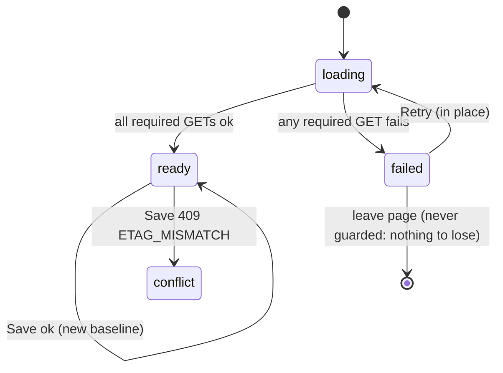

# UI/UX Brief: Admin "Now" phase — safety interactions

Panel role: senior UX designer (interaction design). Read-only review of current `main` on 2026-11-16. Every finding I rely on was re-checked against current code; where the code moved or the finding is already partly fixed, I say so.

---

## 1. Angle summary

- **A page that failed to load must not look like a page that loaded.** The single worst interaction in the admin is "error banner above an editable, saveable form filled with defaults" (ID-B1, IN-B1, IN-B6, OB-B1, OB-B2, PL-B3). Still true today: `AdminAuthPage.jsx:117-122` only sets a message, Save at `:263-265` is `disabled={saving}` only. The fix is structural: **the form is not rendered** until its data loaded; disabling Save is not enough (toggles still "work" and mislead).
- **Retry must be in place, not `window.location.reload()`.** `AdminLoadError.jsx:29` reloads the whole SPA. That drops unsaved edits in *other* sections of the same page, fires the browser's native `beforeunload` prompt, and against a 429 makes things worse. Retry must re-run only the failed request and honour `Retry-After`.
- **One unsaved-changes system, owned by the admin shell, not by each page.** `useUnsavedChanges.js` is good but page-local: every page renders its own dialog, two guards on one page stack navigator interceptors, browser Back (POP) is not intercepted at all, and **same-page query-string changes are intercepted too** (see UX-N1 below). 18 pages use it; Auth, Security, Logging, Telemetry, Voice, client pages, gateway, canvas do not (ID-B11, OB-B16, PL-B14, IN-B12, AX-B6).
- **Modals need the same guard, and Escape must close only the topmost layer.** `Modal.jsx:174-184` and `ConfirmDialog.jsx:49-59` both listen for Escape on `window` and neither checks `defaultPrevented`: a confirm opened over a modal closes *both* on one Escape (UX-N2). Backdrop click closes form modals (IN-B12).
- **Every confirmation names the thing, the scope and the consequence; the confirm button names the verb.** "Are you sure?" / "Confirm" / "this app" is what led to deleting the shipped registry during the review (AX-B14). 32 native `confirm()`/`alert()` calls remain in admin/workflow code.
- **Type-to-confirm is a scarce resource.** Use it only for actions that replace whole-system state or remove something with no restore path. Overused, admins type on autopilot and it protects nothing.
- **A server refusal is a normal outcome, not an error toast.** Last-admin, self-lockout and "group is inherited" refusals keep the form and the admin's edits, explain *why*, and point to the field to change. The client warns *before* Save using the same rule, so the refusal is the backstop, not the teacher.
- **The Overview must say "I couldn't load this" instead of pretending to be a fresh install** (SH-B2, SH-B3 — both still true: `useOverviewData.js:95` maps a rejected apps call to `[]`, `:159` then sets `isFreshInstance`; `AdminOverview.jsx:86,92` hard-code `done: true`).
- **All copy goes through i18n (en + de) from one template set**, so tone and structure are identical across ~45 pages.

### New issues found while verifying (not in the review)

| ID | Status | Issue | Evidence |
|---|---|---|---|
| UX-N1 | Suspected (code read, not run) | On `/admin/ui`, switching tabs while dirty calls `setSearchParams(..., { replace: true })` → `navigator.replace`, which the guard intercepts. Result: a "You have unsaved changes. Leave anyway?" dialog for a tab switch, and "Leave" does not discard anything. Contradicts `docs/admin-ui.md:362` ("A dot on a tab marks unsaved changes"). | `AdminUICustomization.jsx:87-90`; `useUnsavedChanges.js:60-71` (no pathname comparison) |
| UX-N2 | Confirmed (code) | Nested Escape: a `ConfirmDialog` over a `Modal` — Escape triggers both window listeners; the modal's (registered first) closes it. | `Modal.jsx:174-184`, `ConfirmDialog.jsx:49-59` |
| UX-N3 | Confirmed (code) | `ConfirmDialog` uses fixed ids `confirm-dialog-title` / `-message`; two open dialogs (unsaved guard + delete confirm) produce duplicate ids and a wrong accessible name. | `ConfirmDialog.jsx:79-80, 98, 104` |
| UX-N4 | Confirmed (code) | `/admin/ui` load failure is now gated (`!config` at `:217-227`, so CU-B5's "Save after failed load" is fixed) but it is a dead end: no title, breadcrumb or Retry, just red text. | `AdminUICustomization.jsx:217-227` |
| UX-N5 | Confirmed (code) | `AdminSettingsPage` has its own copy of the save bar with hard-coded English (`'Save changes'`, `'Saving…'`, `aria-label="Save bar"`, `"Settings sections"`), no `role="status"` on the dirty text, and an unconditional `animate-pulse` (no `motion-reduce`). `AdminSaveBar` already does all of this correctly. | `AdminSettingsPage.jsx:158-160, 208, 255-288` vs `AdminSaveBar.jsx` |

Already fixed since the review: CU-B4 for `/admin/ui` and Disclaimer (both now use `useUnsavedChanges` + `AdminSaveBar`); CU-B5 (gated, see UX-N4).

---

## 2. Now-phase plan from my angle

PR themes in the order I would ship them. "Approval" marks items that change shipped behaviour, a config shape or an admin API.

### PR 1 — Load-gating (ID-B1, IN-B1, IN-B6, OB-B1, OB-B2, PL-B3, CU-B5/UX-N4)

**Behaviour spec**



1. **Required vs optional sources.** Each page declares which GETs feed a Save. If any *required* one fails, the section that saves it is replaced by the error panel. Optional sources (schema for the JSON editor, group list for a picker) degrade the control that uses them only, with an inline note ("Group list unavailable — type group IDs"). Example: `AdminAuthPage` — `/admin/configs/platform` required; `/admin/groups` and the schema optional (`:89-104` already swallow them).
2. **What replaces the form.** Same page chrome (breadcrumb, H1, description) so the admin knows where they are, then `AdminLoadError` *in place of* the form body. No Save bar, no Save button, no Enable toggle, no JSON tab. Not rendered — not disabled.
3. **Panel content by failure class** (from problem+json `status`/`code`):

   | Class | Title | Body | Action |
   |---|---|---|---|
   | 429 `RATE_LIMITED` | Couldn't load {resource} | Too many requests right now. Nothing was changed. | **Retry** — disabled with countdown "Retry in 12 s" from `Retry-After` (fallback 10 s), then enabled |
   | 401 | Your session ended | Sign in again to continue. Nothing was changed. | **Sign in** |
   | 403 | You can't view {resource} | Your account has no access to this page. | **Back to Overview** (no Retry) |
   | 404 (edit pages) | {Type} "{id}" not found | It may have been deleted or renamed. | **Back to {list}** (no Retry) |
   | 5xx / network / timeout | Couldn't load {resource} | {detail}. Nothing was changed. | **Retry** |

   "Nothing was changed." is deliberate: it answers the admin's first worry.
4. **Retry** re-runs only the failed loads, shows the button's loading state ("Retrying…", `aria-busy`), keeps focus on the button, and on success moves focus to the H1 of the now-loaded form and announces "{Resource} loaded" via the page's polite live region. On repeated failure the panel updates its text; it is not re-mounted (no double announcement).
5. **Focus on failure.** On initial failure, focus is not stolen; the panel is `role="alert"` (already, `AdminLoadError.jsx:33`). On a failed *retry*, focus stays on Retry.
6. **Multi-section pages** (`AdminSecurityPage` with 7 independently saving sections, Logging with 3 GETs): gate per section, plus one summary banner at the top when ≥ 1 section failed: "{n} of {total} sections couldn't load. Retry all". Sections that loaded stay fully usable.
7. **Defence in depth.** Every save handler starts with `if (status !== 'ready') return;` (the shared hook does this), so a stale button cannot fire.

**Done means:** with every required GET of a page answered 500 / 429 / network-abort (Playwright route interception), the page shows no Save control, no editable input of that section, a Retry that re-requests without a full reload, and a test asserts *no* write request is sent after clicking every remaining control. One parametrised e2e test across all config pages, not one per page.

### PR 2 — Lockout / last-admin / self guards (ID-B1, ID-B2, ID-B3, ID-B4) — **Approval** (new refusals change admin API behaviour for scripted callers)

Verified today: `auth.js:660` checks `isLastAdmin` on DELETE only; PUT (`:507-553`) sets `active`/groups freely; `AdminUserEditPage.jsx:282` still sends `active: data.enabled !== false`.

**Rules (server is authority, client mirrors them as preflight):**

| Refusal code (new, `shared/apiErrors.js`) | Status | When |
|---|---|---|
| `LAST_ADMIN` | 409 | PUT user would remove admin rights from, or deactivate, the last active admin (same `isLastAdmin` as DELETE) |
| `SELF_LOCKOUT` | 409 | Admin deactivates themselves, removes their own admin-granting group, or saves an auth config where the method they are signed in with is off and no other admin-capable method stays on |
| `GROUP_INHERITED` | 409 | DELETE group that other groups list in `inherits`; `details.children: [ids]` |

409 (state conflict), not 400 (validation), so clients can branch on `code`.

**Client behaviour**

- **Preflight, before Save** (shared `useAdminGuards`): when editing yourself, the *Enabled* switch is disabled with helper text "You can't deactivate your own account." Removing your own admin group shows an inline amber warning under the field: "Without this group you lose access to Administration as soon as you save." Save stays enabled for that one (it might be intended if another group grants admin); the server decides.
- **Auth config:** the method you are signed in with carries a badge "You're signed in with this". Unticking it shows the inline warning; if no other admin-capable method is on, Save is replaced by the refusal text inline (preflight) — the admin never reaches a dead server refusal for the common case.
- **On a server refusal:** keep the form and every edit; do **not** show a toast. Render an error summary at the top of the form (`role="alert"`, focus moved to its heading) with: title, explanation, what to do, and a link "Go to {field}" that focuses the offending control. The Save bar returns to "You have unsaved changes".
- **Group delete refused:** the delete dialog stays open and switches to its "blocked" state: "Can't delete "{name}". {n} groups inherit from it: {list as links}. Remove it from their *Inherits* first." Only a **Close** button.
- **ID-B3:** the editor must send `active` only when the switch changed, and map `enabled` ⇄ `active` from the stored value. Done means: a disabled user edited only in email stays disabled (unit + e2e).

**Done means:** e2e with the default `admin` as only admin: demote self → 409 `LAST_ADMIN`, form intact, focus on summary; deactivate self → switch not operable; untick Local on `/admin/auth` while signed in locally → preflight message, no request sent; delete inherited group → blocked dialog listing children.

### PR 3 — No redacted or whole-file overwrites (PL-B4, CU-B3, OB-B10) — **Approval** for `If-Match` semantics (decision 6)

UX angle only:
- **A button saves what its label says.** "Save privacy settings" sends only privacy fields (OB-B10). If the page has other dirty fields, they stay dirty and the save bar still shows them.
- **Conflict UX** (once scoped PATCH + optional `If-Match` exist): on 409 `ETAG_MISMATCH`, an `alertdialog`: title "This changed since you opened it", body "{actor or 'Another admin'} saved {resource} at {time}. Your changes are not saved yet." Buttons: **Review changes** (default; opens the existing History diff drawer), **Reload and discard mine** (danger), **Cancel** (keeps form). Never auto-merge silently.
- "Don't show onboarding" (Advanced) and Provenance Save (PL-B4) are one-field actions: they should feel instant (optimistic switch + "Saved" status), which is only safe once they PATCH one field.

**Done means:** no admin action sends a body that was produced by a redacted GET (test asserts the POST body of each listed action contains only its own keys).

### PR 4 — Unsaved-changes guards everywhere (ID-B11, CU-B4, AX-B6, OB-B16, PL-B14, IN-B12, UX-N1, UX-N2)

**Exact behaviour**

| Trigger | Dirty? | Behaviour |
|---|---|---|
| Sidebar link, breadcrumb, in-page `<Link>`, programmatic `navigate()` to a **different pathname** | yes | Block, open the shell's "Leave without saving?" dialog |
| Same pathname, only `?query`/`#hash` changes (tabs, filters) | yes | **Allow**, no dialog (fixes UX-N1); state stays in memory |
| Browser Back/Forward (POP) | yes | Block: re-push the current entry, open the dialog; **Discard and leave** then calls `history.go(-1)` (or the recorded delta) with the guard suspended for that one transition |
| Reload, close tab, typed URL, external link in same tab | yes | Native `beforeunload` prompt (browser text; we cannot style it) |
| Sign out from the user menu | yes | Same in-app dialog first, then sign out |
| Session expiry (401 on save) | yes | Do not navigate; show "Your session ended. Sign in in a new tab, then Save again." and keep edits |
| `markSaved()` then `navigate()` in a save handler | — | Never blocked (keep the live-ref behaviour of `useUnsavedChanges.js:36-47`) |
| Load failed / still loading | — | Never dirty, never blocked |

**Dialog content (shell-owned, one instance):**
- Title: "Leave without saving?"
- Body: "Your changes to {sources} will be lost." where `{sources}` are the labels the dirty registrants gave (e.g. "SSL / TLS and CORS", "the app "HR assistant""). Fallback: "this page".
- Buttons: **Stay** (secondary, initial focus, Escape, backdrop) and **Discard changes** (danger red). Not "Leave"/"OK": the verb is what happens to the data.
- No "Save and leave" in Now (save can fail validation or be refused; that branch needs its own design — Next).

**Modals with forms** (Install integration, OAuth client create, model import, etc.):
- New `Modal` prop `isDirty`. When true: Escape and ✕ open a stacked confirm "Discard changes?" / body "What you entered in "{modal title}" will be lost." / **Keep editing** (focus) · **Discard** (danger). Backdrop click does nothing when dirty (no dialog; a stray click is not an intent).
- Default `closeOnBackdropClick` becomes `false` for any modal that contains form fields (pass explicitly; do not change the global default — read-only viewers rely on it).
- **Overlay stack:** only the topmost overlay reacts to Escape (UX-N2). Implement via a shared `useOverlayStack()` (push on open, pop on close; the handler checks `isTop` and calls `stopPropagation`).

**Multi-section pages:** `AdminSecurityPage` has one `AdminSettingsPage` with 7 sections that each save on their own. Each section registers its own dirty source with its label; the page nav marks dirty sections with a dot + visually hidden "(unsaved)" — the same pattern as the `/admin/ui` tabs.

**Done means:** a single parametrised e2e over every admin route that has an editable form: type one character, click a sidebar item → dialog naming the source; Back button → dialog; switch an in-page tab → no dialog; Discard → navigates, Stay → focus returns to the field that was edited last (or the trigger). Plus unit tests for the POP path and for Escape on stacked overlays.

### PR 5 — Named confirmations on `ConfirmDialog`; ESLint `no-alert` (PL-B1, PL-B7, PL-B8, OB-B7, OB-B8, AI-B2, AI-B12, AX-B14, IN-B3, ID-B15)

**Confirmation tiers (the rule an implementer applies):**

| Tier | Use when | Pattern |
|---|---|---|
| 0 — none | Reversible single-item change the admin can see and undo (toggle one app) | Act, then a status message with **Undo** for 8 s |
| 1 — named confirm | Irreversible single-item delete with no known dependants; reversible bulk action | Title names type + name; body states scope; verb button |
| 2 — dependency-aware | The item has dependants (client-detected list or server 409) | Tier 1 + "Used by" list (max 5 shown + "and {n} more"), loaded *in* the dialog |
| 3 — type-to-confirm | Replaces whole-system state, or removes something other users rely on that has **no restore path**, or is bulk + irreversible | Tier 1/2 + text field; confirm enabled only on exact match |

**Assignment for Now:**

| Action | Finding | Tier | Typed value |
|---|---|---|---|
| Backup **Import** (replaces all of `contents/`) | PL-B1 | 3, plus a preview step: file name, size, export date/version from the archive manifest if present | the instance hostname shown in a code chip |
| Delete marketplace registry | AX-B14 | 3 for shipped/official registries (no restore default), 1 for others | registry id |
| Delete group | ID-B4 | 2 (blocked state if inherited, see PR 2); 3 if the group grants admin | group id (tier 3 only) |
| Delete credential | IN-B3 | 2 — "Used by" installations; integration-owned secrets: blocked, "Managed by {integration}. Remove the integration instead." | — |
| Delete model / app / prompt / provider | AI-B12 | 1, or 2 when references exist (preferred/allowed models, linked prompts, apps-as-tools) | — |
| Enable all / Disable all (apps, models, prompts) | AI-B2 | 1 with count and list: "This enables 9 apps that are currently disabled: …". Disable all on Models adds: "The default model setting will be cleared." | — |
| Run audit cleanup now | OB-B8 | 1: "Delete audit entries older than {date}? {n} files, {size}." | — |
| Usage tracking mode change | OB-B7 | 1: body explains effect of the *new* mode; on failure an inline error, not a silent snap-back | — |
| Force client refresh | PL-B8 | 1: "All signed-in users' pages reload on their next action." (one consistent sentence for warning and success) | — |
| Rotate OAuth client secret | ID-B15 | 1, then `SecretRevealDialog` | — |

**Type-to-confirm details:** label "To confirm, type {token}" with the token in a `<code>` chip that has its own copy button (copying is allowed — the point is reading, not typing practice). Exact match after trim, case-sensitive. Tokens are ids/hostnames, never translated words (a German admin typing an English verb is friction with no safety gain). Initial focus on the field; Enter submits only when matched.

**Dialog states:** idle → (dependants loading: "Checking what uses {name}…", confirm disabled) → ready → busy (confirm shows spinner, both buttons disabled, Escape and backdrop ignored) → success (dialog closes, focus returns to the list row's successor or the list heading; polite status "{Type} "{name}" deleted") or error (dialog stays, inline `role="alert"` with the server detail; buttons re-enabled). If the dependants check itself fails: show "Couldn't check what uses {name}." and keep Confirm enabled — the server's 409 is the authority.

**`SecretRevealDialog` (ID-B15):** secret in a read-only monospace field, **Copy** button (status "Copied"), sentence "This is the only time the secret is shown. Store it now." Close button labelled **Done**. Escape/backdrop: if Copy was never pressed, the first attempt shows an inline warning "You haven't copied the secret yet. Close anyway?" and a second Escape/Done closes. Never `window.alert()`.

**PL-B7 (keyboard import):** use `UploadConfigButton` with a new `accept` prop; the visible button opens the picker; choosing a file opens the tier-3 dialog — it never uploads on `change`.

**Done means:** `no-alert` + `no-restricted-globals: confirm` error-level in ESLint for `client/src/features/**` and `client/src/shared/**` (allow-list the chat surfaces until Next if needed); every listed action's dialog title contains the item's name (e2e asserts by role + name); typed confirm tested with wrong / right / pasted input.

### PR 6 — Honest Overview (SH-B2, SH-B3) and docs deep links (SH-B1)

- Each KPI card and panel has its own state: skeleton → value / "—" with reason ("No usage data yet") / **error card** "Couldn't load apps" with a small **Retry**.
- When ≥ 1 request failed, a single banner above the KPIs: "Some information couldn't be loaded. The figures below may be incomplete." + **Retry all**. 429 → same countdown behaviour as PR 1.
- `isFreshInstance` is computed only from **successful** responses; a failed apps request never yields "fresh". (Change in `useOverviewData.js:95,159` and `:51,78`.)
- Checklist ticks come from real signals: "Admin account ready" is done only when the default `admin` password is no longer in use (the page already knows — it shows that warning); "Configure an LLM provider" done when ≥ 1 enabled model has a usable credential; "Create your first app" done when an app was created or edited beyond shipped defaults *or* simply hidden when apps > 0. The checklist is shown when ≥ 1 step is open and the admin hasn't dismissed it — not tied to `appCount === 0` (which a real install with 28 shipped apps never meets, SH-B3).
- Gated by nothing; changes no API.

**Done means:** with `/admin/apps` answered 429, the Overview shows the banner and an apps error card, no "Getting started 2/6"; on a fresh install with the shipped password the "Admin account ready" step is open and links to the user's edit page.

### PR 7 — Cancel interactions with their run (AX-B16) — UX note only

A cancelled run's approval disappears from Pending Approvals; if an admin has its detail open, it switches to "This run was cancelled. No decision is needed." with **Back to approvals** — never a 404 or a live Approve button.

### Out of my angle but touching it

Visual P1s (AI-B3, ID-B7, ID-B9, CU-B6…), contract bugs, privacy items: I only require that their fixes use the shared components below, so e.g. a new form field on Telemetry is automatically covered by load-gating and the guard.

---

## 3. Shared components, hooks and server layers

### 3.1 `useAdminConfigLoad` (new, `client/src/features/admin/hooks/`)

```js
const { status, data, errors, retry, retryAfterSeconds } = useAdminConfigLoad({
  sources: {
    platform: { load: () => makeAdminApiCall('/admin/configs/platform'), required: true },
    groups:   { load: () => makeAdminApiCall('/admin/groups'), required: false }
  }
});
// status: 'loading' | 'ready' | 'failed'   (failed = any required source failed)
// errors: { [source]: { status, code, detail } }
// retry(): re-runs failed sources only; no full reload
```

Closes ID-B1, IN-B1, IN-B6, OB-B1, OB-B2, PL-B3, UX-N4. `useAdminResourceEditor` already exposes `error`; add `status` and `retry` and let `AdminEditPageShell` consume them.

### 3.2 `AdminLoadGate` (new) + `AdminLoadError` changes

```jsx
<AdminLoadGate status={status} errors={errors} onRetry={retry}
               resourceLabel={t('admin.auth.resource', 'authentication settings')}>
  {/* rendered only when status === 'ready' */}
</AdminLoadGate>
```

`AdminLoadError` gains `onRetry` (replaces the `window.location.reload()` default at `:29`), `retryAfterSeconds`, `kind` (`'load' | 'save'`), and renders the action as a real secondary button (today it is unstyled text, `:44-50`, weak affordance and no visible focus ring). Keep `action` for "Back to …".

### 3.3 `AdminEditPageShell` changes

Add `error`, `errorStatus`, `onRetry`, `listHref`; when `error` render `AdminLoadGate` instead of children (404 → "not found" + Back). Remove its own `ConfirmDialog` (`:91-100`) once the shell provider owns the unsaved dialog.

### 3.4 `UnsavedChangesProvider` + `useUnsavedChanges` v2

```js
// In AdminLayout (and the workflow canvas layout):
<UnsavedChangesProvider>{outlet}</UnsavedChangesProvider>

// In a page or section:
const { isDirty, markSaved } = useUnsavedChanges(initialData, currentData, {
  label: t('admin.security.sections.ssl', 'SSL / TLS'),   // shown in the dialog
  enabled: status === 'ready'
});

// Imperative, for sign-out or custom flows:
const { confirmLeave } = useUnsavedChangesContext();   // Promise<boolean>
```

One interceptor, one dialog, POP handling, same-pathname passthrough, `beforeunload` while any source is dirty. Keep the signature backwards-compatible (the 18 existing callers keep working; `blocker` stays returned but becomes a no-op dialog driver). Closes ID-B11, CU-B4, AX-B6, OB-B16, PL-B14, IN-B12, UX-N1. Medium-term: migrating to a data router would allow `useBlocker`, but that is a routing change — Next, not Now.

### 3.5 `AdminSettingsPage` → use `AdminSaveBar`

Delete the inline bar (`:255-288`), render `<AdminSaveBar>`; i18n the nav label; accept `section.dirty` and `section.status` to show the dot and per-section load errors. Closes UX-N5, supports PL-B3/PL-B14.

### 3.6 `ConfirmDialog` v2 (extend, don't fork)

```ts
type ConfirmDialogProps = {
  isOpen: boolean;
  title: string;                       // "Delete model "GPT-4o"?"
  message?: ReactNode;                 // scope + consequence
  consequences?: ReactNode[];          // bulleted
  dependents?: { status: 'idle'|'loading'|'ready'|'failed', items: {label, href?}[], total?: number };
  blocked?: { reason: ReactNode };     // shows only a Close button
  typedConfirmation?: { token: string; label?: string };
  confirmLabel: string;                // REQUIRED in v2 call sites: verb + noun
  denyLabel?: string;
  danger?: boolean;
  busy?: boolean;                      // spinner, disables both buttons and Escape
  error?: string | null;               // inline alert inside the dialog
  onConfirm: () => void | Promise<void>;
  onDeny: () => void;
};
```

Ids via `useId()` (UX-N3). Uses the overlay stack. Closes AI-B2, AI-B12, AX-B14, IN-B3, OB-B7, OB-B8, PL-B1, PL-B8.

### 3.7 `useOverlayStack` (new, `client/src/shared/hooks/`)

Used by `Modal`, `ConfirmDialog`, `Drawer`. `{ isTop }`; Escape handled by the topmost only. Closes UX-N2. Add `Modal` prop `isDirty` + `dirtyConfirm` labels (IN-B12).

### 3.8 `SecretRevealDialog` (new, shared)

`{ isOpen, title, secret, onDone }` — see PR 5. Reused by OAuth create (`AdminOAuthClientEditPage.jsx:765-810` already has the pattern), rotate (`AdminOAuthClientsPage.jsx:356`), API keys. Closes ID-B15.

### 3.9 Server: guard layer

- `server/utils/adminGuards.js`: `assertNotLastAdmin(before, after)`, `assertNoSelfLockout(req.user, before, after)`, `assertAuthMethodKept(req.user, platformAfter)`, `assertGroupNotInherited(groupId)`; each throws `ServiceError` with the new codes. Called from users PUT/DELETE, groups DELETE, platform auth save.
- `shared/apiErrors.js`: add `LAST_ADMIN`, `SELF_LOCKOUT`, `GROUP_INHERITED` (409) and i18n `apiErrors.*` en + de so `apiErrorMessage()` (`client/src/utils/apiErrorMessage.js:19-28`) localises them automatically.
- Also expose the same rule as data for preflight: `GET /api/admin/auth/users/{id}` could include `guards: { isSelf, isLastAdmin }` — additive.

### 3.10 Microcopy templates (en; de must ship in the same PR)

| Key (proposed) | en | de |
|---|---|---|
| `admin.load.title` | Couldn't load {{resource}} | {{resource}} konnte nicht geladen werden |
| `admin.load.nothingChanged` | Nothing was changed. | Es wurde nichts geändert. |
| `admin.load.rateLimited` | Too many requests right now. | Gerade zu viele Anfragen. |
| `admin.load.retryIn` | Retry in {{seconds}} s | Erneut versuchen in {{seconds}} s |
| `admin.load.retry` | Retry | Erneut versuchen |
| `admin.load.partial` | {{failed}} of {{total}} sections couldn't load. | {{failed}} von {{total}} Abschnitten konnten nicht geladen werden. |
| `admin.unsaved.title` | Leave without saving? | Ohne Speichern verlassen? |
| `admin.unsaved.body` | Your changes to {{sources}} will be lost. | Ihre Änderungen an {{sources}} gehen verloren. |
| `admin.unsaved.stay` | Stay | Bleiben |
| `admin.unsaved.discard` | Discard changes | Änderungen verwerfen |
| `admin.confirm.deleteTitle` | Delete {{type}} "{{name}}"? | {{type}} „{{name}}" löschen? |
| `admin.confirm.irreversible` | This can't be undone. | Das kann nicht rückgängig gemacht werden. |
| `admin.confirm.usedBy` | Used by {{count}} items: | Wird von {{count}} Einträgen verwendet: |
| `admin.confirm.typeToConfirm` | To confirm, type {{token}} | Geben Sie zur Bestätigung {{token}} ein |
| `apiErrors.LAST_ADMIN` | Not saved: "{{name}}" is the last administrator. Give another active user admin rights first. | Nicht gespeichert: „{{name}}" ist der letzte Administrator. Geben Sie zuerst einem anderen aktiven Benutzer Administratorrechte. |
| `apiErrors.SELF_LOCKOUT` | Not saved: this would lock you out of Administration. {{hint}} | Nicht gespeichert: Damit würden Sie sich aus der Administration aussperren. {{hint}} |
| `apiErrors.GROUP_INHERITED` | Can't delete "{{name}}": {{count}} groups inherit from it. | „{{name}}" kann nicht gelöscht werden: {{count}} Gruppen erben davon. |

Style rules: say what happened, then what was *not* affected, then what to do. Verb buttons. No "Are you sure". No "Error:" prefix. Use the decision-11 terms (US English, "Benutzer"). German uses „…" quotes and formal "Sie" (match `de.json`). Plurals via i18next `_one`/`_other` keys.

---

## 4. Next / Later notes

- **Next:** "Save and leave" in the unsaved dialog (needs validation-aware flow); data-router migration so `useBlocker` replaces the navigator patch; draft persistence (apps, branding — decision 6) so "Discard" is not the only escape; conflict dialog with field-level diff once scoped PATCH exists; consolidate all list-page row actions (delete, duplicate, toggle) into one `AdminRowActions` that encodes the tiers.
- **Next:** Undo pattern (tier 0) as a shared `useUndoableAction` with server support for bulk toggles (AI-B2 "restore previous state").
- **Later:** read-only/auditor role (decision 5) needs a "view-only" form state — the load gate's `ready` should become `ready | readOnly`; design it now so the gate API has room.

---

## 5. Pre-mortem — "the rework shipped and failed"

| # | Failure mode | Mitigation |
|---|---|---|
| 1 | **Guard nags on every tab click.** The provider intercepts same-pathname query changes (UX-N1 generalised), admins learn to click "Discard" reflexively and lose real work. | Same-pathname passthrough is a unit-tested rule; e2e on `/admin/ui` tabs and filtered lists. |
| 2 | **False dirty on load.** Normalisation after load (defaults merged, `AdminAuthPage.jsx:113-116` spreads into a default object) makes `initialData !== currentData` → dialog appears without edits. | Baseline is the *normalised* object; test "open page, navigate away, no dialog" for every page in the parametrised e2e. |
| 3 | **Back button traps.** POP handling bugs (double entries, `go(-1)` landing wrong after multiple pops) leave admins unable to go back. | Track the delta; suspend the guard for exactly one transition; test Back, Back-Back, Forward. Kill switch: if POP handling throws, fall back to allowing navigation. |
| 4 | **New refusals break automation.** Scripts that rotate the last admin or delete groups get 409s after upgrade. | Release note in `docs/releases/next/`; user approval (flagged); `detail` text tells exactly what to do. |
| 5 | **Lockout guard has a hole** (OIDC-only admin; proxy auth; admin rights via inheritance) and still lets someone lock out, or wrongly refuses a valid change. | Guard uses the same resolved-group logic as `authorization.js`; test matrix: local, OIDC, proxy, inherited admin group, two admins. |
| 6 | **Load gate hides a usable page.** An *optional* source is marked required; a flaky schema endpoint now blocks the Auth page. | Each page's source list reviewed in PR; only sources whose data is written back by Save are required. |
| 7 | **i18n gaps.** New keys ship en-only; German admins see English or raw keys in safety dialogs. | Translation-key ratchet (SH-B13) runs on this PR; `de` written in the same commit; test that every new key exists in both. |
| 8 | **Typed confirm fatigue / friction.** Too many tier-3 dialogs; or the token (hostname) is long/unknown behind a proxy. | Tier 3 limited to the table above; token has a copy button; review the tier table before adding any new typed confirm. Fallback token when hostname is unavailable: `contents`. |
| 9 | **Stacked overlay regression.** `useOverlayStack` breaks Escape in chat dialogs or the Office task pane (shares `Modal`). | Roll the stack into `Modal` behind identical default behaviour for a single overlay; run existing a11y e2e (`tests/e2e/accessibility.spec.js`). |
| 10 | **Retry storms on 429.** In-place Retry on 7 sections fires 7 requests, extending the rate limit. | "Retry all" is sequential, honours the largest `Retry-After`, and is disabled during countdown. |
| 11 | **Docs drift.** `docs/admin-ui.md:528-530` still describes "leave or stay"; screenshots show old dialogs. | Docs PR in the same increment updates "Unsaved Changes", adds "When a page can't load" and "Confirmations" sections. |
| 12 | **Scope creep.** "While we're here" redesigns of each page during load-gating. | Load-gating PR changes only wrapping; visual changes go to the visual-P1 PR. |
| 13 | **Dependants check is wrong** (misses apps-as-tools), giving false comfort "not used anywhere". | Copy never says "not used anywhere"; with zero found it says nothing about usage. Server 409 remains the authority where it exists. |

---

## 6. Questions I have NOT asked

| Question | Why it matters | My default if unanswered |
|---|---|---|
| Are the new 409 refusals (last admin, self-lockout, inherited group) approved as a behaviour change for scripted callers? | CLAUDE.md: changes to admin API behaviour need approval. | Ship them; they only refuse states that are already broken or dangerous; release note. |
| Should an admin be able to deliberately remove their own admin rights if another admin exists? | Decides preflight warning vs block. | Allow with warning; block only when they'd be the last one. |
| What counts as "admin-capable sign-in method" under proxy auth (no local session)? | `SELF_LOCKOUT` for auth config depends on it. | Proxy auth counts if the current request arrived via proxy auth with admin groups. |
| Is the instance hostname stable/visible enough to be the backup-import token? | Tier-3 token choice. | Use `window.location.host`; fallback `contents`. |
| Does the backup archive carry a manifest (version, date)? | Import preview content. | Show file name/size only; add a manifest in Next. |
| Should "Discard changes" in the unsaved dialog be red (danger)? | Some teams reserve red for server-side destruction. | Red: losing typed work is destructive to the admin. |
| Is migrating to a data router (`createBrowserRouter`) on the table soon? | Would replace the navigator patch and POP hack with `useBlocker`. | No; implement POP handling in the provider now. |
| Do chat/user-facing surfaces (AppChat, Canvas) fall under the `no-alert` lint now? | They have `window.confirm` too (`AppChat.jsx:1677, 2023`). | Lint admin + shared only in Now; chat in Next. |
| Should a successful Retry auto-scroll/focus the form? | Could be disorienting for screen-reader users mid-page. | Focus the H1 only if focus was on the Retry button. |

---

## 7. Decisions I made on my own

1. **Not rendered beats disabled** for failed-load forms: a disabled form with default values still misinforms ("All valid"); hiding it removes the false signal.
2. **Retry is in place**; `window.location.reload()` is removed as `AdminLoadError`'s default. Reload loses other sections' edits and triggers `beforeunload`.
3. **"Nothing was changed."** appears in every load-failure message — it addresses the admin's first fear after the ID-B1 incident.
4. **409 for guard refusals**, not 400: they are state conflicts, not malformed input; clients branch on `code`.
5. **No toast for refusals or save errors** on forms: they disappear before screen-reader users and keyboard users can act; an in-form summary with field links is used instead.
6. **Same-pathname navigation is never guarded**; tabs and filters keep in-memory state.
7. **Two buttons in the unsaved dialog** (Stay / Discard changes), "Save and leave" deferred to Next.
8. **Backdrop click never closes a dirty modal and opens no dialog**; Escape and ✕ ask.
9. **Type-to-confirm tokens are ids/hostnames, never translated words**, and copy-paste is allowed.
10. **Dependants-check failure does not block** the action; the server is the authority.
11. **Bulk Enable/Disable all is tier 1, not tier 3**: reversible per item; the count + list is what was missing.
12. **German copy uses formal "Sie" and „…"**, matching existing `de.json`; terms follow decision 11's recommendations.
13. **Overview checklist visibility is decoupled from app count** and driven by real signals.
14. **One provider-owned unsaved dialog** replaces per-page dialogs, keeping `useUnsavedChanges`' signature so the 18 existing callers need no immediate change.
15. **UX-N1…N5** are reported as new issues; UX-N1 is Suspected (code read only, server not started per brief).
