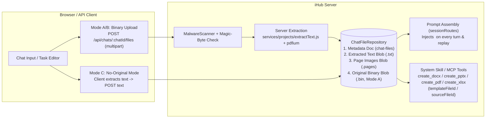
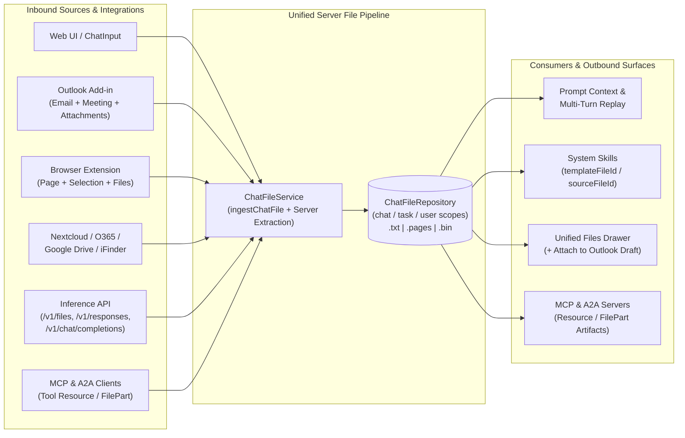

# Durable Chat & Scheduled-Task Files: Server-Side Extraction, Quotas, Sharing, Template Reuse & Integrations

**Status:** Implemented (2026-11-03) — sections 1–9 below are the design as approved, written before the code. Two deviations: `workflow__*` MCP tools return no generated files (a workflow run has no output path for them; only `app__*` tools emit `resource`/`image` blocks), and the server-wide quota is a shared counter document in the `chat-files` namespace (compare-and-set), so several instances enforce it together. The current behaviour is described in [Chat and Scheduled-Task Files](../../docs/chat-files.md).
**Epic:** [#3156](https://github.com/intrafind/ihub-apps/issues/3156)
**Implementation Slices:** [#3157](https://github.com/intrafind/ihub-apps/issues/3157) (Slice 1), [#3158](https://github.com/intrafind/ihub-apps/issues/3158) (Slice 2), [#3159](https://github.com/intrafind/ihub-apps/issues/3159) (Slice 3), [#3160](https://github.com/intrafind/ihub-apps/issues/3160) (Slice 4)

---

## 1. Critical Finding in Current Codebase (Why We Need This Now)

While auditing `server/routes/chat/sessionRoutes.js` and `server/services/chat/chatMaterializer.js` for this design, we uncovered a **major silent regression in multi-turn chats and chat replay**:

1. **Multi-turn chats lose uploaded files on Turn 2+:**
   - Since durable chats (`#2947`) moved history assembly to the server (`messages.length === 1` enforced by `CLIENT_HISTORY_NOT_ALLOWED` in `server/routes/chat/sessionRoutes.js`), the client sends `fileData` only on the turn the file was attached.
   - However, `settleUserTurn` (`server/services/chat/chatMaterializer.js`) only persisted `content: text` (what the user typed) and `attachments: [{ type, name, bytes }]` (metadata only) — unlike `server/routes/inference/responses.js`, it **never stored the extracted document text or `renderedContent`**.
   - On Turn 2, `historyForPrompt(history)` reconstructed Turn 1 using only `entry.content`. **The uploaded file from Turn 1 vanished from the model's context on Turn 2.**
2. **Page reload breaks Replay / Regenerate on turns with uploads:**
   - `client/src/features/chat/hooks/useAppChat.js` tried to restore `prevUser.fileData` from browser memory when regenerating/replaying. After a page reload (or on another device), `GET /api/chats/:id` only returned `attachments: [{ name, type, bytes }]`, so replaying the turn silently ran **without** the uploaded file.
3. **No server-side original file retention for modifying files or using them as templates:**
   - Users could not upload a `.docx`, `.pptx`, `.pdf`, or `.xlsx` and ask the assistant to modify it, fill its PDF form fields, or use its layout/styles as a template.
4. **No file attachments on Scheduled Tasks:**
   - Users could not attach reference documents or templates to a Scheduled Task definition that persist across runs until the task is deleted.

> [!IMPORTANT]
> Moving both **extracted text** and (optionally) **original file binaries** into durable server-side storage per chat/task/user fixes multi-turn document memory, cross-device replay/regenerate, MCP/A2A file tools (`#2543`/`#2589`), scheduled task attachments, Outlook/Browser Extension context persistence, Nextcloud/cloud direct ingest, and template/form modification in one unified architecture.

---

## 2. Related GitHub Issues in `intrafind/ihub-apps`

| Issue | Status | Relation to This Design |
| :--- | :---: | :--- |
| **[#2318](https://github.com/intrafind/ihub-apps/issues/2318)** — *Blob storage facet for uploads and agent artifacts* | `OPEN` | Introduced the `blobs` facet (`ArtifactRepository.js` and `ItemTextStore.js` already use it). Chat uploads live in this same blob store under the `chat-files` namespace. |
| **[#2543](https://github.com/intrafind/ihub-apps/issues/2543) & [#2589](https://github.com/intrafind/ihub-apps/issues/2589)** — *[MCP] File inputs for MCP tools — resolve chat attachments for `format: "file"` parameters* | `OPEN` | MCP tools need a server-side file handle / bytes from the chat's uploaded files. A chat-scoped file store solves `#2543`/`#2589` directly. |
| **[#2773](https://github.com/intrafind/ihub-apps/issues/2773)** — *Run Office document extraction (DOCX, PPTX, ODF) in a worker thread on the inference API path* | `OPEN` | Moving extraction to the server for all chat uploads uses bounded concurrency so large DOCX/PPTX/XLSX/PDF extractions do not block the Node event loop. |
| **[#2905](https://github.com/intrafind/ihub-apps/issues/2905) & [#2906](https://github.com/intrafind/ihub-apps/issues/2906)** — *Projects spec 3 (upload & extraction pipeline) & spec 4 (encrypted blob storage)* | `OPEN` | `ProjectIngestService.js`, `extractText.js`, `ItemTextStore.js` (`streamingAead.js`), and `MalwareScanner.js` are already implemented in `server/services/projects/`. We reuse `extractText` and `MalwareScanner`. |
| **[#3031](https://github.com/intrafind/ihub-apps/issues/3031)** — *Read attachments inside uploaded Outlook `.msg` (and `.eml`) files* | `OPEN` | Server-side extraction already parses `.msg`/`.eml` in `server/services/projects/extractText.js`; nested attachments inside `.msg`/`.eml` can become child chat files. |
| **[#3055](https://github.com/intrafind/ihub-apps/issues/3055)** — *Support more generated file types and add an Artifacts panel with ZIP download* | `CLOSED` | Shipped `ArtifactsPanel.jsx`. Unifies into a single **Files** drawer with **Uploaded** and **Generated** tabs. |
| **[#2967](https://github.com/intrafind/ihub-apps/issues/2967)** — *Scheduled tasks: configurable run retention and manual deletion of runs* | `CLOSED` | Scheduled task runs prune old run chats (`pruneTaskRuns`), whereas files attached to the **task definition** survive until the task itself is deleted. |
| **[#2793](https://github.com/intrafind/ihub-apps/issues/2793)** — *Deleting a user: option to keep their chats, prompts and skills and transfer them* | `OPEN` | User quota accounting and ownership transfer (`userDeletion.js`) include uploaded chat/task files. |
| **[#3148](https://github.com/intrafind/ihub-apps/issues/3148)** — *[Epic] Model-driven Office tools: Outlook first, then Word, Excel and PowerPoint* | `OPEN` | Office add-ins attach the active email/meeting and attachments (`hostContext` / `fileData`). Uploading them as `ChatFileRepository` entries makes them durable across turns and surfaces. |

---

## 3. Target Architecture



### 3.1 Three Configurable Storage Modes (`platform.uploads.storageMode`)

Configured globally under `platform.uploads.storageMode` and overridable per App (`app.uploads.storageMode`):

| Mode | Where Extraction Runs | What is Stored on Server | What Works |
| :--- | :--- | :--- | :--- |
| **1. `original_and_text` (Default)** | **Server** | **Extracted Text Blob** + **Original Binary Blob** (with independent TTL) | Everything: multi-turn chat, replay/regenerate, view/download original file in Files tab, share original file, use as `.docx`/`.pptx`/`.pdf`/`.xlsx` template or fill PDF forms, scheduled task binary attachments. |
| **2. `server_text_only`** | **Server** | **Extracted Text Blob only** (original binary discarded immediately after extraction, like Projects Spec 3 `#2905`) | Multi-turn chat, replay/regenerate, view/download extracted Markdown in Files tab, share extracted text, scheduled task text attachments. Zero original binaries at rest. |
| **3. `client_text_only` ("No binary upload")** | **Browser** (`fileProcessing.js`) | **Extracted Text Blob only** (browser uploads only `{ name, mimeType, text }`; raw binary never leaves the client device) | Multi-turn chat, replay/regenerate, view extracted text in Files tab, scheduled task text attachments. **No original file ever crosses the network.** |

---

### 3.2 Scopes & Lifecycles: `chat`, `task`, and `user`

Following `server/services/artifacts/ArtifactRepository.js`, every uploaded file belongs to an explicit **scope**:

1. **`scope: { type: 'chat', id: chatId }`:**
   - Covers all files in a conversation: paperclip uploads, cloud/iFinder attachments, Outlook emails (`.eml`), Outlook email attachments, calendar meetings (`.ics`), Browser Extension pages (`.md`), and files returned by MCP/A2A tools.
   - **Original Binary TTL (`platform.uploads.originalRetentionDays`, default `14` days):** A background sweep deletes the **original binary blob** after `originalRetentionDays` (setting `originalDeletedAt` on the metadata doc and returning `410 ORIGINAL_DISCARDED`, matching `ProjectPage` in `#1036`), while **keeping the extracted text blob** so the chat can still be read, continued, and replayed until the chat itself expires (`platform.chats.retentionDays`, default `90` days).
   - **Full Cascade on Chat Delete:** `DELETE /api/chats/:id` (and `chatRetention.js`) deletes both the original binary blob and the extracted text blob (unless retained by an active share link that opted to include files).
   - **Message Edit / Truncation (`replaceFromMessageId`):** Editing a message or truncating history deletes unreferenced chat files detached by the edit (unless retained by another message in the chat or an active share).
2. **`scope: { type: 'task', id: taskId }` (Scheduled Tasks):**
   - Files attached to a scheduled task definition live under `task__<taskId>__<fileId>`.
   - **Exempt from age-based TTL:** Task-scoped files are **never** deleted by the daily TTL sweep while the scheduled task exists. They are deleted only when the user removes the file from the task or deletes the task (`DELETE /api/scheduled-tasks/:id`).
   - **Injected into every scheduled run (with optional `refreshOnRun`):** When `server/services/scheduledTasks/taskExecution.js` starts a run chat (`origin: { createdVia: 'scheduled-task', taskId, runId }`), the run chat references the task's files without duplicating the bytes on disk. If a task file is backed by a cloud/iFinder connector with `refreshOnRun: true`, `taskExecution.js` refreshes the file from the connector before executing the run. When `pruneTaskRuns` deletes old run chats (`#2967`), the task's files remain untouched.
3. **`scope: { type: 'user', id: ownerId }` (Inference API `/api/inference/v1/files`):**
   - Files uploaded via `POST /api/inference/v1/files` live under `user__<ownerId>__<fileId>`.
   - Referenced by `file_id` in `/api/inference/v1/responses` and `/api/inference/v1/chat/completions`, governed by the user's `maxUserBytes` quota and `originalRetentionDays` TTL.

---

### 3.3 Three-Tier Quota System (`per-chat`, `per-user`, `server-total`)

Configured under `platform.uploads.quotas`:

| Tier | Default | What Counts Against It | Behavior When Exceeded |
| :--- | :--- | :--- | :--- |
| **Per-File (`maxFileBytes`)** | `25 MB` | Single uploaded file (or extracted text in `client_text_only` mode) | Reject upload immediately (`413 QUOTA_FILE_BYTES`). |
| **Per-Chat / Per-Task (`maxChatBytes`, `maxChatFiles`)** | `100 MB` / `25 files` | Sum of stored bytes (original + extracted text) in that `chatId` or `taskId` | Reject upload (`413 QUOTA_CHAT_BYTES` / `QUOTA_CHAT_FILES`); user can delete an earlier file from the Chat Files tab or purge originals to free space. |
| **Per-User (`maxUserBytes`)** | `1 GB` | Sum of active chat + scheduled task + user files owned by `ownerId` | **Auto-evict oldest unpinned chat original binaries first** (downgrading old chats from `original_and_text` to `text_only` while preserving their extracted text), and only hard-reject (`413 QUOTA_USER_BYTES`) if remaining bytes still exceed quota. |
| **Server-Total (`maxServerBytes`)** | `50 GB` (or `0` = unlimited) | Total bytes in `chat-files` namespace across all users | **Auto-evict oldest unpinned chat original binaries first**, and only hard-reject (`507 QUOTA_SERVER_BYTES`) if remaining bytes still exceed quota. |

> [!TIP]
> **Smart Eviction:** Because we store **original binary** and **extracted text** as separate blobs (`<key>.bin` vs `<key>.txt`), when a user or server approaches the byte quota or TTL, we evict the heavy `.bin` original (saving ~95% of the bytes) while keeping the tiny `.txt` extracted text so chat replay and multi-turn history never break.

---

### 3.4 Chat Input, Replay & Unified "Files" Drawer UX

1. **Pre-Upload on Attach (Non-blocking Chat Input):**
   - As soon as the user drops/selects a file in `ChatInput.jsx`:
     - In Mode 1/2: Upload via `POST /api/chats/:chatId/files`. Returns `{ id, name, mimeType, bytes, originalBytes, hasOriginal, pages, canUseAsTemplate, createdAt }`.
     - In Mode 3 (`client_text_only`): Extract in browser, then `POST /api/chats/:chatId/files` with `{ name, mimeType, text }`.
   - Also supports inline `fileData` on `POST /api/apps/:appId/chat/:chatId` for backwards compatibility, automatically persisting the extracted text in `ChatFileRepository` so Turn 2+ and Replay always work.
2. **Clean Message Bubble + Unified "Files" Drawer:**
   - **In the Message Bubble:** Show compact, clickable file chips (icon + filename + size/pages) — never dump raw file info into the message text. Clicking a chip opens that file directly in the **Files Drawer**.
   - **Unified Files Drawer (extending `ArtifactsPanel.jsx`):**
     - Two tabs in the side drawer: **Uploaded (`N`)** and **Generated (`M`)**.
     - Clicking an **Uploaded** file opens `ArtifactPreview.jsx` (PDF iframe, image preview, CSV table, `.ipynb`, code, email/meeting/page viewer, or extracted Markdown text view for `.docx`/`.pptx`/`.xlsx`, plus a **Download Original** button that is `410 ORIGINAL_DISCARDED` aware).
     - Users can also **delete** an uploaded file right from the Files tab.
3. **Replay / Regenerate / Continue Chat:**
   - Because `chat-messages/<chatId>` stores `files: [...]` descriptors on the user message and `historyForPrompt` resolves them from `ChatFileRepository`, **every follow-up turn, page reload, cross-device continuation, and "Regenerate / Edit & Resend" automatically has the full extracted document text (and page images for scanned PDFs)** without the client re-uploading anything.

---

### 3.5 Chat Sharing with Granular File Access Control

In `ChatSharePanel.jsx` and `ChatShareRepository.js`:
- Share creation/update supports:
  - **`uploadedFilesAccess`: `'none'` (default) | `'extracted_text'` | `'original'`**
  - **`sharedFileIds`**: optional per-file allowlist so the owner can uncheck specific sensitive files or emails in the Share dialog.
- When `uploadedFilesAccess === 'none'`, recipients see the attachment chip names in the shared transcript, but clicking them shows *"The owner did not share the attached files"* and `/api/shares/:shareId/files/:fileId` returns `403`.
- Like `artifactIdsRetainedByShares`, if an active share has `uploadedFilesAccess !== 'none'`, the shared file blobs are pinned against deletion on message edit/truncation until the share expires or is revoked.

---

### 3.6 Using Uploaded Files as Templates & Modifying Them in Skills

Once `file_abc123` is stored in `ChatFileRepository` (in Mode 1 `original_and_text`), the model sees its `id` and `can_use_as_template="true"` in the `<content>` tag:
```xml
<content type="document" id="file_abc123" origin="upload" name="corporate-deck.pptx" format="PowerPoint" can_use_as_template="true">
...
</content>
```
And our system skill tools support `templateFileId` / `sourceFileId`:
- **`create_docx({ ..., templateFileId: "file_abc123", templateMode: "styles_only" | "fill_placeholders" | "append", placeholders: "{\"client\":\"ACME\"}" })`**: Feeds the uploaded `.docx`/`.dotx` binary into `wordTemplate.js`. When an uploaded `.docx` has no `{{content}}` marker, `templateMode` defaults to `'styles_only'` (clearing old body paragraphs while preserving styles, headers/footers, and section setup).
- **`create_pptx({ ..., templateFileId: "file_abc123", templateMode: "styles_only" | "append" })`**: Feeds the uploaded `.pptx`/`.potx` binary into `pptxTemplate.js` + `buildPptx.js` to build slides using the uploaded deck's master and layouts.
- **`create_pdf({ ..., templateFileId: "file_abc123", fillFormFields: "{\"FullName\":\"Jane Doe\"}" })`**: Either stamps the new PDF onto the uploaded PDF letterhead, or uses `pdf-lib` to fill the uploaded PDF's interactive AcroForm fields in place.
- **`create_xlsx({ ..., sourceFileId: "file_abc123" })`**: Loads the uploaded `.xlsx` via `JSZip`, keeping existing sheets and appending/updating the specified sheets.

---

## 4. Additional Considerations & Blind Spots Addressed

1. **Scanned PDFs & Vision Page Images (`pageImages`):**
   - When `extractPdfText` yields `< 50` real characters on the server, render the first `N` pages (up to 5) to JPEG via `@hyzyla/pdfium` and store them in the `.pages` blob so vision models can read scanned PDFs on Turn 1, Turn 2+, and in Scheduled Tasks.
2. **All Upload Entry Points Unified:**
   - Paperclip uploads, Cloud Picker (Google Drive, OneDrive/SharePoint, Nextcloud), iFinder Document Attach (`?documentId=…`), Outlook Add-in (emails, meetings, attachments), Browser Extension (pages, selections), Inference API (`/v1/files`, `/v1/responses`, `/v1/chat/completions`), and MCP/A2A tools all flow through `ChatFileService` and `ChatFileRepository`.
3. **Chat Compaction / Token Window Management on Long Chats:**
   - In `hydrateHistoryForPrompt`, inject full `<content type="document">` blocks when total document tokens fit within budget, and truncate/summarize older turns when a chat accumulates oversized documents.
4. **Backup / Restore (`#2784`):**
   - `chat-files` is registered in `RUNTIME_NAMESPACES` and `BLOB_NAMESPACES` (not configuration namespaces), so configuration ZIP backups never bloat with gigabytes of uploaded user binaries.

---

## 5. Validated Assumptions

1. **Assumption A1 — Separate TTLs for Original Binary vs. Extracted Text:**
   - When the file retention timer fires (`originalRetentionDays`, default `14` days), it deletes the **heavy original binary** first while keeping the **extracted text** until the chat itself is deleted (`chatRetentionDays`, default `90` days), so replaying or continuing an older chat still works even after the original binary has expired.
2. **Assumption A2 — Unified "Files" Drawer:**
   - A single **Files** drawer unifies **Uploaded Files** (inputs: documents, emails, meetings, web pages, cloud files) and **Generated Artifacts** (outputs) in one side panel with tabs (`Uploaded (N)` | `Generated (M)`).
3. **Assumption A3 — Share Snapshots Point to Chat Files (Zero Copy):**
   - Sharing a chat with file access enabled does **not** duplicate the file blobs on disk, but instead pins those `fileId`s against edit-deletion until the share expires (matching how `ChatShareRepository` handles generated artifacts).
4. **Assumption A4 — Corporate App Template Precedence:**
   - If an admin explicitly pins a mandatory corporate `documentTemplate` on an App, the admin's corporate template governs branding unless the App config enables `allowUserTemplateUploads: true` (default `true` when no mandatory admin template overrides it).

---

## 6. Resolved Design Decisions

| # | Decision Topic | Resolved Design |
| :--- | :--- | :--- |
| **Q1** | **Granularity of the "No Original File" setting (`storageMode`)** | **Platform default (`platform.uploads.storageMode`) + per-App override (`app.uploads.storageMode`)** across `'original_and_text'` (default), `'server_text_only'`, and `'client_text_only'`. |
| **Q2** | **What expires on the File TTL timer?** | **Delete original binary at `originalRetentionDays` (default `14` days, returning `410 ORIGINAL_DISCARDED`); delete extracted text with the chat (`chatRetentionDays`, default `90` days).** |
| **Q3** | **Quota enforcement behavior when `per-user` or `server-total` quota is full** | **Auto-evict oldest unpinned chat original binaries first** (downgrading old chats from `original_and_text` to `text_only` while keeping their extracted text), and only hard-reject if remaining bytes still exceed the quota. |
| **Q4** | **Sharing permission granularity** | **3-way choice** (`uploadedFilesAccess`: `'none'` [default] / `'extracted_text'` / `'original'`) plus per-file selection (`sharedFileIds`) in the Share dialog. |
| **Q5** | **Editing a message in chat (`replaceFromMessageId`)** | **Delete unreferenced files detached by the edit** (unless referenced by another message in the chat or an active share). |
| **Q6** | **Scheduled Tasks — Input vs. Output files** | Input files attached to a Scheduled Task (`scope: { type: 'task', id: taskId }`) are exempt from age-based TTL and live until the Task is deleted; generated output files remain on each **run chat** (`#2967`) and surface on the Scheduled Task detail page. |
| **Q7** | **Outlook Emails, Calendar Meetings & Browser Extension Pages** | **Uploaded as first-class files in `ChatFileRepository`** (`<Subject>.eml` `message/rfc822`, `<Subject>.ics` `text/calendar`, `<Title>.md` `text/markdown`), deduplicated per chat by `itemId`/`url`. They appear in the Unified Files Drawer, obey the same storage modes, quotas, TTL, and share permissions, and render `<content type="current-email">` / `<content type="email">` / `<content type="current-meeting">` / `<content type="current-page">` tags in `shared/promptContext.js`. |

---

## 7. Pre-Mortem: "We Built It, Shipped It, and Nobody Used It (or Admins Turned It Off)"

| # | Failure Scenario ("What Went Wrong") | Root Cause | Prevention Designed In |
| :--- | :--- | :--- | :--- |
| **PM-01** | **Admins immediately disable binary storage (`client_text_only`) in production** | Power users upload 50 MB PowerPoint decks and PDFs; local disk fills up or daily config backups balloon to 40 GB. | 1. Exclude `chat-files` blobs from config ZIP backups by default.<br>2. Separate `originalRetentionDays` (default `14` days) from chat retention (`90` days) with LRU original binary eviction. |
| **PM-02** | **Server freezes during peak morning usage** | Moving PDF/DOCX/XLSX extraction onto the Node.js server saturates the main event loop when many users upload large files concurrently. | Run server-side extraction with bounded concurrency and per-file timeouts, reusing `services/projects/extractText.js`. |
| **PM-03** | **Users upload a `.docx` / `.pptx` and say *"Use this as a template"*, and the output looks broken** | Real-world user files aren't clean `.dotx`/`.potx` templates — they have 30 existing slides or 15 pages of old text. Appending new content after old pages looks broken. | When an uploaded `.docx` or `.pptx` is used via `templateFileId` and has **no** `{{content}}` marker, default `templateMode` to **`styles_only`** (clearing old body/slides while keeping styles, headers/footers, section setup, slide master, and slide layouts). |
| **PM-04** | **Users confuse "Chat Files" with "Projects" (`#1036`)** | Users upload reference documents into a single Chat's "Files" tab expecting them to be available across all future chats. | Make the boundary explicit in the UI (*"Files in this chat"*). |
| **PM-05** | **Long chats with 5 uploaded PDFs fail with Token Limit / Slow Responses** | Re-injecting 5 large PDFs on every turn blows past the context window by Turn 8. | Cap total hydrated document characters per prompt turn in `hydrateHistoryForPrompt` with graceful truncation notes. |
| **PM-06** | **Scanned PDFs work in `client_text_only` mode but fail in Server mode** | Browser `fileProcessing.js` rendered scanned PDF pages to JPEG images, while server `extractText.js` returned empty text. | When server `extractPdfText` yields `< 50` real chars, render the first `N` pages via `@hyzyla/pdfium` and store them in the `.pages` blob. |
| **PM-07** | **Data leak complaint on Shared Chats** | A user shares a chat via a share link, forgetting they uploaded a confidential `.xlsx` or email in Turn 1. | Default `uploadedFilesAccess` on new share links to **`'none'`** (opt-in to share uploaded files), with per-file checkboxes in the Share Dialog. |

---

## 8. End-to-End Integrations & API Surfaces ("In One Ride")



### 8.1 Outlook Add-in & Browser Extension (Emails, Meetings, Pages & Attachments as Chat Files)

| Gap Today | Unified Solution |
| :--- | :--- |
| **Emails (`currentEmail`, `addedEmails`), Meetings (`currentMeeting`), and Browser Pages (`currentPage`) are ephemeral `hostContext` side-channels lost on Turn 2+ and Replay:** `ChatRepository.js` does not store `hostContext`, so continuing an Outlook or Browser Extension chat in the Web UI (or after switching emails/tabs) loses Turn 1's email/meeting/page context, and the user cannot inspect or manage them in the Files tab. | **Upload emails, meetings, and pages as first-class files in `ChatFileRepository`:**<br>• **Outlook Emails (`origin: 'email'`, `mimeType: 'message/rfc822'`, `<Subject>.eml`):** In `original_and_text` mode, stores a standard RFC 5322 `.eml` binary (via Office.js `item.getAsFileAsync` when supported, or synthesized RFC 5322 `.eml` from headers + body) as `.bin` plus structured header + body text as `.txt`. In `server_text_only` / `client_text_only` mode, stores only the `.txt` representation (`hasOriginal: false`). Carries `meta: { itemId, from, to, cc, date, subject, mailboxUser, isCurrentEmail }`, deduplicated per chat by `itemId`.<br>• **Outlook Meetings (`origin: 'meeting'`, `mimeType: 'text/calendar'`, `<Subject>.ics`)** and **Browser Extension Pages (`origin: 'page'`, `mimeType: 'text/markdown'`, `<Title>.md`):** Stored in `ChatFileRepository` (`meta: { itemId, url, title, ... }`), deduplicated per chat by `itemId`/`url`.<br>• **Prompt Rendering (`shared/promptContext.js`):** Renders `<content type="current-email">` / `<content type="email">` / `<content type="current-meeting">` / `<content type="current-page">` directly from the stored `ChatFileRepository` entries (preserving `Mailbox-User` so reply/drafting apps know who the signed-in user is).<br>• **Unified Files Drawer, Quotas, TTL & Sharing:** Every email, meeting, and web page appears in the chat's **Files** tab, can be opened or removed by the user, obeys the 3-tier quotas and TTLs, and is protected by `uploadedFilesAccess` (`'none'` default) when sharing a chat. |
| **Outlook drops raw binary `base64` on email attachments:** `outlookMailContext.js` gets raw `base64` via `getAttachmentContentAsync`, but `buildChatApiMessages.js` runs client-side `processDocumentFile` and drops `base64`. Result: `hasOriginal: false`, `canUseAsTemplate: false`. | When `storageMode !== 'client_text_only'`, upload Outlook email attachments directly to `POST /api/chats/:chatId/files` (or preserve `base64` in `fileData` payload) so `ChatFileRepository` stores the `.bin` original (`canUseAsTemplate: true`) and runs server-side extraction. |
| **One-click "Attach to Outlook Draft" for generated/modified files:** `outlookAttachments.js` already implements `addFileAttachmentFromBase64Async`, but the Files Drawer doesn't expose it for chat files. | Add an **"Attach to email"** button in the Unified Files Drawer when running inside Outlook compose mode (`isComposeMode`), fetching the file binary from `/api/chats/:chatId/files/:fileId?download=1` or `/api/chats/:chatId/artifacts/:fileId` and attaching it via `outlookAttachments.js`. |

### 8.2 Cloud Storage & Enterprise Connectors (Nextcloud, Office 365, Google Drive, iFinder)

| Gap Today | Unified Solution |
| :--- | :--- |
| **Chat Cloud Picker & Nextcloud Embed round-trip files through the browser and discard binaries:** `useCloudStorageBrowser.js` and `useNextcloudEmbedAttachments.js` download the file to the browser via `/api/integrations/<service>/download`, extract text client-side (`cloudFileProcessing.js`), and throw away the binary (`hasOriginal: false`). | Support **server-side direct connector ingest** in `POST /api/chats/:chatId/files` and `POST /api/scheduled-tasks/:taskId/files` via `{ source: { kind: 'nextcloud' \| 'office365' \| 'google-drive' \| 'ifinder-document', ref, refreshOnRun? } }`. Reuse the server downloaders from `server/services/projects/kinds/cloudKinds.js` (`NextcloudService.downloadFile`, `Office365Service.downloadFile`, `GoogleDriveService.downloadFile` with Google Docs/Sheets/Slides export to `.docx`/`.xlsx`/`.pptx`, and `iFinderService`) and pass the raw `Buffer` into `ingestChatFile()`. |
| **Scheduled Tasks cannot re-read updated Nextcloud / SharePoint / Google Drive files on each run:** Static snapshots go stale for recurring reports. | Store `source` metadata (`{ kind, ref, refreshOnRun }`) on the `ChatFileRepository` descriptor. When `refreshOnRun: true` on a `task`-scoped file, `taskExecution.js` re-fetches and re-ingests the latest file from Nextcloud / Office 365 / Google Drive / iFinder at the start of each scheduled run using the task owner's credentials. |
| **Saving generated files back to Nextcloud / Cloud:** Users in Nextcloud Embed or Chat with Cloud connectors want to save generated or modified files back to Nextcloud. | Expose the cloud upload actions in the Unified Files Drawer so both uploaded (modified) and generated files can be saved back to Nextcloud / Office 365 / Google Drive. |

### 8.3 Inference API (`/api/inference/v1/chat/completions`, `/v1/responses`, `/v1/conversations`, `/v1/files`)

| Gap Today | Unified Solution |
| :--- | :--- |
| **`inputContent.js` has a separate, weaker file extractor:** `server/services/inference/inputContent.js` lacks `.xlsx` support, throws `400 file_has_no_text` on scanned PDFs instead of rendering page images via pdfium, and `handleModelCompletion` in `server/routes/openaiProxy.js` ignores `file` content parts on plain model completions. | Route `documentFromInlineFile` in `inputContent.js` through `ChatFileService` / `extractText.js` (giving the Inference API full `.xlsx`, `.docx`, `.pptx`, `.pdf`, and scanned-PDF pdfium support), and wire `messagesFromChatCompletions` into `handleModelCompletion` in `openaiProxy.js`. |
| **Web UI and `/v1/responses` conversations (`conv_...` / `chatId`) lose each other's files:** `responses.js` bakes file text into `message.renderedContent` instead of `ChatFileRepository`, and `conversations.js` (`historyForModel`) does not hydrate `ChatFileRepository` files. | When `/v1/responses` or `/v1/conversations` persists a turn (`store !== false`), store inline files in `ChatFileRepository` (`chat` scope) and attach `files` descriptors to the message; in `conversations.js` `historyForModel`, call `hydrateHistoryForPrompt` so Web UI and API turns share files seamlessly. |
| **No `/api/inference/v1/files` endpoint (`file_id` throws `400 unsupported_file_reference`):** Standard OpenAI SDK clients upload files via `POST /v1/files` and reference them via `file_id` in `/v1/responses` and `/v1/chat/completions`. | Add `/api/inference/v1/files` (`POST /v1/files`, `GET /v1/files`, `GET /v1/files/:file_id`, `GET /v1/files/:file_id/content`, `DELETE /v1/files/:file_id`) backed by `ChatFileRepository` (`user` scope `{ type: 'user', id: ownerId }`), and resolve `file_id` references in `inputContent.js`. |

### 8.4 MCP (Client & Server) and A2A (Client & Server)

| Surface | Gap Today | Unified Solution |
| :--- | :--- | :--- |
| **MCP Client (External MCP tools returning files/images)** | `McpServerConnection.js` returns raw MCP `result.content` (`{ type: 'resource', resource: { uri, mimeType, blob } }` or `{ type: 'image', data, mimeType }`) and `AgentLoop.js` `JSON.stringify`s the base64 blob directly into the LLM prompt. | In `server/services/chat/chatSeams.js` (`chatToolSeam`), intercept MCP `resource` (`blob` / `text`) and `image` blocks: store binary outputs as chat artifacts / `ChatFileRepository` entries, emit `generatedFiles` / `images` SSE events so they appear in the Unified Files Drawer, and replace the raw base64 in the tool response with a clean descriptor (`{ fileId, name, mimeType, bytes }`). |
| **MCP Server (`/api/mcp` exposing iHub Apps & Workflows)** | `ChatService.invokeAppInternal` ignores `generatedFiles` and `images`, and `McpServerService.js` serializes `_artifact` as JSON text instead of MCP `EmbeddedResource` / `ImageContent`. Also, `app__<appId>` tools only accept `{ message: string }` with no file input. | 1. Accept optional `files: [{ name, mimeType, data, text }]` on `app__<appId>` and workflow MCP tools, ingesting them via `prepareTurnFiles`.<br>2. Collect `generatedFiles` and `images` in `invokeAppInternal` and emit standard MCP `{ type: 'resource', resource: { uri, mimeType, blob } }` and `{ type: 'image', data, mimeType }` content blocks in `McpServerService`. |
| **A2A Server (`/api/a2a/:kind/:id`)** | `a2aHandler.js` rejects inbound `FilePart` (`part.kind === 'file'`) with `-32005 CONTENT_TYPE_NOT_SUPPORTED` and only emits `TextPart` / `DataPart` in task `artifacts`. | 1. Accept inbound `FilePart` (`file.bytes` base64 or `file.uri`) in `a2aHandler.js`, ingest via `prepareTurnFiles`, and advertise supported file MIME types in `defaultInputModes` / `defaultOutputModes` on the Agent Card.<br>2. Emit outbound `{ kind: 'file', file: { name, mimeType, bytes } }` parts in A2A task `artifacts` when an App or Workflow generates files or images. |
| **A2A Client (`a2aTools.js` & `A2aAgentConnection.js`)** | `a2aTools.js` only sends a `TextPart` to remote A2A agents and silently drops any `FilePart`s returned in remote A2A `artifacts` or `status.message`. | 1. Add optional `fileIds: string[]` to the `a2a_<id>` tool schema so the agent can forward chat files (`getOriginal` / `getText` from `ChatFileRepository`) as `FilePart`s to remote A2A agents.<br>2. When a remote A2A agent returns `FilePart`s (`bytes` or `uri`), ingest them into `generatedFiles` / `ChatFileRepository` so the user can download them in the Files Drawer and the agent can use them in follow-up skill calls. |

---

## 9. Implementation Slices & Issue Breakdown (Epic [#3156](https://github.com/intrafind/ihub-apps/issues/3156))

| Slice | GitHub Issue | Scope & Deliverables |
| :--- | :---: | :--- |
| **Slice 1** | **[#3157](https://github.com/intrafind/ihub-apps/issues/3157)** | **Core Server Storage, Extraction, Quotas, TTLs & Multi-Turn Hydration:**<br>• `chat-files` namespace in `server/storage/namespaces.js`<br>• `chatFilePolicy.js` (3 storage modes, 3-tier quotas, template eligibility)<br>• `ChatFileRepository.js` (`chat`, `task`, and `user` scopes, `.txt`/`.pages`/`.bin` blobs, LRU original binary eviction, `410 ORIGINAL_DISCARDED`)<br>• `ChatFileService.js` (`ingestChatFile`, `prepareTurnFiles`, `hydrateHistoryForPrompt`)<br>• Chat file REST endpoints (`POST/GET/DELETE /api/chats/:chatId/files`), share file access (`uploadedFilesAccess`, `sharedFileIds`), cascade deletion & daily original TTL sweep in `chatRetention.js` |
| **Slice 2** | **[#3158](https://github.com/intrafind/ihub-apps/issues/3158)** | **Scheduled Task Attachments & Using Uploaded Files as Templates / Fillable Forms in System Skills:**<br>• Scheduled task file endpoints (`POST/GET/DELETE /api/scheduled-tasks/:taskId/files`) and cascade cleanup on task deletion<br>• Inject task-scoped files into every scheduled task run in `taskExecution.js` (exempt from age-based TTL)<br>• `templateFileId` / `sourceFileId` support in `create_docx` (`styles_only` default when no `{{content}}` marker), `create_pptx`, `create_pdf` (letterhead stamp + interactive AcroForm `fillFormFields`), and `create_xlsx` |
| **Slice 3** | **[#3159](https://github.com/intrafind/ihub-apps/issues/3159)** | **Client Pre-Upload, Unified Files Drawer (`Uploaded` + `Generated`), Share Access Controls & Admin Quota UI:**<br>• `ChatInput` pre-upload on attach (supporting `original_and_text`, `server_text_only`, and `client_text_only`)<br>• Unified Files Drawer (`ArtifactsPanel.jsx`) with **Uploaded** and **Generated** tabs (including emails/meetings/pages), preview, original download (`410 ORIGINAL_DISCARDED` aware), and delete<br>• `ChatSharePanel.jsx` controls for `uploadedFilesAccess` (`'none'` default \| `'extracted_text'` \| `'original'`) and per-file selection<br>• Scheduled Task editor file attachment UI & Admin Settings UI for storage mode, TTL, and 3-tier quotas |
| **Slice 4** | **[#3160](https://github.com/intrafind/ihub-apps/issues/3160)** | **End-to-End Integrations & API Surfaces (Outlook, Browser Extension, Nextcloud/Cloud, Inference API, MCP, A2A):**<br>• **Outlook & Browser Extension:** Upload emails (`<Subject>.eml`), calendar meetings (`<Subject>.ics`), and web pages (`<Title>.md`) as first-class `ChatFileRepository` entries (deduplicated by `itemId`/`url`) while rendering `<content type="current-email">` / `<content type="email">` / `<content type="current-meeting">` / `<content type="current-page">` in `shared/promptContext.js`; preserve raw `base64` on Outlook email attachments (`canUseAsTemplate: true`); add "Attach to email" button in the Unified Files Drawer in Outlook compose mode<br>• **Nextcloud / Office 365 / Google Drive / iFinder:** Server-side direct connector ingest (`source: { kind, ref, refreshOnRun? }`) in chat and scheduled task file endpoints, plus `refreshOnRun: true` re-ingest in `taskExecution.js`<br>• **Inference API:** Unify `inputContent.js` with `ChatFileService` / `extractText.js` (`.xlsx` + scanned-PDF pdfium), wire `messagesFromChatCompletions` into `handleModelCompletion`, persist/hydrate `/v1/responses` & `/v1/conversations` files in `ChatFileRepository`, and add `/api/inference/v1/files` (`user` scope + `file_id` resolution)<br>• **MCP & A2A (Client & Server):** Lift MCP client binary `resource`/`image` tool results into `generatedFiles`/`ChatFileRepository`; accept `files` and emit MCP `resource`/`image` blocks in `McpServerService`; accept inbound `FilePart` and emit outbound `FilePart` artifacts in `a2aHandler.js` and `a2aTools.js` |
