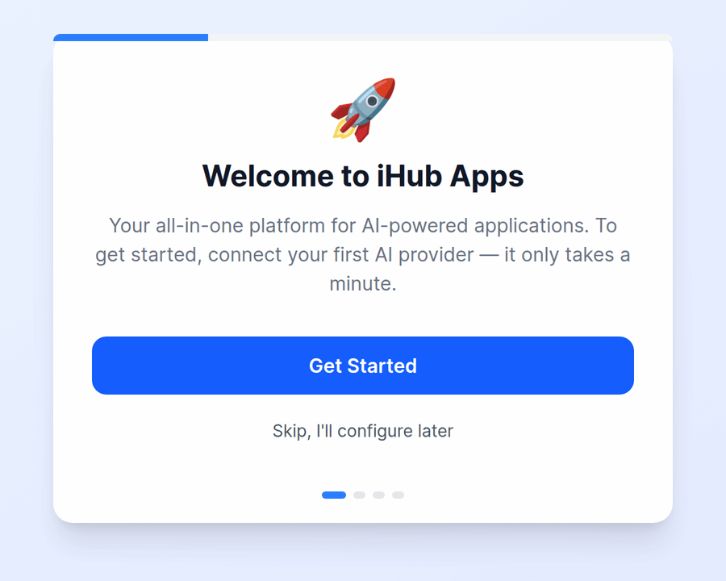
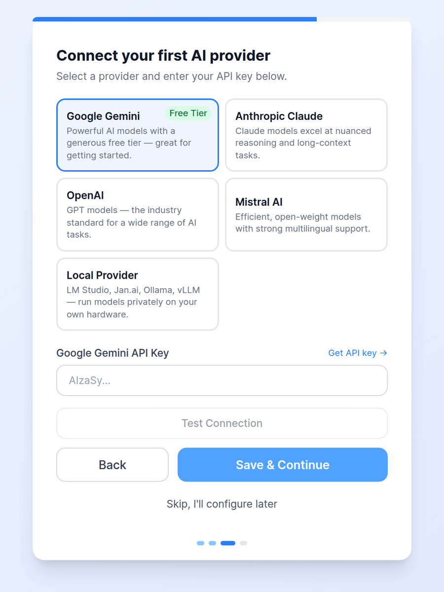
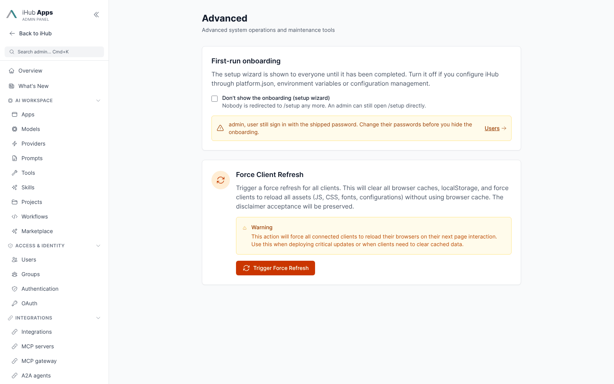
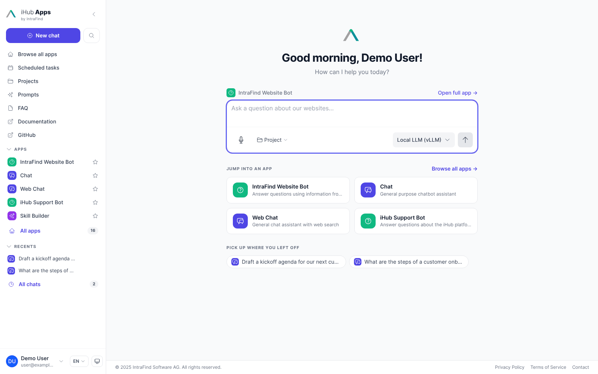

# Getting Started with iHub Apps

iHub Apps runs without a database, without a `.env` file and without manual configuration. Start
it, open it in the browser and connect a model in the setup wizard.

## 1. Start iHub

Pick one of the three ways in. [Installation](INSTALLATION.md) has the details for each.

| Method | Command | Open |
| ------ | ------- | ---- |
| **Binary** (Linux, macOS, Windows) | Download from [GitHub Releases](https://github.com/intrafind/ihub-apps/releases), extract, run `./ihub-apps-v*-linux` (or the `.bat` on Windows). Or use the installer: `curl -fsSL https://raw.githubusercontent.com/intrafind/ihub-apps/main/install.sh \| sh` | http://localhost:3001 |
| **Docker** | `docker compose -f docker-compose.quickstart.yml up` | http://localhost:3000 |
| **npm** (development) | `git clone https://github.com/intrafind/ihub-apps.git && cd ihub-apps && npm run setup:dev && npm run dev` | http://localhost:5173 |

The binary's port comes from the `config.env` next to the executable (`PORT=3001`); Docker and
the npm server listen on 3000 (in development the Vite dev server on 5173 serves the UI and
forwards API calls to port 3000).

### What happens on first start

When the `contents/` directory is empty, the server copies the default configuration from
`server/defaults` into it — apps, models, providers, groups, users, UI settings — and then starts
normally. On later starts it applies any pending [configuration migrations](configuration-migrations.md)
and leaves your configuration alone.

```
🔍 Checking if initial setup is required...
📦 Contents directory is empty, performing initial setup...
📋 Copying default configuration from server/defaults to contents
✅ Default configuration copied successfully
```

## 2. Run the setup wizard

On a fresh installation the browser opens the setup wizard:

1. **Welcome** — **Get Started**, or **Skip, I'll configure later**.
2. **Sign in** as an administrator. A fresh installation ships the local account `admin` with the
   password `password123`.
3. **Connect your first AI provider** — Google Gemini (with a free tier), Anthropic Claude,
   OpenAI, Mistral AI or a local provider (LM Studio, Jan.ai, Ollama, vLLM). Paste the API key,
   **Test Connection**, **Save & Continue**. The key is stored encrypted on the provider. A local
   provider needs neither: just continue.
4. **Finish** — choose **Add your models** to pick the models of the provider you connected. A fresh
   installation has no enabled chat model, so chatting starts once you have imported or enabled
   one; the first chat model you enable becomes the default.

<p align="center">
  
  &nbsp;
  
</p>

You can add more providers and models at any time under **Admin → Providers** and
**Admin → Models** (including **Import from URL** for whole endpoints; OpenRouter ships as a
provider whose key you enter there). API keys can also come from
environment variables such as `GOOGLE_API_KEY`, `ANTHROPIC_API_KEY`, `OPENAI_API_KEY` or
`MISTRAL_API_KEY` — see [Models](models.md) and [Environment Variables](environment-variables.md).

### Skipping or turning off the wizard

**Skip** only skips for the current browser session: until the wizard is completed, every new tab,
browser or user is sent back to it. A signed-in administrator who skips is asked whether to hide the
wizard for good (and is warned if a demo account still uses the shipped password). The same switch
is under **Admin → Advanced → First-run onboarding** (`setup.disabled` in `platform.json`), next to
the demo-account status. With it on, nobody is redirected to `/setup`; the page stays reachable by
direct URL.



## 3. Look around



- The **start page** greets you with the chat input of the default app and shortcuts to the most
  important apps. See the [User Guide](user-guide.md) for a tour.
- **Admin** (`/admin`, or the user menu) configures everything: apps, models, providers, users,
  groups, authentication, branding. See the [Admin UI Guide](admin-ui.md).
- **Admin → Platform → Features** switches on the preview features: Chat History, Scheduled
  Tasks, User Projects, Marketplace, Workflows, Agent Skills and more.
- **Admin → Marketplace** (once enabled) installs more apps, skills, models, workflows and prompts
  — see [Marketplace](marketplace.md).

## What you get out of the box

- **26 apps** — Chat, Web Chat, Email Composer, Meeting Briefing, Diagram Generator, Image
  Generator, File Analyzer, NDA Risk Analyzer and more; some ship disabled and are switched on in
  **Admin → Apps**.
- **Providers** for OpenAI, Anthropic, Google, Mistral, OpenRouter, AWS Bedrock and local servers,
  with their API addresses filled in. No cloud model is preconfigured: **Admin → Models → Import
  from provider** lists the models of a provider and adds the ones you pick. The disabled local
  models (vLLM chat, Voxtral transcription on vLLM, iAssistant) are ready to switch on.
- **Two marketplace registries**: the iHub Official Marketplace (90 apps, 98 skills, 19 models,
  6 workflows, 5 prompts) and the iHub Examples.
- **Authentication**: local accounts and anonymous access are on.

## Default access

| Who | What they get |
| --- | ------------- |
| **Anonymous visitors** (`anonymous` group) | The **Chat** app with the default model, the prompt library. No admin, no scheduled tasks. |
| **Signed-in users** (`authenticated`, `users`) | All apps, models, prompts and skills; scheduled tasks |
| **Administrators** (`admins`) | Everything, including the admin area |

The shipped accounts are `admin` (group `admins`) and `user` (group `users`), both with the
password `password123`, and the login page offers them as demo accounts. **Before you open iHub to
other people**, change both passwords under **Admin → Users** and turn off **Show Demo Accounts in
Login Form** under **Admin → Authentication** — the admin area warns until you do. Local sign-in
locks an account for 15 minutes after 5 failed attempts.

## Choosing authentication

| Option | Best for | Guide |
| ------ | -------- | ----- |
| Local accounts (default) | Small teams, trials | [Authentication Quick Start](AUTHENTICATION_QUICK_START.md) |
| Anonymous only, restricted | Public or kiosk deployments — narrow the `anonymous` group's apps and models | [External Authentication](external-authentication.md) |
| LDAP / Active Directory, NTLM | Windows domains | [LDAP/NTLM Authentication](ldap-ntlm-authentication.md) |
| OIDC single sign-on | Microsoft Entra ID, Google, Keycloak, Okta, ADFS | [OIDC Authentication](oidc-authentication.md) |
| Reverse proxy / JWT | An existing SSO gateway in front of iHub | [External Authentication](external-authentication.md) |

Groups from LDAP or OIDC are mapped to iHub groups, which decide who sees which apps, models,
prompts and skills.

## Next steps

1. **Try the apps** on the start page and in **Browse all apps** — [User Guide](user-guide.md)
2. **Secure the installation** — change the shipped passwords, choose an authentication method,
   put a [reverse proxy](production-reverse-proxy-guide.md) with HTTPS in front of it
3. **Connect your knowledge** — [Projects](projects.md), [iFinder](iFinder-Integration.md),
   [Office 365](office365-integration.md), [Google Drive](google-drive-integration.md)
4. **Create your own apps** — [App Configuration](apps.md), or install them from the
   [Marketplace](marketplace.md)
