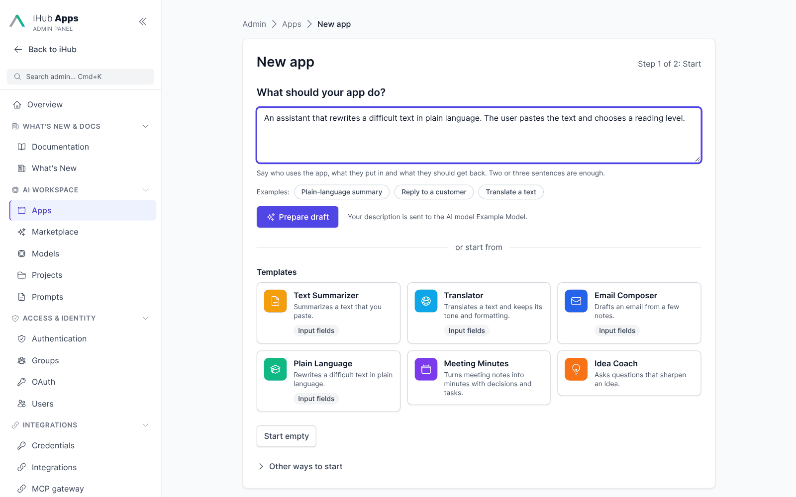
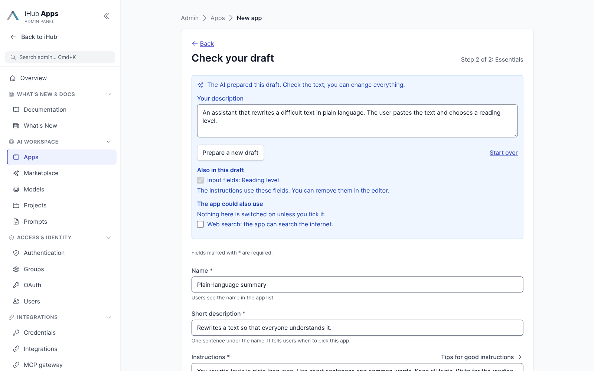
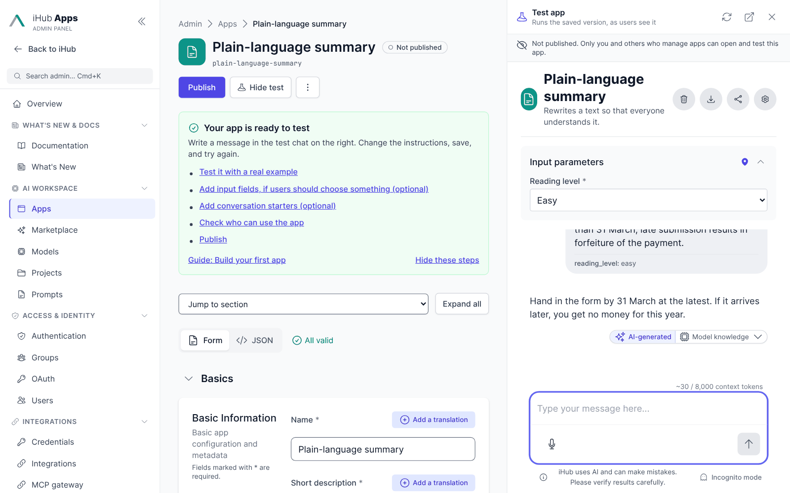
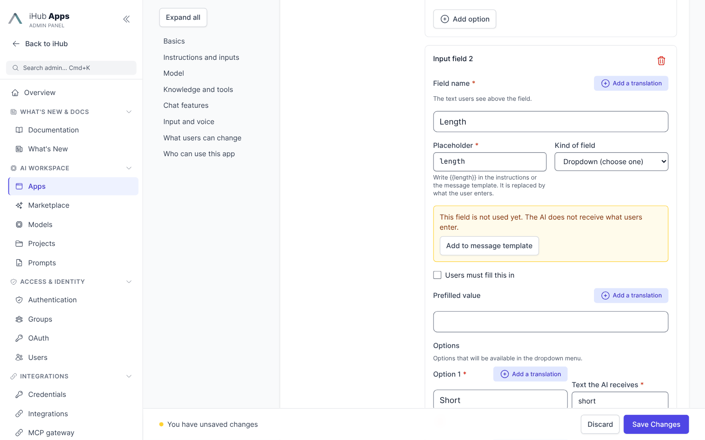
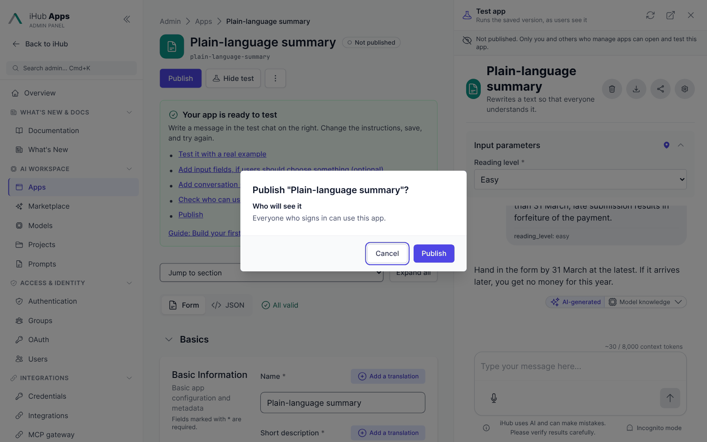

# Build your first app

<!-- The steps of "Create the app by describing it" and "Test it" are the steps of cases 4 and 1 of
     tests/e2e/app-builder.spec.js. Change the spec and this page together. -->

This guide takes you from an idea to a published app without writing any configuration. You
describe the app in two or three sentences, an AI model prepares a draft, you test the draft in a
chat beside the editor, and you publish it when it does what you want. Plan about fifteen minutes.

## What an app is

An app is an assistant for one task, for example "Summarize a text" or "Reply to a customer".
Users open it from the start page and chat with it. What makes it an app are a few things you set
once, so that users do not have to explain the task every time:

- a **name** and a **short description**, which users see in the app list,
- **instructions**, which the AI reads before every chat and users never see,
- optionally **input fields**, which users fill in before they send, for example a tone or a
  language,
- optionally **conversation starters**, which are buttons in an empty chat.

## What you need

- **Permission to manage apps.** You are an administrator, or you belong to a group with the
  permission **Content Admin (Apps, Prompts, Projects)**. iHub ships such a group,
  **Content Admins**. An administrator assigns you to it under **Admin → Users**, or sets the
  permission on another group under **Admin → Groups**. Other users cannot create apps.
- **One working AI model.** If none is set up, the page **New app** says so at the top. You can
  still prepare an app from a template or from an empty form, but it cannot answer until an
  administrator connects a model under **Admin → Models**.

A content admin can do more than build apps. The role also manages prompts and projects in the
admin area, and it can give groups access to an app or a prompt. Giving access is limited to the
groups the content admin belongs to and the groups that inherit from them. Models, users, groups
and platform settings stay with administrators.

### Without admin rights

When an administrator has switched on the preview feature **Personal apps**, users without any
admin right can build apps too. They click **New app** on the apps page and get the two steps
described below, without the **App ID**, the category, **Copy an existing app** and
**Other ways to start**. Such an app
belongs to its author, who can share it, publish it as a company app and hand it over. It can
use less than an app built here: for example, it cannot answer from a project.
[Personal apps](personal-apps.md) describes what users can do and what administrators set up.

## Create the app by describing it

1. Open **Admin → Apps** and click **New app**.
2. Under **What should your app do?**, write who uses the app, what they put in and what they
   should get back. Two or three sentences are enough. The buttons after **Examples:** fill the
   box with a sample text that you can change.
3. Click **Prepare draft**, or press `Ctrl+Enter` (`Cmd+Enter` on a Mac). This can take up to a
   minute. **Cancel** stops it.

The line beside the button names the AI model your description is sent to. The model receives
the description the same way it receives a chat message.

4. The page now shows **Check your draft**. The AI has filled in **Name**, **Short description**
   and **Instructions**. Read them and change what does not fit.
5. Look at the blue box above the fields:
   - **Also in this draft** lists the input fields the AI proposed. Untick the box to create the
     app without them. The box is locked while the instructions use one of the fields; you can
     remove the fields later in the editor.
   - **The app could also use** lists web search and connected systems that might help. Nothing
     in this list is switched on unless you tick it.
   - If the draft misses the point, change the text under **Your description** and click
     **Prepare a new draft**. A new draft replaces the current one, including your changes.
6. Click **Create and test**.

The app now exists with the status **Not published**. Users do not see it. Only you and other
people who manage apps can open and test it.

Also useful to know about this page:

- **More details** holds the **App ID** and the **Category**. The ID is derived from the name and
  becomes part of the app's link. You can change it here. After the app is created it cannot be
  changed.
- The app is written in the language of your user interface. You can add translations later in
  the editor.
- If you reload the page, your unfinished entries are restored. **Start over** discards them.

### What the AI draft can and cannot set

A draft fills in texts and input fields. It never switches on anything that lets the app reach
other systems, and it never decides who can use the app:

| The draft sets                                                        | The draft never sets                                                |
| --------------------------------------------------------------------- | ------------------------------------------------------------------- |
| Name, short description, instructions                                 | Web search and connected systems (they are suggestions you tick)    |
| Icon, color and category                                              | The AI model, uploads, tools, skills, workflows, projects           |
| Input fields, the message template and the hint in the message box    | Who can use the app                                                 |
| Up to four conversation starters                                      | The status: every draft becomes an app that is not published        |

The server builds the app from the AI's answer and checks it. When the server cannot use an
answer, you get a message and no app is created.

How good a draft is depends on the AI model. Draft quality has not yet been measured with real
models, so read every draft before you create the app.

### Other ways to start

You do not have to describe the app. On the first screen you can also choose:

- a **template**, for example **Text Summarizer** or **Email Composer**. The badge
  **Input fields** marks templates that ask users for something.
- **Copy an existing app**, the last card after the templates, which lists the published apps. A
  copy is described under [Duplicate an app](#duplicate-an-app).
- **Start empty**, where you type the name, the short description and the instructions yourself.
- **Other ways to start → Create a link app**, for a link to a website or a page shown inside
  iHub. It asks for a website address instead of instructions.
- **Other ways to start → More apps in the Marketplace**, which administrators see when the
  Marketplace is switched on. See [Marketplace](marketplace.md).

## Test it

After **Create and test** the editor opens with the test chat on the right. The test chat is the
same chat your users will get.

1. If the app has input fields, fill them in above the message box.
2. Write a message with a real example, such as a text you would really want to have rewritten,
   and send it.
3. Read the answer. If it is not what you want, change the **Instructions** on the left and
   click **Save Changes** (`Ctrl+S` or `Cmd+S`). The test chat restarts with the saved version.
4. Send the same example again and compare.

What to know about the test chat:

- It runs the **saved** app. While you have unsaved changes, a hint in the panel says so.
- **Test** and **Hide test** in the header open and close the panel. The circular arrow starts a
  new chat without saving. On a small screen the test chat covers the editor; close it to get
  back to the form.
- Test chats are ordinary chats of your own account. They are stored like your other chats.
- Test messages and drafts are AI model calls. They count against your own usage limit, like
  every chat you have (see [Usage Limits](usage-limits.md)).
- The card **Your app is ready to test** lists the next steps as links. It stays in the browser
  you created the app with until you click **Hide these steps**.

The following messages can appear in place of the chat:

- **Your groups cannot use this app yet.** The test chat checks group access like every chat, and
  none of your groups may use the new app. Click **Who can use this app**, give one of your
  groups access and test again. The same message appears when a feature or a connected system
  that the app requires is switched off; in that case ask an administrator.
- **No AI model is set up yet.** The app cannot answer until an administrator connects a model.

## Improve the instructions

The instructions decide most of what the app does. The following changes help most often.

| Tip                              | Before                          | After                                                                                                                                                                  |
| -------------------------------- | ------------------------------- | ---------------------------------------------------------------------------------------------------------------------------------------------------------------------- |
| Say what the app does            | Help with texts.                | You rewrite texts in plain language. The user pastes a text. You return the same content in short sentences and common words.                                          |
| Say what the answer looks like   | Summarize the text.             | Summarize the text in at most five bullet points. Put the most important point first. Answer in the language of the text.                                              |
| Say what the app must not do     | Write a reply to the customer.  | Write a reply to the customer email. Do not promise refunds, dates or prices that are not in the email. If information is missing, say what you need. Do not guess.     |

Change one thing at a time, save, and send the same example again. That way you see what each
change does.

**Never put passwords, API keys or other credentials into the instructions.** Instructions are
part of the app's configuration: everyone who manages apps can read them, they are kept in the
change history, and the AI model can repeat them in an answer. Access to another system belongs
in that system's connection, which an administrator sets up under **Admin → Integrations**.

## Add a dropdown input field

An input field asks the user for one thing before they send, for example a length or a tone. This
example adds a dropdown with two options.

1. In the group **Instructions and inputs**, go to **Input fields** and click
   **Add input field**.
2. Type the **Field name**: `Length`. This is the text users see above the field. The
   **Placeholder** fills itself with `length`.
3. Under **Kind of field**, choose **Dropdown (choose one)**.
4. Under **Options**, click **Add option** twice and fill in:
   - **Option 1**: `Short`, **Text the AI receives**: `short`
   - **Option 2**: `Detailed`, **Text the AI receives**: `detailed`

5. The field now shows the notice **This field is not used yet. The AI does not receive what
   users enter.** A field only has an effect when its placeholder appears in a text. Choose one
   of the following:
   - Click **Add to message template**. This adds the line `Length: {{length}}` to the
     **Message template**, the text that is sent together with every message of a user.
   - Or write the placeholder into the **Instructions** yourself, for example:
     `Write a {{length}} version.`
6. Click **Save Changes** and test. The test chat now shows the field **Length**. Whatever the
   user picks replaces `{{length}}` before the AI reads the text.

In a text, a placeholder is written in double curly brackets. The placeholder of a new field
follows the field name until you change it or use it in a text. After that it stays as it is, so
that the text keeps working.

## Add two conversation starters

Conversation starters are buttons in an empty chat. A click puts a prepared text into the message
box, which shows new users what the app is for.

1. In the group **Instructions and inputs**, go to **Conversation starters** and click
   **Add conversation starter**.
2. Fill in **Text on the button**, for example `Rewrite a letter`, and the **Message**, for
   example `Rewrite this letter in plain language:`.
3. Add a second one, for example `Explain a contract clause` with the message
   `Explain this clause in plain language:`.
4. Click **Save Changes**. The test chat shows both buttons in the empty chat.

Tick **Send immediately when clicked** only for a starter that needs no further input.

## Check who can use the app and publish

Publishing makes the app visible to users. Who these users are is decided by groups, not by the
app, so check the audience before you publish.

1. Open the last group of the editor, **Who can use this app**. The card **Group access** shows
   the groups that may use the app. Use the search box to give another group access, or remove a
   group's chip to withdraw it. Each change here is saved at once. A locked chip marks a group
   that may use all apps; only an administrator can change that, in the group's settings.
2. Click **Publish** in the header. The dialog says who will see the app.
3. Read the sentence under **Who will see it**, then click **Publish**.

The sentence in the dialog means the following:

| The dialog says                                                                            | Meaning                                                                                                                                                 |
| ------------------------------------------------------------------------------------------ | ------------------------------------------------------------------------------------------------------------------------------------------------------- |
| Everyone who signs in can use this app.                                                    | The group that every signed-in user belongs to may use the app. This is the case on a standard installation.                                            |
| Everyone can use this app, including people who are not signed in.                         | As above, and anonymous access is switched on and includes this app.                                                                                    |
| People who are not signed in can use this app.                                             | Anonymous access includes this app, but the group of all signed-in users does not. Further sentences name the groups that may use it.                   |
| Members of these groups can use it: …                                                      | Only the listed groups may use the app.                                                                                                                 |
| No group can use this app yet.                                                             | Nobody would see the app. Give a group access first.                                                                                                    |
| You see only the groups you manage. Other people may also be able to use it; …             | You are a content admin. The page shows only your groups, so it cannot tell you the full audience. An administrator can.                                |
| None of the groups you manage can use this app yet. …                                      | None of your groups has access. Other groups may have. Give one of your groups access, or ask an administrator.                                         |

After publishing:

- The status in the header reads **Published**, and the app appears for its users.
- Every later save changes the app for users at once. The save bar reminds you:
  **Users get the change as soon as you save.** To try a risky change first, work on a copy.
- If you publish while you have unsaved changes, they are saved first. If that save fails,
  nothing is published.
- **More** (the ⋮ button) **→ Unpublish** hides the app from users again. Unpublishing does not
  save the form, so it also works while a field has an error.

## Duplicate an app

A copy is the safe way to try a larger change, or to make a second app that differs only in
details.

1. In the app list, open the row menu (⋮) and choose **Duplicate**. In the editor the same
   command is under **More**.
2. The page **Adjust your copy** opens with the name ending in "(copy)". Change the name, the
   short description and the instructions as you like.
3. Click **Create and test**.

What a copy contains:

- Everything of the app is copied, including connected systems and file settings.
- Group access is not copied. The copy starts **Not published**, and you decide separately who
  can use it.
- The copy is independent. Later changes to the original do not reach it.
- A copy keeps every language of its source. If you rewrite a text while creating the copy, the
  other language versions of that text are removed, so that all users get your new text. The
  page tells you when this happens. You can add translations again in the editor.

## What the messages mean

### While a draft is prepared

| Message                                                                           | What happened                                                                                                                              | What to do                                                                                   |
| --------------------------------------------------------------------------------- | ------------------------------------------------------------------------------------------------------------------------------------------ | -------------------------------------------------------------------------------------------- |
| No AI model is available to you, so a draft cannot be prepared. …                  | No chat model is switched on, or your groups may not use one.                                                                              | Start from a template or start empty, or ask an administrator.                               |
| The AI's draft could not be used. Try again.                                      | The model answered, but its answer could not be turned into an app: it had the wrong form, was cut off, or lacked a name or instructions.  | Try again. If it keeps failing, shorten the description or use a template.                   |
| The AI model did not answer. Try again in a moment.                               | The model did not respond in time or the connection to it failed.                                                                          | Wait a moment and try again.                                                                 |
| The AI model is not set up correctly. Ask an administrator. …                      | The provider refused the request, for example because of a wrong key or an unknown model name. Trying again does not help.                 | Tell an administrator. Meanwhile, start from a template or start empty.                      |
| You have reached your usage limit, so a draft cannot be prepared now. …            | Drafts count against your personal usage limit, and it is used up.                                                                         | Wait for the limit to reset, ask an administrator, or start without a draft.                 |
| The AI model refused this description. Change the wording and try again.          | The provider's content filter rejected the text.                                                                                           | Reword the description.                                                                      |
| You have prepared many drafts in the last hour. …                                  | A person can prepare 30 drafts per hour. Failed drafts count.                                                                              | Try again later, or start from a template or start empty.                                    |
| Too many requests right now. Wait a moment and try again.                         | The admin area or the model provider is throttling requests.                                                                               | Wait a moment.                                                                               |
| Drafting with AI is switched off on this installation.                            | An administrator switched off the feature **App Drafts with AI**.                                                                          | Start from a template or start empty.                                                        |
| The draft could not be prepared. …                                                 | Another error. The sentence after it is the server's explanation.                                                                          | Read the explanation; try again or ask an administrator.                                     |

Your description stays in the box after every failed draft.

### While the app is created

| Message                                                                           | What happened                                                                                                  | What to do                                                             |
| --------------------------------------------------------------------------------- | -------------------------------------------------------------------------------------------------------------- | ---------------------------------------------------------------------- |
| 1 field needs your attention. / 3 fields need your attention.                     | Required fields are empty or not valid. The list under the message links to each field.                        | Follow the links and correct the fields.                               |
| An app with the ID "…" already exists. Choose another ID.                          | The ID you entered is taken.                                                                                   | Change the **App ID** under **More details**.                          |
| "…" cannot be used as an app ID. Choose another ID.                                | The ID is reserved for a page of the admin area, for example `new`.                                            | Choose another ID.                                                     |
| The app could not be created because these entries are not accepted: …             | The server refused the named fields.                                                                           | Correct the named fields and try again.                                |
| You are not allowed to create apps. Ask an administrator.                         | Your account may not manage apps, or you are no longer signed in.                                              | Sign in again, or ask an administrator for the permission.             |
| The server cannot be reached. Your entries are still here. Try again.             | The connection to the server failed.                                                                           | Check your connection and click **Create and test** again.             |

## What this guide does not cover

- **Answering from your documents.** The page **New app** does not ask for documents, and an app
  created here knows only what its instructions say and what the AI model knows. To let an app
  answer from a set of documents, an app is linked to a project in the group
  **Knowledge and tools** of the editor. See [Projects](projects.md).
- **The other groups of the editor.** They are collapsed and show a one-line summary of their
  settings. See [Managing Apps](admin-ui.md#managing-apps) and [Apps](apps.md) for what each
  setting does.

## Glossary: UI terms and their JSON fields

The editor has a **JSON** mode, and apps can also be managed as files. The following table maps
the words of the admin UI to the field names used there and in [Apps](apps.md).

| In the admin UI                             | JSON field                                       |
| ------------------------------------------- | ------------------------------------------------ |
| App ID                                      | `id`                                             |
| Name                                        | `name`                                           |
| Short description                           | `description`                                    |
| Instructions (also called the system prompt) | `system`                                         |
| Message template                            | `prompt`                                         |
| Hint in the message box                     | `messagePlaceholder`                             |
| Input fields                                | `variables`                                      |
| Field name (of an input field)              | `variables[].label`                              |
| Placeholder                                 | `variables[].name`, written `{{name}}` in a text |
| Kind of field                               | `variables[].type`                               |
| Users must fill this in                     | `variables[].required`                           |
| Prefilled value                             | `variables[].defaultValue`                       |
| Options, Text the AI receives               | `variables[].predefinedValues`, `value`          |
| Conversation starters                       | `starterPrompts`                                 |
| Text on the button, Message                 | `starterPrompts[].title`, `message`              |
| Published / Not published                   | `enabled`: `true` / `false`                      |
| Icon, Color, Category                       | `icon`, `color`, `category`                      |
| App type, Position in the app list          | `type`, `order`                                  |
| AI model, Allowed models, Answer format     | `preferredModel`, `allowedModels`, `preferredOutputFormat` |
| Web search                                  | `websearch`                                      |
| Connected systems                           | `integrations`; set up on the admin page **Integrations** |
| What users can change                       | `settings`                                       |
| Who can use this app, Group access          | Not in the app: the `apps` list of each group in `groups.json` |
| Duplicate                                   | A new app; no field links it to its source       |

## Next steps

- [Managing Apps](admin-ui.md#managing-apps): the app list, the editor and its groups.
- [Apps](apps.md): every setting of an app, and apps as files.
- [Projects](projects.md): give an app knowledge from documents.
- [Integrations](integrations.md): connect other systems.
