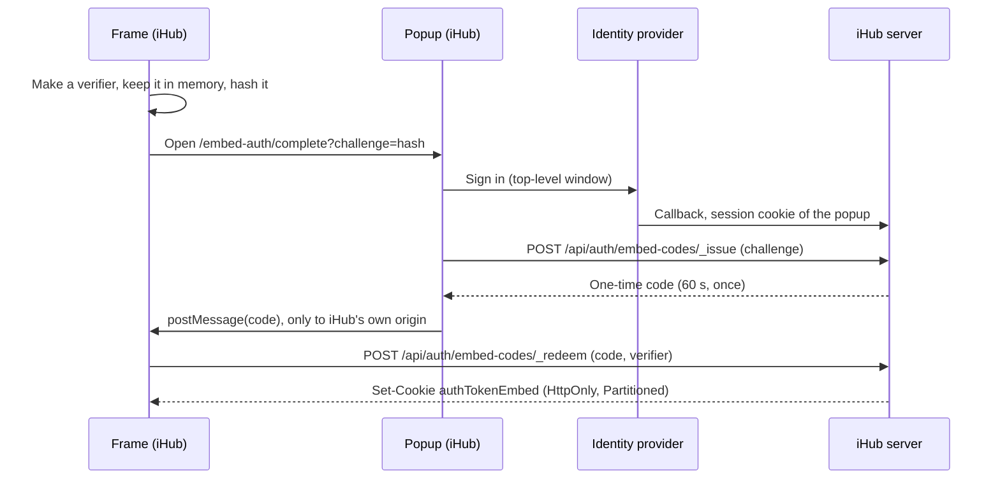

# Embed Mode

An embedding host — iFinder, a portal, an intranet page — can show iHub in an iframe and steer its
chrome and appearance with URL parameters. With **`embed=true`**, iHub keeps everything those
parameters set **in the browser tab only**: nothing reaches `localStorage`, so people who open iHub
directly keep their own settings.

```html
<iframe
  src="https://ihub.example.com/apps/translator?embed=true&sidebar=false&header=false&footer=false&mode=dark&language=de"
></iframe>
```

This renders the Translator app without iHub's own chrome, in dark mode and in German.

## Why a separate mode

An iframe on a same-site subdomain (`ifinder.example.com` → `ihub.example.com`) shares iHub's
browser storage with direct visits. Without embed mode, `?sidebar=false` or `?language=de` in the
iframe would be remembered in `localStorage` and change iHub for the same person the next time they
open it directly.

## Parameters

| Parameter | Values                        | Effect                                                                                                        |
| --------- | ----------------------------- | ------------------------------------------------------------------------------------------------------------- |
| `embed`   | `true`                        | Switches embed mode on for this tab. Any other value is ignored.                                              |
| `mode`    | `light`, `dark`, `auto`       | Colour mode. `auto` follows the system setting. Any other value is ignored.                                   |
| `header`  | `false` / `true`              | Hide / show iHub's header. The sidebar is part of it: `header=false` hides both.                              |
| `sidebar` | `false` / `true`              | Hide / show the left navigation sidebar (the classic top header is used instead when it is off).              |
| `footer`  | `false` / `true`              | Hide / show the footer.                                                                                       |
| `language`| `en`, `de`                    | UI language. The built-in languages are accepted (`de-DE` selects `de`); any other value is ignored.          |

`embed` and `mode` are read when the page loads. `header`, `footer`, `sidebar` and `language` are
also read when the page changes inside iHub. The values are case-insensitive for `mode` and
`language`.

**An embed starts without iHub's chrome.** Header, footer and sidebar are all off until the host
turns a part on with `header=true`, `footer=true` or `sidebar=true` (the sidebar needs the header
too). So `?embed=true` alone gives the bare page; the host does not have to pass `=false` for each
part.

## What stays in the tab

In embed mode these preferences live in the tab's `sessionStorage` and **`localStorage` is neither
read nor written** for them:

| Preference                       | Direct visit (`localStorage`) | Embed (`sessionStorage`)     |
| -------------------------------- | ----------------------------- | ---------------------------- |
| Header / footer / sidebar        | `ihubIntegrationSettings`     | `ihubIntegrationSettings`    |
| Colour mode (also the toggle)    | `ih-dark-mode`                | `ih-dark-mode`               |
| UI language (also the selector)  | `i18nextLng`                  | `i18nextLng`                 |

- The values survive navigation inside iHub (which drops the query string) and a reload of the
  frame, and are gone when the tab closes. Signing out and the forced refresh clear the rest of
  the tab's `sessionStorage` but keep them, so the frame stays an embed.
- Embed mode applies to a **frame**. If the same tab later opens iHub at top level — a link in the
  host that opens iHub in the same tab, or an address typed there — that page is an ordinary visit
  that uses the user's own settings, even though a frame on a same-site host shares the tab's
  storage with it. The frame's embed session is still there when the host's frame comes back. A
  top-level page whose own URL carries `embed=true` is an embed until it navigates on (a reload of
  an in-app URL no longer is one).
- Loading a URL with `embed=true` **starts a fresh embed session**: what an earlier load of the
  same frame left behind is discarded, so the URL the host builds is what the user gets. A URL
  without `embed=true` keeps the session.
- Without `mode`, an embed follows the system colour mode. It does not inherit the colour mode the
  user chose in a direct visit, and without `language` it uses the browser language.
- An embed does **not publish** language changes on the cross-product `intrafind`
  `BroadcastChannel` (see [Localization](localization.md#iframe-embedding)), so it cannot switch the
  language of other iHub tabs. It still listens, so a host on the same origin can drive it.
- If the browser blocks `sessionStorage` for the frame, embed mode keeps working until the frame is
  reloaded.

### What embed mode does not cover

Only the parameters above are session-scoped. iHub still stores other things in the browser as it
does for any visit: the sign-in token, recently used apps, whether the sidebar is collapsed, drafts
and similar usage data. Opening an app inside an embed therefore also updates the **recently used
apps** list a direct visit shows. The language of the sign-in screen is taken from the browser, not
from `language`.

## Invalid values

Values outside the lists above are ignored — iHub keeps what it had and does not store anything.
That also applies to `language` outside embed mode.

## Outside embed mode

Without `embed=true` the parameters behave as before: `header`, `footer`, `sidebar` and `language`
are remembered in `localStorage` until they are passed again with another value (see
[UI Configuration](ui.md#navigation-sidebar)). `mode` is new and is stored like a click on the
dark-mode toggle (`ih-dark-mode`).

## AI-use acknowledgement

The [AI-use acknowledgement](ai-act.md#ai-use-acknowledgement) dialog appears in embed mode as everywhere
else (not while the [EU AI Act features are switched off](ai-act.md#switching-the-features-off)). Signed-in users confirm once for the account, in any client. Two limits to know:

- **Anonymous guests in a frame of another site.** A guest's confirmation is a cookie
  (`SameSite=Lax`). A browser that blocks third-party cookies drops it in a cross-site frame, so the
  confirmation does not stick. After **Confirm** the dialog then says so and offers **Open iHub in the
  browser**, where the confirmation works. Authenticated embeds do not have this limit.
- **Evidence quality depends on the host.** The confirmation is bound to the user (or guest), not to the frame,
  but the frame is where the user reads the text. Pin `frame-ancestors` to the hosts you trust (see below)
  so the dialog cannot be shown inside an untrusted page.

---

## Signing in inside a frame

Identity providers such as Microsoft Entra ID, Google and Okta refuse to be shown in a frame
(`X-Frame-Options` / `frame-ancestors`). With OpenID Connect, iHub in an iframe therefore cannot
send people to the provider the usual way. LDAP and local sign-in work, because their form never
leaves the frame.

iHub solves this with a popup. The sign-in runs in a window of its own, where the provider is
allowed to show its page. The frame then gets its own session, and no token reaches a script.

### Set it up

Name the sites that may show iHub in `contents/config/platform.json`:

```json
{
  "embedAuth": {
    "allowedHostOrigins": ["https://ifinder.example.com"]
  }
}
```

| Setting                          | Effect                                                                                                                          |
| -------------------------------- | ------------------------------------------------------------------------------------------------------------------------------- |
| `embedAuth.allowedHostOrigins`   | Origins (scheme, host, port) of the sites that may show iHub in a frame. Empty or missing: the feature is off.                  |

Restart the server after changing it: platform settings are read at start-up. The setting has no
admin page yet; the admin settings pages keep it when they save.

- Use HTTPS on both sites. The session cookie is `Secure`.
- Register nothing new at the identity provider: the popup uses the redirect address iHub already
  has.
- While the list is set, iHub's pages are sent with `Content-Security-Policy: frame-ancestors
  'self' <your origins>`, so **no other site can show iHub in a frame**. A site that shows iHub
  and is not on the list, such as a Teams tab, stops working: add it.
- Reverse proxies must not add their own `X-Frame-Options` or `frame-ancestors` header that
  contradicts the list.

### What people see

1. The frame shows iHub's sign-in. With one OIDC provider, there is no redirect: they click the
   provider's button.
2. A pop-up window opens. If they are signed in at the provider already, it closes by itself;
   otherwise they sign in there.
3. The frame continues. If their browser blocks pop-ups, the frame says so and asks them to allow
   them for the iHub address.

Signing out in the frame ends the frame's session. It does not end the session at the identity
provider.

### How it works



- The code is worth nothing without the verifier, which never left the frame, and works once.
- The session cookie is `HttpOnly`: no script can read it, and no token is ever in a response
  body, in `localStorage` or in a URL. Another site cannot make the browser send it.
- The cookie is `Partitioned`: the browser keeps it per top-level site and sends it only while iHub
  is shown by the site it was set for. It is `SameSite=None`, which gives up the protection `Lax`
  gives against forged requests, so iHub honours it only for requests the iHub page itself made
  (`Sec-Fetch-Site: same-origin`, or an `Origin` that is iHub's own). Anything else is answered as
  if the cookie were not there.
- The cookie lasts as long as the session it was made from, and has a name of its own
  (`authTokenEmbed`), so it never clashes with the `authToken` cookie of a visit to iHub.

### Limits

- The popup needs a way back to the frame. If an identity provider or a browser policy cuts that
  link (`Cross-Origin-Opener-Policy`), the popup says it cannot return and the sign-in does not
  complete. Opening iHub in its own tab always works.
- A sign-in that names the user on every request (a reverse proxy, an API client) has no session to
  hand over and needs no cookie.
- Other flows that send the frame to a provider, such as connecting an integration, still need a
  tab of their own.
- Signing out in iHub in its own tab does not end the session of a frame. It ends when it expires
  or at **Sign out** in the frame.

---

## Notes for hosts

- Embed mode only controls what iHub renders and stores. Whether a browser lets your site frame
  iHub is decided by the `Content-Security-Policy: frame-ancestors` / `X-Frame-Options` headers that
  iHub or your reverse proxy sends: allow the host's origin there. With
  [OIDC sign-in in a frame](#signing-in-inside-a-frame), iHub sends that header itself, from
  `embedAuth.allowedHostOrigins`.
- The [Nextcloud embed](nextcloud-embed.md) uses the same mode; it switches it on itself and does
  not need the parameter.
- Deployments under a sub-path work as usual: `https://example.com/ihub/apps/translator?embed=true`.
