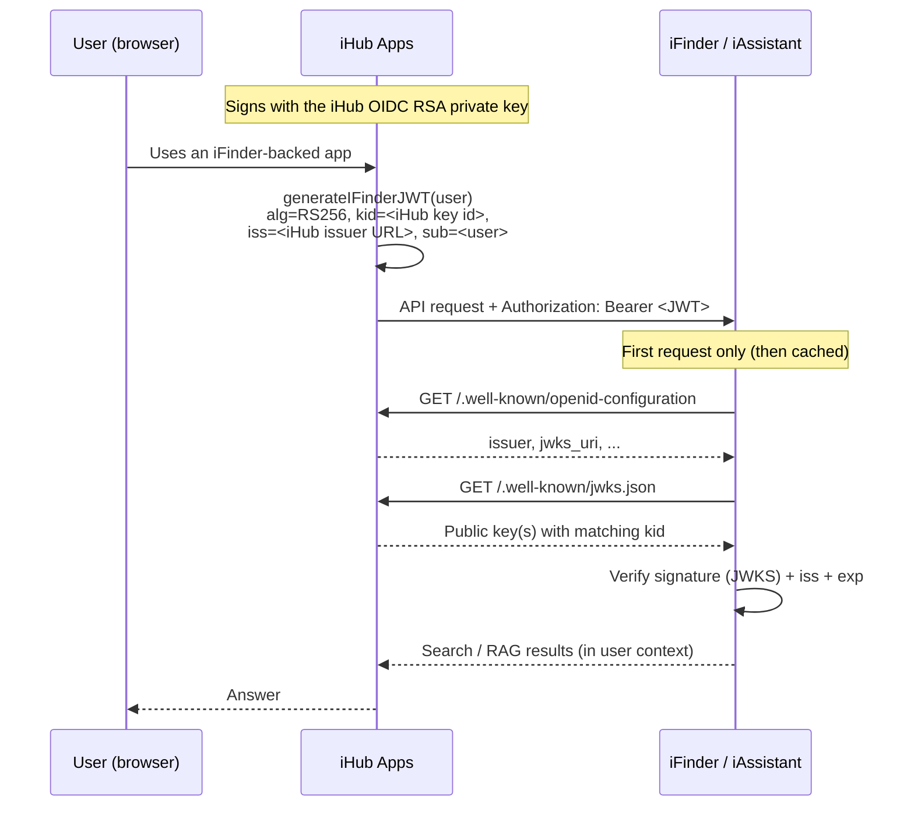

# iFinder Keyless (OIDC/OAuth) JWT Integration

> **This is the recommended way to connect iHub Apps to iFinder / iAssistant.**
> It replaces the manual RSA key generation and exchange described in
> [iFinder JWT Key Generation](ifinder-jwt-key-generation.md). No key pair has
> to be created, no public key has to be copied into iFinder — the whole trust
> relationship is established through configuration alone.

> **iHub and iFinder already share an OIDC provider** (Zitadel, Keycloak, Entra
> ID)? Then iFinder can trust that provider instead of iHub: see
> [Shared OIDC Provider (Token Exchange)](#shared-oidc-provider-token-exchange).

## Table of Contents

1. [Overview](#overview)
2. [Why Keyless?](#why-keyless)
3. [How It Works](#how-it-works)
4. [Prerequisites](#prerequisites)
5. [Step 1 — Configure iHub Apps](#step-1--configure-ihub-apps)
6. [Step 2 — Configure iFinder](#step-2--configure-ifinder)
7. [Step 3 — Verify the Connection](#step-3--verify-the-connection)
8. [Token Structure](#token-structure)
9. [Migrating from Manual Key Exchange](#migrating-from-manual-key-exchange)
10. [Configuration Reference](#configuration-reference)
11. [Troubleshooting](#troubleshooting)
12. [Shared OIDC Provider (Token Exchange)](#shared-oidc-provider-token-exchange)
13. [Related Documentation](#related-documentation)

## Overview

iHub Apps calls the iFinder / iAssistant APIs on behalf of the logged-in user.
Every request carries a short-lived JWT that identifies that user. iFinder must
be able to verify that the token was really issued by iHub and has not been
tampered with.

There are two ways to establish that trust:

| Approach | How iFinder gets the verification key | Key management |
|---|---|---|
| **Keyless / OIDC (recommended)** | iFinder fetches iHub's public key at runtime from iHub's JWKS endpoint (`/.well-known/jwks.json`) | None — nothing to generate or copy |
| Manual key exchange (legacy) | An operator generates an RSA key pair, gives the private key to iHub and uploads the public key into iFinder | Manual generation, distribution, and rotation |

The keyless approach reuses the RSA key pair that iHub already maintains for its
OpenID Connect / OAuth server. That key pair is published — public half only —
at the standard JWKS endpoint, exactly the way any OIDC identity provider
publishes its signing keys. iFinder, which is a Spring Boot application, already
knows how to consume an OIDC provider's discovery and JWKS endpoints, so pointing
it at iHub is all that is required.

## Why Keyless?

- **Nothing to generate.** No `openssl genpkey`, no PEM files, no
  `IFINDER_PRIVATE_KEY`.
- **Nothing to exchange.** The public key is never emailed, copied, or checked
  into a config repository. iFinder pulls it over HTTPS when it needs it.
- **Automatic rotation.** When iHub's signing key changes, iFinder picks up the
  new key from the JWKS endpoint automatically (keys are matched by their `kid`).
  There is no coordinated "rotate on both sides" procedure.
- **Standards-based.** iFinder validates iHub tokens the same way it would
  validate tokens from Entra ID, Keycloak, or any other OIDC provider.
- **One key, one source of truth.** The token that goes to iFinder is signed with
  the same key iHub uses for its own OIDC tokens, so there is only one key to back
  up and protect (`contents/rsa_private.pem`).

## How It Works



1. A user triggers an iFinder tool (search, get content, …) or an iAssistant
   RAG conversation inside iHub.
2. iHub mints a JWT for that user, signing it with its **OIDC RSA private key**
   using `RS256`. The JWT header includes a `kid` (key id) that matches the key
   published at iHub's JWKS endpoint, and the `iss` (issuer) claim is iHub's
   public base URL.
3. iHub sends the token to iFinder in the `Authorization: Bearer …` header.
4. On the first token it sees, iFinder reads iHub's discovery document
   (`/.well-known/openid-configuration`), learns the `jwks_uri`, and downloads
   the public key(s). It caches them and only refetches when it encounters an
   unknown `kid`.
5. iFinder verifies the signature against the public key, checks that `iss`
   matches its configured `issuer-uri`, and checks expiry. If everything lines
   up, the request runs in the user's context.

Because the public key travels from iHub to iFinder over HTTPS on demand, there
is no manual key exchange step.

## Prerequisites

- **iHub Apps** reachable from iFinder over HTTPS at a stable, public base URL
  (this is the URL iFinder will fetch `/.well-known/*` from).
- **RS256 signing** — iHub's default JWT algorithm. The JWKS endpoint only
  publishes a key when `platform.jwt.algorithm` is `RS256` (the default). If it
  was changed to `HS256`, switch it back to `RS256` first.
- **Administrative access** to both the iHub Admin UI and the iFinder Spring
  configuration.
- **iFinder** must recognize the user identity that iHub puts in the token's
  `sub` claim (see [JWT Subject](#configuration-reference)). This is the same
  identity requirement as the legacy approach.

You do **not** need to fully turn iHub into an OAuth identity provider
(`oauth.enabled`) just for iFinder verification. The `/.well-known/jwks.json`
and `/.well-known/openid-configuration` endpoints are always served, and the RSA
key pair is created automatically on first startup. The only OAuth setting that
matters here is the **issuer URL** (below).

## Step 1 — Configure iHub Apps

### Option A — Admin UI (recommended)

1. Set `oauth.issuer` to your iHub public URL under **Admin → Authentication →
   OAuth Server** (see the important note below) and restart the server.
2. Open **Admin → Integrations → Installed**, pick **iFinder** in the catalog
   and **Install** (or **Edit** the existing installation).
3. Set the **iFinder base URL** and leave **Authentication** at *JWT signed by
   iHub*.
4. Tick **Sign with iHub's OIDC key pair**. The **Private key** field is not
   used then and can stay empty.
5. Under the advanced settings, check the **JWT audience** (default
   `ifinder-api`) and **Token scope** (`fa_index_read`); set **User identity
   sent to iFinder** to the identity iFinder expects (usually *E-mail*).
6. **Test**, then **Install** / **Save**. The iFinder side is configured as in
   [Step 2](#step-2--configure-ifinder).

While keyless mode is on, the private key, the signing algorithm and the JWT
issuer fields are ignored — the OIDC key and the OAuth issuer URL are used.

### Option B — `integrations.json`

The installation lives in `contents/config/integrations.json`; the issuer stays
in `platform.json`:

```json
{
  "installed": [
    {
      "id": "ifinder",
      "definition": "com.intrafind/ifinder",
      "enabled": true,
      "values": {
        "baseUrl": "https://your-ifinder-instance.com",
        "authMode": "ihubSigned",
        "useOidcKeyPair": true,
        "audience": "ifinder-api",
        "defaultScope": "fa_index_read",
        "jwtSubjectField": "email",
        "tokenExpirationSeconds": 3600
      }
    }
  ]
}
```

```json
{
  "oauth": {
    "issuer": "https://your-ihub-instance.com"
  }
}
```

Changes to `integrations.json` are picked up automatically. The `oauth.issuer`
change (server behavior/auth) requires a **server restart**.

### ⚠️ Important: set the OAuth Issuer URL explicitly

When `useOidcKeyPair` is enabled, iHub stamps the token's `iss` claim from
`platform.oauth.issuer`. **This value must be an absolute URL** (starting with
`http`/`https`) and must be identical to the `issuer-uri` you configure on the
iFinder side.

Token signing happens outside of any HTTP request, so iHub **cannot
auto-detect** the public host at signing time. The "Auto-detected" issuer shown
in the Admin UI is only used for display and for the discovery document served
on live requests — it is **not** used when minting the iFinder token. If
`oauth.issuer` is left unset, the token's `iss` silently falls back to the
literal string `ihub-apps`, which is **not** a URL and will **not** match
iFinder's `issuer-uri`, causing every token to be rejected.

**Always set `oauth.issuer` to your iHub public base URL** (Admin →
Authentication → OAuth Server, or the `oauth.issuer` key in `platform.json`)
before relying on keyless iFinder tokens. iHub logs a warning at token-signing
time if this is misconfigured:

```
iFinder useOidcKeyPair is enabled but platform.oauth.issuer is not a URL.
iFinder JWT issuer will not match OIDC Discovery.
```

If iHub sits behind a reverse proxy, set `oauth.issuer` to the **external**
URL that iFinder will use to reach iHub, not the internal hostname.

## Step 2 — Configure iFinder

iFinder is a Spring Boot application using Spring Security's OAuth2 resource
server. Point it at iHub's issuer and enable resource-server validation:

```yaml
# iFinder application configuration
intrafind:
  security:
    auth:
      enable-oauth2-resource-server: true

spring:
  security:
    oauth2:
      resourceserver:
        jwt:
          # iFinder auto-discovers /.well-known/openid-configuration and the
          # JWKS endpoint from this issuer URL. Must match iHub oauth.issuer.
          issuer-uri: https://your-ihub-instance.com
          # Which JWT claim identifies the user. Match iHub's jwtSubjectField.
          principal-claim-name: email
```

What each setting does:

- **`enable-oauth2-resource-server: true`** turns on JWT validation for incoming
  API calls.
- **`issuer-uri`** is the single most important value. Spring appends
  `/.well-known/openid-configuration` to it, reads the `jwks_uri`, downloads the
  public key, and from then on validates every token's signature, `iss`, and
  `exp` automatically. It must be **byte-for-byte identical** to iHub's
  `oauth.issuer` (mind the trailing slash).
- **`principal-claim-name`** tells iFinder which claim to treat as the username.
  Use the claim iHub populates via its **JWT Subject Field** — typically `email`.
  For Microsoft Entra ID-backed identities, `email` is the safe choice.

### Alternative: point directly at the JWKS endpoint

If you prefer not to rely on discovery, you can point iFinder straight at the
key set instead of the issuer:

```yaml
spring:
  security:
    oauth2:
      resourceserver:
        jwt:
          jwk-set-uri: https://your-ihub-instance.com/.well-known/jwks.json
```

With `jwk-set-uri`, Spring validates the signature and expiry but does **not**
enforce an issuer match by default. `issuer-uri` is preferred because it also
pins the issuer.

## Step 3 — Verify the Connection

### From iHub

- Under **Admin → Integrations → Installed**, click **Test** on the iFinder
  installation (and on the iAssistant installation). A green result means iHub
  could reach iFinder and the token was accepted.
- Confirm the endpoints iFinder will read are reachable and, for RS256, return a
  key:

  ```bash
  curl https://your-ihub-instance.com/.well-known/openid-configuration
  curl https://your-ihub-instance.com/.well-known/jwks.json
  ```

  The JWKS response must contain a key with a `kid`. An empty `keys: []` array
  means iHub is not signing with RS256 — fix `platform.jwt.algorithm` first.

### From iFinder

Enable Spring Security debug logging while testing:

```yaml
logging:
  level:
    org.springframework.security: DEBUG
    org.springframework.security.oauth2: TRACE
```

A successful validation logs the resolved principal (the value of your
`principal-claim-name` claim). Signature, issuer, or expiry failures are logged
here too.

## Token Structure

A keyless iFinder token looks like this:

```json
{
  "header": {
    "alg": "RS256",
    "typ": "JWT",
    "kid": "e67f5e39d283ddec"
  },
  "payload": {
    "sub": "user.email@example.com",
    "name": "User Name",
    "iat": 1643723400,
    "exp": 1643727000,
    "iss": "https://your-ihub-instance.com",
    "aud": "ifinder-api",
    "scope": "fa_index_read"
  }
}
```

Compared with the legacy manual-key token, two things change automatically when
`useOidcKeyPair` is on:

- **`kid`** is added to the header, matching the key published at
  `/.well-known/jwks.json`, so iFinder can select the right key.
- **`iss`** becomes the iHub issuer **URL** (from `oauth.issuer`) instead of the
  literal `ihub-apps`, so it validates against OIDC discovery.

The same token is used for both the iFinder tools and the iAssistant RAG
integration.

## Migrating from Manual Key Exchange

If you already run iFinder with a manually exchanged key pair, switch over like
this:

1. **iHub:** set `oauth.issuer` to your public URL, then tick **Sign with
   iHub's OIDC key pair** (`useOidcKeyPair`) in the iFinder installation and
   save. You can leave the old **Private key** credential (or
   `IFINDER_PRIVATE_KEY`) in place — it is ignored while keyless mode is on.
2. **iFinder:** replace the `public-key-location` configuration with
   `issuer-uri` (or `jwk-set-uri`) as shown in [Step 2](#step-2--configure-ifinder).
3. **Restart** iFinder (and iHub, since `oauth.issuer` is an auth setting) and
   run the connection test.
4. Once verified, you can remove the old public key file from iFinder and delete
   the `IFINDER_PRIVATE_KEY` env var / the installation's **Private key** credential from iHub.

Because iFinder now trusts iHub's OIDC signing key, no future key rotation
requires touching iFinder — new keys are discovered through JWKS.

> **Breaking-change note:** the two mechanisms are mutually exclusive per
> environment. While `useOidcKeyPair` is `true`, the manually configured private
> key is not used. Plan the cutover so iHub and iFinder are switched together.

## Configuration Reference

### iHub Apps — the `ifinder` installation and `platform.json`

| Setting | Where | Purpose | Required for keyless |
|---|---|---|---|
| `enabled` | installation (its switch) | Enables the integration | Yes |
| `baseUrl` | installation values | iFinder / iAssistant instance URL | Yes |
| `useOidcKeyPair` | installation values (**Sign with iHub's OIDC key pair**) | Sign with the iHub OIDC RSA key and advertise via JWKS | **Yes — set `true`** |
| `oauth.issuer` | `platform.json`, oauth block | Absolute URL stamped into the token `iss`; must equal iFinder `issuer-uri` | **Yes — must be a URL** |
| `audience` | installation values, advanced | `aud` claim (default `ifinder-api`) | Optional |
| `defaultScope` | installation values, advanced (**Token scope**) | `scope` claim (e.g. `fa_index_read`) | Optional |
| `jwtSubjectField` | installation values (**User identity sent to iFinder**) | Which user field becomes `sub` (`email`, `id`, `username`, `name`; in the JSON also `domain\\username` or a `${user.field}` template) | Recommended |
| `tokenExpirationSeconds` | installation values, advanced | Token TTL (default `3600`) | Optional |
| `jwt.algorithm` | `platform.json`, jwt block | Must be `RS256` (default) so JWKS is populated | Yes (default) |

Settings that are **ignored** while `useOidcKeyPair` is `true`:
the installation's `privateKeyRef`, `IFINDER_PRIVATE_KEY`, `algorithm`, and
`issuer` (the OIDC issuer URL is used instead).

### iFinder — Spring Boot

| Property | Value | Purpose |
|---|---|---|
| `intrafind.security.auth.enable-oauth2-resource-server` | `true` | Turn on JWT validation |
| `spring.security.oauth2.resourceserver.jwt.issuer-uri` | iHub public URL | Discover keys and pin the issuer |
| `spring.security.oauth2.resourceserver.jwt.principal-claim-name` | `email` (or your subject claim) | Map the JWT to a user |

## Troubleshooting

### "Invalid issuer" / token rejected

The token `iss` must exactly equal iFinder's `issuer-uri`. Common causes:

- `oauth.issuer` was never set on iHub, so `iss` fell back to `ihub-apps`. Set
  `oauth.issuer` to your public URL and restart iHub.
- Trailing-slash mismatch (`https://host` vs `https://host/`). Make both sides
  identical.
- iHub is behind a reverse proxy and `oauth.issuer` points at the internal host
  while iFinder uses the external host. Use the external URL on both sides.

### JWKS endpoint returns `{ "keys": [] }`

iHub is not signing with RS256. Set `platform.jwt.algorithm` back to `RS256`
(the default) and restart. HS256 (symmetric) keys cannot be published via JWKS.

### "Unable to find a signing key" / unknown `kid`

iFinder's cached key set is stale, or iHub's RSA keys were regenerated. iFinder
refreshes on an unknown `kid`; if it does not, restart iFinder to force a
refetch. Note that losing / regenerating `contents/rsa_private.pem` on iHub
invalidates all previously issued tokens.

### iFinder cannot reach `/.well-known/*`

Check network path and TLS from the iFinder host to iHub:

```bash
curl -v https://your-ihub-instance.com/.well-known/openid-configuration
```

Firewalls, split-horizon DNS, or a proxy that rewrites `Host` headers are the
usual culprits.

### "iFinder JWT requires authenticated user"

Anonymous users cannot use iFinder. Ensure the user is logged in to iHub. This
is unrelated to the signing mode.

### Wrong user resolved in iFinder

`principal-claim-name` on iFinder must match the claim iHub fills via
`jwtSubjectField`. If iHub sends `sub = email` but iFinder reads `sub` as an
opaque id, set `principal-claim-name: email` (or align the two).

## Shared OIDC Provider (Token Exchange)

Everything above describes the **`ihubSigned`** mode: iHub issues the iFinder
token and iFinder trusts iHub. When iHub and iFinder already sign users in
through the **same OIDC provider**, iFinder usually trusts that provider and
nothing else, and pointing it at iHub as a second issuer conflicts with its own
logins. For that setup iHub offers a second mode, **`oidcTokenExchange`**: the
provider issues the iFinder token.

| | `ihubSigned` (default) | `oidcTokenExchange` |
|---|---|---|
| Who issues the iFinder token | iHub (private key or OIDC key pair) | The shared OIDC provider |
| iFinder `issuer-uri` | iHub (`oauth.issuer`) or the key you deployed | The provider |
| `sub` in the token | The installation's `jwtSubjectField` | The provider's user claim, the same iFinder sees for its own logins |
| `fa_*` claims | `scope` claim set by iHub | Scopes iHub requests, or added by a claim mapper on the provider |
| Who can use iFinder | Every signed-in user | Users who signed in to iHub through that provider |

### How it works

1. **Sign-in.** When a user signs in to iHub through the selected provider, iHub
   keeps the provider's access and refresh token, encrypted in
   `contents/integrations/oidc-login/` (AES-256-GCM, the same store the cloud
   storage integrations use). They are never written to `users.json`. Sign-ins
   through any other provider store nothing.
2. **Per iFinder call.** iHub exchanges the stored access token at the provider's
   token endpoint for a token with the iFinder audience and scopes, and caches it
   per user, audience and scope until one minute before it expires.
3. **Expiry.** An expired sign-in token is refreshed with the refresh token first.
   Cluster workers take a per-user lock for the refresh, because Zitadel and
   Keycloak rotate refresh tokens and two concurrent refreshes would invalidate
   them.
4. **Background runs.** Scheduled tasks, personal API keys and workflows have no
   session; they use the stored refresh token in the same way. **Add
   `offline_access` to the provider's scopes** (Admin > Authentication > OIDC
   provider > Scopes), otherwise there is no refresh token and iFinder access ends
   when the sign-in token expires.

The stored tokens stay after logout, so scheduled tasks keep running. They are
deleted when the user is deleted or deactivated, when the user revokes them
under **Integrations** in their profile, and when the provider rejects the
refresh token for good (revoked, expired, user disabled). In that last case the
call fails with *"Sign in again via &lt;provider&gt; to re-authorize iFinder
access"*; signing in once restores it.

Users who did not sign in through the selected provider (local, LDAP, NTLM, or
another OIDC provider) have no token to exchange. Their iFinder calls fail with
*"iFinder requires sign-in via &lt;provider&gt;"*. There is no fallback to
iHub-signed tokens.

### Configure iHub

In the iFinder installation (**Admin → Integrations → Installed → iFinder →
Edit**), set **Authentication** to *OIDC token exchange*, then:

| Field | Installation value | Purpose |
|---|---|---|
| OIDC provider for token exchange | `tokenExchangeProvider` | Name of the provider under Admin → Authentication that iFinder shares |
| Token exchange grant | `tokenExchangeGrant` | `tokenExchange` (RFC 8693: Zitadel, Keycloak) or `entraObo` (Entra On-Behalf-Of) |
| Token exchange audience | `tokenExchangeAudience` | iFinder's client or project id at the provider (RFC 8693 only) |
| Provider scope for `fa_index_read`, `fa_iassistant`, `fi_smartcollections` | `tokenExchangeScopeIndexRead`, `tokenExchangeScopeAssistant`, `tokenExchangeScopeSmartCollections` | Map the scopes iHub asks for (`fa_index_read` for search, `fa_iassistant` for iAssistant, `fi_smartcollections` for Smart Collections, the **Token scope** otherwise) to provider scopes. An empty value sends the scope unchanged |
| Extra scopes for the exchange | `tokenExchangeExtraScopes` | A list, sent with every exchange |

All but the provider are advanced settings. In `contents/config/integrations.json`:

```json
{
  "id": "ifinder",
  "definition": "com.intrafind/ifinder",
  "enabled": true,
  "values": {
    "baseUrl": "https://ifinder.example.com",
    "defaultScope": "fa_index_read",
    "authMode": "oidcTokenExchange",
    "tokenExchangeProvider": "zitadel",
    "tokenExchangeGrant": "tokenExchange",
    "tokenExchangeAudience": "312345678901234567",
    "tokenExchangeScopeIndexRead": "",
    "tokenExchangeScopeAssistant": "",
    "tokenExchangeScopeSmartCollections": "",
    "tokenExchangeExtraScopes": []
  }
}
```

The key, issuer, algorithm, expiry and **User identity sent to iFinder** settings do not
apply in this mode: the provider signs the token and sets its subject. No new
credentials are needed: iHub refreshes and exchanges with the client ID and
secret configured for the provider under Admin > Authentication, so that client
must be allowed to exchange for the iFinder audience. iHub authenticates at the
token endpoint with `client_secret_post` (client id and secret in the form
body), the same way it signs users in; make sure the client allows that
method. The token endpoint is called through the iHub proxy and SSL
settings, so a provider with a private CA works once its host is in
`ssl.domainWhitelist`.

### Configure iFinder

Point iFinder at the provider, the same issuer it already uses for its own
logins:

```yaml
intrafind.security.auth.enable-oauth2-resource-server: true
spring.security.oauth2.resourceserver.jwt.issuer-uri: https://<provider issuer>
```

| Provider | `issuer-uri` |
|---|---|
| Zitadel | `https://<instance>.zitadel.cloud` (or your custom domain) |
| Keycloak | `https://<host>/realms/<realm>` |
| Entra ID | `https://login.microsoftonline.com/<tenant-id>/v2.0` |

Extra claims in the provider's token are harmless. The token must **also**
carry the `fa_*` claims iFinder reads, in the form iFinder reads them today:
either as scopes iHub requests (scope map) or added by a claim mapper on the
provider for the iFinder audience.

To switch an existing installation without downtime, let iFinder accept both
issuers first (iHub and the provider), then switch iHub's mode.

### Provider setup

**Zitadel**

1. Enable token exchange for the instance: it is a beta feature, switched on
   through the feature API (`PUT /v2/features/instance` with
   `"oidcTokenExchange": true`) or in the instance's feature settings in the
   console.
2. The iHub application must be a confidential web application (client secret).
   Enable the *Token Exchange* grant on it, and the *Refresh Token* grant for
   `offline_access`.
3. Set the audience to iFinder's project id, and request project roles through
   Zitadel's reserved scopes, for example in **Additional scopes**:
   `urn:zitadel:iam:org:project:id:<ifinder-project-id>:aud` and
   `urn:zitadel:iam:org:projects:roles`. Map the `fa_*` roles into the claim
   iFinder reads with an Action if they are not already there.
4. Add `offline_access` to the provider's sign-in scopes in iHub.

**Keycloak 26.2 or later**

1. On the iHub client (confidential, *Client authentication* on), enable
   **Standard token exchange** under *Capability config*.
2. Allow the iHub client to exchange for the iFinder client: add the iFinder
   client as an audience (an *audience* mapper or a client scope), and set
   **Audience** in iHub to the iFinder client id.
3. Make the `fa_*` values available: as client scopes iHub requests through the
   scope map, or as roles mapped into the token by a protocol mapper.
4. Add `offline_access` to the provider's sign-in scopes in iHub. Keycloak
   rotates refresh tokens when *Revoke refresh token* is on; iHub handles that.

Only internal-to-internal exchange is supported by Keycloak's standard token
exchange, and the subject token must be an access token, which is what iHub
sends.

**Microsoft Entra ID (On-Behalf-Of)**

Entra does not support RFC 8693; choose the grant type **On-Behalf-Of**.

1. Expose an API on the iHub app registration (*Expose an API*, for example
   `api://<ihub-client-id>/access_as_user`). Add that scope to the provider's
   sign-in scopes in iHub, together with `openid profile email offline_access`.
   Without it the sign-in returns a Microsoft Graph token, which On-Behalf-Of
   rejects.
2. Expose an API on the iFinder app registration and give the iHub registration
   an API permission for it, with admin consent.
3. Map the iHub scope to iFinder's `.default` scope: set **Provider scope for
   `fa_index_read`** (and for `fa_iassistant`) to `api://<ifinder-app-id>/.default`.
   Audience is not used.
4. Provide the `fa_*` claims as app roles of the iFinder app registration
   assigned to the users or groups, or as optional claims.

### Verify

**Test** on the iFinder installation (**Admin → Integrations → Installed**) runs the exchange for your
own account (you must have signed in through the selected provider), decodes
the token without verifying it, and shows `iss`, `aud`, `sub`, the scope claim
and which of the expected `fa_*` claims are present. It then calls the iFinder
search API with that token.

Users see the stored authorization under **Integrations** in their profile,
with the date it was granted and a button to revoke it.

### Troubleshooting

| Message | Cause |
|---|---|
| *iFinder requires sign-in via &lt;provider&gt;* | The user signed in some other way. Sign in through the selected provider |
| *Sign in again via &lt;provider&gt; to re-authorize iFinder access* | No stored token (signed in before the mode was switched on, revoked, deactivated) or the refresh token was rejected |
| *&lt;provider&gt; refused the iFinder token exchange (HTTP 400): …* | The provider's exchange policy: token exchange not enabled, client not allowed for the audience, scope not granted, or (Entra) a Graph token as assertion |
| *The sign-in provider &lt;provider&gt; is temporarily unavailable* | The refresh failed for a temporary reason (network, 5xx); the stored tokens are kept |
| Diagnostics: *The token does not carry fa_…* | Request the claim through the scope map or add it with a claim mapper |

## Related Documentation

- [iFinder Integration](iFinder-Integration.md) — full feature and tool reference
- [iFinder & iAssistant Admin Guide](ifinder-iassistant-admin-guide.md) — end-to-end admin setup
- [iFinder JWT Key Generation](ifinder-jwt-key-generation.md) — legacy manual key-exchange approach
- [Using iHub as an OIDC Identity Provider](ihub-as-oidc-idp.md) — the same JWKS/discovery machinery for other clients
- [JWT Well-Known Endpoints](jwt-well-known-endpoints.md) — JWKS and discovery endpoint details, key management

---

_Last updated: July 2026_
