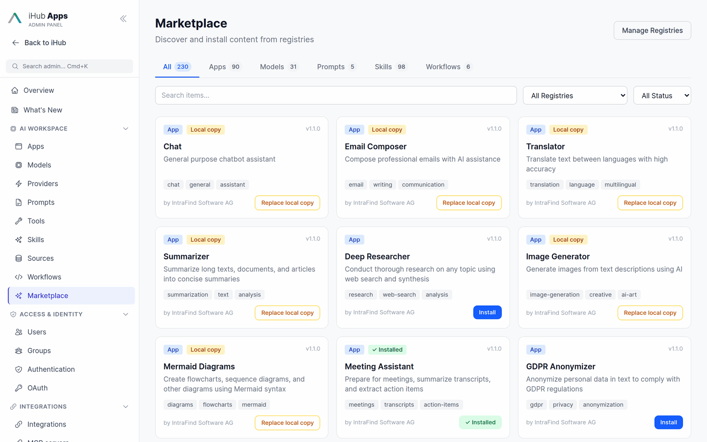
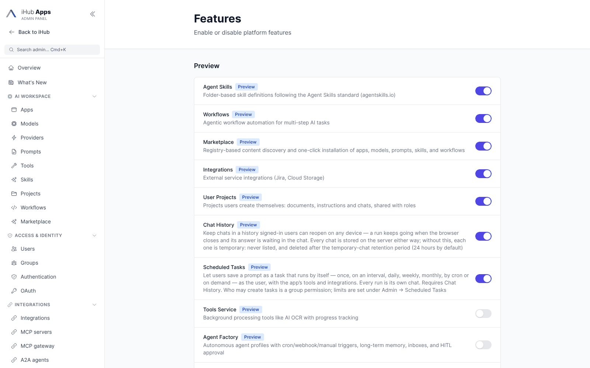
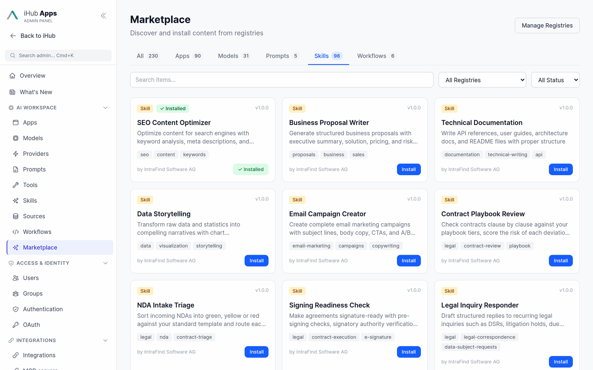
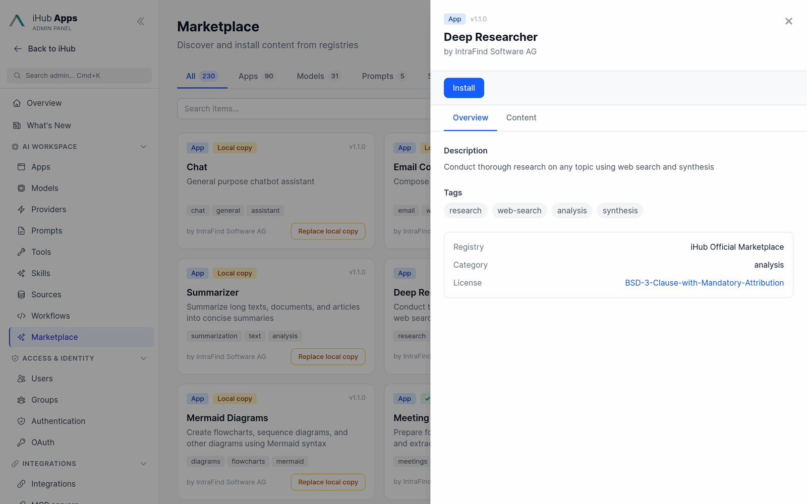
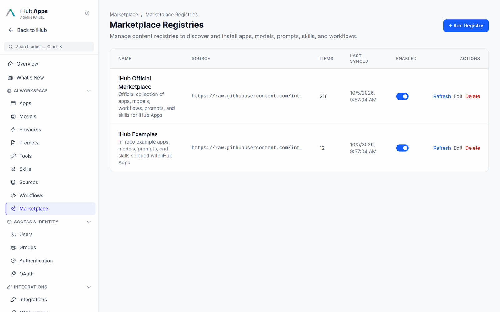

# Marketplace

The marketplace installs apps, models, prompts, skills, workflows and integrations from **registries** — catalogs
published as a `catalog.json` file, for example in a Git repository. Admins browse the catalogs in
**Admin → Marketplace**, read what an item does and install it with one click. iHub keeps track of
what it installed, so an item can later be updated, uninstalled or handed over to manual
maintenance.



## Enabling

The marketplace is on by default. Switch it off under
**Admin → Platform → Features → Marketplace** (`features.marketplace` in `contents/config/features.json`).
While it is on, the **Marketplace** entry appears in the admin sidebar under **AI Workspace**.



## Shipped registries

One registry is preconfigured in `contents/config/registries.json`:

| Registry                      | Catalog                                                                                     | Content |
| ----------------------------- | ------------------------------------------------------------------------------------------- | ------- |
| **iHub Official Marketplace** | `https://raw.githubusercontent.com/intrafind/ihub-marketplace/main/catalog.json`           | 100 apps (30 general apps and department assistants for data, engineering, finance, HR, security, leadership, legal, marketing, operations, product, PR, sales and support), 195 skills, 30 integrations (CKAN and 29 hosted MCP servers), 36 model configurations (including the [AWS Bedrock](models.md#aws-bedrock) models and the speech models), 6 workflows, 5 prompts |

Earlier versions also preconfigured an **iHub Examples** registry, served from the `examples/`
folder of this repository. That folder is gone and its content now lives in the official
marketplace; an update removes the registry from `registries.json` (migration V224). Apps, models
and prompts you installed from it keep working and stay under **Installed**; they are no longer
checked for updates, because their registry is gone. Install the same item from the official
marketplace to get updates, or **detach** it to maintain it by hand.

The official catalog can also be browsed without an iHub installation at
[intrafind.github.io/ihub-marketplace](https://intrafind.github.io/ihub-marketplace/). Its source is
the [intrafind/ihub-marketplace](https://github.com/intrafind/ihub-marketplace) repository.

Both registries are fetched on demand. If the catalog is empty the first time you open the
marketplace, press **Refresh** on the registry under **Manage Registries**. The installation needs
outbound HTTPS access to the catalog host (see [Proxy Configuration](proxy-configuration.md) for
installations behind a proxy). An installation without internet access uses the offline
marketplace instead (see [Air-gapped installations](#air-gapped-installations)).

## Browsing

The tabs filter by type and show how many items each type has. The search box matches names and
descriptions; the two selectors narrow the list to one registry and to a status.



Each card shows the item's type, version, tags, author and its state:

| State                | Meaning                                                                                                     | Action                                    |
| -------------------- | ----------------------------------------------------------------------------------------------------------- | ----------------------------------------- |
| *(none)*             | Available in the registry, not on this installation                                                         | **Install**                               |
| **Installed**        | Installed from the marketplace and tracked                                                                   | **Update** (when the catalog has a newer version), **Uninstall**, **Detach** |
| **Local copy**       | An item with the same id already exists here but was not installed from the marketplace — a shipped default or something an admin created | **Replace local copy** (asks for confirmation) |
| **Update available** | Installed, and the catalog offers a newer version                                                            | **Update** opens a dialog with what changed |
| *greyed*             | The item needs an iHub version this server does not have (`compatibility.ihub` or `minVersion` in the catalog); the card says which | **Install** and **Update** are disabled |

An integration card also shows four fixed facts, read from the item's definition when the catalog
is refreshed:

| Fact          | Shows                                                                                              |
| ------------- | -------------------------------------------------------------------------------------------------- |
| Sign-in       | The sign-in modes the definition offers (`none`, `service account`, `user API key`, `user OAuth`, …) |
| Effect        | **read** when every action only reads, **read · write** as soon as one writes or deletes, **not declared** when the actions do not say |
| Where it runs | **cloud**, **on-premises** or **local** (the definition's `runs`), **not stated** without one       |
| Actions       | The number of actions the definition declares; **listed by the server** for an MCP server or A2A agent, whose actions are known only once iHub connects |

Click a card to open its details: description, tags, registry, category, license (linked to the
license text when the catalog provides one) and, when the item declares one, the iHub version range
it needs. For an integration the details add **Integration facts**: the four facts and the actions
the definition declares, each with its effect (read, write, destructive, unknown) as a badge. When
the definition could not be read from the registry, the details say so and the card shows no
facts. The **Content** tab previews the item itself — the app or model JSON, or a skill's
`SKILL.md`. An integration with a release history gets a **Releases** tab: one entry per version
with its date and summary, and the notes per category (features, fixes, breaking changes) are
fetched from the registry and rendered when you open them, without installing anything.



## Installing, updating and removing

- **Install** fetches the item, validates it against the same schema the admin editors use, and
  writes it to `contents/` (`apps/`, `models/`, `prompts/`, `workflows/`, `skills/<name>/` or
  `integration-definitions/<name>/`). The item's id must equal its catalog name (for an
  integration, the definition's folder name: its id with the `/` replaced by `__`). The installation is recorded in
  `contents/config/installations.json` together with the version, the registry and the admin who
  installed it, and written to the audit log.
- **Model configurations never carry API keys.** An installed model uses the key of its provider
  (**Admin → Providers**) or the provider's environment variable. A model that replaces an existing
  one keeps that one's API key and its `default` flag.
- Installed content behaves like any other: who can use an app, model, prompt or skill is decided by
  the [group permissions](admin-ui.md#managing-groups), and it can be edited in its admin page.
- **Update** replaces the installed item with the version the registry offers: the catalog's
  current version, unless the registry's channel or the item's pin selects an older one (see
  [Versions, channel and pins](#versions-channel-and-pins)). An update is offered when that
  version is newer than the installed one; an update never goes back to an older version
  (`409 VERSION_NOT_NEWER`: revert the installations instead,
  [Integrations → Migrations](integrations.md#migrations)). Local edits to the item are
  overwritten — **Detach** it first if you want to keep them. For an integration, the dialog
  lists the releases between the installed and the catalog version (newest first) with their
  summaries, the compatibility line, and opens each release's notes on request. **Admin →
  Integrations** shows an **Update to vX available** badge on every installation of a
  definition with a newer compatible catalog version, and the admin dashboard counts them.
- **Updating an integration migrates its installations.** When a release between the installed
  and the catalog version names a definition migration, the update runs it for every
  installation of the definition: the new folder is staged, each installation is backed up and
  brought to the new version (install values, action policy, the bindings of the apps that bind
  it), and the folder moves in only in the same commit as the migrated installations, so no
  installation ever runs the new definition with old values. The item detail carries
  `migrationPreview`, planned from the catalog item's own copy of the migrations before anything
  is downloaded: per installation what changes (install values, actions, app bindings), the
  warnings and any collision. An installation older than the oldest release the catalog lists
  is planned against the downloaded definition at update time instead (`planFromCatalog:
  false`). An installation whose migration fails stays on its old values, is marked **Migration
  failed** and offers no tools until an admin re-runs the migration, restores the backup (which
  also brings the previous package back) or uninstalls it; the others are updated. When the
  commit itself fails, the previous folder, every installation and the manifest stay as they
  were. See [Integrations → Migrations](integrations.md#migrations).
- **The update dialog** (the item's **Update** button) lists, under the release notes, every
  installation of the definition with what the update does to it: "This update changes 2
  install values and 1 action of *GovData*; a backup is made first.", the apps that lose an
  action, an installation whose migration will fail ("the update still goes in, but it stays on
  its version and offers no actions until you act on its page"), one that is planned only when
  the update is downloaded, one that needs a review and is not migrated. After the update it
  reports each installation's result (migrated, version recorded, failed with the reason,
  skipped), each with a link to the installation's page; a migration that holds the lock is
  reported in the dialog ("try again in a moment").
- **Compatibility** is enforced on install and update: an item whose `compatibility.ihub` (or the
  short form `minVersion`, read as `>=minVersion`) this server does not satisfy is refused with
  `INCOMPATIBLE_IHUB_VERSION`, also when the API is called directly; an integration definition
  written for a format revision this server does not know is refused with
  `UNSUPPORTED_DEFINITION_SCHEMA`. See [Integrations → Version, compatibility and release
  notes](integrations.md#version-compatibility-and-release-notes).
- **Uninstall** deletes the item's files and the installation record. An integration definition
  cannot be uninstalled while an installed instance of it exists (**Admin → Integrations**); remove the instance first.
- **Integrations** are definition folders (an `integration.json` with its OpenAPI document, icon
  and README as companions). Installing one makes it available in the catalog under **Admin →
  Integrations**, where **Set up integration** opens the install wizard; the
  installation itself (URL, sign-in, actions) is created there, so one definition can be
  installed several times. See [Integrations](integrations.md).
- **Detach** keeps the files but removes the installation record. The item is then maintained by
  hand like anything an admin created, and the marketplace shows it as **Local copy**.

## Skills for users

Besides installing skills for everyone, admins can let users pick skills from the marketplace
themselves: in the library, **New → Skill from the marketplace** lists the skills of all enabled
registries, and **Add** copies one into the user's own skills. Nothing is installed in
`contents/`, and the copy is private to the user until they share it. This is on by default
while the marketplace feature is on and a registry has been refreshed; switch it off under
**Admin → Skills → User skills → Settings** (`userSkills.allowMarketplace`). See
[Skills → Skills from the marketplace](skills.md#skills-from-the-marketplace).

## Registries

**Admin → Marketplace → Manage Registries** lists the configured registries with their item count
and last sync. **Refresh** re-fetches a catalog, **Edit** changes it, and the toggle takes a
registry out of browsing without deleting it.



**Add Registry** asks for:

| Field            | Notes                                                                                           |
| ---------------- | ----------------------------------------------------------------------------------------------- |
| Name, ID         | The ID is a lowercase slug (`a-z`, `0-9`, `-`)                                                  |
| Catalog URL      | The URL of the `catalog.json` (or of the directory that holds it)                               |
| Authentication   | **None**, **Bearer Token**, **Basic Auth** or **Custom Header** — for private catalogs, e.g. a private GitHub repository read with a token |
| Auto Refresh     | Re-fetch the catalog periodically, every 1–168 hours (default 24)                               |
| Trust for code   | Off by default. On, the registry may deliver integrations that run their own connector module in the server process (`script` protocol) or migration modules (`module` steps); every code file must carry a hash in the catalog. Turn it on only for a publisher you trust |
| Versions         | **Channel**: *Stable releases only* (default) or *All releases, including pre-releases*. **Version pins**: per item (`<type>:<name>`, e.g. `integration:org.ckan__open-data-portal`) a semver range such as `1.3.x`; see [Versions, channel and pins](#versions-channel-and-pins) |

**Test Connection** fetches the catalog with the entered values before you save. Credentials are
stored encrypted with the other platform secrets.

### Publishing your own registry

A registry is a `catalog.json` that lists the items and where to fetch each one from — a path
relative to the catalog, a file in a GitHub repository, or an absolute URL. Every item carries a
`type` (`app`, `model`, `prompt`, `skill`, `workflow` or `integration`), a `name`, a display name, a description,
a version and optional author, category, tags, license and `licenseUrl`. The schema is described
in [Configuration Validation → Catalog Schema](configuration-validation.md#9-catalog-schema-catalogschemajs);
the [ihub-marketplace](https://github.com/intrafind/ihub-marketplace) repository is a complete
example, including a script that regenerates the catalog from its content folders. Items of type
`integration` and `skill` may list companion files in `source.companions`; for an integration the
OpenAPI document, the icon and the release-note files named in the definition are fetched even
when not listed. An integration item copies the definition's `version`, `compatibility` and
`releases` (version, date, summary, note paths and the `migration` a release names) and the
`migrations` those releases name, so the marketplace greys an incompatible item, shows its
release history and plans an update without downloading the folder; any item may carry
`minVersion` as the short form of `compatibility.ihub: ">=minVersion"`. An
integration that brings code (`script` protocol) must list a hash for every code file in
`source.integrity` (`{ "connector.js": "sha256-<base64 of the SHA-256>" }`); iHub installs it only
from a registry the admin trusts for code and refuses a file that does not match its hash.

When a catalog is refreshed (or tested), iHub fetches the `integration.json` of every integration
item from the registry, at most four at a time, and derives the facts the cards show from it; the
catalog file itself carries no facts (a `facts` field in it is ignored). A registry never offers a
local process: an item whose definition is an MCP server over `stdio`, or one without a fixed
remote transport, is left out of the catalog and the server log names the registry, the item and
the reason:

> Catalog item 'integration:local-files' of registry 'acme' rejected: An MCP integration from a
> registry needs a fixed remote transport (stdio is not allowed)

Install refuses such a definition as well, so a catalog cached before this check cannot install
it. An item whose definition cannot be fetched stays in the catalog without facts. A `script`
integration is not affected by this check; it is governed by the registry's trust for code.

A private registry is a good way to roll the same apps, prompts and skills out to several iHub
installations — for example a test and a production system, or one installation per subsidiary.

### Versions, channel and pins

A catalog item lists its current `version` and may list the versions the registry still serves:

```jsonc
"versions": [
  { "version": "1.4.0", "ref": "versions/integrations/org.ckan__open-data-portal/1.4.0.json" },
  { "version": "1.3.2", "ref": "versions/integrations/org.ckan__open-data-portal/1.3.2.json" }
]
```

`ref` points at the **version descriptor**, a catalog item of that version (its own `source` with
the companions and integrity of that version), relative to the catalog or as an absolute URL.
Without `ref`, iHub asks the catalog URL itself:
`<catalog URL>?type=integration&name=<name>&version=<version>` must answer with the descriptor, for
a registry server that serves versions dynamically. The descriptor must name the same type, name and
version, or the install is refused (`VERSION_DESCRIPTOR_INVALID`). The
[ihub-marketplace](https://github.com/intrafind/ihub-marketplace) repository tags every integration
release `integrations/<id>@<version>` and its site build publishes one descriptor and folder per tag.

The registry config decides which of these versions this server is offered:

- **`channel`**: `stable` (the default when the field is absent) hides pre-release versions
  (`2.0.0-rc.1`); `all` offers every listed version.
- **`pins`**: `{ "<type>:<name>": "<semver range>" }`, e.g. `{ "integration:org.ckan__open-data-portal": "1.3.x" }`.
  Only versions inside the range are offered.

The **offered version** is the newest listed version that passes both. Install and update take it
when no version is named (`POST …/_install` and `…/_update` accept `{ "version": "1.3.2" }`, which
must be listed and pass both, else `409 VERSION_NOT_LISTED` / `VERSION_NOT_OFFERED`; when nothing
passes, `409 NO_VERSION_OFFERED`). The update badge, `GET /api/admin/marketplace/updates`, the
**Update to vX** badge in **Admin → Integrations** and the update dialog (with its migration
preview) all use the offered version, so a pinned item is offered updates inside its pin only.
Browse results and the item detail carry `offeredVersion`, `availableVersions`, `channel` and `pin`;
the item detail shows **Pinned to 1.3.x** and the version offered when it is not the catalog's
current one. An item whose version is not a semantic version has no channel; its one version is
offered unless it is pinned.

The installation manifest records, for an integration with code files, the hashes the catalog
listed (`codeIntegrity`), so a migration module that runs later is checked against them.

### Air-gapped installations

An iHub that cannot reach GitHub cannot refresh the two shipped registries. For such installations
the [ihub-marketplace](https://github.com/intrafind/ihub-marketplace) repository publishes the
**offline marketplace**: the official catalog and every file it points at as static files, which
you host inside your network and add as a registry. Every merge to the repository is a release,
versioned by the UTC build time as `yyyymmddhhmm` (for example `202611032031`), and a release comes
in two forms, built by the repository's **Offline Marketplace** workflow:

- a **Docker image**, `ghcr.io/intrafind/ihub-marketplace:<version>` (nginx on port 8080, no
  configuration, no volume, runs as a non-root user, `linux/amd64` and `linux/arm64`; `latest` is
  the newest release);
- a **`.tar.gz` bundle** with its SHA-256 file, attached to the GitHub release, to unpack on any
  web server.

```bash
# connected machine
docker pull ghcr.io/intrafind/ihub-marketplace:202611032031
docker save ghcr.io/intrafind/ihub-marketplace:202611032031 | gzip > ihub-marketplace-image.tar.gz
# air-gapped network
docker load < ihub-marketplace-image.tar.gz
docker run -d --restart unless-stopped -p 8080:8080 ghcr.io/intrafind/ihub-marketplace:202611032031
```

Then add it under **Manage Registries → Add Registry** with the Catalog URL
`http://<host>:8080/catalog.json`, press **Refresh**, and switch off **iHub Official Marketplace**,
which needs internet access. The bundle's website shows the URL to copy.

- **Nothing is left out.** The 89 skills that the official catalog links to on GitHub (the Google
  skills) are copied into the bundle at their pinned commits, with their reference files and
  license texts; every item of the official catalog is in the bundle, with its version history, so
  [channel and pins](#versions-channel-and-pins) work as online.
- **One host.** The bundle must be served from the host of its catalog URL, see
  [Which hosts the server fetches from](#which-hosts-the-server-fetches-from). A private address is
  fine. A certificate from a private CA must be trusted by the iHub server, or its host listed in
  the platform's SSL whitelist (`ssl.domainWhitelist`).
- **What the items connect to is unchanged.** The 29 hosted MCP integrations still need the
  internet, and a model configuration still needs a reachable endpoint of its provider.
- **Updating** is publishing a new release (a new version tag or bundle); iHub's **Refresh** or **Auto Refresh** picks it up
  and the cards show **Update available** as usual.

The registry's guide, [docs/offline.md](https://github.com/intrafind/ihub-marketplace/blob/main/docs/offline.md),
covers hosting without Docker, building the bundle yourself, proxies and a check for a hosted copy.
Skills with reference files from a registry's own host need this iHub version or later; an older
iHub installs everything else.

## Security

### Which hosts the server fetches from

Everything the marketplace downloads — the catalog, an item, the companion files of a skill or an
integration, the GitHub file tree that lists them, the content preview — is fetched by the iHub
server. A catalog therefore decides which addresses the server connects to. So that a catalog
cannot steer the server into the internal network, every request is checked against the registry
it is made for:

| Target                                                        | Fetched                                                                      |
| ------------------------------------------------------------- | ---------------------------------------------------------------------------- |
| The registry's own host — host and port of its Catalog URL    | Always, also on a private address. A registry inside the company network keeps working |
| `api.github.com` and `raw.githubusercontent.com`              | For a registry whose catalog is on GitHub (`raw.githubusercontent.com`, `github.com`, `api.github.com`) |
| Any other host                                                | Only when every address it resolves to is public: no loopback, private ranges (`10/8`, `172.16/12`, `192.168/16`, `fc00::/7`), link-local and cloud metadata addresses (`169.254.169.254`), shared address space, multicast or reserved ranges. The connection is pinned to the addresses that were checked |

- **Redirects** are followed by the server itself, at most 5, and every hop is checked by the same
  rules: an allowed host cannot redirect the server to an internal address. A redirect to another
  host is sent without the registry's credentials (between the GitHub hosts they are kept).
- **A refused fetch** fails the install, update or refresh with a message that names the host, for
  example:

  > Marketplace fetch from '169.254.169.254' refused: the host is not the registry's own host and
  > not a public address (IP 169.254.169.254 is private)

  The content preview of an item is left empty instead, and a user who adds a skill from the
  marketplace sees that the marketplace could not be reached; the server log names the host.
- **A private registry** must serve its items and companion files from the host of its catalog
  (a relative `source.path`). An item or a `source.rawBase` on another internal host is refused.
- **Credentials:** the companion files of an integration whose `source.rawBase` is on another host
  than the registry are fetched without the registry's credentials.
- The check resolves a third-party host name on the iHub server, also when outbound traffic goes
  through a [proxy](proxy-configuration.md); a host the server cannot resolve is refused. The
  registry's own host and the GitHub hosts of a GitHub registry are not resolved for the check.

## Multi-server deployments

Installations write to `contents/` and to `contents/config/installations.json`. With several
servers on separate hosts, run installs and updates against one host (or a CI job) — see
[Multi-Server Deployment → Marketplace installs](multi-server-deployment.md#marketplace-installs).

## API

All routes below are admin-only and require the marketplace feature. The routes users browse and
add skills with are listed under [Skills → API](skills.md#api).

| Method & path                                                                 | Purpose                                     |
| ----------------------------------------------------------------------------- | ------------------------------------------- |
| `GET /api/admin/marketplace`                                                  | Browse items (type, search, registry, status filters); an integration item carries `facts` (`authModes`, `effect`, `runs`, `actionCount`, `protocol`; null when its definition could not be read) |
| `GET /api/admin/marketplace/registries/:registryId/items/:type/:name`         | One item with its content preview, `compatible`, `requires`; an integration also `facts` with its `actions` (`name`, `title`, `sideEffect`), and an installed one `migrationPreview` (below) |
| `GET …/items/integration/:name/_file?path=…`                                  | One Markdown companion file of an integration item (a release's notes), fetched from the registry |
| `POST …/items/:type/:name/_install`                                            | Install (`{ "replaceLocal": true }` to replace a local copy; `{ "version": "…" }` for a listed version, default the offered one) |
| `POST …/items/:type/:name/_update` · `_uninstall` · `_detach`                  | Update (`{ "version": "…" }` optional, default the offered version; `409 VERSION_NOT_NEWER` for an older one), uninstall, detach; an integration update answers with `integrationMigrations` (one result per installation: `migrated`, `stamped`, `failed`, `skipped`) and is `409 MIGRATION_LOCKED` while a migration of one of them runs |
| `GET /api/admin/marketplace/installations`                                    | What the marketplace installed              |
| `GET /api/admin/marketplace/updates`                                          | Installed items whose offered version (channel and pin applied) is newer |
| `GET` · `POST /api/admin/marketplace/registries`                              | List, create registries                     |
| `GET` · `PUT` · `DELETE /api/admin/marketplace/registries/:registryId`        | Read, edit, delete a registry               |
| `POST /api/admin/marketplace/registries/:registryId/_refresh`                 | Re-fetch a catalog                          |
| `POST /api/admin/marketplace/registries/_test` · `/:registryId/_test`         | Test an unsaved or a saved registry         |

`migrationPreview` (null when no installation of the definition exists):

```jsonc
{
  "definitionId": "org.ckan/open-data-portal",
  "to": "1.4.0",
  "planFromCatalog": true,          // false: an installation is older than the releases listed
  "reason": null,
  "errors": [],                     // migrations in the catalog this server cannot read
  "installations": [
    {
      "id": "govdata", "label": { "en": "GovData" },   // the stored label, or null
      "from": "1.2.0", "to": "1.4.0", "planFromCatalog": true,
      "migrations": ["1.3.0", "1.4.0"],
      "summary": { "values": 2, "actions": 1, "apps": 1 },
      "warnings": [], "collisions": [], "ok": true, "reason": null
    }
  ]
}
```

## Code map

| File                                                   | Responsibility                                        |
| ------------------------------------------------------ | ----------------------------------------------------- |
| `server/services/marketplace/RegistryService.js`       | Fetching, caching and refreshing catalogs; the descriptor of a listed version (`fetchItemVersion`) |
| `server/services/marketplace/versionPolicy.js`         | The offered version of an item: the registry's channel and the item's pin (pure) |
| `server/services/marketplace/ContentInstaller.js`      | Install, update, uninstall, detach; the installations manifest |
| `server/services/marketplace/marketplaceFetch.js`      | Every marketplace download: allowed hosts, redirects, credential scope |
| `server/validators/catalogSchema.js`                   | Catalog schema                                        |
| `server/validators/registryConfigSchema.js`            | Registry configuration schema                         |
| `server/routes/admin/marketplace.js`                   | The HTTP surface                                      |
| `client/src/features/admin/pages/AdminMarketplacePage.jsx` | Browse page                                       |
| `client/src/features/admin/components/marketplace/`    | Cards, detail panel, type tabs, registry form (channel and pins: `registryPins.js`) |
