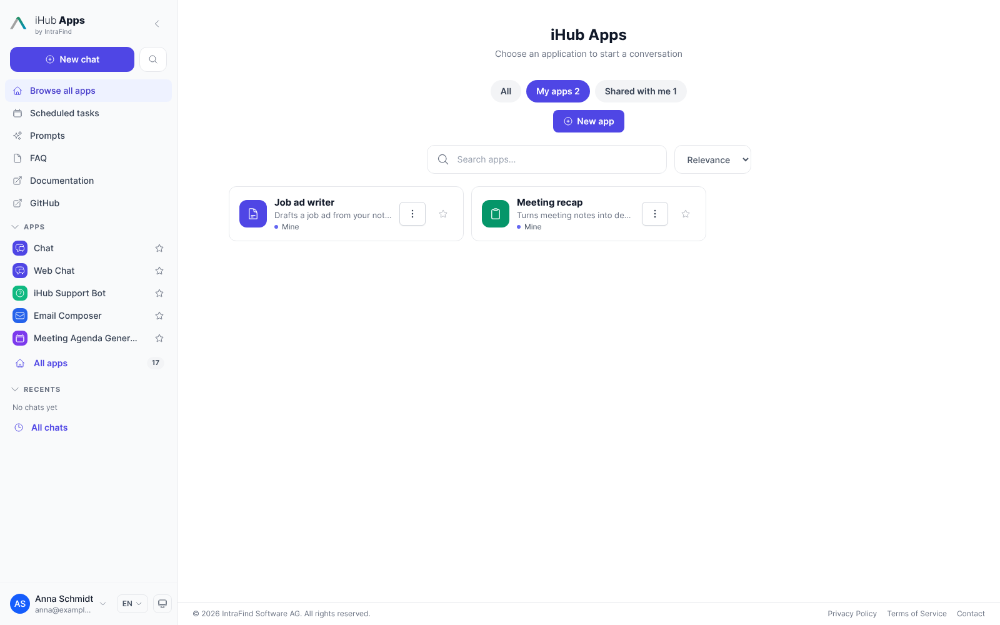
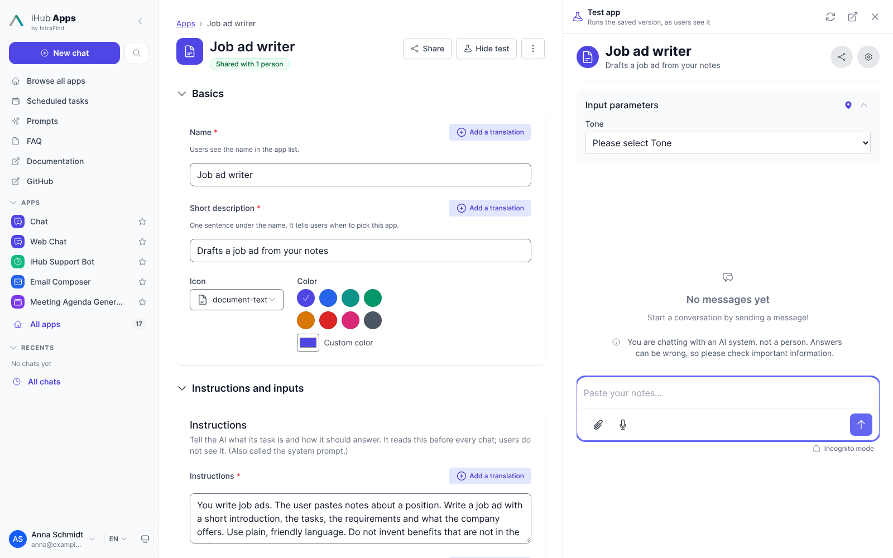
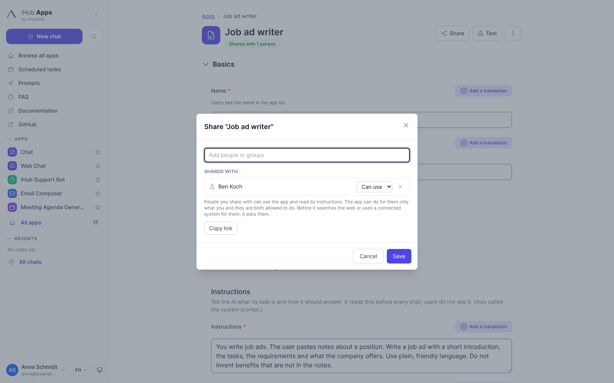
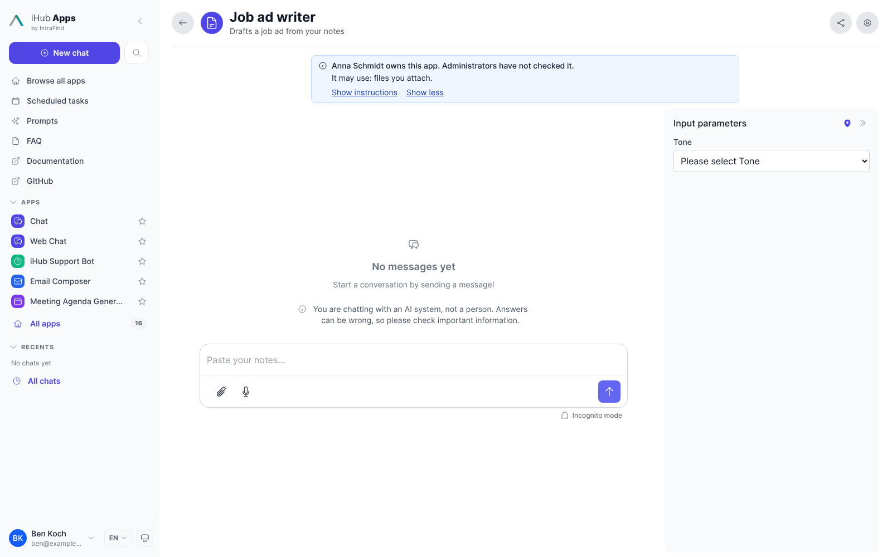
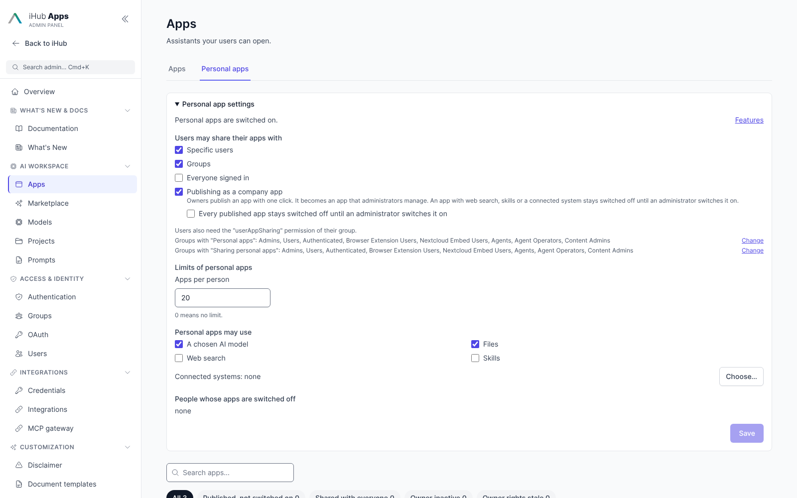
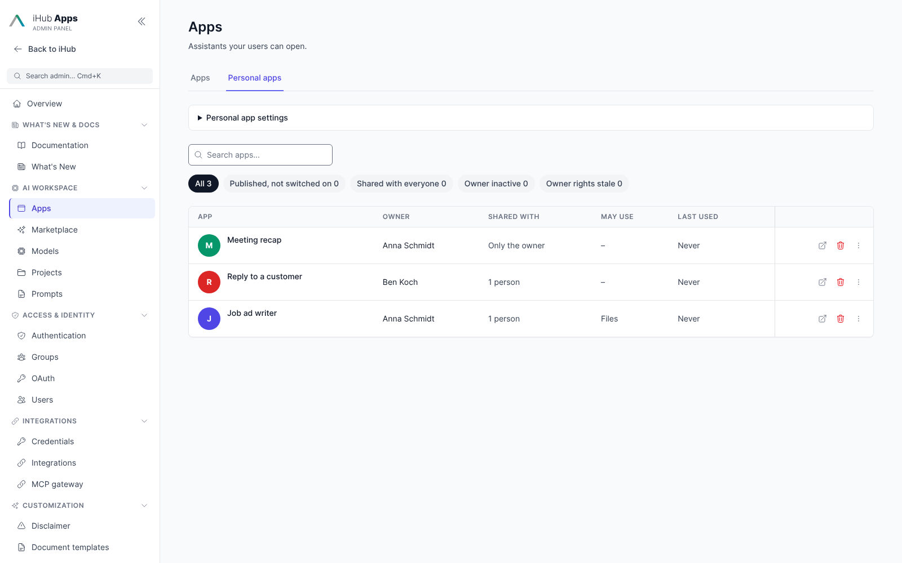

# Personal apps

A **personal app** is an app that a signed-in user builds without admin rights. It belongs to
that user. The owner shares it with colleagues, can publish it as a company app and can hand it
over to another person. Administrators decide whether users may do this at all and what a
personal app may use.

Personal apps are a preview feature and are switched off after an installation or an upgrade.
With the feature off, users see nothing of it. Full administrators see the tab **Personal apps**
under **Admin → Apps**, where they can prepare the settings first.

Personal apps and the apps administrators manage are two kinds behind one app list:

|                  | Company apps                                                       | Personal apps                                                              |
| ---------------- | ------------------------------------------------------------------ | -------------------------------------------------------------------------- |
| Created by       | Administrators and content admins, under **Admin → Apps**          | Users, with **+ → App** in the sidebar                                      |
| Used by          | Everyone whose groups may use the app                              | The owner and the people it is shared with                                 |
| Stored as        | Configuration, `contents/apps/<id>.json`                           | Runtime data in the storage provider, never in `contents/apps/`            |
| ID               | Chosen by the admin or derived from the name                       | Minted by the server: `uap_` followed by 32 hex characters                 |
| Settings         | Every setting of [Apps](apps.md)                                   | Texts, input fields, conversation starters and a few switches              |
| Runs in          | The chat, scheduled tasks, workflows, other apps, the inference API | The interactive chat only                                                  |
| Tool calls       | Follow the installation's [tool approval](tool-approval.md)        | Ask the person chatting; see [What a shared app asks first](#what-a-shared-app-asks-first) |
| Feature flag     | None                                                               | `userApps` (preview, off by default)                                       |

This page first describes what users do, and then what administrators set up and see. The
section for administrators starts at [Switching personal apps on](#switching-personal-apps-on).

## Three limits to know first

- **A shared app asks the person chatting before every tool call.** When someone uses an app they
  do not own, every web search, every page the app opens and every step in a connected system
  shows an approval card, one call at a time. The button **Approve & allow for this chat** is not
  offered there. An app that a team uses every day should therefore be
  [published](#publishing-as-a-company-app): as a company app it follows the approval settings
  of the installation.
- **A change of the owner's groups can take up to 30 days to reach a shared app.** A personal
  app may use only what its owner may use. For a local account iHub reads the owner's groups on
  every request. For an account of an identity provider (OIDC, proxy, LDAP, NTLM, Teams) iHub
  knows the groups from the owner's last visit; it takes them over again when the owner next
  opens the apps page, an app or a chat, and stops trusting them after 30 days without such a
  visit. **When someone leaves, deactivate the iHub account.** That takes effect at once.
- **A personal app cannot use a document collection.** It links no project, and the person
  chatting cannot attach one in its chat. It works with text that is pasted and with files a
  user attaches. The page **New app** says so before the author types.

## Who can build one

A user sees the entry **App** in the **Create** menu (+) of the sidebar when all of the
following hold:

- the feature **Personal apps** is switched on,
- one of the user's groups has the permission **Personal apps** (`userApps`),
- an administrator has not switched off the apps of this person,
- the user is signed in with an account of their own. Anonymous visitors, OAuth clients, agents
  and third-party apps acting for a user never see or hold personal apps.

A person can own 20 personal apps unless an administrator changed the limit. At the limit the
page says: "You have 20 apps, which is the limit. Delete one to create a new one." An app the
owner published still counts until the owner deletes it.

A [personal API key](personal-api-keys.md) can create and manage the apps of its own user and
chat with them. It cannot open an app that was only shared with that user, and it never acts as
an administrator for personal apps.

## The apps page



With the feature on, the apps page gets three filters:

- **All** shows company apps and personal apps together. A personal app carries a line under its
  description: **Mine**, or the name of its owner.
- **My apps** shows the apps you own, and apps someone offers to you, marked **Offered to you**.
- **Shared with me** shows the apps other people shared with you.

The ⋮ menu of a tile offers **Edit**, **Share**, **Duplicate** and **Delete** for an app you
own, and **Duplicate** and **Leave** for an app that was shared with you by name. **Leave** is
not offered when your access comes only through a group or through "Everyone signed in". For an
app offered to you it offers **View offer**, and the tile itself opens the offer instead of the
chat. **Duplicate** and **Publish** in the editor wait until your changes are saved: they take
the saved app.

## Creating an app

**App** in the sidebar's **Create** menu (+, between **New chat** and the search) opens the same
two steps that
administrators use under **Admin → Apps**; the guide [Build your first app](app-quickstart.md)
describes them. The differences for a personal app:

- The starts are the description box, the templates, **Copy an existing app** and **Start
  empty**. Link apps and the Marketplace are not offered.
- **Copy an existing app** lists the apps the person has access to: the company apps they may
  use, and the personal apps they own or that are shared with them. Left out are apps a personal
  app cannot become (link apps, websites shown inside iHub, apps connected to the iAssistant,
  apps that are switched off) and apps
  whose content the person cannot read (a personal app that is switched off or whose sharing is
  suspended, an app that was published and is now a company app for them, an app only offered
  to them). The copy takes the texts in every language, the icon, the colour, the message
  template, the input fields, the conversation starters, the preferred model and the switches
  for files, web search, skills and connected systems. Of these it keeps only what personal apps
  may use on this installation and what the person may use; the server checks again on create.
  The source's ID, owner, members, sharing and publishing state and every setting only a company
  app has stay behind. A link `/apps/new?from=<appId>` opens the copy of that app directly.
- There is no **App ID** and no category. The server mints the ID.
- The description box and **Prepare draft** need the feature **App Drafts with AI**. A draft
  suggests web search or a connected system only when personal apps may use it on this
  installation. A person can prepare 30 drafts per hour, counted together with the drafts the
  same person prepares in the admin area.
- Under the description box the page says what a personal app cannot do: "An app of your own
  cannot use a document collection yet. It can work with text you paste or a file a user
  attaches."
- Above the button the page says: "Only you can see the app until you share it."

**Create and test** stores the app and opens its editor with the test chat.

## The editor



The editor of a personal app is a page of its own, at `/apps/<id>/edit`. It has three groups:

| Group                         | Contains                                                                                                                              |
| ----------------------------- | ------------------------------------------------------------------------------------------------------------------------------------- |
| **Basics**                    | Name, short description, icon and color.                                                                                              |
| **Instructions and inputs**   | The instructions, input fields and conversation starters.                                                                             |
| **What the app may use**      | **AI model**, **Users can attach files**, **Web search**, **Skills** and **Connected systems**, as far as the installation allows them. |

- The header shows who can see the app: **Only you**, "Shared with 3 people" (groups are
  counted apart: "Shared with 2 people, 1 group"), **Shared with everyone**, **Now with the
  administrators** or **Switched off by an administrator**.
- The help under the instructions says that the people you share the app with can read them.
  A person who may read the app but not change it sees the instructions as text, not in a
  locked field, so that long instructions can be scrolled with the keyboard.
- **Test** opens the test chat beside the form. It runs the saved app, as the test chat of the
  admin editor does.
- **Share** opens the share dialog. The ⋮ menu holds **Open app**, **Publish**, **Hand over**,
  **Duplicate** and **Delete**. **Publish** is shown only when you may publish.
- A text is written in one language. **Add a translation** adds another one by hand; a personal
  app holds up to five languages. There is no automatic translation.
- If someone else saved the app while you were editing, the save bar says "Someone else changed
  this app. Reload to see the changes." Your entries stay in the form until you click
  **Reload**.
- **Improve with AI** on the instructions and the **Conversation** view (preview feature **Change
  apps in a conversation**) work as in the admin editor; see [Build your first app](app-quickstart.md#change-the-app-in-a-conversation-preview).
  They are shown to the owner and to people who may change the app. A change applied in the
  conversation reaches everyone you share the app with; the card says how many people that is.
  The builder never changes what the app may use.

### What a personal app can contain

| Part                                   | Limit                                                                 |
| -------------------------------------- | --------------------------------------------------------------------- |
| Name, short description, instructions  | 100, 500 and 8,000 characters per language                            |
| Message template, hint in the message box | 4,000 and 200 characters per language                              |
| Input fields                           | 8                                                                     |
| Conversation starters                  | 4                                                                     |
| Connected systems                      | 5, each with the functions it uses named one by one                   |
| People and groups it is shared with    | 100 entries                                                           |

Everything else an app configuration can hold is not available: website and link apps, HTML
answers, custom answer views, structured output, linked projects, workflows, other apps as
tools, a welcome message, fixed model lists and a start form. A personal app cannot store these
settings, so they cannot run. An administrator can add them after the app was
[published](#publishing-as-a-company-app).

Invisible characters, such as zero-width and text-direction marks, are removed from every text
when the app is saved. A person who reads the instructions therefore sees what the AI model
sees.

### What the app may use

The group **What the app may use** lists only what an administrator allowed for personal apps and
what you may use yourself:

| Switch                       | What it does                                                                                                                                              | Allowed on a new installation |
| ---------------------------- | --------------------------------------------------------------------------------------------------------------------------------------------------------- | ----------------------------- |
| **AI model**                 | A preferred model for the app. Without one, the standard model answers.                                                                                   | Yes                           |
| **Users can attach files**   | People can attach images and files in the chat.                                                                                                           | Yes                           |
| **Web search**               | The app can search the web and open pages. Each person switches web search on in their own chat. It needs a search engine that is installed in iHub; the search of the model provider is not used. | No                            |
| **Skills**                   | The app can use the skills that both the owner and the person chatting may use.                                                                           | No                            |
| **Connected systems**        | The app can use the functions you tick, out of those an administrator allowed for personal apps. Each person switches a connected system on in their own chat. | None                          |

**The rule behind the switches.** A capability works in a chat only when four things hold: the
app asks for it, the installation allows it for personal apps, the owner may use it and the
person chatting may use it. iHub checks this when the app is saved and again on every chat
request, because rights change after a save. If a check fails, the app still answers; it runs
without that capability, and with the standard model if the preferred model is the one that is
missing.

When a capability the app uses is no longer available to you, the editor says, for example, "Web
search is no longer available for your apps. The app runs without it." and offers **Remove**.

## Sharing



**Share** needs the group permission **Sharing personal apps** (`userAppSharing`). You add
people, groups or, when an administrator allowed it, **Everyone signed in**, each with a role:

| Can                                                          | Owner | Can edit | Can use |
| ------------------------------------------------------------ | :---: | :------: | :-----: |
| Chat with the app and read its instructions                  |   ✓   |    ✓     |    ✓    |
| See who else it is shared with (others see only how many)    |   ✓   |    ✓     |    —    |
| Change the app                                               |   ✓   |    ✓     |    —    |
| Change who it is shared with                                 |   ✓   |    ✓     |    —    |
| Duplicate it into an app of their own                        |   ✓   |    ✓     |    ✓    |
| Publish it, hand it over, delete it                          |   ✓   |    —     |    —    |

- The strongest role that reaches a person wins. The group of anonymous users cannot be added.
- A person with **Can edit** changes the list only when both that person and the owner have the
  permission **Sharing personal apps**.
- A person with **Can edit** can save only when they may use everything the app uses. Otherwise
  the form is read-only and says, for example, "This app uses Jira, which you may not use. You
  can use the app but not change it." Removing that capability is the one change such a person
  can save.
- Nobody is notified. **Copy link** copies the address of the app's chat, which opens the app
  only for people who may use it. The app also appears under **Shared with me**.
- A duplicate belongs to the person who made it, is shared with nobody and leaves out what that
  person may not use.

**Shares depend on the owner's rights.** When the owner loses the permission **Personal apps** or
**Sharing personal apps**, or an administrator switches off the owner's apps, the people the app
was shared with can no longer use it. They see "This app is not available at the moment. Ask
Anna Schmidt or an administrator." An owner who lost a permission keeps the app and can still
use it; a person whose apps were switched off cannot use them either. When the owner's account is
deactivated, the app stays usable as a plain chat without files, web search, skills and
connected systems, and people with **Can edit** can no longer change it.

### What a shared app asks first



The instructions of a shared app were written by a colleague, not by an administrator, and they
steer tools that run with the rights of the person chatting. iHub therefore treats the chat of
an app you do not own differently:

- A notice above the chat names the owner and says "Administrators have not checked it." It
  lists what the app may use and what is not available to you. **Show instructions** opens
  everything the author wrote that reaches the AI: the instructions, the message template your
  messages are put into, and the value a choice sends where it differs from its label. The notice can be reduced to one line; it cannot be dismissed for good.
- Web search and connected systems are off in a new chat until you switch them on.
- Every tool call asks you first, reads included, with the tool and its arguments on the card.
  Approving a call applies to that one call. **Approve & allow for this chat** is not offered.
- In the owner's own chats the app asks before it changes something, and the owner can allow a
  tool for the rest of the chat. A stricter approval setting of the installation still applies.
  This holds whoever saved the current instructions: the owner does not confirm changes, so a
  change a "Can edit" member makes runs under the owner's approval settings. Give "Can edit" only
  to people whose changes you would run yourself.

A research turn with three searches and two page reads therefore shows five cards to a person
who does not own the app. This is intended; see [Three limits](#three-limits-to-know-first).

## Publishing as a company app

Publishing turns a personal app into a company app that administrators manage. It is off until
an administrator allows it (see [Settings](#settings)).

**Publish** in the ⋮ menu of the editor is shown to the owner when publishing is allowed and the
owner has the permission **Sharing personal apps**. A person with **Can edit** never sees it. The
dialog lists what the company app will be able to do and says whether it is visible at once:

| The app uses                                         | The dialog says                                                                                              | The company app starts |
| ---------------------------------------------------- | ------------------------------------------------------------------------------------------------------------ | ---------------------- |
| No web search, no skills, no connected system        | "The app becomes a company app. Everyone who may use the company's apps sees it right away."                 | **Published**          |
| Web search, skills or a connected system             | "The app becomes a company app. Because it uses web search, an administrator checks it and switches it on."  | **Not published**      |
| Anything, and the administrator chose to check every published app | "The app becomes a company app. An administrator checks it and switches it on."                | **Not published**      |

What a publish does:

- It writes a new app file into `contents/apps/` with an ID derived from the name, for example
  `job-ad-writer`. An existing app is never overwritten; a taken ID gets a number. The app has no
  category and no owner.
- The company app gets only what the owner may use at that moment. Connected systems are written
  with their functions named, skills as a list of skill IDs. What is not taken over is listed in
  the dialog under "Not taken over", with the reason.
- **The owner cannot take it back.** From then on administrators manage the app, and the former
  owner has no special right on it. The personal app becomes read-only and shows **Now with the
  administrators**.
- People the app was shared with keep using the personal app until they can use the company
  app. A person who can use the company app sees "This app is now a company app." with a button
  that opens it. Earlier chats stay in the chat history.
- Nobody is notified. While the company app is not switched on, the owner's editor says
  "Published on …. An administrator has not switched the company app on yet. Your app keeps
  working until then."
- **Duplicate** gives the owner a new personal app to keep working on.

A company app differs from the personal app it came from: its tools follow the approval settings
of the installation instead of asking before every call, it can run in scheduled tasks,
workflows and the inference API, and everyone whose groups may use it sees it without a notice.
This is why an app with tools waits for an administrator.

## Handing an app over

A change of owner is an offer that the other person accepts.

1. The owner chooses **Hand over** in the ⋮ menu of the editor, picks a person and confirms with
   **Ask …**. Until that person accepts, the owner stays the owner and nothing changes. The
   editor shows "Offered to Ben Koch" and **Withdraw**.
2. The receiver finds the app under **My apps**, marked **Offered to you**. Its tile, **View
   offer** in its ⋮ menu, and **View the offer** in the notice above its chat open the app
   read-only with the offer, where the receiver can read its instructions, see who it is shared
   with and try it with **Try it**.
3. **Take over** makes the receiver the owner. **Decline** removes the offer.

When the offer is accepted:

- The receiver needs the permission **Personal apps** and room under the app limit.
- Everyone with **Can edit** gets **Can use**. The new owner decides anew who may change the
  app.
- The former owner keeps no access, unless a group the app is shared with reaches them.
- If the app was changed after the receiver opened it, the receiver is asked to read it again.

A person can have 5 open offers at a time. An offer that is not answered lapses after 30 days.
A published or switched-off app cannot be offered.

## Deleting

The owner deletes an app with **Delete**. It is removed for the owner and for everyone it was
shared with. Chats with it stay in the chat history and cannot be continued. A company app that
was published from it is not affected.

## For administrators

### Switching personal apps on

Personal apps are set up in the same three places as [user projects](projects.md#user-projects),
in the same order.

1. Turn on the feature flag `userApps` (**Admin → Platform → Features**, **Personal apps**). No
   other flag is needed.
2. Check the group permissions (**Admin → Groups**, or `groups.json`):

   | Permission       | In the group editor         | Allows                                                                    | Default                                 |
   | ---------------- | --------------------------- | ------------------------------------------------------------------------- | --------------------------------------- |
   | `userApps`       | **Personal apps**           | Creating personal apps                                                    | `true` for admins, users, authenticated |
   | `userAppSharing` | **Sharing personal apps**   | Sharing the apps a member owns or edits, and publishing the apps they own | `true` for admins, users, authenticated |

   Both are `false` for `anonymous`. Groups that inherit from one of the three groups inherit the
   permissions; other groups of your own get nothing until you tick the boxes. An upgrade does
   not change a value you set. The settings panel names the groups that hold each permission,
   so you see who gets the feature before you switch it on.

3. Open **Admin → Apps → Personal apps → Personal app settings** and adjust the audiences, the
   publishing switch, the limit and what personal apps may use (see [Settings](#settings)).
   **Publishing is off until you switch it on here.**

Full administrators see the tab and its settings whether or not the feature is on. With the
feature off the tab says "Personal apps are switched off. Switch them on under Features."
Content admins do not see the tab.

Personal apps are stored in the storage provider, as user projects are.

### Settings



The panel **Personal app settings** edits the block `userApps` of `platform.json`. A change in
the panel applies at once, without a restart. A change to the file takes effect after a server
restart.

```json
{
  "userApps": {
    "limits": { "maxAppsPerUser": 20, "maxOpenOffersPerUser": 5, "ownerSnapshotMaxAgeDays": 30 },
    "sharing": {
      "allowUsers": true,
      "allowGroups": true,
      "allowEveryone": false,
      "allowPublish": false
    },
    "capabilities": {
      "modelChoice": true,
      "upload": true,
      "webSearch": false,
      "skills": false,
      "integrations": []
    },
    "publishing": { "adminEnables": "withTools" },
    "blockedOwners": []
  }
}
```

| Key                              | In the panel                                                                   | Default     | Meaning                                                                                                                                             |
| -------------------------------- | ------------------------------------------------------------------------------ | ----------- | --------------------------------------------------------------------------------------------------------------------------------------------------- |
| `sharing.allowUsers`             | **Specific users**                                                             | `true`      | Users may share with individual users.                                                                                                              |
| `sharing.allowGroups`            | **Groups**                                                                     | `true`      | Users may share with groups.                                                                                                                        |
| `sharing.allowEveryone`          | **Everyone signed in**                                                         | `false`     | Users may share with everyone signed in.                                                                                                            |
| `sharing.allowPublish`           | **Publishing as a company app**                                                | `false`     | Owners may publish. It is the counterpart of `sharing.allowCatalog` of projects.                                                                    |
| `publishing.adminEnables`        | **Every published app stays switched off until an administrator switches it on** | `withTools` | `withTools`: a published app with web search, skills or a connected system starts not published. `always`: every published app does.                |
| `limits.maxAppsPerUser`          | **Apps per person**                                                            | `20`        | Personal apps one person may own; 0 means no limit. Published apps count until their owner deletes them. Lowering the limit removes nothing.        |
| `limits.maxOpenOffersPerUser`    | (file or API)                                                                  | `5`         | Open offers to a new owner that one person may have.                                                                                                |
| `limits.ownerSnapshotMaxAgeDays` | (file or API)                                                                  | `30`        | Days after which the stored groups of an owner from an identity provider are no longer trusted; 0 never distrusts them.                              |
| `capabilities.modelChoice`       | **A chosen AI model**                                                          | `true`      | An owner may name a preferred model.                                                                                                                |
| `capabilities.upload`            | **Files**                                                                      | `true`      | Personal apps may take files from users.                                                                                                            |
| `capabilities.webSearch`         | **Web search**                                                                 | `false`     | Personal apps may use web search.                                                                                                                   |
| `capabilities.skills`            | **Skills**                                                                     | `false`     | Personal apps may use skills.                                                                                                                       |
| `capabilities.integrations`      | **Connected systems**, **Choose…**                                             | `[]`        | The connected systems personal apps may use, each with the functions you tick. A function you do not tick cannot be used. The system installation `ihub` cannot be allowed. |
| `blockedOwners`                  | **People whose apps are switched off**                                         | `[]`        | User IDs. The apps of these people stop for everyone, they cannot create new ones, and they cannot change, share or delete the ones they own.     |

Three things to know about what personal apps may use:

- Allowing a connected system here does not give anyone access to it. A person still needs a
  group that may use that system. The setting only says that members may bind it in an app they
  write themselves, with the functions you ticked. Allow read-only functions first.
- Switching a capability off here takes effect on the next chat request of every personal app
  that uses it. The apps keep working without it.
- There is no setting that lets a published app with tools start visible.

### What administrators see and can do



The tab **Personal apps** lists every personal app with its owner, who it is shared with, what it
may use and when it was last used. The filters are **All**, **Published, not switched on**,
**Shared with everyone**, **Owner inactive** and **Owner rights stale**.

| Action                              | Who                | Effect                                                                                                                                                                         |
| ----------------------------------- | ------------------ | ------------------------------------------------------------------------------------------------------------------------------------------------------------------------------ |
| **Open app**                        | Full administrator | Opens the chat of the app. The first turn of each chat is written to the audit log. Not offered while the feature is off.                                                      |
| **Earlier versions**                | Full administrator | Shows the last 20 saved states of the app with who saved them. There is no restore.                                                                                            |
| **Switch off**, **Switch on**       | Full administrator | Nobody but a full administrator can chat with a switched-off app. The owner and the people it is shared with see your reason. The owner cannot change or duplicate the app, only delete it. |
| **Offer to a new owner**            | Full administrator | Makes the offer described under [Handing an app over](#handing-an-app-over). The person becomes the owner by accepting; an administrator cannot make someone an owner. You are listed first, so you can offer the app to yourself. Not offered for a switched-off app. |
| **Take over as app…**               | Full administrator | Makes a company app without the owner; see below.                                                                                                                              |
| **Give back to the owner**          | Full administrator | Makes a published personal app editable again. The company app stays. Unpublish or delete the company app first.                                                               |
| **Delete**                          | Full administrator | Removes the app for everyone.                                                                                                                                                  |
| **Switch off all apps of this person** | Full administrator | On the user's page under **Admin → Users**. The person's apps stop for everyone, and the person cannot create new ones. The person can still see their apps but can no longer change, share, delete, hand over or publish them. **Switch on again** in the settings panel undoes it. |
| Switch a published app on           | Content admin      | In the admin editor of the company app, with **Publish**.                                                                                                                      |

- **Administrators never edit a personal app.** To change one, take it over as a company app, or
  become its owner through an offer. Both are recorded.
- **Content admins have no access to personal apps.** A published app is an ordinary company app
  in their list. When published apps wait to be switched on, a line above the app list says, for
  example, "2 apps published by users are not switched on yet." and links to their editors. The
  tab label shows the same number.
- **Take over as app…** is for an app that many people use while its owner is away. The dialog
  asks for the **App ID** and a category and lists every function and skill the new app will
  have. A capability you may not use yourself is left out. The app is always created as **Not
  published**, and you land in its editor. It works with publishing switched off.
- For a published app the list shows how many of the people it is shared with cannot use the
  company app yet, for example "3 of 5 members cannot use the company app." They keep the
  personal app until you give their groups access to the company app.
- Deleting the company app gives the personal app back to its owner, who can edit it again.
  A published company app records the personal app it came from (`sourceUserAppId` in its
  file). An app that carries no such entry, or another app's, does not count as the company
  app: an app created by hand under the same ID also gives the personal app back. Keep the
  entry when you edit the app file by hand.
- With the feature off, the list, **Switch off**, **Delete**, **Take over as app…** and the
  settings still work. Nobody can chat with a personal app, administrators included. Offers
  cannot be made or withdrawn; an open offer lapses after 30 days.
- **Stopping a whole group.** Removing **Personal apps** or **Sharing personal apps** from a
  group stops the shares of the apps its members own, not only new apps. For owners from an
  identity provider this follows the 30-day rule of
  [Three limits](#three-limits-to-know-first).

### Before you delete a user

Deleting a user deletes the personal apps they own, with the saved states of those apps, removes
the user from the apps of other people and clears offers made to them. Everyone the apps were
shared with loses them.

1. Open the user under **Admin → Users**. The page shows, for example, "Personal apps: 3 (2
   shared)" with a link to the list of these apps.
2. For each app that others still need, choose **Offer to a new owner** or **Take over as
   app…**. An offer must be accepted before you delete the account.
3. Then delete the user.

A company app that was published from a personal app is not affected: it has no owner.

To stop someone from signing in while keeping their apps, deactivate the account instead. The
apps then run as plain chat until a new owner accepts them.

### Audit log

- Every create, change, share, offer, publish, take-over, switch-off and delete of a personal app
  writes an audit entry. Entries carry the revision and a hash of the content, never the text of
  the instructions.
- The first turn of each chat with a given version of a personal app writes an entry that names
  the app, its owner and the role of the person chatting. Together with **Earlier versions** this
  answers which instructions a chat ran with.
- A full administrator who reads or chats with an app they are not a member of leaves an entry.
- A change of the settings is logged as `update` on `platform` with the resource ID `user-apps`.
- After an app is deleted, its newest saved state is kept for 90 days.
- A published app has two entries: one for the personal app and one for the new app file, which
  names the former owner, the capabilities, the functions and the skills.

### What changes for an installation

With the feature off, an administrator can notice the following:

- The app ID form `uap_` followed by 32 hex characters is reserved. See
  [Apps → Reserved IDs](apps.md#reserved-ids).
- The group editor shows the two permissions, the features page the feature, and `platform.json`
  holds the block `userApps`.
- Full administrators see the tab **Personal apps**.

With the feature on, in addition:

- When publishing is allowed, files appear in `contents/apps/` that no administrator created.
  Each has an audit entry.
- If an app with the ID `new` exists, people who may create personal apps reach the page **New
  app** at `/apps/new` instead of that app's chat. The server logs a warning at start-up.
- If a file placed by hand in `contents/apps/` has an ID of the reserved form and a personal app
  has the same ID, that ID answers "not found" for everyone, and the tab shows "ID clash: an app
  file has the same ID. Rename the file or delete this app."

## Not available yet

- Knowledge: a personal app cannot link a project, and no project can be attached in its chat.
- Scheduled tasks, workflows, apps as tools, the inference API, MCP and A2A do not see personal
  apps.
- Owners cannot restore an earlier version.
- No request-and-approve flow for publishing: an owner publishes directly, or not at all.
- No automatic deletion of unused personal apps.

## API

Personal apps use the collection `/api/apps`. The routes follow the
[API guidelines](api-guidelines.md): errors are `application/problem+json` with a `code`, lists
are `{ items, nextCursor }`, and every response that carries a personal app sends an `ETag` with
its revision.

| Method and path                                   | Purpose                                                                                     |
| ------------------------------------------------- | ------------------------------------------------------------------------------------------- |
| `GET /api/apps/_config`                           | What the caller may do: `enabled`, `canCreate`, `canShare`, `canPublish`, `maxApps`, `used`, and what an app may use |
| `GET /api/apps?scope=mine\|shared\|personal`      | Personal apps of the caller. Without `scope` the response is unchanged.                     |
| `POST /api/apps`                                  | Create; `201` with `Location`                                                               |
| `GET`, `PATCH`, `DELETE /api/apps/{appId}`        | Read, change (`If-Match` optional), delete                                                  |
| `PUT /api/apps/{appId}/members`                   | Replace the list of people and groups                                                       |
| `POST /api/apps/{appId}/_leave`                   | Remove the caller's own share                                                               |
| `POST /api/apps/{appId}/_duplicate`               | A copy owned by the caller                                                                  |
| `PUT`, `DELETE /api/apps/{appId}/owner-offer`     | Make, withdraw or decline an offer                                                          |
| `POST /api/apps/{appId}/owner-offer/_accept`      | Accept; `If-Match` required                                                                 |
| `POST /api/apps/{appId}/_publish`                 | Publish; `If-Match` required                                                                |
| `GET /api/apps/_templates`, `POST /api/apps/_generate`, `GET /api/apps/_share-targets` | Templates, a draft, and people and groups to share with |
| `GET /api/admin/user-apps`                        | Every personal app, with filters and a cursor (full administrators)                         |
| `GET`, `DELETE /api/admin/user-apps/{appId}`      | Read or delete one                                                                          |
| `GET /api/admin/user-apps/{appId}/revisions`      | The saved states                                                                            |
| `POST /api/admin/user-apps/{appId}/_disable`, `_enable` | Switch off and on                                                                     |
| `POST /api/admin/user-apps/{appId}/_promote`      | Take over as a company app; `If-Match` required; `201` with `Location`                      |
| `POST /api/admin/user-apps/{appId}/_release`      | Give back to the owner                                                                      |
| `GET`, `PUT /api/admin/user-apps/_settings`       | The settings block; `PUT` takes a partial body and refuses an unknown key                   |
| `GET /api/admin/user-apps/_waiting`               | Published apps that are not switched on (content admins and full administrators)            |

Errors a client should branch on:

| `code`                       | Status | Meaning                                                                                  |
| ---------------------------- | ------ | ---------------------------------------------------------------------------------------- |
| `USER_APPS_DISABLED`         | 403    | The feature is off. `GET /api/apps/{appId}` and the chat routes answer 404 instead.      |
| `USER_APPS_UNAVAILABLE`      | 503    | The store for personal apps is not available.                                            |
| `USER_APP_CAPABILITY_DENIED` | 403    | The app uses something the caller or the owner may not use; `details.capability`, `details.reason`. |
| `QUOTA_USER_APPS`            | 409    | The app limit is reached; `details.max`.                                                 |
| `QUOTA_USER_APP_OFFERS`      | 409    | Too many open offers; `details.max`.                                                     |
| `USER_APP_ACCESS_CHANGED`    | 403    | The caller's access changed while the request waited.                                    |
| `ETAG_MISMATCH`              | 409    | `If-Match` does not name the stored revision.                                            |
| `PERMISSION_DENIED`          | 403    | `details.required` names what is missing, for example `publish`.                         |

An app the caller cannot see answers 404 with the body of an unknown ID.

## Related

- [Build your first app](app-quickstart.md): the two steps of **New app**.
- [Apps](apps.md): every setting of a company app.
- [Projects](projects.md): user projects are set up and shared the same way.
- [Tool Approval](tool-approval.md): when a tool call asks.
