# Projects

A **project** is one container for knowledge: documents, instructions and, for user projects,
chats. Apps, workflows and agents read a project's documents either in full, as part of the
prompt, or through three search tools. Answers cite the documents they drew on.

Projects come in two kinds behind one model:

|                     | Admin projects                                                    | User projects                                                    |
| ------------------- | ----------------------------------------------------------------- | ---------------------------------------------------------------- |
| Created by          | Content admins, under **Admin → Projects**                        | Users, under **Projects** in the sidebar                         |
| Used by             | Everyone who may use an app, workflow or agent that links them; with **Everyone signed in**, every signed-in user | The owner and the members it is shared with                      |
| Stored as           | Configuration, `contents/projects/<id>.json`                      | Runtime data in the storage provider                             |
| Id                  | Chosen by the admin (`faq`, at most 50 characters, not `prj_…` or `ifc_…`) | Minted, `prj_` followed by 22 characters                |
| Name, description   | Localized (`{ "en": "…", "de": "…" }`)                            | Plain text                                                       |
| Chats               | None                                                              | Chats started in the project                                     |
| Feature flag        | `projects` (on by default)                                        | `projects` and `userProjects` (preview, off by default)          |

Admin projects are the successor of sources. An upgrade turns every source into an admin project
(see [Migration from sources](#migration-from-sources)).

## Documents

Each document in a project is an **item**. An item either holds text that iHub extracted and
stores (uploads, web pages, files from websites, picked cloud files), or links to content that is
fetched when it is used (iHub pages, iFinder).

### Item kinds

| Kind                | What it adds                                         | Stored as           | Read with the rights of                         | Offered when                                     |
| ------------------- | ---------------------------------------------------- | ------------------- | ----------------------------------------------- | ------------------------------------------------ |
| `upload`            | An uploaded file, or text written in the dialog      | Extracted text      | —                                               | Project file storage is available                |
| `url`               | A web page (HTML)                                    | Text, snapshot refreshed on the TTL | —                               | Always                                           |
| `web-file`          | A file linked from a website (PDF, Office, …)        | Text, downloaded    | —                                               | While `url` is                                   |
| `page`              | An iHub page (`contents/pages`) in one language      | Link                | The reading user (the page's own access rules)  | Always                                           |
| `ifinder-document`  | One iFinder document                                 | Link                | The reading user                                | iFinder is configured                            |
| `ifinder-query`     | The hits of an iFinder search                        | Link                | The reading user                                | iFinder is configured                            |
| `office365`         | A file picked from OneDrive or SharePoint            | Text, taken at pick | The user who picked it (and refreshes it later) | A cloud storage provider of that type is enabled |
| `google-drive`      | A file picked from Google Drive                      | Text, taken at pick | The user who picked it                          | As above                                         |
| `nextcloud`         | A file picked from Nextcloud                         | Text, taken at pick | The user who picked it                          | As above                                         |
| `project-item`      | A document of another project                        | Link to it          | The reading user (the source project's members) | Always                                           |

- An `ifinder-query` item with an empty query is a dynamic search: the model's search terms become
  the iFinder query. Such an item only takes part in `knowledge_search`; it is never loaded in
  full.
- Picked cloud files are snapshots. The text is taken with the picking user's account; the
  citation says when ("text taken 12 Oct 2026"). An editor with a connected account refreshes the
  item to take the text again.
- An iFinder document the reading user may not open is left out of that user's answer and named
  as unavailable; the item itself is not changed, because another member may still have access.
- `platform.projects.kinds` switches kinds off by id, for example `{ "url": false }`. Switching
  `url` off also switches `web-file` off.

### Files from websites

An address added as a web page (one URL, or pages picked from the site search) is looked at
first: what the server answers decides the item, by the response's content type, with the file
name's extension only as a hint (the same rule as for an upload):

| The address serves                                                  | Item                                                         |
| ------------------------------------------------------------------- | ------------------------------------------------------------ |
| An HTML page                                                        | `url`: a stored snapshot of the page (see [Web pages](#web-pages)) |
| A type the upload extractors read: PDF, Word, PowerPoint, Excel, OpenDocument, e-mail, text, … | `web-file`: downloaded and stored like an upload |
| Anything else (an image, an archive, `.doc`, `.xls`, `.ppt`)        | Refused with `UNSUPPORTED_TYPE`, as the same upload would be |
| Nothing readable right now (the server is down, an error status), and the address ends in `.pdf`, `.docx`, `.pptx`, `.xlsx`, `.odt`, `.ods` or `.odp` | `web-file`: its download fails on the item, and **Retry** downloads it once the site answers |
| Nothing readable right now, any other address                       | `url`: its first fetch fails on the item, and **Retry** fetches it once the site answers |

A **file from a website** is treated as a file uploaded to the project:

- the same pipeline: downloaded, scanned by the malware scanner, extracted, encrypted and stored;
  the downloaded original is discarded;
- the same limits: `maxFileBytes` (a declared size over it is refused when the item is added, a
  download that grows past it is cut off and fails with `QUOTA_FILE_BYTES`), `maxProjectBytes`,
  `maxFiles` and the accepted types;
- the same text limit as an upload (10,000,000 characters), with no 50,000-character cap of the
  page reader.

The source address stays with the item: the item card, citations and `knowledge_list` (`url`,
`snapshotAt`) link to it, and a refresh downloads from it again. The download goes through the
page reader's protections (no private addresses unless the host is in `ssl.domainWhitelist` or
`ssrf.allowedHosts`, every redirect checked, DNS pinned, certificate checks skipped only for
whitelisted hosts, the proxy settings) on its own request queue, `project_download`.

A web page item cannot be pointed at a file later; add the file as a new item. Admin projects
created through the API with their items may hold `url` items: each is fetched once the project
exists. Files are added through the item endpoints.

### Web pages

A **web page** (`url`) is a stored snapshot, like a file from a website:

- **One fetch per version.** The page is fetched by its ingest job on one server process,
  converted from HTML to Markdown once (the page reader's extraction: menus, page trees and
  footers are left out), scanned, encrypted and stored. When the page is added, the check that
  finds out what the address serves is that fetch: its response goes to the ingest job, so the
  website is asked once. A page picked from the site search is not fetched again at all: the
  search keeps every page it read (encrypted, for an hour, for the user who searched), and adding
  it stores that read.
- **No fetch on use.** Chats, searches and previews read the stored text. Every server process
  builds its own search index from it; none asks the website or parses HTML.
- **Refreshed after its TTL** (see [Refresh](#refresh)): the request is conditional, and an
  unchanged page is neither downloaded nor converted again.
- **Counted like a file.** The page's text counts toward `maxProjectBytes`, a page larger than
  `maxFileBytes` is refused, and the whole page is kept up to the text limit of an upload (no
  50,000-character cap; `ref.maxContentLength` of older items is no longer applied).
- **A page that cannot be read** when it is added is still added, and its item shows **Failed**
  with the reason; **Retry** fetches it again.
- **Its title** becomes the item's name when the item was added without one, and its title and
  meta description are what the item is about.
- **A changed address** (edit the item) drops the old snapshot and fetches the new page.

Web pages stored as links before this change are converted on their own: migration V247
converts the items of admin project files, and the ingest reconciler converts the rest (user
projects, and any link left) shortly after the server starts. Each converted page waits for its
first fetch, which one server process takes under the project's lock (at most 200 pages per
reconciler run; the rest follow 15 minutes later).

### Refresh

How long a file from a website or a web page is taken as current is its **refresh TTL**, set on
three levels; the most specific one that is set applies:

1. the item (**Refresh schedule** in the item menu),
2. the project (**Refresh** in the project's side panel; owners and editors, and admins for admin
   projects),
3. the installation: `platform.projects.refreshTtl` (**Admin → Projects → Project settings**),
   one day by default.

A TTL is a number of seconds (15 minutes to a year; the dialogs offer 1 hour, 6 hours, 1 day, 7 days
and 30 days) or `never`.

- **Files from websites** are refreshed on their own: every 15 minutes the ingest reconciler
  queues the files (and web pages) whose last check is older than their TTL (at most 50 per run, on the
  `ingest.concurrency` queue). These background refreshes wait behind every upload, pick and
  refresh someone asked for, and with more than one slot they never take the last free one, so
  an upload starts within one job's time however many files are due. The request is conditional (`If-None-Match` with the stored ETag,
  `If-Modified-Since` with the stored `Last-Modified`): an unchanged file is neither downloaded
  nor extracted again and keeps its text. A changed file replaces the text once the new one is
  stored; until then the old one stays readable. A refresh that fails leaves the item
  **Outdated** with the old text, and is tried again after another TTL. `never` refreshes only
  when someone chooses **Refresh**. The item shows when its text was taken and when it is
  refreshed next.
- **Web pages** are refreshed the same way, in the same reconciler run and with the same
  conditional request: an unchanged page keeps its text and is not converted again.
- **Picked cloud documents** (OneDrive / SharePoint, Google Drive, Nextcloud) are refreshed only
  by hand. Their download needs the account of the user who picked them, which a background job
  must not use: that user may have left, lost access to the file, or let the connection expire.

In the admin **Add item** dialog the three cloud tabs are disabled ("coming in a later release");
users pick cloud files from their own projects.

### Uploads

Uploads accept PDF, Word (`.docx`), PowerPoint (`.pptx`), Excel (`.xlsx`), OpenDocument (`.odt`,
`.ods`, `.odp`), HTML, e-mail (`.eml` and Outlook `.msg`), Markdown, CSV, JSON, XML and other text
files. Images, audio, video, archives, executables and the legacy Office formats (`.doc`, `.xls`,
`.ppt`) are refused; save those as `.docx`, `.xlsx`, `.pptx` or PDF first. An e-mail is stored as
its headers (subject, sender, recipients, date), the names of its attachments and its body; the
attachments themselves are not read. Each file is one request, so several files
upload in parallel and each gets its own status.

The server extracts the text, encrypts it and stores it. **The original file is discarded.** A
PDF of at most 500 pages is read; extracted text longer than 10,000,000 characters (about 10 MB,
2.5 million tokens) is cut at that length. A file that iHub imports from the server itself, such as
the shipped documentation, is not cut below 20,000,000. There is no OCR: a scanned PDF without a text layer fails with a message that says so.
Run it through OCR and upload the result.

A large text costs memory and time. The first search after a start, or after any document of the
project changed, builds the search index of the project: about 1.5 seconds per 10,000,000
characters, during which that worker does nothing else. A 10 MB text needs about 130 MB of heap
while it is searched (its index, the decrypted text and, for `knowledge_read`, a second index of
that one document). The indexes are kept for at most 30,000,000 characters per worker; past that
the oldest are dropped and built again when needed. A search of an unchanged project with a warm
index does not decrypt its texts again. Plan for a few such documents per project, not for the
largest allowed.

### Writing and editing text

The **Text** tab of the **Add item** dialog stores typed or pasted text as a document without an
upload. **Preview text** on an uploaded, written or migrated document
offers **Edit text**: the whole text opens in a text area, and saving replaces the stored document
(`PUT …/items/:itemId/text`). The item then counts as written by the editor, and the model reads
the new text from the next question on. A web page, an iHub page and a document picked from a
cloud drive or iFinder cannot be edited: their text is the source's and is fetched or refreshed
from there.

The limits of `platform.projects.limits` apply to admin and user projects alike: files per
project, bytes per file and bytes per project.

### Statuses

| Shown as         | Status       | Meaning                                                                                         |
| ---------------- | ------------ | ----------------------------------------------------------------------------------------------- |
| **Waiting**      | `pending`    | The item exists, the content has not arrived yet.                                               |
| **Extracting**   | `extracting` | The server is extracting and encrypting the text. The page refreshes until it is done.          |
| **Ready**        | `ready`      | Usable. Text items show their size in tokens, picked items the date the text was taken.         |
| **Failed**       | `failed`     | Permanent, with the reason. An upload has to be removed and added again; a picked cloud document can be refreshed once its source is reachable again. |
| **Outdated**     | `stale`      | A refresh could not read the source; the old text stays usable. A refresh that finds a newer version installs it and the item is **Ready** again. |

Link items are **Ready** as soon as their reference checks out.

The reasons a **Failed** item names:

| Code                | Message                                                                     |
| ------------------- | --------------------------------------------------------------------------- |
| `NO_TEXT`           | This PDF has no text layer (scanned). Run it through OCR and upload the result. |
| `UNSUPPORTED_TYPE`  | This file type is not supported.                                            |
| `EXTRACTION_FAILED` | The extractor's own message.                                                |
| `SCAN_REJECTED`     | Rejected by the malware scanner.                                            |
| `INTERRUPTED`       | The upload was interrupted. Upload the file again.                          |
| `SOURCE_FORBIDDEN`  | Connect the integration again; the document could not be read with your account. |
| `SOURCE_GONE`       | The source document was removed.                                            |

An item that stays **Waiting** or **Extracting** longer than `platform.projects.ingest.staleAfterMinutes`
(30 minutes, for example after a restart) is marked `INTERRUPTED`. The check runs at startup and
every 15 minutes.

## Admin projects

### Managing admin projects

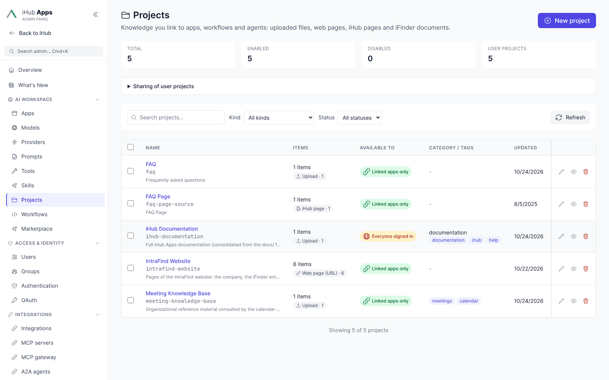

**Admin → Projects** lists every admin project with its number of items, who it is **Available to**,
its category and tags and when it was last updated, with counts of all, enabled and disabled
projects and of the user projects on the installation; filter by item kind and status. The page
needs the `projects` feature flag and the admin page switch `admin.pages.projects`; content admins
and full admins may use it. Full administrators also find **Project settings** there: the sharing
audiences (see [Roles and sharing](#roles-and-sharing)), the tier policy (see
[The iFinder tier](#the-ifinder-tier-smart-collections)) and the limits of user projects (items per
project, size of one file and of one project, projects per user; see
[Platform settings](#platform-settings)).

1. **New project** opens one form: the name (the **Project ID** is filled in from it until you
   type one; it cannot be changed later), an optional description, **Who can use this project?**,
   the **instructions**, and, under **Category and tags (optional)**, a category and tags.
2. **Create and add items** creates the project and opens its editor with the **Add item** dialog
   already open: upload files, paste text, or add a web page, an iHub page, an iFinder document or
   an iFinder search.
3. Pin items that must always reach the model (see [Load in full or search](#load-in-full-or-search)):
   choose **Edit** on an item and set **For the AI** to *Pinned*. Preview the stored text, edit the
   text of an uploaded, written or migrated document, edit an item's name, refresh or remove an item
   from the items table.
4. Link the project to apps, workflows and agents.

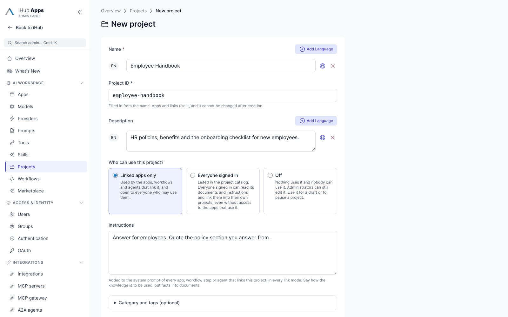

**Who can use this project?** has three answers:

| Choice                 | Stored as                                  | Meaning                                                                                                                                  |
| ---------------------- | ------------------------------------------ | ---------------------------------------------------------------------------------------------------------------------------------------- |
| **Linked apps only**   | `"enabled": true`                          | Used by the apps, workflows and agents that link it, and open to everyone who may use them.                                             |
| **Everyone signed in** | `"enabled": true, "published": true`       | Also listed in the project catalog: everyone signed in can read it and link its documents into their own projects (see [Admin projects for everyone](#admin-projects-for-everyone)). Asks for a confirmation. |
| **Off**                | `"enabled": false`                         | Skipped by everything that links it; administrators can still edit it. Use it for a draft while you add documents, or to pause a project. |

After the project is created, its settings are rows beside the items — **Name and description**
(with category and tags), **Instructions** and **Availability** — and each one opens a dialog
with **Edit** or **Change** that saves at once. A project that something still links cannot be
deleted: the dialog lists the apps, workflows and agents to change first.

### Moving, copying and merging

Projects that belong together are often split: the sources migration made one project per source,
so a website that was five sources is five projects with one item each. Two tools bring them
together.

**Move or copy items.** Tick items in the items table of a project's editor and choose **Move to…** or
**Copy to…**, or use **Move or copy to…** in a row's menu. Pick the target project and confirm.

- A move leaves the source and arrives in the target; a copy leaves the source as it is.
- Stored text is encrypted per project and item, so the text is decrypted and encrypted again under
  the target with a new key. The kind, reference, pin, status and the original file's details come
  along, and the item records where it came from (`provenance.transferredFrom`).
- Items go one at a time. One that is still **Waiting** or **Extracting**, or **Failed**, cannot go
  yet (`ITEM_NOT_READY`); one that would exceed the target's limits is refused (`QUOTA_*`). The
  dialog lists these and the other items still go.
- An item that is changed while it moves (a refresh, an edit, a rename) stays where it is and is
  reported (`PROJECT_MISMATCH`); move it again.
- A moved item keeps its id unless the target already has an item with that id.
- Items move between admin projects only, not into or out of a user project.
- A copy of the shipped documentation is an independent document; a moved one keeps syncing with
  the shipped file.

**Delete items.** Tick items in the same table and choose **Delete**. After one confirmation every
selected item is removed, one at a time, each recorded in the audit log like a single removal. An
item that is already gone counts as deleted; one that cannot be deleted stays in the list and stays
selected, and the page shows why.

**Merge projects.** Select two or more projects on the list and choose **Merge…**. Choose the
project that stays; the dialog shows how many items move and how many apps, workflows and agents
link the other projects.

1. Every item of the other projects moves into the kept project.
2. Apps, workflows (steps, loop bodies and planner task templates included) and agents that linked
   a merged project link the kept project instead. When one list linked several of them, it keeps
   one link, at the position of the first. The link's mode is the one they shared, or none (the
   project's own default applies) when
   they differed, and it may write when any of them could.
3. With **Delete the emptied projects** (on by default), the merged projects are deleted.

A project that ships with iHub (the `faq`, `meeting-knowledge-base` and `intrafind-website`
project, for example) is restored at the next server start once it is deleted, like any missing
default file. The merge result says so for such a project; disable it then, or leave **Delete the
emptied projects** off and disable it yourself.

A project whose items did not all move (an item still being processed, a limit) is left alone:
it keeps its remaining items and its links, nothing is deleted, and the result says why. Run the
merge again when the cause is gone. The **instructions** of a merged project are not carried over;
the dialog warns when one has any. Each merged and changed project has an entry in its change
history, and the links that changed are in the audit log summary.

The edit page warns while uploads are enabled and no malware scanner is configured
(`platform.projects.scan`).

### Linking a project

Apps, workflows, workflow steps (prompt, planner, verifier), planner task templates and agent
profiles carry a `projects` list. An entry is a project id, or an object with the access mode and
the write flag:

```json
{
  "projects": [
    { "id": "faq", "mode": "context" },
    { "id": "ihub-documentation", "mode": "tools" },
    "handbook"
  ]
}
```

| Field   | Values                          | Default | Meaning                                                                                                |
| ------- | ------------------------------- | ------- | ------------------------------------------------------------------------------------------------------ |
| `id`    | A project id                    | —       | The project to link. A bare string is a link without a mode of its own.                                |
| `mode`  | `auto`, `context`, `relevant`, `tools`, `pinned` | the project's own default | How the project reaches the model, see [Knowledge modes](#knowledge-modes). A link without a mode uses the project's default (`auto` unless the project says otherwise); an explicit `auto` does not. |
| `write` | `true`, `false`                 | `false` | Whether a workflow or agent run may store documents in this admin project (`project-write`).           |

The app editor (**Admin → Apps**, card **Projects**), the workflow editor and the agent editor offer
a project picker with the mode (or **Project default**) and the project's size against the budgets. `write` is not
editable in the forms yet; set it in the JSON. A step's own `config.projects` replaces the
workflow's list for that step.

The linked project's **instructions** are added to the system prompt of the app, step or agent:
each project's instructions go in a `<project-instructions project="…">` block at the end of
the system prompt, whatever the link mode. They apply for the projects an app, workflow
or agent links and for the project a chat runs in; a project a user attaches to a single chat
brings its documents but not its instructions. Use them for how the knowledge is to be used ("answer
only from these contracts", "cite the clause number"), not for facts: facts belong in a document.
The project's **description** is shown to the model next to its name, so it can tell what a project
that is only searched can answer.

### The `{{projects}}` placeholder

The text of the linked projects goes into the system prompt as a `<projects>` block. Put
`{{projects}}` where it should go; without the placeholder the block is appended at the end of the
system prompt.

```xml
<projects>
  <project id="faq" name="FAQ" mode="loaded">
    <document id="itm_…" name="faq.md" origin="uploaded">…text…</document>
  </project>
  <project id="ihub-documentation" name="iHub Documentation" mode="searched" documents="2" tool="knowledge_search">
    <document-list documents="2" listed="2">
Read a listed document directly with knowledge_read (its id), or search them all with knowledge_search.
- itm_… "release-notes-5.2.pdf" (12000 tokens) — Release notes 5.2: What changed in iHub 5.2.
- itm_… "Install guide" https://docs.example.com/install — Installing iHub: Requirements and first steps.
    </document-list>
  </project>
</projects>
```

A **searched** project lists the documents that are not in the prompt already, so the model can
pick the one to read instead of searching blindly. See
[What the model knows about a searched project](#what-the-model-knows-about-a-searched-project).

### Switching projects off for an app

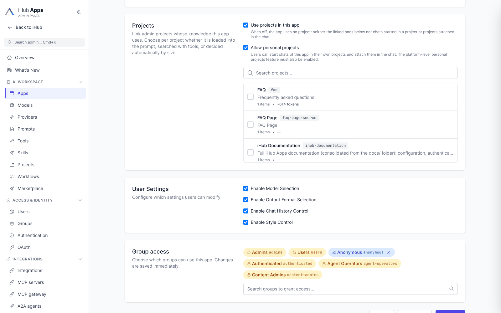

Two switches on an app decide what it does with projects. Both are on unless set to `false`, and
both are under **Admin → Apps → Edit → Projects**:

| Setting                 | Admin label                  | When `false`                                                                                                                               |
| ----------------------- | ---------------------------- | ------------------------------------------------------------------------------------------------------------------------------------------ |
| `features.projects`     | **Use projects in this app** | The app uses no project at all: not its linked admin projects, no chat runs inside a project and none can be attached from the chat input. |
| `features.userProjects` | **Allow personal projects**  | The app keeps its admin project links, but no chat of it runs inside a user project or attaches one.                                       |

An app that answers from a fixed knowledge set turns personal projects off:

```json
{ "features": { "userProjects": false } }
```

The project page offers only apps that allow personal projects when you start a chat. The
installation-wide feature flags `projects` and `userProjects` still have to be on; the app
switches can only narrow them. A workflow step's own project links are the workflow's and are not
affected.

### Checking a project

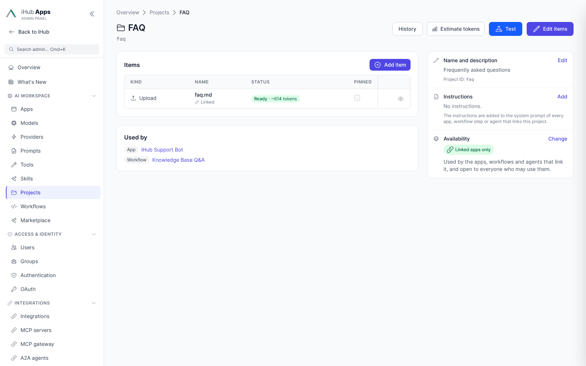

- **Test** (`POST /api/admin/projects/:id/_test`) reads every item the way a chat would, with your
  own credentials for iFinder items, and reports per item whether it was readable, its size and
  how long it took.
- **Try in chat** (on the project's page, `/admin/projects/:id`) opens a scratch chat beside it that
  has this project and nothing else in scope, to see whether the project works and, when an
  answer is wrong, whether the cause is the project or the app and the model. See
  [Try in chat](#try-in-chat).
- **Estimate tokens** (`POST /api/admin/projects/:id/estimate`, on the project's page) loads every item, link items included, and counts its tokens. It recommends for each
  document whether it is small enough to pin into the prompt (up to 20 % of the load-all budget)
  or better searched, and for the project whether it belongs in the prompt (it fits the budget;
  *tight* above half of it) or is searched (it exceeds the budget, or a source delivered only part
  of its text). It also names the context window a model needs to load the project in full. The
  numbers are an estimate; the real decision of a request is made against the model in use.
  User projects have the same button on their page (`POST /api/projects/:projectId/estimate`).
- The name of a project on **Admin → Projects** (or **Edit project** in the list) opens its page
  (`/admin/projects/:id`). There is no separate read-only view and edit mode: on the same page you
  add, preview, refresh, move and remove items, and set each document's **For the AI** mode
  (*Normal*, *Pinned* or *Not for AI*) in the item's **Edit** dialog, which also changes its name
  (and, for a link item, what it points at). The table marks a pinned or *Not for AI* document. **Used by** lists the apps, workflows and agents that link
  the project, and the settings are rows beside the items, each changed in a dialog.
- `GET /api/admin/projects/_tokens` reports each admin project's size in tokens, items and bytes,
  together with the load-all budget (`loadAllBudgetTokens`) and the tool result budget. The app
  editor uses it to explain whether a linked project will be loaded in full.

#### Try in chat

**Try in chat** on the project's editor opens the real chat of an app next to it, so an admin can
ask the questions the project is for before linking or publishing it. A disabled or unpublished
project can be tried too.

- **Only this project.** The chat uses this project's items and instructions. The projects the app
  links itself, the chat's own container and attached projects are left out, so a wrong answer
  cannot come from other knowledge. The app's own instructions and tools still apply, except that
  it cannot call other apps or workflows (they would run with their own projects), and an
  `@workflow` mention stays plain text.
- **App and model.** The app picker lists the enabled chat apps, the general chat first. The model
  is picked in the chat, whatever the app says about model selection.
- **Sources for every answer.** The chat is the normal one: each answer shows the basis chip, the
  knowledge searches and reads that were made and the **Sources** panel with the hits. A retrieval
  problem shows there, together with errors such as an unreachable host.
- **Saved state.** The chat reads the project as saved. The editor saves every change at once, so
  a change counts from the next question on; **Restart** starts a new chat. Items that are
  waiting, being extracted or failed are not searched, and the panel says how many.
- **As you.** The chat runs as the signed-in admin. How other users reach the project (app links,
  publishing, groups) is not tested; the panel says so.
- **Nothing is kept.** The chat is temporary: it is not listed in the admin's chat history, expires
  on its own and adds nothing to the project. The incognito switch is not offered, and the chat is
  marked as a test chat (`origin.createdVia: "project-test"`), so it cannot be kept through the API
  either: `PATCH /api/chats/:id` with `{ "temporary": false }` answers
  `409 PROJECT_TEST_CHAT_NOT_KEEPABLE`.

Only content admins can try an admin project; the chat request carries `testProjectId` (see the
[Admin API](#admin-api)).

## How the model reaches a project

### Knowledge modes

A **knowledge mode** says how one project reaches the model. There are five:

| Mode (value)           | In the prompt                                                                                                                                      | Knowledge tools | For                                                                                          |
| ---------------------- | -------------------------------------------------------------------------------------------------------------------------------------------------- | --------------- | -------------------------------------------------------------------------------------------- |
| **Automatic** (`auto`) | Everything if it fits the budget; otherwise the pinned documents plus the best sections for the question                                           | yes             | most projects (the default)                                                                  |
| **Read everything** (`context`) | Everything, up to the hard limit of 75 % of the context window; what is cut stays reachable with `knowledge_read`                            | yes             | small sets that must be read whole: a contract, a policy, a specification                    |
| **Best passages** (`relevant`) | The pinned documents plus the best sections for the question across all documents, up to the budget, word for word. Works for iFinder smart collections, which cannot be loaded in full | yes | large projects; models that call tools poorly; saves a tool round trip |
| **Look things up** (`tools`) | The pinned documents only; the rest through `knowledge_search`                                                                                     | yes             | large libraries; agents and workflows that search on purpose                                 |
| **Pinned documents only** (`pinned`) | The pinned documents only                                                                                                                      | **no**: the other documents are not reachable | one curated subset of a large project for a given app |

The mode is chosen at three levels; the first that is set wins. A chat never changes it: the mode
of a project is the decision of whoever owns the project or links it, and it is binding for everyone
else who uses it. You choose the mode of your own projects; the mode an administrator set on a link
or on an admin project, or the owner of a project shared with you, applies as set.

1. **The link** of an app, workflow or agent, set by an administrator. A link without a `mode`
   passes to the next level.
2. **The project's default** (`knowledgeMode`): the owner and editors set it on the project page
   (**Knowledge mode**), administrators in **Admin → Projects → edit → Name and description**.
3. **Automatic.**

`platform.projects.knowledgeModes` lists the modes users may choose (**Admin → Projects → Project
settings**, "Knowledge modes users may choose"); all five by default, and `auto` is always offered.
A user's own project that uses a mode switched off falls back to the next level. What an
administrator set is not narrowed by the list: the links of apps and workflows keep their mode, and
so does the default mode of an admin project (the admin project editor offers every mode).

**Models without tools** (`supportsTools: "none"`) cannot call `knowledge_search`. For them `tools`
is read as `relevant`, and an `auto` project that does not fit injects its best sections as it does
for any model, so unpinned documents are not silently out of reach. The prompt then names no
knowledge tool and lists no documents to read from. **About this answer** says the mode was replaced.

**Not for AI.** Next to **Pinned**, an item can be marked **Not for AI** (**For the AI** in the
item's **Edit** dialog, `excludedFromAi`). It stays in the project for people (preview, download, sharing) but is
never injected, listed to the model or searched, `knowledge_read` cannot open it, and the MCP project resource (`project://<id>`) leaves it out. Pinned,
normal and "Not for AI" are one setting: choosing one clears the other. Workflow project nodes work
on the documents themselves and still see it.

The server decides the mode; the answer (`knowledge/scope`, shown under **About this answer**) reports the mode each project was
used in (`knowledgeMode`), the level that chose it (`modeSource`: `link`, `project` or
`default`), and, when it was replaced, the mode it replaced (`modeFallback`). A `pinned` project is
reported with `mode: "pinned"`.

### Load in full or search

For every request the server plans each project in scope, in this order: the chat's own project,
the app's links, projects attached to the chat, the workflow's links.

- The **budget** is `min(platform.projects.loadAllMaxTokens, 40 % of the model's context window)`,
  50,000 tokens by default. Projects spend it in that order.
- `context`: every usable document goes into the prompt.
- `tools`: only pinned documents go into the prompt; the model searches the rest.
- `relevant`: the pinned documents plus the sections of the other documents that best match the
  question (see [Reading with the question in mind](#reading-with-the-question-in-mind)), also when
  the whole project would fit. The model can still search.
- `pinned`: only pinned documents go into the prompt; no knowledge tool is offered for the project.
- `auto`: the whole project goes into the prompt when it fits what is left of the budget;
  otherwise its pinned documents plus the sections of the other documents that best match the
  question (the same as `relevant`), and the model searches the rest.
- **Pinned** documents always go into the prompt, in every mode, ahead of the other documents of
  their project, even when they exceed the budget.
- Nothing injected may exceed **75 % of the model's context window**, whatever the mode. Documents
  beyond that limit are cut from the prompt and stay reachable through `knowledge_read` (not in
  `pinned` mode); the cut
  keeps the sections that answer the question when there is one. The limit
  is spent project by project, in the order of the links: a pinned document of a later project is
  cut when the projects before it have used the limit up. Link the project whose pinned documents
  must always be present first.

Usable documents are those that are **Ready**, and **Outdated** ones whose old text is still
readable. Documents that are waiting, failed or unreadable for this user are listed as unavailable,
so the model can say so.

The budget depends on the model's `contextWindow` (see [Models](models.md)).

### Reading with the question in mind

A document that is cut to its first characters loses the part that answers the question. When a
chat turn has a question, iHub reads long documents for it instead — with the BM25 keyword ranking
that `knowledge_search` uses, the text kept **verbatim**, and no model call.

- **The question** is the user's latest message. When it is short (under 40 characters or six
  words, like "and in German?"), the user message before it is added. Assistant text is never part
  of it, and nothing rewrites it. It is cut at 500 characters. A workflow node, an empty message
  and a request without text have no question; they behave as before.
- **`auto` project that does not fit:** the prompt holds the pinned documents (in full) plus the
  best sections of the other documents, up to what is left of the budget, at most half of the
  budget for the excerpts of all projects together. Each document with excerpts is marked
  `excerpt="true"`, each section carries its document id and `<section id path>`, and a note tells
  the model to read the rest with `knowledge_read`. The document stays in the project's document
  list, so the model knows there is more of it. The ranking uses the project's cached search index,
  the same one `knowledge_search` uses.
- **The 75 % limit:** the document that does not fit keeps its best sections for the question and
  an outline of the rest instead of its first characters, when at least 1,500 tokens are left for
  it and a section matches; otherwise its start, as before. A document that was already reduced
  to excerpts and does not fit is dropped whole.
- **`knowledge_read` with `focus`:** a long document returns its best sections and an outline of
  the rest, not the outline alone (`retrieval.mode` is `focus`). An explicit `section` wins over
  `focus`, and a document that fits in one result is returned in full. The sections appear as
  passages of the document's source in the sources panel; a citation points to the document.

Excerpts depend on the question, so the system prompt of a project that does not fit changes from
turn to turn. A model provider's prompt cache then misses on those turns, and the first call of a
turn can carry up to half of the budget in excerpts. Lower `projects.loadAllMaxTokens` to spend
less per turn. There is no setting to switch excerpts off.

### The knowledge tools

Every request that reaches a project gets three tools automatically while the projects feature is
on. They belong to projects: they are no tool of an app's bindings, are no action of an
integration and cannot be switched off. The definition ships with iHub
(`server/defaults/tools/knowledge.json`, read in place, in the request's language); a
`contents/tools/knowledge.json` is not read.

| Tool               | What it does                                                                                               |
| ------------------ | ---------------------------------------------------------------------------------------------------------- |
| `knowledge_search` | Searches the projects (all, or one with `project`) for passages that answer a query; ranked, numbered hits. |
| `knowledge_read`   | Reads one document in full, or one section of it, by an id from a search, `knowledge_list` or a project's document list. A long document comes back as an outline first, or, with `focus` (the question), as its best sections and an outline of the rest. |
| `knowledge_list`   | Lists the documents of the projects with id, name, title and description (when known), kind, size, status and provenance. |

Each tool's description names the projects in scope and whether each one is loaded in full, so
the model knows which ids it may pass. A tool call can never reach a project the request did not
bring. Search is keyword search (BM25) over the stored text; there are no embeddings.

#### What the model knows about a searched project

A project that is searched rather than loaded in full carries a `<document-list>` inside its
`<project>` element of the `<projects>` block. One line per document: its id, its name, its size in
tokens, whether it is pinned, its URL (web pages and other linked documents) and, when known, the
document's title and a short description. Pinned documents come first; documents already in the
prompt (pinned ones, in `auto` and `tools` mode) are not listed again.

- **Bounded.** At most 50 documents and about 2,000 tokens per project, and all lists of a
  request together at most 10 % of the model's context window (never more than the 75 % limit
  leaves beside the documents in the prompt), spent in scope order. When the list is cut, its
  last line says how many documents are left out and to call `knowledge_list` for the complete
  list. The `<document-list>` element says how many documents there are (`documents`) and how many
  it lists (`listed`).
- **In the prompt, not the tool descriptions.** Document names, titles and descriptions of a user
  project are text its editors control, so they go into the `<projects>` block, with any tag that
  could close it escaped, and never into the tool descriptions, which carry only what an admin wrote.
- **Read directly.** `knowledge_read` takes a listed document's id; the model need not search first.

The **title and description** are captured, not typed:

| Document                    | Title                                                         | Description                                          |
| --------------------------- | ------------------------------------------------------------- | ---------------------------------------------------- |
| Upload, picked or written   | The document's metadata title (PDF, HTML), else its first heading or short first line | The HTML meta description, else its first paragraph |
| Web page (URL item)         | The page's title                                              | The page's meta description                          |
| iHub page | The page's configured title, in the item's language (else English, else the page id) | none |
| iFinder document | The document's `title` field, else its file name | none |

An upload records them when it is extracted, and again on every new version or refresh. A web
page records them when it is added or its URL changes; a web page added before this existed, or
one that could not be read when it was added, records them the first time it is read. An iFinder
document records its title the first time it is read. An iHub page's title is not stored: it is
read from the page configuration each time, so a renamed page is listed by its new title. In a
smart collection (the iFinder tier) a document is named by its title, else its file name, as the
reader may see it. A title the
same as the document's name is not repeated in the list. `knowledge_list` returns both, as `title`
and `description`, beside the other fields.

#### How much of a linked document is searchable

Link items are fetched when they are used, and the fetch is cut at a fixed length before anything
searches, reads or loads the text: per document, and for an iFinder search per hit. This limit is
separate from the tool result budget, which only shortens what one tool call returns from text
iHub already has:

| Kind                                | Default           | Option in `ref`    | Maximum   |
| ----------------------------------- | ----------------- | ------------------ | --------- |
| `ifinder-document`, `ifinder-query` | 10,000 characters | `maxLength`        | 1,000,000 |
| `url`                               | 50,000 characters | `maxContentLength` | 5,000,000 |

Only that first part of the document is searchable: neither `knowledge_search` nor another section
read with `knowledge_read` reaches the rest. iHub pages and uploaded or picked documents are not
cut this way. A cut document is marked as truncated in the tool result and in the prompt, and a
project with such a document counts as _searched_, not _loaded in full_, in the tool descriptions
and in **About this answer**.

Set a higher limit when you add the item through the API (`POST /api/projects/:projectId/items` or
`POST /api/admin/projects/:id/items`), for example
`{ "kind": "ifinder-document", "ref": { "documentId": "…", "maxLength": 100000 } }`. The project
pages add items with the default, and an item's `ref` cannot be changed afterwards: remove the item
and add it again. Sources migrated from `config/sources.json` keep their `maxLength` and
`maxContentLength`.

### What users see

- A chip under the answer says that it is based on a project: **Project**, or **Project · Web**
  when it also searched the web. It never names the project. Opening it shows **About this answer**,
  which lists each project that contributed by name, with how it was used (_all documents read_,
  _searched for matching passages_, _only pinned documents_), the diagnostics and, for a user
  project, an **Open project** link; a project the viewer may not see reads _Private project_. A
  searched project that also put the sections matching the question into the prompt (see [Reading
  with the question in mind](#reading-with-the-question-in-mind)) reads _searched for matching
  passages_. A project is a basis only when its text went into the prompt or a search of the turn
  returned its documents (`contributed` on `knowledge/scope`); a project that was in scope but not
  used is listed under **Not used**, and the chip never claims it.
- Every search hit and every read document is an answer source in the **Sources** panel (see
  [Answer Sources](answer-sources.md)). The card shows the provenance: _Uploaded_, _Picked from
  SharePoint · text taken 12 Oct 2026_ or _Linked_. A document written by a workflow shows as
  _Uploaded_.
- The preview of an uploaded or picked document shows the stored text with the cited passages
  highlighted, because the original is not kept. **Download** saves the text as a `.txt` file.
- Project sources are found with the viewer's membership, so a shared chat leaves them out. The
  answer text keeps its citations.

## User projects

User projects are a preview feature.

### Switching user projects on

1. Turn on the feature flag `userProjects` (**Admin → Platform → Features**, **User Projects**). The `projects` flag must be on
   as well; it is by default.
2. Check the group permissions in `groups.json` (**Admin → Groups**):

   | Permission       | Allows                                      | Default                                     |
   | ---------------- | ------------------------------------------- | ------------------------------------------- |
   | `projects`       | Creating user projects                      | `true` for admins, users, authenticated     |
   | `projectSharing` | Adding members to projects                  | `true` for admins, users, authenticated     |

   Both are `false` for `anonymous`. Anonymous users never see user projects, and neither do OAuth
   clients, agents and third-party apps acting for a user; a personal API key acts as its owner.

3. Adjust `platform.projects` if needed: the limits, the sharing audiences and retention (see
   [Platform settings](#platform-settings)).

User projects need a storage provider; without one the page says that projects are not
available on this installation.

### The Projects page

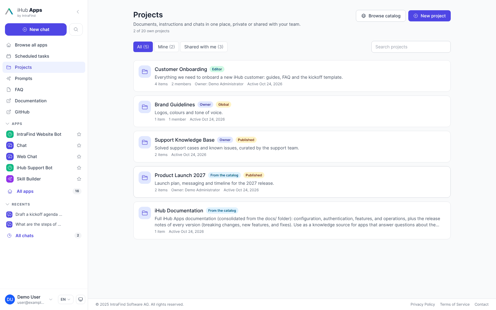

**Projects** in the sidebar lists the projects you own, the projects shared with you, and those
you added from the catalog. Projects that administrators created are listed only once you added
one from the catalog (under **Shared with me**); the others are linked to apps and managed by
administrators, and no chat can start in one. Filter by all, mine or shared, search by name, and create a project with **New project** (name, description,
instructions). The button shows how many projects you have against `maxProjectsPerUser`.

A project page shows:

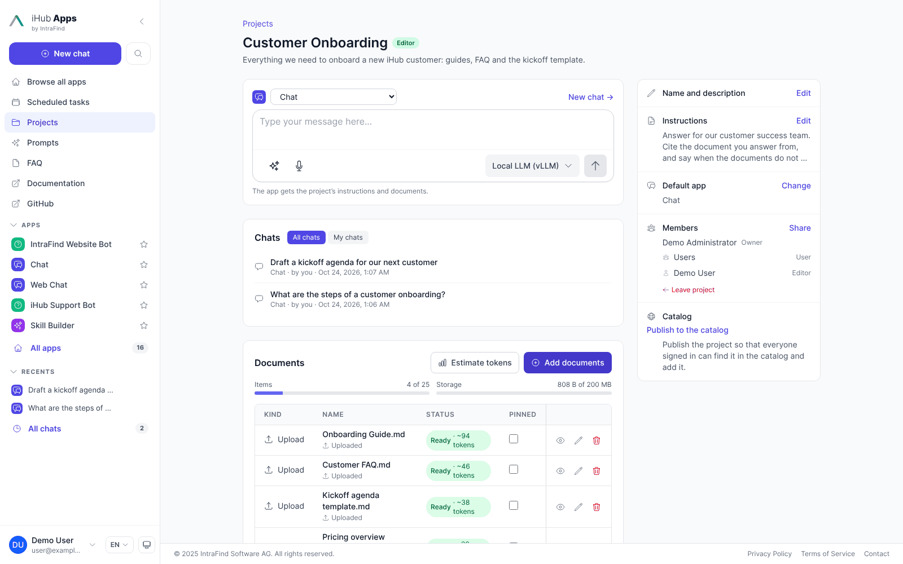

- **A chat input** at the top, the main action: the same input as the start page, with
  attachments, the model selector, tools, web search, magic prompt and dictation. Send a message to
  start a chat in the project, with that message already sent. The app above the input is the
  project's default app; pick another one to chat with it this time. **New chat** opens an empty
  chat. The message goes to the chat in the link that opens it. A message whose link would be
  longer than 7,500 characters (a little over 7,000 characters of ordinary text, fewer for text
  with many non-English characters) shows an error when you send it and no chat is started.
- **Chats** in the project, all or only your own, above the documents so that a long document list
  does not push them down. They come a page at a time (10, 25 or 50, newest first), and the Projects
  page pages its list the same way; a list on these pages never grows with its content.
- **Documents** with status, provenance and size, and the usage against the limits; from six
  documents on the list scrolls inside its card. Owners and editors edit (name, **For the AI**), refresh, preview
  and remove documents and retry failed cloud documents. They can also tick several documents and
  choose **Delete** to delete them all after one confirmation. A document that cannot be deleted
  stays ticked, and the page says why. **Estimate tokens** shows what each
  document and the project weigh. An iFinder document offers what a cited iFinder document offers
  in a chat, to everyone who may read the project: **Open in iFinder** (its deep link), and under
  **More actions** **Preview (PDF)**, **Download** and **Details** (iFinder's metadata, such as
  file, author and path), each read with the viewer's own iFinder rights.
- **A side panel** of compact rows: the **Instructions** (a preview), the **default app**, the
  **Members** and, where it applies, the **Catalog**. Owners and editors click **Edit** or
  **Change** to open the settings: name (up to 200 characters), description (up to 2,000
  characters), instructions (up to 20,000 characters) and the default app. The instructions apply
  to every chat in the project. The default app is where new chats of the project start; everyone
  can still pick another app above the chat input. A project without a default app starts in the
  default app an administrator set for project chats (**Admin → Projects → Project settings →
  Default app for project chats**, `platform.projects.defaultAppId`). If you cannot use the
  project's default app (it was removed, or it is not shared with you), that one is used, and
  without it the first app that allows projects.
- **Members**: the owner, the members, **Share**, **Transfer ownership**, **Leave project** and
  **Delete project**.

### Adding documents

**Add documents** offers one tab per kind the installation allows: upload (several files, drag and
drop), text, web page, iHub page, iFinder document or search, and OneDrive / SharePoint, Google
Drive and Nextcloud through the cloud file browsers. The text of a picked cloud file is taken with
your account; refresh the item later to take it again.

The iFinder document and search tabs have **Search in**: your iFinder search profiles, the same
list the chat input offers (narrowed to `iFinder.allowedSearchProfiles`; not shown with a single
profile or when users may not change it). A profile other than the default is stored with the item
and the document is read in it. A smart collection holds document ids only, so its picker searches
the default profile.

### Adding web pages

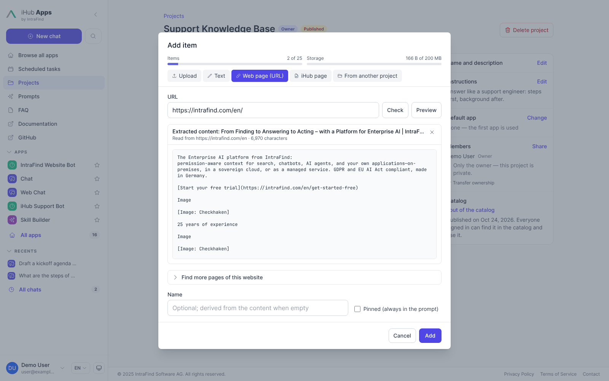

The **Web page (URL)** tab (in user projects and in the admin project editor) adds one page or
several pages of a website:

- **Check** tells whether the page can be read.
- **Preview** shows the text the model gets from the page, before it is added (the page reader's
  first 50,000 characters; the stored item keeps the whole page), so a page that needs JavaScript
  or blocks automated access shows up here as an empty or short text. An address that serves a document
  (PDF, Office, …) is downloaded when it is added and stored like an upload, without that limit
  (see [Files from websites](#files-from-websites)).
- **Find more pages of this website** opens the site search. **Find pages** follows the links of
  the page that stay on the same website and lists the pages it finds, with their titles. Tick the
  pages to add (filter the list, **Select all**, or preview a page with its eye icon); **Add N
  pages** adds each as its own web page item, named after its title. Pages the project has already
  are marked and cannot be ticked again, also when written differently (`https://example.com` and
  `https://example.com/#top`). No more pages can be ticked than the project's item limit leaves
  room for; the list says how many more fit.
  - **Link depth** (1–3) is how many links away from the start page the search goes.
  - **At most** caps the list (25–200 pages); when the cap or the 25-second time limit stops the
    search, the list says so.
  - **Stay in this part of the website** keeps the search in the start page's folder. The start
    page counts as read after redirects, so `https://example.com` that answers from
    `https://www.example.com/` searches `www.example.com`. From a page such as
    `https://example.com/docs/intro.html` or `https://example.com/blog/my-post` it lists the pages
    below `/docs/` or `/blog/`; from `https://example.com/docs` it lists the pages below `/docs/`
    when the page links there. The list shows which part was searched. Untick it to search the
    whole website.
  - Links to documents (PDF, Word, PowerPoint, Excel and OpenDocument files) are listed too and
    added as [files from websites](#files-from-websites); a link without such an extension that
    turns out to serve one is listed as a document as well. Images, scripts, archives and the
    legacy Office formats are not.
  - **Include files on other websites** also lists documents that the pages found link to on
    another host (a CDN, a download server). They are only listed, never searched for further
    links, and pages on other hosts are never listed; added, they are downloaded with the same
    protections as any file. The start site's `robots.txt` does not apply to another host.
  - Links
    marked `rel="nofollow"` are not followed, and dead links are left out. A page that redirects
    is listed once, under the address it was read from.
  - The website's `robots.txt` is honored: links its rules for every crawler (`User-agent: *`)
    disallow are left out, and the list says how many. The start page itself is read as asked.
  - Tracking and session parameters (`utm_*`, `fbclid`, `gclid`, `jsessionid`, …) are dropped from
    the links, and at most three addresses that differ only in their query (`?page=2`, `?sort=…`)
    are listed per page, so a calendar or a paged list does not fill the list.

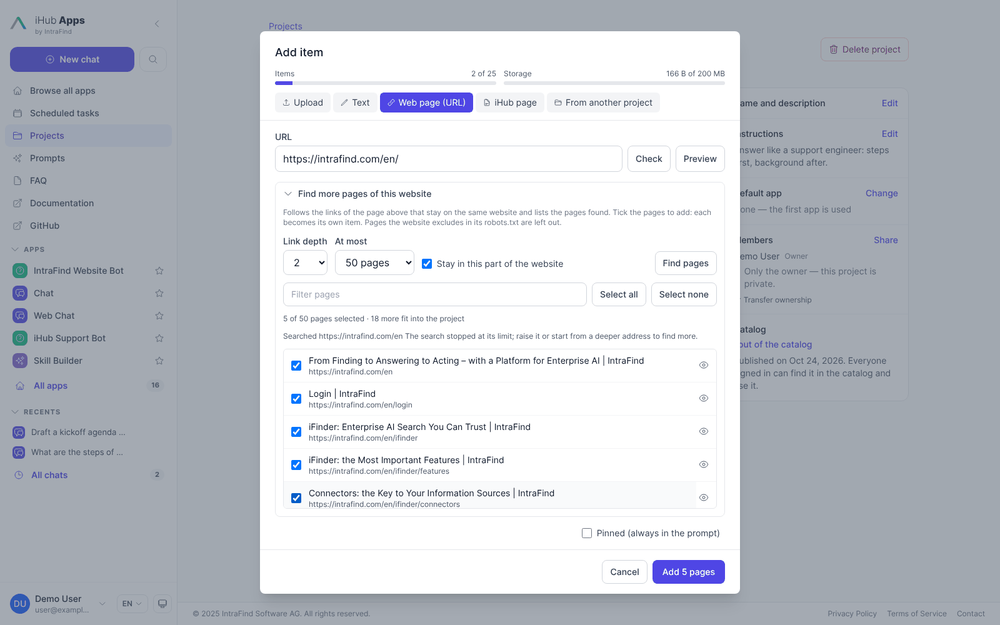

The search runs on the server with the same protections as the page reader: no private or internal
addresses (unless the host is in `ssl.domainWhitelist` or `ssrf.allowedHosts`), every redirect checked, certificate checks
skipped only for hosts in `ssl.domainWhitelist`, and at most 2 MB read per page. It reads on its own
request queue (`project_crawl`, `requestConcurrency` slots), so a search does not hold up the page
reads of chats. A user runs one search at a time, and a search stops when the browser stops
waiting for it.

### Linking documents from other projects

**From another project** links documents instead of copying them, so one document can serve several
projects without being duplicated: for example the shipped iHub documentation (an admin project)
next to your own notes in a project about an iHub delivery. Pick one of your own projects or a
published one, tick its documents and link them.

- Nothing is copied. A chat reads the original as it is now, so a change to the original shows in
  every project that links it. A linked document counts as one item against the project's limit,
  and none of its bytes.
- You can link documents only from a project you own or a published one: a user project in the
  catalog (while the catalog is on) or an admin project available to **Everyone signed in**. A
  project shared with you, an admin project you reach only through an app, or a full
  administrator's compliance view of someone else's project is not enough. Into an admin project,
  an administrator also links from the admin projects they manage, through the API
  (`POST /api/admin/projects/:id/items` with `{ "kind": "project-item", "ref": { "projectId", "itemId" } }`);
  the admin editor offers no tab for it. Links added earlier keep working.
- Everyone reads a linked document with their own rights: a member of your project who may not use
  the source project gets nothing from it, and the document shows **No access** for them. Sharing
  your project does not share the projects it links.
- A link to a linked document points to the original, and a project cannot link its own documents.
- When the original or its project is removed, the link shows **Source removed**; remove it or
  link another document. Linked documents are not refreshed: they always read the source.
- Moving an admin project's document to another project, or merging admin projects, does not
  re-point the links to it: they show **Source removed** and are linked again from the new place.

### Admin projects for everyone

**Everyone signed in** under **Who can use this project?** (in the create form, or later under
**Admin → Projects → a project → Availability → Change**; `"published": true` in
`contents/projects/<id>.json`) makes an admin project available to everyone signed in, after a
confirmation (**Make available**): they can use it and link its documents into their own projects,
without an app that links it. While the catalog is on, it is listed under **Projects → Browse
catalog** as **From the administrators**, and users add it with **Add to my projects** like a
published user project: it then
shows on their Projects page (under **Shared with me**) and in the chat input's **Project** picker,
and its page starts a chat with the project attached (an admin project never holds chats). This is
how administrators offer global projects that they manage and everyone uses in their chats. Only
administrators change it. The shipped iHub documentation project is available to everyone signed
in; installations that upgrade get it switched too (migration V181), unless an administrator
already set the switch.

### Roles and sharing

| Can                                                                  | Owner | Editor | User |
| -------------------------------------------------------------------- | :---: | :----: | :--: |
| See the project, its documents and instructions                      |   ✓   |   ✓    |  ✓   |
| See the member list (users see only how many members there are)      |   ✓   |   ✓    |  —   |
| Chat in it, read other members' chats in it (read-only)              |   ✓   |   ✓    |  ✓   |
| Add, refresh, pin, rename and remove documents; edit settings        |   ✓   |   ✓    |  —   |
| Let a workflow write into it                                         |   ✓   |   ✓    |  —   |
| Change members                                                       |   ✓   |   ✓    |  —   |
| Delete the project, transfer ownership                               |   ✓   |   —    |  —   |

A member is a user, a group (inherited groups count) or everyone signed in; the strongest role
that reaches you wins. The `anonymous` group cannot be a member. A project holds at most 100
members. Who you may add depends on the `projectSharing` permission and on
`platform.projects.sharing`: users and groups by default, everyone signed in only when an admin
allows it. Full administrators change these audiences under **Admin → Projects → Project
settings** (`GET`/`PUT /api/admin/projects/_settings`, which also carry `tierPolicy`); a change there applies at once, without a
restart.

A project shared with everyone signed in shows **Global**; one in the catalog shows **Published**.

### Global projects and the catalog

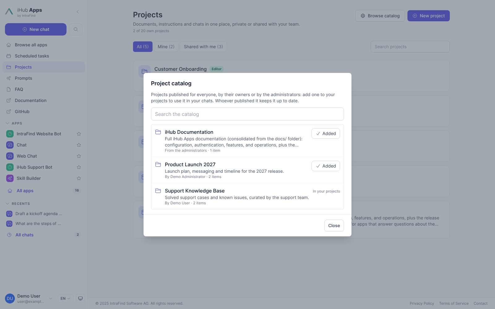

There are two ways to make a project available to everyone, so that a few people curate it and
everyone else uses it:

- **Share with everyone signed in** (`sharing.allowEveryone`): the project appears in every user's
  list under **Shared with me**, marked **Global**, in the role you chose. Everyone becomes a member,
  and members read each other's chats in the project.
- **Publish to the catalog** (`sharing.allowCatalog`): the project does not appear in anyone's list
  by itself. Users find it under **Projects → Browse catalog**, open it and add it with **Add to my
  projects** (and take it away with **Remove from my projects**). It shows **From the catalog** for them. They read its documents
  and instructions, link its documents, attach it to their chats and chat inside it. A chat they
  start in it is **private to them**: the owner, the editors and the other members cannot read it, and
  they do not read the members' chats. The project's page lists their own chats, and only those.

Owners and editors publish a project with **Publish to the catalog** on the project page, after a
confirmation, and take it out with **Take out of the catalog**. Publishing needs the `projectSharing` permission;
taking it out does not, and a full administrator can take any project out (for example one whose
owner has left). Taking a project out, or turning `sharing.allowCatalog` off, removes it
from the lists of everyone who added it from the catalog; members keep their access. Published
again, it is back in those lists: what each user added is remembered.

### Transfer, delete and an owner who leaves

- **Transfer ownership** hands the project to another active user, within that user's project
  limit. After you pick the new owner, a second step says what the transfer means and asks you to
  confirm; nothing changes before that. Only the ownership moves: a share that reaches the former
  owner (a group they are in, everyone signed in) stays in force, and the confirmation names those
  shares, so review the members first when the handover is meant to end your access. Afterwards
  you are back on the Projects page, which says who owns the project now and whether you still
  see it under **Shared with me**.
- **Delete project** removes the project and all its documents. Its chats are kept, outside the
  project. This cannot be undone.
- When the owner's account is **deactivated**, the project stays readable for its members, but
  nobody can change it until a full administrator transfers it.
- When the owner's account is **deleted**, their projects are deleted with it, and their
  memberships in other projects are removed.
- An owner cannot leave; they transfer or delete the project. An editor listed by name leaves with
  **Leave project**.

Full administrators may read and delete any user project, and transfer it, for compliance. They
never edit one.

### Chats in a project

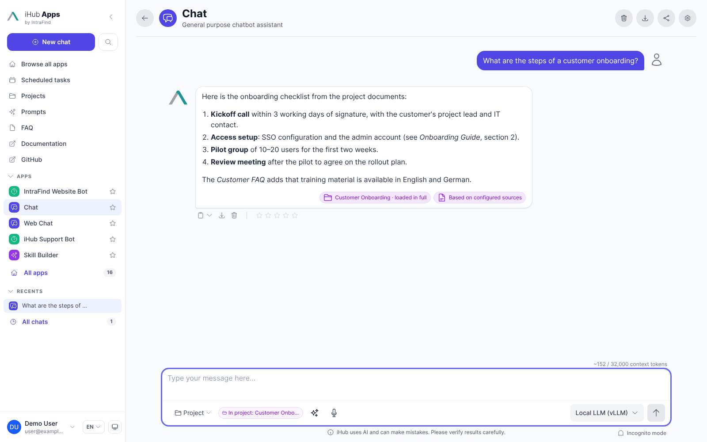

A chat started from the project page runs inside the project: it answers with the project's
instructions and documents (in the chat's [knowledge mode](#knowledge-modes): `auto` unless the chat or the project says otherwise), next to whatever the app itself links. A chat belongs to
a project from its first message on: it is started from the project page. A chip beside the message
box and the chat history show which project a chat belongs to. Only user projects hold chats.

Someone who took a project from the catalog chats inside it too, but their chats are **private**:
the chat records it when it opens (`projectPrivate`), and nobody but its owner reads it, not the
project's owner, editors or members. A full administrator keeps the compliance read every chat has.
Their page of the project lists their own chats in it and the ones that attach it, newest first,
without an **All chats / My chats** switch. A chat that is private stays so for good, even if the
person is later made a member. When the project is deleted its private chats are kept outside it, like
the members' chats; when it is taken out of the catalog, the chats stay in the history and answer without
the project.

An admin project made available to everyone holds no chats: a chat starts with it attached, and its
page lists your own chats that have it attached.

Every member may open the chats in a project; chats of other members are read-only. Only kept
chats are listed: a temporary chat (incognito, or every chat while the Chat History feature is off,
see [Chat Persistence](chat-persistence.md#temporary-chats-and-guests)) runs with the project but
is not listed on its page, and it cannot be moved into a project.

### Using a project in any chat

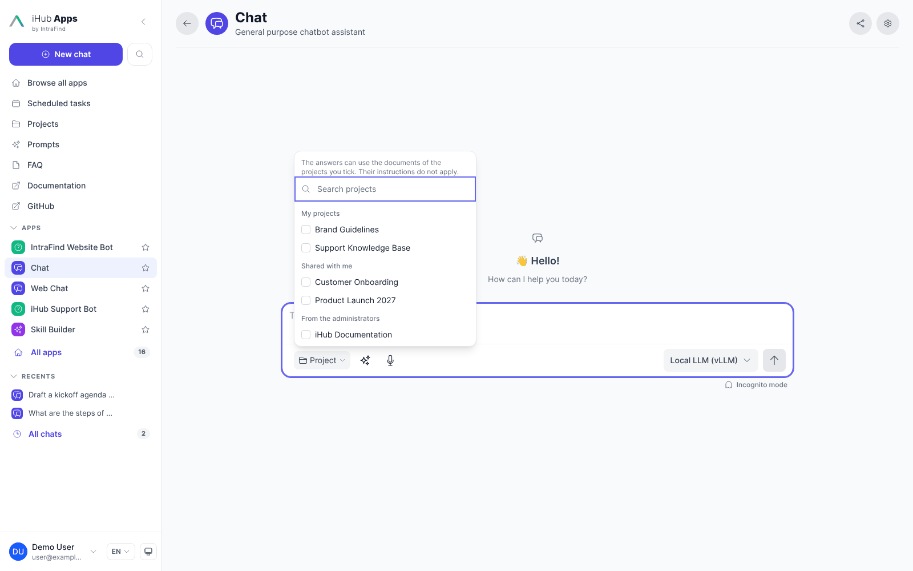

A chat does not have to start in a project to use one. **Project** in the message box (on the start
page too) opens the project picker: a search field over your own projects, those shared with you
and those you added from the catalog, in sections (**My projects**, **Shared with me**, **From the
administrators**); however many there are, the list keeps one height. Tick one and the
answers of that chat can use its documents (the project is loaded or searched like one the chat
runs in); its instructions do not apply, only those of the project the chat runs in and of the
app's own links. Instructions are written for the chats inside a project. A chat can have up to ten
projects attached, among them projects of other people from the catalog, and their instructions
would contradict each other and steer a chat that is not theirs. To have a project's instructions,
start the chat in the project (from its page). The smart collections you added to your projects are
listed here too, under **My projects**, marked **Smart collection from iFinder**. A chip beside the message box names each attached project and links to it; its
**×** takes the project away again. Up to 10
projects can be attached. The project picker is only there until the first message is sent: it is
gone from the message box afterwards, and the chips still show what the chat draws on. Before the
first message the choice is kept and saved with the chat; projects picked on
the start page ride along to the chat that opens. Attaching
does not move the chat into the project: it stays where it is, and the project's members do not
see it. When the chat runs in a shared project, its members read the answers, including what was
drawn from an attached private project.

### The iFinder tier: smart collections

With `platform.projects.tierPolicy` set to `both` or `ifinder` (**Admin → Projects → Project
settings**, a change applies at once), **iFinder** installed and
enabled (**Admin → Integrations**) and **User Projects** switched on, users can add their iFinder
smart collections to their projects. **Browse catalog** on the Projects page lists them under
**Your iFinder smart collections**; **Add** makes one a project, marked **iFinder**. Collections
nobody added are not listed under **Projects**.

The project of a collection keeps what iFinder does not have: a **default app**, **instructions**
and the **chats** started in it. The documents stay in the collection and are read from iFinder
every time, with the owner's rights; the project stores no document. Its owner can **rename** it
(the collection is renamed in iFinder too), **add** iFinder documents and **remove** them (the
membership only, never the document; tick several and choose **Remove** to remove them at once),
and **delete** it: the dialog asks whether to delete the
collection in iFinder as well; without that, the collection stays in iFinder and can be added again.
**New project → As an iFinder smart collection** creates a collection in iFinder and its project at
once. A collection that was deleted in iFinder keeps its project, marked **Deleted in iFinder**: its
chats and settings stay, it has no documents, and its owner deletes it when it is no longer needed.
Sharing, publishing, any other kind of item and uploading are not part of a collection's project.
Where this installation cannot serialize writes (see [Writes](#writes-to-a-collection)), renaming
and adding or removing documents are off and the page says **read-only**; the default app and the
instructions can still be changed.

Earlier versions listed every collection automatically. Chats that had a collection attached
keep it (by its `ifc_…` id, see below).

| | Smart collection (iFinder tier) | User project |
| --- | --- | --- |
| Id | `prj_…` (its project); `ifc_` plus the collection's UUID for a collection attached by itself | `prj_…` |
| Documents | `ifinder-document` items, one per document id of the collection | Any kind |
| Read with the rights of | The reading user, every time | Depends on the kind |
| Changed from iHub | Rename, default app, instructions, add and remove documents, delete; by the owner only | By the owner and editors |
| Chats | Held inside its project, or attached | Held inside, or attached |
| In the prompt | Searched (`knowledge_search`), never loaded in full | Loaded in full when it fits, else searched |

**When the tier is offered.** All of these must hold for a user, otherwise they see no iFinder
projects and nothing is sent to iFinder:

- `tierPolicy` is `both` or `ifinder`. `ihub` (the default) leaves everything as before. Under
  `ifinder` the local tier stays usable too: local projects keep working and can still be created.
  Under `both` a user picks the tier when creating a project; `ifinder` does not limit creation to
  the iFinder tier (that would stop users of an installation that already has `ifinder` set from
  creating projects, so it is left to the owner to decide).
- iFinder is configured and the user can be signed for it: they have a value in the **JWT Subject
  Field** (default `email`). Anonymous users, OAuth clients, agents and users without such a value
  (local accounts without an e-mail address) get nothing.
- iFinder answers the Smart Collections public API (v1, iFinder 6.8 and later). iHub asks with
  `size=0` and remembers an answer for 5 minutes (for 10 minutes when the API is missing); an
  older iFinder never shows the tier.
- The user has the `fi_smartcollections` role in iFinder. iHub requests that scope explicitly in
  the user's token; the default scope of the iFinder token (`defaultScope`) is not enough.

`GET /api/projects/_config` answers `ifinder: { available, writable, maxDocuments }` for the caller:
`available` says whether the tier is offered (with a `reason` when it is not), `writable` whether
collections can be changed from this installation (with `writeDisabledReason` `NO_LOCK` or
`MULTI_INSTANCE` when it cannot), and `maxDocuments` is the cap of 200.

**Whose collection.** The owner of a collection is the name iHub signs into the iFinder token
(`sub`, taken from **JWT Subject Field**). A collection lines up with the same person in the
iFinder UI only if both sides produce the same string.

- iFinder's *list* call matches the owner **case-sensitively**; its per-collection checks do not.
  A collection whose owner differs only in case from the user's token name (for example created
  in iFinder as `ada@example.com` while iHub signs `Ada@Example.com`) is **missing from the
  list, but still opens by its id**. iHub does not work around this. Set the **JWT Subject Field** so it yields the iFinder login exactly, and
  test with a user whose login has capitals.
- Caches use the name exactly as signed, so `Ada@…` and `ada@…` never share an entry.

**Checking the setup.** **Admin → Integrations → iFinder → Test** has an **iFinder smart
collections** step. It asks the Smart Collections API for the collections of the test user (with
the `fi_smartcollections` scope) and reports the tier policy, an iFinder without the API, a user
without the role, and a subject whose case may not match the owner. A failure is a warning while
the policy hides the tier.

**The list.** `GET /api/projects/_collections` lists the user's collections for the catalog, each
with `added` and the `projectId` of its project. `GET /api/projects` (scope `all` or `mine`) lists
the projects of the collections the user added, with the collection's current name, description
and document count from the same list; a collection missing from that list is asked for by its id,
and one iFinder no longer has comes back with `collection: { state: "deleted" }`. Each shows its
document count only; the documents are fetched when the project is opened. The collections are asked for beside the local list with a 5 second timeout and cached
for 60 seconds per iFinder installation and user (a collection for 30 seconds, titles for 10
minutes). Nothing is shared between users, and every response is built for the user who asks.
If iFinder is slow or down, the local projects still come back with
`warnings: [{ "code": "IFINDER_UNAVAILABLE", "tier": "ifinder" }]` and the page says the
collections are missing; a failure is not asked again for 15 seconds.

**Opening one.** The project page lists the documents of the collection, named by their iFinder
titles. Titles are looked up with the user's rights in batches of 100 documents (a collection
holds up to 200, so two searches), and a document the user may not see keeps its id as its name
and is named as unavailable when read, like an iFinder document in a project. Reading a document
fetches its text (10,000 characters by default, as for any iFinder document item) and its
metadata with the user's own token.

**Limits.**

- A collection holds up to 200 documents (iFinder's `max-document-count`). The count includes
  documents the user may not see.
- A document is read with its own requests (its text, and a search by its id for the metadata), so
  no read carries more than one id. Only the title lookup sends several ids in one search, at most
  100, which is also the page size iHub asks iFinder for. The 100-document limit of the iFinder
  retrieval scope (`document_ids`) does not come into play, because iHub does not use that scope.
  The first search in a collection of 200 documents makes up to 400 requests, six at a time; the
  texts are then cached for two hours per user.
- A user lists at most 300 collections.

#### Changing a collection

What the owner can do, and how:

- **Add to the projects:** `POST /api/projects/_collections` with `{ collectionId, instructions?,
  defaultAppId? }`. iHub asks iFinder for the collection with the caller's rights first (another
  user's collection answers `404`), and refuses a collection the caller added already with `409
  COLLECTION_ALREADY_ADDED` (`details.projectId`). The project takes no slot of
  `maxProjectsPerUser`.
- **Create:** `POST /api/projects` with `tier: "ifinder"` and a `name` (and `description`,
  `instructions`, `defaultAppId`). No owner is sent: iFinder sets it from the user's token, so the
  collection is the user's. Only the name and the description go to iFinder; the answer is the new
  project (`prj_…`, `source.collectionId` the collection's UUID). Without `tier`, or with `ihub`, a
  local project is created as before. The `projects` group permission is needed, as for local
  projects.
- **Rename and configure:** `PATCH /api/projects/:projectId` takes what a user project takes. A
  changed `name` or `description` is sent to iFinder first, and only those fields: its `PATCH`
  writes every non-null field, so an `owner` or `documents` would hand the collection away or
  overwrite its list. `instructions` and `defaultAppId` stay in iHub. A collection deleted in
  iFinder renames its project alone; while iFinder cannot be reached a rename answers `503`.
- **Delete:** `DELETE /api/projects/:projectId` deletes the project; its chats stay, outside it.
  `?deleteCollection=true` deletes the collection in iFinder first (its documents stay there).
- **Add documents:** `POST /api/projects/:projectId/items` with `{ kind: "ifinder-document", ref: { documentId } }`,
  or `{ items: [...] }` for up to 200 at once. Only that kind is accepted. iFinder does not check ids,
  so iHub does, with the user's own token: a document the user cannot read (or that does not exist)
  is refused with `DOCUMENT_NOT_READABLE` and nothing from that call is added. A document that is a
  member already is skipped (`200`, `alreadyMember`). More than 200 documents in total is refused
  with `QUOTA_COLLECTION_DOCUMENTS` before anything is sent.
- **Remove documents:** `DELETE /api/projects/:projectId/items/:itemId`. Only the membership goes.
- Every other write to the project of a collection answers `403 PROJECT_READ_ONLY` (members, the
  catalog, a transfer, pins, refreshes and any other kind of item). Each allowed route needs the
  owner: nobody else sees the project. A full admin keeps the compliance read and delete every user
  project has, and sees no documents.
- A collection attached to a chat before collections were added to the projects is reached by its
  `ifc_…` id: it keeps being read, takes a rename and adding or removing documents, and every other
  write to an `ifc_…` id answers `403 PROJECT_READ_ONLY` before anything is looked up. Another user's collection answers `404`, like a missing one. The text of a collection
  document stays read-only.
- Every write drops the caller's cached list, collection and the titles of the documents it touched,
  so the next read sees it. iFinder's own list is a search that refreshes about every ten seconds;
  for twenty seconds iHub lays what the user just wrote over their list.

##### Writes to a collection

iFinder changes a collection with an unversioned read-and-write (the utilities service has no
`if_seq_no`), so two overlapping writes lose one. iHub therefore runs every write to one collection
(create excepted) under a lock taken from the storage layer, named by iFinder installation and
collection, never by user. Two iHub users that are one principal in iFinder share it. The lock must
reach every iHub instance:

| Storage | Writes |
| --- | --- |
| Lock facet with `locking: distributed` | On |
| `locking: advisory-single-machine` and `multiInstance: false` (the filesystem provider: workers of one machine) | On |
| `multiInstance: true` without a `distributed` lock | **Off**, `MULTI_INSTANCE` |
| `locking: none`, or no lock facet or storage | **Off**, `NO_LOCK` |

When writes are off the collections stay readable, `_config.ifinder.writable` is `false`, the page
says read-only, and a write answers `403 IFINDER_WRITES_DISABLED` with the `reason`. The cluster bus
is no substitute: it only reaches the workers of one machine. A second writer waits up to ten
seconds, then gets `409 COLLECTION_BUSY`. Changes made in the iFinder UI itself are not covered: a
write there at the same moment can still overwrite one from iHub. iHub reads the collection back
after each write and reports a document that is missing.

**iFinder fails in the middle of a change.** The call is not atomic. When iFinder answers an error
(or does not answer) after an add or remove, iHub reads the collection again under the same lock and
answers `502 IFINDER_WRITE_FAILED` with `details: { outcome, added | removed, not }`: `partial`
(some documents made it), `none`, or `unknown` (the read-back failed too). If every document turns
out to have landed (only the answer was lost), the call counts as done. Repeating the call is safe:
members are skipped. A create whose answer is lost reports `outcome: "unknown"`; check the list
before creating again, as there is no way to find a duplicate.

**When iFinder cannot be reached in a chat.** A chat that has a collection attached still answers
when iFinder is slow or down, but without that collection. The system prompt names it with
`mode="unavailable"` and tells the model that its documents are missing from this answer and to
say so to the user, and the answer shows an amber chip (**Project not available**; the name and the reason are
in its text for screen readers and under **Not used** in **About this answer**) next to the
chip of what the answer used. The knowledge
tools and workflow steps only see what can be read, so a search never reaches it. The notice is
named as the user last saw the collection (an iFinder collection never seen shows as **iFinder
collection**). A collection that was deleted in iFinder, or that is no longer the user's, is not
reported this way: it leaves the chat's knowledge without a notice.

**Not part of this version.** Upload, sharing and any item kind but iFinder documents in the
project of a collection.

Every route of `/api/projects/ifc_…` that is not a read or one of the three writes above answers
`403` with the code `PROJECT_READ_ONLY`, before anything is looked up. Admin project IDs may not
start with `ifc_`.

### Retention

With `platform.projects.retentionDays` above 0, a daily sweep deletes user projects without
activity for that many days, with all their documents. Activity is anything that changes the
project or is done in it: documents added, refreshed, renamed, pinned or removed; settings or
members changed; chats started in the project; and a message sent in one of its
chats (counted at most once every five minutes). As with **Delete project**, the project's chats are
kept: they leave the project and stay in their owners' chat history. The deletion is audited. The
default, 0, keeps projects until someone deletes them. Admin projects have no retention.

### Not available yet

- **Linking a whole project** into another (projects in projects): link its documents one by one.
  Documents added to the source later are not linked by themselves.
- **Linking documents in the admin project editor**: the tab is offered on the project page only.
- **Search box** on the project page: there is no project search endpoint yet; search happens in
  chats through `knowledge_search`.
- **Leaving** as a member with the role _user_, or as a member through a group or everyone.
- **Transfer target search** finds users only when the owner may share with users
  (`projectSharing` and `sharing.allowUsers`).
- **Starting a project chat from the start page**; start it from the project page.
- **Admin projects on the Projects page** are read-only; content admins change them under
  **Admin → Projects**.
- **Compliance listing of user projects** in the admin UI: the API answers
  `GET /api/admin/projects?ownership=user` for full admins, the page shows only the count.

## Platform settings

`platform.json` → `projects`. A change to the file takes effect after a server restart. What
**Admin → Projects → Project settings** changes (the sharing audiences, the tier policy, the default
app, the refresh TTL and the four `limits`) applies at once. Lowering a limit removes nothing; it only refuses what
would go past it.

```json
{
  "projects": {
    "tierPolicy": "ihub",
    "limits": {
      "maxFiles": 100,
      "maxFileBytes": 20971520,
      "maxProjectBytes": 524288000,
      "maxProjectsPerUser": 20
    },
    "sharing": {
      "allowUsers": true,
      "allowGroups": true,
      "allowEveryone": false,
      "allowCatalog": false
    },
    "retentionDays": 0,
    "loadAllMaxTokens": 50000,
    "refreshTtl": 86400,
    "kinds": {},
    "encryption": { "keyProvider": "local-file" },
    "scan": { "provider": "none", "command": "", "timeoutMs": 30000, "onError": "reject" },
    "ingest": { "concurrency": 2, "staleAfterMinutes": 30 }
  }
}
```

| Key                         | Default             | Meaning                                                                                                  |
| --------------------------- | ------------------- | -------------------------------------------------------------------------------------------------------- |
| `limits.maxFiles`           | `100`               | Items per project, every kind counted. At most 200 (the document cap of an iFinder smart collection).    |
| `limits.maxFileBytes`       | `20971520` (20 MB)  | Size of one uploaded or picked file.                                                                     |
| `limits.maxProjectBytes`    | `524288000` (500 MB) | Sum of the original file sizes in one project.                                                          |
| `limits.maxProjectsPerUser` | `20`                | User projects one person may own; 0 or less means no limit. Admin projects do not count.                 |
| `sharing.allowUsers`        | `true`              | Users may share with individual users.                                                                   |
| `sharing.allowGroups`       | `true`              | Users may share with groups.                                                                             |
| `sharing.allowEveryone`     | `false`             | Users may share with everyone signed in.                                                                 |
| `sharing.allowCatalog`      | `false`             | Owners and editors may publish projects to the catalog. Off hides published projects again.              |
| `retentionDays`             | `0`                 | Days without activity after which a user project is deleted; 0 keeps them.                               |
| `loadAllMaxTokens`          | `50000`             | Upper bound of the load-all budget (also capped at 40 % of the model's context window).                  |
| `knowledgeModes`            | all five            | The [knowledge modes](#knowledge-modes) users may choose for a project: a list of `auto`, `context`, `relevant`, `tools`, `pinned`; `auto` is always offered. **Admin → Projects → Project settings**. |
| `refreshTtl`                | `86400` (1 day)     | How long a file from a website is kept before it is downloaded again, and how long a web page's read is cached: seconds (900 to 31536000) or `"never"`. Projects and items may set their own (see [Refresh](#refresh)). **Admin → Projects → Project settings**. |
| `kinds`                     | `{}`                | Item kinds to switch off, `{ "<kind>": false }`.                                                         |
| `scan.provider`             | `none`              | `none` (no scan) or `command` (run a scanner on every upload and picked file before extraction).         |
| `scan.command`              | `""`                | The scanner command; `{path}` is replaced by the file, or the path is appended. Exit code 0 is clean, 1 infected, anything else an error. |
| `scan.timeoutMs`            | `30000`             | How long the scanner may run.                                                                            |
| `scan.onError`              | `reject`            | What a scanner error does to the file: `reject` fails it, `allow` lets it through.                       |
| `ingest.concurrency`        | `2`                 | Extraction jobs per server process, at most 8.                                                           |
| `ingest.staleAfterMinutes`  | `30`                | After how long a waiting or extracting item counts as interrupted.                                       |
| `tierPolicy`                | `ihub`              | `ihub`: local projects only. `both` and `ifinder`: users add their iFinder smart collections to their projects from the catalog, and create, rename, configure and delete them (see [The iFinder tier](#the-ifinder-tier-smart-collections)). Local projects stay creatable under every value. |
| `defaultAppId`              | —                   | The app a chat in a project starts in when the project has no default app of its own (or the user cannot use it). Without it, the first app that allows projects. **Admin → Projects → Project settings**. |
| `encryption.keyProvider`    | `local-file`        | The key provider for document keys; `local-file` is the only one in this version.                        |

A scanner configuration, for example with ClamAV:

```json
{
  "projects": {
    "scan": { "provider": "command", "command": "clamdscan --no-summary --fdpass {path}" }
  }
}
```

## Storage and security

- **Text only, encrypted.** iHub keeps the extracted text of uploaded and picked documents, never
  the original. Each document is encrypted with its own key; that key is wrapped by the
  installation's master key, `TOKEN_ENCRYPTION_KEY` or `contents/.encryption-key`. Losing the
  master key loses every project document. Before you rotate it, read
  [Encryption Key Management](encryption-key-management.md) (`TOKEN_ENCRYPTION_KEY_PREVIOUS`).
- **Where it lives.** Admin projects are JSON under `contents/projects/`; user projects are runtime
  documents of the storage provider; the encrypted text of both is in
  `contents/data/blobs/project-files`. Back up `contents/` as a whole.
- **Cluster workers, not separate instances.** The worker processes of one installation on one
  machine share its master key and `contents/data/blobs/project-files`, so they need no extra
  setup; extraction runs in the worker that received the upload. Separate server instances
  pointed at one `contents/` directory or one blob volume (several hosts, several containers, a
  load-balanced pair) are not supported: the shipped filesystem storage provider reports
  `multiInstance: false` and locks only within one machine, so concurrent writes from another
  instance are not coordinated. Do not share `contents/` or the blob directory between
  installations, not even with the same `TOKEN_ENCRYPTION_KEY`. Running several instances needs a
  storage provider that reports multi-instance support; see
  [Storage Providers → Choosing a provider](storage.md#choosing-a-provider).
- **Malware scan.** Configure `platform.projects.scan` for production installations; without it
  uploads are not scanned.
- **Audit.** Creating, changing and deleting projects and items, sharing, transfers, moving chats
  and retention deletions are audited. Reading a document's text (preview, download, source
  content) is audited only when `platform.audit.logReads` is `true`; it is off by default because
  every citation preview would be an event. Audit summaries never contain document text.
- **Link items** are fetched when they are used: web and iHub pages with a cache, iFinder items
  with the reading user's own rights.

## Workflows and agents

Workflows link projects like apps do, offer a start input of type `project` and have three steps
to list, read and write documents (`project-items`, `project-read`, `project-write`). Agent
profiles carry the same `projects` list. See [Workflows → Projects in a workflow](workflows.md#projects-in-a-workflow).

The MCP gateway lists admin projects as resources `ihub://project/<id>`.

## Migration from sources

Upgrading to this version migrates sources to admin projects (migrations `V174__sources_to_projects`
and `V175__support_bot_knowledge_prompt`):

- Every entry of `config/sources.json` becomes `contents/projects/<id>.json` with one item of the
  source's kind. The project keeps the source id when it is a valid admin project id: at most 50
  characters and not starting with `prj_`. Every other id is remapped, in the project file and in
  every reference to it:

  | Source id                                    | Project id                                  |
  | -------------------------------------------- | ------------------------------------------- |
  | Valid admin id (`faq`)                       | Unchanged (`faq`)                           |
  | Starts with `prj_` (`prj_case`)              | `legacy-<id>` (`legacy-prj_case`)           |
  | `legacy-<id>` would exceed 50 characters     | `legacy-` and a 12-character hash of the id |
  | `legacy-<id>` is another source's project id | `legacy-` and a 12-character hash of the id |

  For example, with the sources `prj_case` and `legacy-prj_case`, `legacy-prj_case` keeps its id
  and `prj_case` gets a hashed id. The migration logs every remap at level `info` as
  `Source "<old>" is remapped to "<new>"` (component `Migration`, version `174`) in the server log,
  `logs/app.log` when file logging is on (see [Logging](logging.md)). Search the startup log for
  these lines to find a renamed project and to update API clients and external references that
  use the old id.
- `sources` on apps, workflows, workflow steps, planner task templates and agent profiles becomes
  `projects`: a prompt source `{ "id": "…", "mode": "context" }`, a tool source
  `{ "id": "…", "mode": "tools" }`. A configuration that still says `sources` fails validation.
- `{{sources}}` and `{{source}}` become `{{projects}}`. `source_<id>` tools are removed; the
  knowledge tools are added at runtime. The shipped iHub Support Bot prompt is updated when it was
  not customised.
- The feature flag `sources` and the page switch `admin.pages.sources` become `projects`.
- Files under `contents/sources/` are imported into encrypted storage at the first start and
  deleted once their item is **Ready**. A **Failed** item names the file it could not import; the
  next start retries it.
- `config/sources.json` is kept as `config/sources.json.migrated` for reference and no longer read.

Back up `contents/` before upgrading; the migration is forward-only. Details: the breaking-change
note "Sources are now Projects" in the release notes.

Every source becomes a project of its own, also when several sources belonged together (the pages
of one website, the documents of one department). For the shipped IntraFind website sources,
migration `V178__merge_intrafind_website_projects` does this already: the six projects become the
one project `intrafind-website`, unless an admin changed one of them. Bring them together afterwards with
[Moving, copying and merging](#moving-copying-and-merging): merge the projects, or move the items
you want into one project.

## API

All paths are relative to the server's base path. Project errors are RFC 9457 problems that carry
their code in `code`; `details` holds any further information (for `PROJECT_IN_USE`, the dependencies):

```json
{
  "type": "urn:ihub:problem:PROJECT_NOT_FOUND",
  "title": "…",
  "status": 404,
  "detail": "Project not found",
  "code": "PROJECT_NOT_FOUND"
}
```

The codes are the ones named on this page plus `PROJECT_NOT_FOUND` (also "no access"),
`PERMISSION_DENIED`, `USER_PROJECTS_DISABLED`, `QUOTA_*`, `KIND_DISABLED`, `INVALID_REF`,
`SHARE_TARGET_INVALID`, `PROJECT_MISMATCH`, `STORAGE_UNAVAILABLE`, `PROJECT_READ_ONLY` (a write to an
iFinder smart collection that is not rename, add or remove), `IFINDER_UNAVAILABLE` (iFinder could not be
reached), `TIER_NOT_AVAILABLE`, `IFINDER_WRITES_DISABLED` (no lock reaches every instance),
`IFINDER_FORBIDDEN` (the user lacks the iFinder role), `IFINDER_REJECTED`, `IFINDER_WRITE_FAILED`
(not atomic: see `details.outcome`), `COLLECTION_BUSY`, `QUOTA_COLLECTION_DOCUMENTS`,
`DOCUMENT_NOT_READABLE` and `KIND_NOT_ALLOWED`. Generic errors (a plain
"not found", a validation failure, an unexpected server error) carry the generic code of
their status.

The chat request is different: a project it names but may not use is answered with the code at the
top level:

```json
{ "error": "Project not found", "code": "PROJECT_NOT_FOUND" }
```

### User API

Every route needs the `projects` flag and a signed-in user. User projects also need the
`userProjects` flag: while it is off, every route of a user project, reads included, answers
`403` with the code `USER_PROJECTS_DISABLED` for everyone but a full admin, who keeps access for
compliance work. _Who_ is the least role on the project: member (any role), editor or
owner. On an admin project, anyone whose app, workflow or agent links it counts as a member;
changing it takes a content admin.

| Method   | Path                                          | Who       | What it does                                                                                     |
| -------- | --------------------------------------------- | --------- | ------------------------------------------------------------------------------------------------ |
| `GET`    | `/api/projects/_config`                       | —         | Flags, limits, sharing audiences, enabled kinds, accepted upload types, your project count.      |
| `GET`    | `/api/projects/_catalog`                      | —         | The catalog: published user projects and admin projects for everyone signed in; `?q=` filters. `{ enabled: false, items: [] }` while the catalog is off. |
| `GET`    | `/api/projects`                               | —         | Your projects; `?scope=all` (default), `mine`, `shared` or `admin`. The projects of the smart collections you added carry `tier: "ifinder"`, `source.collectionId` and `collection.state` (`ok`, `deleted`, `unavailable`); `warnings` says when iFinder could not be asked. |
| `POST`   | `/api/projects`                               | `projects` permission | Create a project `{ name, description?, instructions?, defaultAppId?, tier? }`; `tier: "ifinder"` creates a smart collection in iFinder (name and description) and its project. |
| `GET`    | `/api/projects/_collections`                  | —         | Your iFinder smart collections, each with `added` and the `projectId` of its project; `available: false` while the tier is not offered to you. |
| `POST`   | `/api/projects/_collections`                  | `projects` permission | Add a collection to your projects: `{ collectionId, instructions?, defaultAppId? }`. |
| `GET`    | `/api/projects/share-targets?q=`              | —         | Users and groups you may share with.                                                             |
| `GET`    | `/api/projects/:projectId`                    | member    | The project with its items and your `permissions`.                                               |
| `PATCH`  | `/api/projects/:projectId`                    | editor    | Change `name`, `description`, `instructions`, `defaultAppId` (`null` clears it), `knowledgeMode` (`null` clears it), `refreshTtl` (seconds or `"never"`, `null` for the installation's). For a smart collection the name and the description are changed in iFinder too; one attached by its `ifc_…` id takes `name` and `description` only. |
| `POST`   | `/api/projects/:projectId/estimate`           | member    | Tokens of every document and the recommendation (prompt or search).                              |
| `DELETE` | `/api/projects/:projectId`                    | owner     | Delete the project and its documents. For a smart collection, `?deleteCollection=true` deletes the collection in iFinder too. |
| `GET`    | `/api/projects/:projectId/items`              | member    | The items.                                                                                       |
| `POST`   | `/api/projects/:projectId/items`              | editor    | Add an item: multipart field `file` (plus `name`, `pinned`), or JSON `{ kind, ref, name?, pinned? }`, or `{ kind: "upload", text, name }`. Text kinds answer `202` while extracting, link kinds `201`. A smart collection takes `ifinder-document` only (also `{ items: [...] }`). |
| `GET`    | `/api/projects/:projectId/items/:itemId`      | member    | One item; poll it while it extracts.                                                             |
| `PATCH`  | `/api/projects/:projectId/items/:itemId`      | editor    | Change `name`, `pinned`, `excludedFromAi` ("Not for AI"; excludes `pinned`), and for a file from a website or a web page `refreshTtl` (seconds or `"never"`, `null` for the project's). Item answers carry `refresh`: the TTL that applies, where it comes from, and for a file `checkedAt` and `nextAt`. |
| `DELETE` | `/api/projects/:projectId/items/:itemId`      | editor    | Remove the item. From a smart collection: the membership only.                                   |
| `POST`   | `/api/projects/:projectId/items/:itemId/_refresh` | editor | Take the text of a picked file again, with your account; download a file from a website again (conditionally); drop a web page's cached read. |
| `PUT`    | `/api/projects/:projectId/items/:itemId/text` | editor    | Replace the text of an uploaded, written or imported document: `{ text }`. Links and picked documents are refused (`INVALID_REF`). |
| `GET`    | `/api/projects/:projectId/items/:itemId/text` | member    | The text as `text/plain`; `?maxChars=`, `?download=1` saves it as `.txt`.                        |
| `PUT`    | `/api/projects/:projectId/members`            | editor    | Replace the member list `{ members: [{ type, id?, role }] }`.                                    |
| `POST`   | `/api/projects/:projectId/transfer`           | owner     | Hand the project to `{ ownerId }`.                                                               |
| `PUT`    | `/api/projects/:projectId/catalog`            | editor    | Publish a user project to the catalog or take it out: `{ published }`. Publishing needs `projectSharing` and the catalog on; a full admin may take any project out. |
| `POST`   | `/api/projects/:projectId/subscription`       | signed in | Add a project from the catalog (or an enabled admin project for everyone) to your list; a project you are already a member of, or any other, answers `400`. |
| `DELETE` | `/api/projects/:projectId/subscription`       | —         | Remove it from your list again.                                                                  |
| `GET`    | `/api/projects/:projectId/chats`              | member    | The chats in the project, newest first, a page at a time: `?filter=all`, `mine` or `others`; `limit` (default 20, at most 100) and `cursor`. Answers `{ items, nextCursor, total }`. |
| `PATCH`  | `/api/chats/:chatId`                          | chat owner | `{ attachedProjectIds }` replaces the projects attached to the chat (new ones need the right to use them; `404` otherwise). |

The chat request (`POST /api/apps/:appId/chat/:chatId`) accepts `projectId`, the project the chat
runs in (first turn; a different one later answers `PROJECT_MISMATCH`), and `projects`, projects
attached to the chat for their documents only.

Picker helpers, needing the `projects` flag and a signed-in user:

| Method | Path                                    | What it does                                                    |
| ------ | --------------------------------------- | --------------------------------------------------------------- |
| `GET`  | `/api/projects/pickers/pages`           | iHub pages you may read, with their languages.                  |
| `GET`  | `/api/projects/pickers/ifinder/profiles` | Your iFinder search profiles, as the chat input offers them.   |
| `GET`  | `/api/projects/pickers/ifinder/search`  | iFinder search with your rights; `?q=&profile=&limit=`. A profile outside the allow-list answers `403 INTEGRATION_SCOPE_NOT_ALLOWED`. |
| `GET`  | `/api/projects/pickers/ifinder/metadata` | One iFinder document's metadata; `?documentId=&profile=`.      |
| `POST` | `/api/projects/pickers/url/_check`       | Check a URL `{ url }` before adding it.                         |
| `POST` | `/api/projects/pickers/url/_preview`    | The text a URL `{ url }` gives the model, before it is added.   |
| `POST` | `/api/projects/pickers/url/_crawl`       | Pages of a site: `{ url, maxPages?, maxDepth?, samePath?, otherHostDocuments? }` (`otherHostDocuments`: also list documents on other hosts). |
| `GET`  | `/api/projects/pickers/cloud`           | The enabled cloud storage providers.                            |

### Admin API

Content admins, behind the `projects` flag. User projects are reachable by full admins only.

| Method   | Path                                        | What it does                                                                                |
| -------- | ------------------------------------------- | ------------------------------------------------------------------------------------------- |
| `GET`    | `/api/admin/projects`                       | Admin projects, disabled ones included. `?ownership=user` lists user projects (full admins). |
| `GET`    | `/api/admin/projects/_stats`                | Counts of admin and user projects, items by kind, the limits.                               |
| `GET`    | `/api/admin/projects/_kinds`                | Every item kind with whether it is enabled.                                                 |
| `GET`    | `/api/admin/projects/_config`               | Upload availability and accepted types, scan provider, limits, `loadAllMaxTokens`.          |
| `GET`    | `/api/admin/projects/_settings`             | The sharing audiences of user projects (full admins).                                       |
| `PUT`    | `/api/admin/projects/_settings`             | Change them: `{ sharing: { allowUsers?, allowGroups?, allowEveryone?, allowCatalog? } }`, also `tierPolicy`, `defaultAppId`, `limits` and `refreshTtl` (full admins). |
| `GET`    | `/api/admin/projects/_tokens`               | Size of each admin project and the budgets, for the app editor.                             |
| `GET`    | `/api/admin/projects/_dependencies/:id`     | Apps, workflows and agents that link the project.                                           |
| `POST`   | `/api/admin/projects/:id/estimate`          | Tokens of every item and the recommendation (prompt or search) per item and for the project. |
| `POST`   | `/api/admin/projects/_toggle`               | Enable or disable projects `{ ids, enabled }`.                                              |
| `POST`   | `/api/admin/projects/_merge`                | Merge projects `{ sourceIds, targetId, deleteSources? }`: moves the items, re-points the links, optionally deletes the emptied projects. Answers `{ target, sources: [{ id, moved, failed, relinked, merged, deleted }] }`. |
| `POST`   | `/api/admin/projects`                       | Create an admin project.                                                                    |
| `GET`    | `/api/admin/projects/:id`                   | One project (a user project for full admins).                                               |
| `PUT`    | `/api/admin/projects/:id`                   | Replace the settings; items change through the item routes. Without `refreshTtl` the stored one stays. |
| `PATCH`  | `/api/admin/projects/:id`                   | Change some settings, `refreshTtl` among them (`null` for the installation's).               |
| `DELETE` | `/api/admin/projects/:id`                   | Delete; `PROJECT_IN_USE` with the dependencies while something links it.                    |
| `POST`   | `/api/admin/projects/:id/items`             | Add an item, as in the user API.                                                            |
| `PATCH`  | `/api/admin/projects/:id/items/:itemId`     | Change `name`, `pinned`, `excludedFromAi`, `refreshTtl` (a file from a website or a web page).                |
| `DELETE` | `/api/admin/projects/:id/items/:itemId`     | Remove an item.                                                                             |
| `POST`   | `/api/admin/projects/_move`                 | Move items into another admin project `{ sourceId, targetId, itemIds }`. Answers `{ transferred, failed, source, target }`; an item that cannot go is in `failed` with its code. |
| `POST`   | `/api/admin/projects/_copy`                 | The same body and answer; the items stay in the source.                                     |
| `POST`   | `/api/admin/projects/:id/items/:itemId/_refresh` | Refresh an item.                                                                        |
| `PUT`    | `/api/admin/projects/:id/items/:itemId/text` | Replace the text of an uploaded, written or imported document: `{ text }`.                  |
| `GET`    | `/api/admin/projects/:id/items/:itemId/text` | The stored or fetched text as `text/plain`.                                                |
| `POST`   | `/api/admin/projects/:id/_test`              | Read every item the way a chat would.                                                       |

A project is tried in chat with the ordinary chat request, `POST /api/apps/:appId/chat/:chatId`,
plus `testProjectId` (the id of an admin project). The turn runs with that project as the only one
in scope, as a temporary chat, whatever `ephemeral`, `projectId` and `projects` say. A caller who is
not a content admin is refused with `403 PROJECT_TEST_FORBIDDEN`; an unknown project, one that is
not an admin project, or the whole `projects` feature being off answer `404 PROJECT_NOT_FOUND`. A
A test turn on a chat that was kept answers `409 PROJECT_TEST_CHAT_KEPT`, and one on a chat that
no test of this project started (a conversation with messages, or the scratch chat of another
project) answers `409 PROJECT_TEST_CHAT_MISMATCH`. The messages of all these refusals are in the
caller's language.
