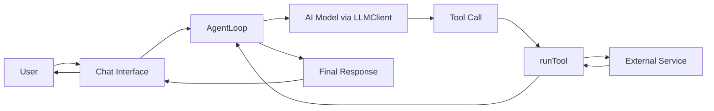

# Tool Calling Guide

This comprehensive guide covers how to implement and use tool calling in iHub Apps, enabling AI models to extend their capabilities by calling external functions and services.

## Table of Contents

- [Quick Start](#quick-start)
- [Core Concepts](#core-concepts)
- [Tool Development Lifecycle](#tool-development-lifecycle)
- [Implementation Patterns](#implementation-patterns)
- [Advanced Features](#advanced-features)
- [Practical Examples](#practical-examples)
- [Troubleshooting & Best Practices](#troubleshooting--best-practices)
- [Tool Configuration Reference](#tool-configuration-reference)
- [Native Web Search Resolution](#native-web-search-resolution)
- [Built-in Tools Reference](#built-in-tools-reference)

## Quick Start

Get tool calling working in under 10 minutes with this simple example.

### Enable a Tool for Your App

An app gets tools from the integrations it binds (`integrations`) and from its `websearch` configuration; it has no tool list of its own (the `tools` field was removed in #3275). This app turns on web search:

```json
{
  "id": "research-assistant",
  "name": {
    "en": "Research Assistant",
    "de": "Recherche-Assistent"
  },
  "description": {
    "en": "AI assistant with web search capabilities",
    "de": "KI-Assistent mit Web-Suchfunktionen"
  },
  "system": {
    "en": "You are a helpful research assistant. Use web search to find current information when needed.",
    "de": "Du bist ein hilfreicher Recherche-Assistent. Nutze die Websuche, um aktuelle Informationen zu finden."
  },
  "websearch": {
    "enabled": true,
    "provider": "auto",
    "useNativeSearch": true,
    "enabledByDefault": false
  }
}
```

### User Experience

When users ask questions requiring current information, the AI automatically uses available tools:

**User**: "What are the latest developments in quantum computing?"

**AI**: *[Searches web for "latest developments quantum computing 2024"]* 

Based on recent search results, here are the latest developments in quantum computing...

### How It Works

1. User sends a message requiring external information
2. AI model recognizes the need for a tool
3. Model generates a tool call request with parameters
4. iHub Apps executes the tool and returns results
5. Model incorporates tool results into its response

## Core Concepts

### What Are Tools?

Tools are functions that AI models can call to:
- **Access Real-time Information**: Web search, news feeds, APIs
- **Process Documents**: Extract content, analyze PDFs, parse structured data
- **Integrate Systems**: Query databases, call external APIs, interact with enterprise systems
- **Perform Computations**: Complex calculations, data transformations, analysis

**Important**: Models don't execute tools directly - they generate structured requests that iHub Apps executes on their behalf.

### Tool Architecture



The round trip between model and tools is the shared [Agent Loop](agent-loop.md):
chat, workflow nodes, app-as-tool and MCP all run tool calls through it (tool
matching, argument repair, circuit breakers, round budgets), and the tool itself
is executed by `runTool()` (`server/services/tools/runTool.js`). In chat, one tool runs at a time and each
call is surfaced to the client as `tool/started` / `tool/completed` SSE v2 frames
(see [SSE v2 Streaming](sse-v2.md)).

### Tool Registration and Discovery

Every tool a model can call is an action of an installed integration (#3275); nothing lists tools by
id any more, and there are no tool files in `contents/tools/` (the loader was retired: migration V230
reports leftover files and leaves them in place, nothing reads them).

> **Custom tools are built as integrations.** Add one under **Admin → Integrations → Add manually**,
> the integration builder, which takes an OpenAPI document, an HTTP request, a script, an MCP server
> or an A2A agent as its source (see
> [Integrations → Custom integrations](integrations.md#custom-integrations-add-manually)). An app,
> workflow node or agent profile gets the tool by binding the installation (`integrations`).

Tools reach a request in three ways:

1. **Installed integrations**: their actions are discovered from the definition (built-in, OpenAPI,
   HTTP, script) or from the remote server (MCP servers, A2A agents).
2. **Platform tools**: the agent workspace, the evidence tools and `read_url`, shipped with iHub in
   `server/defaults/tools/` and read in place; workflow nodes and agent profiles name them in
   `systemTools`.
3. **Feature tools**: project knowledge, stored-chat lookups and skills come with the feature, not
   from a binding.

## Tool Development Lifecycle

### 1. Tool Definition

A tool is declared as an **action** of an integration: a name, a description for the model, a JSON
schema for the parameters, a side effect (`read`, `write`, `destructive`) and an approval mode. In the
integration builder (**Admin → Integrations → Add manually**) you fill these in per action; a
shipped definition writes them in its `integration.json`. This is the parameter schema of a weather
action:

```json
{
  "name": "weatherLookup",
  "description": { "en": "Get current weather for a location", "de": "Aktuelles Wetter für einen Ort abrufen" },
  "sideEffect": "read",
  "parameters": {
    "type": "object",
    "properties": {
      "location": { "type": "string", "description": "City name or coordinates" },
      "units": { "type": "string", "enum": ["celsius", "fahrenheit"], "default": "celsius" }
    },
    "required": ["location"]
  }
}
```

The tool id the model sees is `<installationId>__<action>` (`weather__weatherLookup`).

### 2. Tool Implementation

For a **Script** integration the builder writes a connector module whose `actions.<name>.run(args, ctx)` does the work (see [Code-based integrations](integrations.md#code-based-integrations-script)). The function body below is the same logic, shown as a plain function:

```javascript
export async function execute(params) {
  const { location, units = 'celsius' } = params;
  
  try {
    // Validate parameters
    if (!location) {
      throw new Error('Location is required');
    }
    
    // Call external API
    const response = await fetch(
      `https://api.weather.com/v1/current?location=${encodeURIComponent(location)}&units=${units}`,
      {
        headers: {
          'Authorization': `Bearer ${process.env.WEATHER_API_KEY}`
        }
      }
    );
    
    if (!response.ok) {
      throw new Error(`Weather API error: ${response.statusText}`);
    }
    
    const data = await response.json();
    
    // Return structured result
    return {
      success: true,
      data: {
        location: data.location.name,
        temperature: data.current.temp,
        conditions: data.current.description,
        humidity: data.current.humidity,
        units: units
      }
    };
  } catch (error) {
    return {
      success: false,
      error: error.message
    };
  }
}
```

### 3. Testing and Validation

Test your tool independently before integration. There is no direct tool API (the `/api/tools`
routes were removed in #3275): test an action under **Admin → Integrations → the installation →
Actions** (the action tester), or with **Test in chat**. An inbound MCP client reaches the same
actions through the MCP gateway (see [MCP Integration](mcp-integration.md#who-sees-which-tool)).

### 4. App Integration

Tools are provided by integrations; a custom tool is a custom integration (see [Integrations](integrations.md#custom-integrations-add-manually)). Bind the installation in your app configuration:

```json
{
  "id": "weather-assistant",
  "integrations": { "weather": {} },
  "system": {
    "en": "You are a weather assistant. Use the weatherLookup tool to provide current weather information."
  }
}
```

## Implementation Patterns

### Simple Tools (Single Function)

Basic tools that perform one specific task:

```javascript
// server/tools/simpleTool.js
export async function execute(params) {
  // Single function implementation
  const result = await performTask(params);
  return { success: true, data: result };
}
```

Configuration:
```json
{
  "id": "simpleTool",
  "script": "simpleTool.js",
  "parameters": {
    "type": "object",
    "properties": {
      "input": { "type": "string" }
    }
  }
}
```

### Method-Based Tools (Multiple Functions)

Complex tools providing multiple related functions:

```javascript
// server/tools/documentManager.js
export const functions = {
  search: async (params) => {
    // Search implementation
    const results = await searchDocuments(params.query);
    return { success: true, data: results };
  },
  
  getContent: async (params) => {
    // Content retrieval implementation
    const content = await fetchDocument(params.id);
    return { success: true, data: content };
  },
  
  update: async (params) => {
    // Update implementation
    const updated = await updateDocument(params.id, params.changes);
    return { success: true, data: updated };
  }
};

export async function execute(method, params) {
  if (!functions[method]) {
    throw new Error(`Unknown method: ${method}`);
  }
  return await functions[method](params);
}
```

Configuration:
```json
{
  "id": "documentManager",
  "functions": {
    "search": {
      "description": "Search documents",
      "parameters": {
        "type": "object",
        "properties": {
          "query": { "type": "string" }
        }
      }
    },
    "getContent": {
      "description": "Get document content",
      "parameters": {
        "type": "object",
        "properties": {
          "id": { "type": "string" }
        }
      }
    }
  }
}
```

App usage:
```json
{
  "integrations": { "document-manager": { "actions": ["search", "getContent"] } }
}
```

### Reporting What a Tool Found

A tool that finds things for the user — documents, pages, tickets, people —
can have them listed in the answer's **Sources** panel, cited with numbered
badges and offered with their actions. Either return a `sources` array next to
the tool's data:

```js
return {
  results,
  sources: results.map(hit => ({ title: hit.title, url: hit.link, snippet: hit.summary }))
};
```

or, without touching the tool, declare a mapping in its definition (per tool,
or per function under `functions.<name>.sources`):

```json
"sources": { "provider": "crm", "kind": "item", "list": "results",
             "fields": { "id": "id", "title": "title", "url": "link" }, "query": "query" }
```

Both are private (never in a shared chat) unless they say otherwise. See
[Answer Sources](answer-sources.md) for the fields and the privacy rules, and
[Building an Integration](integration-development.md) for a step-by-step guide,
including how an integration adds preview and download.

### External Service Integration

Integrate with external APIs and services:

```javascript
// server/tools/jiraIntegration.js
import { JiraClient } from './lib/jira-client.js';

export async function execute(params) {
  const client = new JiraClient({
    host: process.env.JIRA_HOST,
    email: process.env.JIRA_EMAIL,
    apiToken: process.env.JIRA_API_TOKEN
  });
  
  try {
    switch (params.action) {
      case 'createIssue':
        return await client.createIssue({
          project: params.project,
          summary: params.summary,
          description: params.description,
          issueType: params.type || 'Task'
        });
        
      case 'searchIssues':
        return await client.searchIssues({
          jql: params.jql,
          maxResults: params.limit || 10
        });
        
      case 'updateIssue':
        return await client.updateIssue(params.issueKey, {
          fields: params.updates
        });
        
      default:
        throw new Error(`Unknown action: ${params.action}`);
    }
  } catch (error) {
    return {
      success: false,
      error: `JIRA API error: ${error.message}`
    };
  }
}
```

### Real-time Tool Execution

Tools that provide streaming or real-time responses:

```javascript
// server/tools/liveDataFeed.js
export async function* executeStream(params) {
  const eventSource = new EventSource(params.feedUrl);
  
  try {
    for await (const event of eventSource) {
      // Process and yield each event
      yield {
        type: 'data',
        content: processEvent(event)
      };
      
      // Check for completion condition
      if (shouldStop(event)) {
        break;
      }
    }
  } finally {
    eventSource.close();
  }
}
```

## Advanced Features

### MCP Server Integration

iHub speaks the Model Context Protocol in **both directions** — it can act
as an MCP client connecting to external MCP servers, and as an MCP server
exposing iHub apps/workflows/tools to MCP-aware agents (Claude Desktop,
Cursor, etc).

See [MCP Integration](mcp-integration.md) for the full guide:

- Outbound: install external MCP servers as integrations under
  **Admin → Integrations** (`/admin/integrations`,
  stored in `contents/config/integrations.json`) and bind them to apps under
  `integrations`. Supports Streamable HTTP, SSE (legacy), stdio, and
  WebSocket transports with SSRF guards and encrypted credentials.
- Inbound: enable the gateway in `platform.mcpServer.enabled` and point
  MCP-aware clients at `https://your-ihub/mcp`. Gated by the existing
  OAuth2 authorization server using new `mcp:*` scopes.

### Tool Chaining and Workflows

Combine multiple tools for complex workflows:

```json
{
  "id": "document-processor",
  "integrations": { "pdf-extractor": {}, "text-analyzer": {}, "summary-generator": {} },
  "system": {
    "en": "Process documents by first extracting content, then analyzing it, and finally generating summaries. Chain tools as needed."
  }
}
```

Workflow example:
```javascript
// AI model generates sequential tool calls
1. pdfExtractor.extract({ file: "document.pdf" })
2. textAnalyzer.analyze({ text: extractedContent })
3. summaryGenerator.generate({ analysis: analysisResults })
```

### Requiring a tool call

By default a model with tools available decides for itself whether to use them,
and some answer from memory when the app wanted them to look something up. Set
`toolChoice` on the app to change that:

```json
{
  "id": "research-assistant",
  "integrations": { "ifinder": { "actions": ["search"] } },
  "toolChoice": "required"
}
```

| Value | Behavior |
|-------|----------|
| `auto` (default) | The model decides whether to call a tool |
| `required` | The **first** model call of every message must call one of the app's tools. Every later call is `auto`, so the model can answer from the tool results |

Only the first call is forced because the first call is the one that has to
trigger the tool; the rest follows from its result. A mandatory call on every
round could never end in an answer. A message that resumes after the model asked
the user a question (`ask_user`) is not forced again, and nothing is forced when
the turn offers no tools (for example web search switched off). `required` does
not pick a tool: the model chooses among the ones it was given, and a workflow
`prompt` node takes the same setting as `config.toolChoice`. The admin app
editor has it under **Tools → Tool use**.

How the request reaches each provider:

| Adapter | Sent to the provider | Notes |
|---------|----------------------|-------|
| `openai`, `openai-responses` | `tool_choice: "required"` | |
| `mistral` | `tool_choice: "required"` | |
| `local` (vLLM, ...), and `openai` with your own URL | `tool_choice: "required"` | Depends on the installation: vLLM is usually started with `--enable-auto-tool-choice`, which serves `auto`, and `required` depends on the vLLM version and deployment; other local servers may ignore or refuse the field. Keep these models on `auto` (apps then ask in words) until you have checked |
| `anthropic` | `tool_choice: { "type": "any" }` | **Not accepted** by Claude Opus 5.5, Sonnet 5.5, Fable 5.1 and Mythos 5.1, or with manual extended thinking. Not applied when the app has an output schema (the structured-output `json` tool is already pinned) |
| `google` | `toolConfig.functionCallingConfig.mode: "ANY"` | Not sent with native Google Search, which drops the function tools |
| `bedrock` | `toolConfig.toolChoice: { "any": {} }` | Claude models on Bedrock have the same restrictions as on Anthropic's API |
| `iassistant-conversation` | — | The conversation API has no function calling |

**When the model cannot be forced.** Not every model takes it, and a rejected
request would fail the whole turn. For those the first call carries a one-off
instruction instead ("call one of the available tools first"): shown to the
model for that call only and never part of the conversation. The loop knows a
model can be forced only when its `supportsTools` is `required` (the model
editor's **Tool Calling** dropdown; `auto` is set on the shipped Claude Opus 5,
Sonnet 5 and Fable 5.1). A `required` model that the provider still refuses,
with a `400` naming `tool_choice`, is handled the same way: the request is
repeated in words, without being charged as a round, and the model is
remembered for an hour so later turns do not try again. The OpenAI-compatible API (`/v1/chat/completions`) is not
affected: a `tool_choice` sent by a client passes through unchanged on every
request.

The setting is per app (and workflow node) rather than per tool because
"required" is about what the model must do in a turn, not about one tool.

### Performance Optimization

#### Caching Strategy

```javascript
// server/tools/cachedTool.js
const cache = new Map();
const CACHE_TTL = 300000; // 5 minutes

export async function execute(params) {
  const cacheKey = JSON.stringify(params);
  const cached = cache.get(cacheKey);
  
  if (cached && Date.now() - cached.timestamp < CACHE_TTL) {
    return cached.data;
  }
  
  const result = await performExpensiveOperation(params);
  
  cache.set(cacheKey, {
    data: result,
    timestamp: Date.now()
  });
  
  return result;
}
```

#### Concurrency Handling

```javascript
// server/tools/concurrentTool.js
import pLimit from 'p-limit';

const limit = pLimit(5); // Max 5 concurrent operations

export async function execute(params) {
  if (params.batch) {
    // Process batch with concurrency limit
    const promises = params.items.map(item =>
      limit(() => processItem(item))
    );
    
    return await Promise.all(promises);
  }
  
  return await processItem(params);
}
```

### Security Considerations

#### Authentication and Authorization

```javascript
// server/tools/secureTool.js
export async function execute(params, context) {
  // Check user permissions
  if (!context.user || !context.user.permissions.includes('tool:secure')) {
    throw new Error('Unauthorized: Missing required permissions');
  }
  
  // Validate API keys
  if (!process.env.SECURE_API_KEY) {
    throw new Error('Configuration error: API key not configured');
  }
  
  // Execute with user context
  return await performSecureOperation(params, context.user);
}
```

#### Input Validation

```javascript
// server/tools/validatedTool.js
import Ajv from 'ajv';

const ajv = new Ajv();
const validateParams = ajv.compile({
  type: 'object',
  properties: {
    query: { type: 'string', maxLength: 500 },
    limit: { type: 'integer', minimum: 1, maximum: 100 }
  },
  required: ['query']
});

export async function execute(params) {
  // Validate input parameters
  if (!validateParams(params)) {
    throw new Error(`Invalid parameters: ${ajv.errorsText(validateParams.errors)}`);
  }
  
  // Sanitize input
  const sanitized = {
    query: params.query.replace(/<script\b[^<]*(?:(?!<\/script>)<[^<]*)*<\/script>/gi, ''),
    limit: params.limit || 10
  };
  
  return await performOperation(sanitized);
}
```

## Practical Examples

### Web Search Tool

Complete implementation of a web search tool:

```javascript
// server/tools/webSearch.js
import fetch from 'node-fetch';

export async function execute(params) {
  const { query, limit = 10 } = params;
  
  if (!query) {
    throw new Error('Search query is required');
  }
  
  try {
    const response = await fetch(
      `https://api.duckduckgo.com/search?q=${encodeURIComponent(query)}&limit=${limit}`,
      {
        headers: {
          'User-Agent': 'iHub-Apps/1.0'
        }
      }
    );
    
    const data = await response.json();
    
    return {
      success: true,
      results: data.results.map(result => ({
        title: result.title,
        url: result.url,
        snippet: result.snippet
      }))
    };
  } catch (error) {
    return {
      success: false,
      error: `Search failed: ${error.message}`
    };
  }
}
```

### Document Processing Tool

Process and analyze documents:

```javascript
// server/tools/documentProcessor.js
import { PDFExtract } from 'pdf-extract';
import natural from 'natural';

export const functions = {
  extractText: async (params) => {
    const pdfExtract = new PDFExtract();
    const data = await pdfExtract.extract(params.filePath);
    
    const text = data.pages
      .map(page => page.content.map(item => item.str).join(' '))
      .join('\n');
    
    return { success: true, text };
  },
  
  analyze: async (params) => {
    const { text } = params;
    
    // Tokenize and analyze
    const sentences = natural.SentenceTokenizer.tokenize(text);
    const tfidf = new natural.TfIdf();
    tfidf.addDocument(text);
    
    // Extract key terms
    const keyTerms = [];
    tfidf.listTerms(0).slice(0, 10).forEach(item => {
      keyTerms.push({ term: item.term, score: item.tfidf });
    });
    
    return {
      success: true,
      analysis: {
        wordCount: text.split(/\s+/).length,
        sentenceCount: sentences.length,
        keyTerms
      }
    };
  },
  
  summarize: async (params) => {
    const { text, maxLength = 500 } = params;
    
    // Simple extractive summarization
    const sentences = natural.SentenceTokenizer.tokenize(text);
    const scores = calculateSentenceScores(sentences);
    const topSentences = selectTopSentences(scores, maxLength);
    
    return {
      success: true,
      summary: topSentences.join(' ')
    };
  }
};
```

### API Integration Tool

Integrate with REST APIs:

```javascript
// server/tools/apiConnector.js
export async function execute(params) {
  const { endpoint, method = 'GET', headers = {}, body } = params;
  
  // Validate endpoint
  const allowedDomains = ['api.example.com', 'data.company.com'];
  const url = new URL(endpoint);
  
  if (!allowedDomains.includes(url.hostname)) {
    throw new Error('Endpoint domain not allowed');
  }
  
  const options = {
    method,
    headers: {
      'Content-Type': 'application/json',
      ...headers
    }
  };
  
  if (body && method !== 'GET') {
    options.body = JSON.stringify(body);
  }
  
  try {
    const response = await fetch(endpoint, options);
    const data = await response.json();
    
    return {
      success: response.ok,
      status: response.status,
      data
    };
  } catch (error) {
    return {
      success: false,
      error: error.message
    };
  }
}
```

### Custom Business Logic Tool

Implement domain-specific business logic:

```javascript
// server/tools/invoiceProcessor.js
export async function execute(params) {
  const { action, data } = params;
  
  switch (action) {
    case 'validate':
      return validateInvoice(data);
      
    case 'calculate':
      return calculateTotals(data);
      
    case 'approve':
      return approveInvoice(data);
      
    default:
      throw new Error(`Unknown action: ${action}`);
  }
}

function validateInvoice(invoice) {
  const errors = [];
  
  // Business rule validations
  if (!invoice.invoiceNumber) {
    errors.push('Invoice number is required');
  }
  
  if (!invoice.customer?.id) {
    errors.push('Customer ID is required');
  }
  
  if (!invoice.items || invoice.items.length === 0) {
    errors.push('At least one line item is required');
  }
  
  invoice.items?.forEach((item, index) => {
    if (!item.quantity || item.quantity <= 0) {
      errors.push(`Item ${index + 1}: Invalid quantity`);
    }
    if (!item.unitPrice || item.unitPrice < 0) {
      errors.push(`Item ${index + 1}: Invalid unit price`);
    }
  });
  
  return {
    success: errors.length === 0,
    errors,
    valid: errors.length === 0
  };
}

function calculateTotals(invoice) {
  let subtotal = 0;
  
  const items = invoice.items.map(item => {
    const lineTotal = item.quantity * item.unitPrice;
    subtotal += lineTotal;
    return { ...item, lineTotal };
  });
  
  const taxRate = invoice.taxRate || 0.1;
  const tax = subtotal * taxRate;
  const total = subtotal + tax;
  
  return {
    success: true,
    data: {
      items,
      subtotal,
      taxRate,
      tax,
      total
    }
  };
}
```

## Troubleshooting & Best Practices

### Common Implementation Errors

**Error: Tool not found**
```
Error: Tool 'myTool' not found
```
**Solution**: 
- Verify the integration is installed and enabled (**Admin → Integrations → Installed**) and that the action is not switched off
- Verify the app, node or profile binds the installation and the user's group is granted it (`permissions.integrations`)
- Check tool ID matches exactly (case-sensitive)

**Error: Parameter validation failed**
```
Error: Invalid parameters: data.query should be string
```
**Solution**:
- Review parameter schema in tool configuration
- Ensure all required parameters are provided
- Check parameter types match schema

**Error: Tool execution timeout**
```
Error: Tool execution exceeded 30 second timeout
```
**Solution**:
- Implement timeout handling in tool
- Consider breaking long operations into chunks
- Use streaming for real-time feedback

### Performance Optimization

**Tool Execution Performance**

| Operation Type | Recommended Timeout | Caching Strategy |
|---------------|-------------------|------------------|
| Simple Query | 5 seconds | 5 minutes |
| API Call | 10 seconds | 1 minute |
| Document Processing | 30 seconds | 30 minutes |
| Batch Operations | 60 seconds | No caching |

**Optimization Strategies**:

1. **Implement Caching**
```javascript
const cache = new LRUCache({ max: 100, ttl: 300000 });
```

2. **Use Connection Pooling**
```javascript
const pool = new Pool({ max: 10, min: 2 });
```

3. **Batch Operations**
```javascript
const results = await Promise.all(items.map(processItem));
```

### Security Guidelines

**1. Input Sanitization**
Always sanitize user inputs before processing:

```javascript
function sanitizeInput(input) {
  // Remove script tags
  input = input.replace(/<script\b[^<]*(?:(?!<\/script>)<[^<]*)*<\/script>/gi, '');
  
  // Escape special characters
  input = input.replace(/[&<>"']/g, char => ({
    '&': '&amp;',
    '<': '&lt;',
    '>': '&gt;',
    '"': '&quot;',
    "'": '&#39;'
  }[char]));
  
  return input;
}
```

**2. API Key Management**
- Store API keys in environment variables
- Never log or expose API keys
- Rotate keys regularly
- Use separate keys for development/production

**3. Rate Limiting**
Implement rate limiting for external API calls:

```javascript
import rateLimit from 'express-rate-limit';

const limiter = rateLimit({
  windowMs: 60 * 1000, // 1 minute
  max: 10 // limit to 10 requests
});
```

### Testing Strategies

**1. Unit Testing**
```javascript
// tests/tools/myTool.test.js
import { execute } from '../../server/tools/myTool.js';

describe('MyTool', () => {
  test('executes successfully with valid params', async () => {
    const result = await execute({ query: 'test' });
    expect(result.success).toBe(true);
    expect(result.data).toBeDefined();
  });
  
  test('handles missing parameters', async () => {
    await expect(execute({})).rejects.toThrow('Query is required');
  });
});
```

**2. Integration Testing**
Run the action from **Admin → Integrations → the installation → Actions** (the action tester).

**3. End-to-End Testing**
Test complete workflow from chat interface through tool execution.

### Tool Development Checklist

- [ ] Integration installed with the action declared (description, parameters, side effect, approval)
- [ ] Implementation (script connector, OpenAPI operation or HTTP request)
- [ ] Parameter validation implemented
- [ ] Error handling for all edge cases
- [ ] Authentication/authorization checks
- [ ] Input sanitization
- [ ] Timeout handling
- [ ] Caching strategy (if applicable)
- [ ] Unit tests written
- [ ] Integration tests passed
- [ ] Documentation updated
- [ ] Security review completed

## Tool Configuration Reference

### Action Field Reference

Each action of an integration definition uses these fields (the builder writes them for you):

| Field | Description |
|-------|-------------|
| `name` | The action's name; the tool id is `<installationId>__<action>` unless the definition fixes a `toolId` |
| `title` / `description` | Localized display name and the description the model receives |
| `parameters` | JSON schema describing the tool input |
| `sideEffect` | `read`, `write` or `destructive` (drives [tool approval](tool-approval.md)) |
| `dataFlow` | Where the data goes (optional) |
| `toolId` | A fixed tool id (built-in and custom definitions only) |

Native web search (Google Search grounding, OpenAI Web Search, Anthropic Web Search) is not a tool: the
provider handles it, see [Native Web Search Resolution](#native-web-search-resolution) below.

## Native Web Search Resolution

Native (provider-handled) web search is resolved directly by `webSearchResolver.resolveNativeWebSearchProvider()` / `resolveAppNativeWebSearch()` from the app's unified `websearch` config (see [Web Tools](web-tools.md)) or a workflow node's generic `webSearch` tool id — it is never a tool file in `contents/tools/` and never flows through the generic tool-calling converters. When native search applies, the adapter (`anthropic.js`, `google.js`, or `openai-responses.js`) injects the provider's native tool block directly into the request:

| Provider | Native tool injected |
|----------|----------------------|
| `google` | `{ google_search: {} }` — mutually exclusive with function calling (Gemini API limitation); function tools are dropped when native search is active |
| `openai-responses` | `{ type: 'web_search' }` — combinable with function tools |
| `anthropic` | `{ type: <toolVersion>, name: 'web_search', max_uses: <cap> }` — the version comes from the model's `nativeWebSearch.toolVersion` (default `web_search_20250305`); newer versions are sent with `allowed_callers: ['direct']` unless the model enables `dynamicFiltering`; `max_uses` is the app's `websearch.maxSearches` or the node's `maxWebSearches` (default 5); combinable with function tools; billed separately by Anthropic per search |

For any other provider — and for models with `nativeWebSearch.enabled: false` — `websearch` config uses the search tool of the app's engine (`websearch.provider`, an installed integration of type `web-search`; `auto` takes the first engine the user may use), and offers nothing while no engine is available. Native search itself needs no engine. Response-side, search results and citations are surfaced as `groundingMetadata` on the generic streaming response, which powers the "Grounding" answer-source badge, the Sources list under the answer and (for workflow agent nodes) the synthesizer's citation ledger.

Two runtime safeguards live in the agent loop and the LLM client: when the provider rejects the request with a client error that names web search, the loop retries once without the directive and with the app's engine (`auto` for a workflow node), and remembers the rejection per model for 15 minutes (`server/services/loop/nativeWebSearchFallback.js`); when Anthropic pauses a search turn (`stop_reason: pause_turn`), `LLMClient` replays the paused assistant blocks verbatim on a follow-up request (`providerContent`), up to three times per call.

## Built-in Tools Reference

iHub Apps ships with a set of pre-configured built-in tools that cover the most common integration scenarios.

### `braveSearch`

- **Provider**: Any model supporting function calling
- **Description**: Web search powered by the Brave Search API for privacy-focused search results, with optional content extraction
- **Type**: Server-side execution — the `search` action of the built-in engine **Brave Search** (installation `brave`, **Admin → Integrations → Web search**), not a tool file in `contents/tools/`; the same holds for `staanSearch` (`staan`) and `qwantSearch` (`qwant`). The page reader `read_url` is a platform tool of the web search feature (`server/defaults/tools/read_url.json`)
- **Parameters**:
  - `query` (string, required): The search query or search terms
  - `extractContent` (boolean, optional): Extract full content from top results (default: configured by app's `websearch.extractContent`)
  - `maxResults` (number, optional): Maximum results to return (default: configured by app's `websearch.maxResults`, max: 10)
  - `contentMaxLength` (number, optional): Maximum content length per page (default: configured by app's `websearch.contentMaxLength`)
- **Authentication**: Pick a **secret** credential in the **API key** field of the `brave` engine (**Admin → Integrations → Web search → Brave Search**) or set the `BRAVE_SEARCH_API_KEY` environment variable
- **Configuration**:
  - **Installation Method** (Recommended):
    1. Store the key as a credential of type **secret** under Admin → Integrations → Credentials
    2. Open Admin → Integrations → **Web search**
    3. Pick that credential in the **Brave Search API key** field (Staan: **Staan API key**)
    4. Save changes — no server restart required; **Test** runs one live search
  - **Environment Variable Method**:
    - Set the `BRAVE_SEARCH_API_KEY` environment variable (`STAAN_API_KEY` for Staan)
    - Restart the server for changes to take effect
  - **Fallback**: A referenced credential wins; the environment variable applies when the installation references none
- **Returns**: Array of search results with:
  - `title`: Page title
  - `url`: Page URL
  - `description`: Brief excerpt from the page
  - `language`: Detected language of the result
  - `content`: Extracted page content (when `extractContent` is enabled)
- **Use Cases**: Privacy-focused web search, general information lookup, comprehensive research with content extraction

**Example Tool Call**:
```json
{
  "tool": "braveSearch",
  "parameters": {
    "query": "latest AI developments 2024"
  }
}
```

### Unified Web Search Configuration

> **Changed in v5.2.11**: Web search is no longer configured by adding tool IDs to the `tools` array. Instead, use the `websearch` configuration object on each app. The server automatically resolves the best search tool at runtime based on the model's provider. See [Web Tools](web-tools.md) for full details.

**Example App Configuration**:
```json
{
  "id": "research-assistant",
  "websearch": {
    "enabled": true,
    "provider": "auto",
    "useNativeSearch": true,
    "maxResults": 5,
    "extractContent": true,
    "contentMaxLength": 3000,
    "enabledByDefault": false
  }
}
```

**How provider resolution works**:
- **Gemini models** + `useNativeSearch: true` → Google Search grounding
- **OpenAI Responses models** + `useNativeSearch: true` → OpenAI Web Search
- **Anthropic models** + `useNativeSearch: true` → Anthropic Web Search
- **Otherwise** → the engine named by `provider` (an engine installation id), if it is installed, enabled and granted to the user; for `"auto"`, the first engine that is, in the order Brave, Staan, Qwant, then any other engine by id; no engine means no web search on that model

**Key properties**:

| Property | Type | Default | Description |
|----------|------|---------|-------------|
| `enabled` | Boolean | `false` | Enable web search for this app |
| `provider` | String | `"auto"` | `"auto"` or the id of an installed engine: `"brave"`, `"staan"`, `"qwant"` or a third-party engine's id |
| `useNativeSearch` | Boolean | `true` | Prefer native search for Gemini/OpenAI/Anthropic models |
| `maxResults` | Number | `5` | Maximum search results (1-20) |
| `extractContent` | Boolean | `true` | Extract full page content from results |
| `contentMaxLength` | Number | `3000` | Max extracted content per page (500-50,000) |
| `enabledByDefault` | Boolean | `false` | Whether search is active by default for users |
| `researchGuidance` | Boolean or String | `true` | Research instruction added to the system prompt when search is on; `false` = off, string = custom text |

**Migration**: Existing apps with websearch tool IDs (`braveSearch`, `enhancedWebSearch`, etc.) in their former tool list are automatically migrated to the new format on server startup. Migration V195 moves the search engines' API keys from `providers.json` into credentials, deletes the shipped tool files `braveSearch.json`, `staanSearch.json`, `qwantSearch.json` and `read_url.json` from `contents/tools/`, and strips the search ids from the app's former tool list; migration V204 installs one engine per key (and Qwant where it was reachable) in place of the former `websearch` installation.

### `iFinder`

- **Provider**: Any model supporting function calling
- **Description**: Comprehensive document search, content retrieval, and management for iFinder document management systems
- **Type**: Actions of the built-in installed integration **iFinder** (`com.intrafind/ifinder`, installation `ifinder` under **Admin → Integrations**); there is no tool file any more
- **Tools**: `iFinder_search`, `iFinder_getContent`, `iFinder_getMetadata`, `iFinder_discover`, `iFinder_getFields`, `iFinder_getFacetValues`, `iFinder_listProfiles` (ids unchanged)
- **Authentication**: Requires authenticated users and the iFinder JWT configuration of the installation
- **App Usage**: bind the installation (`"integrations": { "ifinder": {} }` for all seven actions, or `{ "actions": ["search", "getContent"] }`); `iFinder` or `iFinder.*` entries in `tools` select nothing (migration V192 rewrote them, see [Apps → Integrations: binding an installed integration](apps.md#integrations-binding-an-installed-integration))
- **Documentation**: See [iFinder Integration](iFinder-Integration.md) for detailed setup and usage

### People directories (`<directoryId>__search_people`, …)

- **Description**: Search LDAP people directories — the company directory (reusing an LDAP sign-in provider) and external ones such as x500.bund.de. Each directory is an installation of the built-in integration **People directory (LDAP)** (`com.intrafind/ldap-directory`, **Admin → Integrations**) and offers `<directoryId>__search_people`, `<directoryId>__get_person` and optionally `<directoryId>__list_units`, named and described after the directory so the model can choose between them
- **Type**: Actions of a `native` installation, run through the installation's connector
- **App Usage**: bind the installation (`"integrations": { "x500bund": {} }`) for one directory, the definition (`"integrations": { "com.intrafind/ldap-directory": {} }`) for every LDAP directory including ones installed later, or the type (`"integrations": { "type:people-directory": {} }`, the shipped People search app) for every people directory, the Entra ID directory included. The group grant (`permissions.integrations`) still applies
- **LDAP browser**: the raw-entry tools `<browserId>__browse_search`, `__browse_read` and `__browse_children` belong to installations of the separate integration **LDAP browser** (`com.intrafind/ldap-browser`), which reuse a directory's connection. Bind a browser installation, or `com.intrafind/ldap-browser` for every browser; a binding without `actions` binds all three. Only signed-in, non-delegated users the browser is granted to get them; the `ldapBrowse` reference is retired (migration V205)
- **Documentation**: See [People Directory Search](people-directory-search.md)

### `entraPeopleSearch`

- **Provider**: Any model supporting function calling
- **Description**: Corporate directory integration for Microsoft Entra ID (formerly Azure AD) through Microsoft Graph
- **Type**: Actions of the built-in installed integration **Microsoft Entra ID directory** (`com.intrafind/entra-directory`, installation `entra` under **Admin → Integrations**); there is no tool file any more
- **Tools**: `entraPeopleSearch_findUser`, `entraPeopleSearch_getAllUserDetails`, `entraPeopleSearch_getUserManager`, `entraPeopleSearch_getUserGroups`, `entraPeopleSearch_getTeamMembers`, `entraPeopleSearch_getUserPhotoBase64` (ids unchanged)
- **Configuration**: the installation holds the tenant id, the application (client) id and the client secret as a credential reference; each falls back to `AZURE_TENANT_ID`, `AZURE_CLIENT_ID`, `AZURE_CLIENT_SECRET` when empty. The app registration needs the application permissions `User.Read.All` and `GroupMember.Read.All` with admin consent. **Test** acquires a token with the values as entered (never a token cached from the saved settings) and lists one user; it warns when the secret credential has no value and the environment variable stood in.
- **Apps**: bind the installation (`"integrations": { "entra": {} }`, or `{ "actions": ["findUser", "getUserManager"] }`); an app that binds it is offered only while the installation is enabled. Migration V197 rewrote `tools: ["entraPeopleSearch"]` entries.
- **Use Cases**: Org chart lookups, employee directory, team composition queries

### iHub's own tools (`ask_user`, `knowledge_*`, `write_artifact`, …)

iHub's own tools keep the ids they always had; there are no tool files for them in `contents/tools/` any more (migration V199 retired them, and initial setup no longer copies them there). Each belongs to the feature that uses it (Unified Integrations concept §6.9):

- **Asking the user and scheduled tasks — the iHub integration.** `ask_user` and the scheduled-task tools `schedule_task`, `list_scheduled_tasks`, `update_scheduled_task`, `delete_scheduled_task`, `run_scheduled_task_now`, `list_task_runs`, `get_task_run` are the actions of the always-installed built-in integration **iHub** (`com.intrafind/ihub`, installation `ihub` under **Admin → Integrations**). The installation cannot be removed or disabled; its **Settings** switch single actions off for every app (the former `enabled: false` of a tool file); groups grant it on **Admin → Groups**. Apps bind the installation (`"integrations": { "ihub": { "actions": ["ask_user"] } }`); the tool ids stay. `ask_user` survives a chat's tool narrowing, the scheduling tools follow the scheduled-tasks gate, `list_task_runs` and `get_task_run` are only ever added to a scheduled run.
- **Project knowledge — projects.** `knowledge_search`, `knowledge_read` and `knowledge_list` come with every request that reaches a project (a linked, attached or workflow project the user may use) while the projects feature is on, and never otherwise. No integration binding adds, removes or switches them off; the definition ships with iHub (`server/defaults/tools/knowledge.json`, read in place) and a `contents/tools/knowledge.json` is not read. See [Projects → The knowledge tools](projects.md#the-knowledge-tools).
- **Earlier turns of a chat — stored chats.** `chat_sources_list` / `chat_sources_read`, `chat_files_list` / `chat_files_read` and `chat_artifacts_list` / `chat_artifacts_read` let the model look up the sources earlier answers found, the files uploaded to the chat and the files its turns created. Each pair comes with a turn of a stored chat that has something of its kind and sends its history, and never otherwise. Like the knowledge tools, no integration binding adds or removes them; the definitions ship with iHub (`server/defaults/tools/chat_*.json`, read in place). See [Chat Persistence → What earlier turns give the model](chat-persistence.md#what-earlier-turns-give-the-model).
- **Agent workspace and evidence — workflows and agents.** `write_artifact`, `read_memory`, `write_memory`, `read_inbox`, `write_inbox`, `create_task`, `list_tasks`, `mark_task_done` and `evidence_collect`, `evidence_validateQuotesFastPath`, `evidence_composeReport` are plain tools, not integration actions, and are not listed on the Integrations page. Workflow nodes and agent profiles name them in `systemTools` by exact id or base id (`"evidence"`), agent runs attach them and a scheduled run with memory gets `read_memory` / `write_memory`. Apps cannot offer them and the inbound MCP gateway does not expose them.
- **Documentation**: [Ask User Tool](ask-user-tool.md), [Projects](projects.md), [Scheduled Tasks](scheduled-tasks.md)

## Related Documentation

- **[Structured Output Guide](structured-output.md)**: Combine tools with structured JSON responses
- **[App Configuration](apps.md)**: Configure apps to use tools
- **[Models Configuration](models.md)**: Model-specific tool calling behavior
- **[Security Guide](security.md)**: Security best practices for tool implementation

---

*This documentation follows iHub Apps best practices for tool calling implementation. For additional support, refer to the troubleshooting section or consult the community resources.*