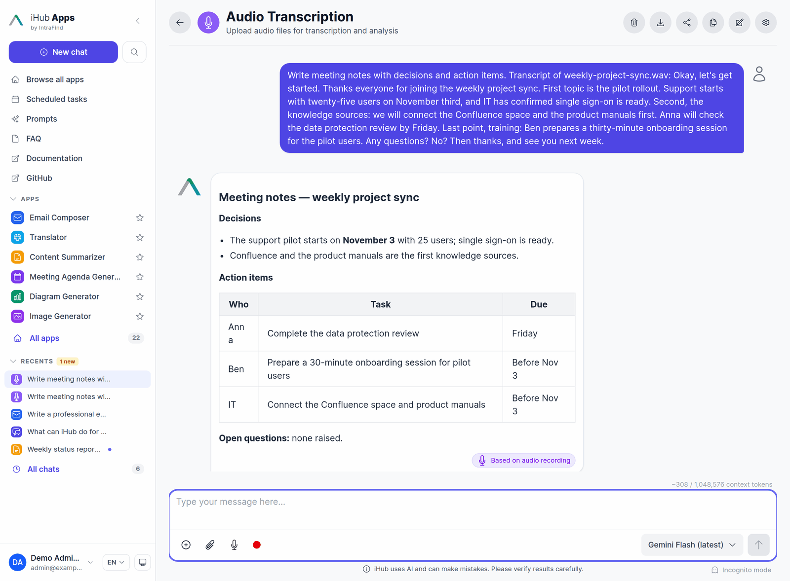
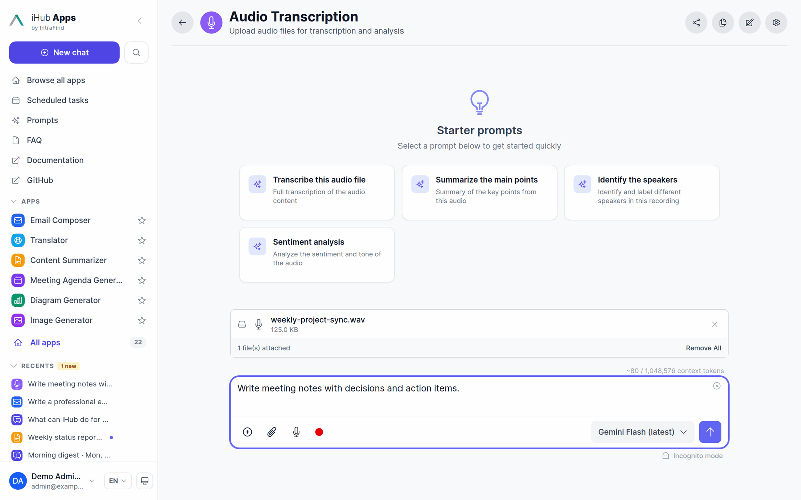
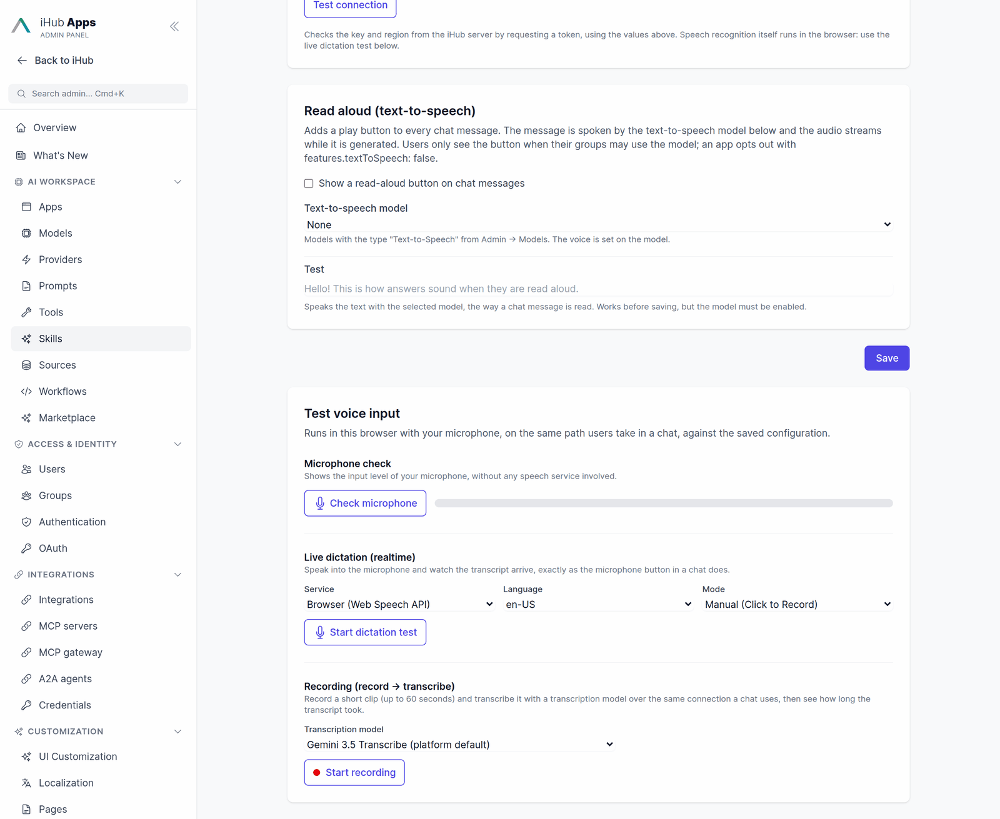

# Realtime Voice & Transcription (Voxtral)

This guide covers iHub Apps' realtime speech-to-text stack end to end: what users see, how audio flows through the system, how to deploy and configure a self-hosted Voxtral (vLLM) backend, how to put it behind a reverse proxy such as nginx, and how it behaves under load. It is written for administrators running iHub Apps in production.

Three user-facing features share one server-side pipeline:

| Feature                     | What the user does                                                     | Where the text goes                                                        |
| --------------------------- | ---------------------------------------------------------------------- | -------------------------------------------------------------------------- |
| **Dictation** (with a model)| Clicks the microphone icon and speaks                                  | Into the chat **input field**                                              |
| **Record → send**           | Clicks the record button, speaks, clicks stop                          | Grows the **user's message** while speaking; sent to the chat model on stop |
| **File/video transcription**| Uploads an audio file or a video (audio track is extracted in-browser) | Into the **user's message**, after the typed text; sent to the chat model  |

In all three the transcript is **user input**. The selected chat model answers it like any typed message — the transcription model only turns speech into text.



All three send audio to the same iHub WebSocket endpoint, `/api/voice/realtime`, naming a transcription model; iHub relays it to that model's endpoint (e.g. Voxtral on vLLM). The browser **never** connects to the endpoint directly, and its URL / API key **never** reach the browser.

Dictation can also run without iHub in the path: the **browser** service (Web Speech API) and **Azure Speech** recognize speech in the browser. Which one an app uses is set under **Admin → Voice Input** (the platform default) or per app — see [Choosing what voice input uses](#choosing-what-voice-input-uses).

## Architecture

```
Browser                          iHub Apps server                     GPU host
┌───────────────────────┐       ┌──────────────────────────┐        ┌─────────────────┐
│ mic / file / video    │       │ /api/voice/realtime      │        │ vLLM            │
│  → AudioWorklet /     │  WS   │  · JWT auth on upgrade   │   WS   │  /v1/realtime   │
│    decodeAudioData    │──────▶│  · Origin (CSWSH) guard  │───────▶│  Voxtral model  │
│  → 16 kHz mono PCM16  │       │  · per-model permissions │        │                 │
│                       │◀──────│  · connection caps       │◀───────│ transcription.* │
│ transcript (deltas)   │ JSON  │  · relay + backpressure  │  JSON  │ frames          │
└───────────────────────┘       └──────────────────────────┘        └─────────────────┘
```

The GPU host above is one of four interchangeable backends. Which one a
session uses comes from the selected transcription model's provider, and the
browser-facing protocol is identical for all of them:

| Provider | Upstream | Shape |
| --- | --- | --- |
| `vllm-realtime` | your own vLLM `/v1/realtime` | Streaming WebSocket |
| `mistral` | Mistral realtime API (`wss://api.mistral.ai/v1/audio/transcriptions/realtime`) | Streaming WebSocket |
| `google-live` | Gemini Live API (`wss://…BidiGenerateContent`) | Streaming WebSocket |
| `google-transcribe` | Gemini Files API + `/v1beta/interactions` | Batch: one HTTPS request on `stop` |
| `openai` / `local` | OpenAI-compatible `/audio/transcriptions` (Whisper on T-Systems LLM Hub, OpenAI, vLLM) | Batch: one HTTPS request on `stop` (in parts for long recordings) |

A batch provider has no upstream socket. The server buffers the PCM the browser
streams, makes a single transcription request when the client sends `stop`, and
returns the result as one `final` frame followed by `done` — so the client
cannot tell the difference. See [Batch providers and memory](models.md#batch-providers-and-memory)
for the byte caps that bound the buffering.

Key properties:

- **All audio processing happens in the browser.** Decoding uploaded files (`decodeAudioData`), extracting the audio track from videos, downmixing to mono, and resampling to 16 kHz run client-side (AudioWorklet / `OfflineAudioContext`). The server only relays already-prepared PCM16 frames — there is no server-side decoding, no ffmpeg, and no CPU-heavy work on the Node.js event loop.
- **The server is a thin, per-connection bridge.** Each browser connection gets its own dedicated upstream socket and closure-scoped state. There is no broadcast and no shared session registry — one user can never receive another user's transcript frames.
- **Audio is never persisted.** Audio is relayed and discarded; transcripts stream to the requesting client only. Once sent, a transcript is an ordinary user message and is stored like one (see [Chat persistence](chat-persistence.md)). Server logs record frame counts and text lengths (at debug level), never transcript content.

### WebSocket protocol (browser ↔ iHub)

The protocol is iHub-defined (both ends are ours):

| Direction        | Frame                                | Meaning                                                        |
| ---------------- | ------------------------------------ | -------------------------------------------------------------- |
| client → server  | `{"type":"start", "modelId"}`        | Begin a session with that transcription model. Audio without a `start` frame gets a `no-model` error. |
| client → server  | binary frames                        | PCM16 audio, 16 kHz mono, little-endian                        |
| client → server  | `{"type":"stop"}`                    | No more audio; flush and finish                                 |
| server → client  | `{"type":"ready","mode"}`            | Upstream session initialized — safe to stream at full speed. `mode` is `stream` or `batch` (a batch transcript only arrives after `stop`) |
| server → client  | `{"type":"delta","text":"..."}`      | Streaming partial transcript                                    |
| server → client  | `{"type":"final","text":"..."}`      | A completed utterance/segment                                   |
| server → client  | `{"type":"done"}`                    | Transcript complete (sent after `stop` once the upstream settles) |
| server → client  | `{"type":"error","code","message"}`  | Setup or upstream failure (connection closes afterwards)        |

Error frames carry a stable machine-readable `code` alongside the human-readable `message`:

| `code`                                          | Meaning                                                     |
| ----------------------------------------------- | ----------------------------------------------------------- |
| `no-model`                                      | The session named no model (`start` without `modelId`, or no `start`) |
| `unknown-model` / `not-transcription-model` / `model-disabled` | The requested `modelId` is invalid for transcription |
| `not-permitted`                                 | The user's groups don't grant the model                     |
| `unsupported-provider` / `no-endpoint` / `resolve-failed` | Model misconfiguration                            |
| `upstream-unreachable` / `upstream-rejected` / `upstream-closed` / `upstream-error` | Upstream connectivity/protocol failures (vLLM, Gemini) |
| `session-limit`                                 | The `maxSessionSeconds` cap was hit                          |
| `audio-too-long`                                | Batch providers only: the recording exceeded `maxBufferedAudioBytes` |
| `server-busy`                                   | Batch providers only: process-wide `maxBufferedAudioBytesTotal` reached |

### Connection lifecycle and guards

A transcription session pins a GPU-backed upstream socket, so the bridge is deliberately strict about lifecycle:

| Guard                       | Default   | Behavior                                                                                       |
| --------------------------- | --------- | ---------------------------------------------------------------------------------------------- |
| Upstream opens on `start`   | —         | The upstream socket opens only once the client names a model; with the no-audio grace below, an idle browser tab cannot pin a GPU session for long. |
| No-audio grace              | 15 s      | A connection that never sends audio is closed.                                                 |
| Idle timeout                | 60 s      | No audio and no upstream activity → close both legs.                                           |
| Keepalive ping/pong         | every 25 s| Server pings the browser (browsers auto-pong). A client that misses a whole interval (crashed tab, suspended laptop) is terminated. Pings also keep reverse-proxy read timeouts from killing quiet sessions while the GPU processes a long tail. |
| Post-stop settle            | 2.5 s     | After `stop`, the transcript is complete once the upstream stays quiet this long (long files produce many segments). Then `{"type":"done"}` is sent and the session closes. |
| Session duration cap        | 4200 s    | Hard ceiling on one session's lifetime, counted from the connection (configurable, see below). The default is the 3600 s an app records by default plus 10 minutes for the setup and the final transcription. |
| Frame size cap              | 256 KB    | `maxPayload` on the WebSocket server; oversized frames terminate the connection.               |
| Connection caps             | 50 total / 3 per user | Enforced **before** the handshake completes; excess upgrades get HTTP 429. Anonymous users are capped per client IP (first `X-Forwarded-For` hop behind a proxy), not as one shared bucket. |
| Upstream backpressure       | 4 MB high water | If iHub→vLLM is the slow hop, the client socket is paused (real TCP flow control) until the upstream send buffer drains below 1 MB — per-connection memory stays bounded instead of buffering a whole file. |
| Browser send queue (live recording) | 8 MB | While the server holds the client socket paused, a recording's audio queues in the browser. Past ~4 minutes of queued audio the recording stops with a "service is busy" error and the text transcribed so far goes into the input field, instead of buffering the rest of the recording in the tab. |

Everything on the relay path is asynchronous and O(one frame): per-frame work is a ≤256 KB base64 encode and a JSON stringify. The Node.js event loop is never blocked by file-sized work.

## Deploying Voxtral with vLLM

Run Voxtral's realtime model on a GPU host with a recent vLLM release that includes the realtime API:

```bash
vllm serve mistralai/Voxtral-Mini-4B-Realtime-2602 \
  --host 0.0.0.0 \
  --port 8080
```

This exposes a WebSocket endpoint at `ws://<gpu-host>:8080/v1/realtime`. Verify it accepts connections before wiring it into iHub (the **Test** action on the model in **Admin → Models** performs the protocol handshake for you).

Recommendations for production:

- **Network placement:** keep the vLLM endpoint on an internal network reachable only by the iHub server(s). It does not need to be — and should not be — reachable from user browsers.
- **TLS:** if the endpoint crosses a network boundary, front it with TLS and use a `wss://` URL. iHub verifies upstream certificates using Node's default trust store; for a private CA, set `NODE_EXTRA_CA_CERTS=/path/to/ca.pem` in the iHub server environment. Never disable TLS verification.
- **Authentication:** if you front vLLM with an authenticating gateway, configure the key in the iHub model config (sent upstream as `Authorization: Bearer <key>`); it is encrypted at rest in iHub.

## Configuring the transcription model

Transcription models are first-class model configs with `modelType: "transcription"`. A disabled default ships at `contents/models/voxtral-mini-realtime.json`:

```json
{
  "id": "voxtral-mini-realtime",
  "modelId": "mistralai/Voxtral-Mini-4B-Realtime-2602",
  "name": { "en": "Voxtral Mini (Transcription)" },
  "description": { "en": "Self-hosted Voxtral realtime speech-to-text." },
  "url": "ws://localhost:8080/v1/realtime",
  "provider": "vllm-realtime",
  "modelType": "transcription",
  "apiKey": "",
  "enabled": false
}
```

Field notes:

- **`url`** — the vLLM realtime WebSocket endpoint (`ws://` or `wss://`). Supports `${ENV_VAR}` placeholders (e.g. `"url": "${VOXTRAL_URL}"`), which is the recommended way to vary the endpoint across environments. This URL is **never** sent to browsers — the public models API strips it.
- **`modelId`** — the upstream model name announced to vLLM in the session handshake.
- **`apiKey`** — optional. Plaintext values are encrypted at rest (AES-256-GCM `ENC[...]`) when saved through the admin UI; `${ENV_VAR}` placeholders are also supported. Sent upstream as a Bearer token, never to browsers.
- **`enabled`** — must be `true` for the model to be usable.

Configure it in **Admin → Models** (select model type "Transcription"), or edit the JSON directly — changes are hot-reloaded. The **Test** action on the model validates reachability and protocol without streaming speech: a streaming model passes once its endpoint starts a session, a batch model (Gemini Transcribe, Whisper) is sent one second of silence. It also works on a disabled model, so you can check one before enabling it.

### Hosted alternative: Voxtral on the Mistral platform

The Voxtral model you would run on vLLM is also available as a hosted model,
`voxtral-mini-transcribe-realtime-2602`. A disabled model ships next to the
vLLM one:

```json
{
  "id": "voxtral-mini-transcribe-realtime",
  "modelId": "voxtral-mini-transcribe-realtime-2602",
  "url": "wss://api.mistral.ai/v1/audio/transcriptions/realtime",
  "provider": "mistral",
  "modelType": "transcription",
  "enabled": false
}
```

- It streams the transcript as the audio arrives, like the vLLM model, and
  detects the language by itself.
- It uses the Mistral credential the chat models already use: a per-model
  `apiKey`, the `mistral` entry in `providers.json`, or `MISTRAL_API_KEY`. The
  key is sent to Mistral as a Bearer token from the iHub server and never
  reaches the browser.
- `config.targetStreamingDelayMs` (optional, milliseconds) lets Mistral wait
  longer before transcribing, for more accuracy at the cost of latency.
- Enabling it **sends user audio to Mistral**, which is why it is off by
  default.

Enable it in **Admin → Models**, then pick it under **Admin → Voice Input** (for
voice input, transcription or both) or in an app.

### Hosted alternative: Gemini transcription

If you would rather not run a GPU, two Google-hosted transcription models ship
disabled alongside Voxtral. Both reuse the Google credential the chat models
already use (a per-model `apiKey`, the `google` entry in `providers.json`, or
`GOOGLE_API_KEY`), and both send user audio to Google — which is exactly why
they are off by default.

```json
{
  "id": "gemini-3.5-transcribe-live",
  "modelId": "gemini-3.5-transcribe-live",
  "provider": "google-live",
  "modelType": "transcription",
  "config": { "languageCodes": [] },
  "enabled": false
}
```

- **`gemini-3.5-transcribe-live`** (`provider: "google-live"`) streams the
  transcript as the audio arrives, like Voxtral. `config.languageCodes` pins
  languages (BCP-47); empty means auto-detect across 85+ languages, including
  mid-sentence code-switching. Google limits a Live API session in two ways, and
  iHub handles both (see [Live model limits](#live-model-limits-pacing-and-session-rotation)):
  a session lasts about 10 minutes, and audio sent much faster than real time
  ends the session with `1011 Resource has been exhausted`.
- **`gemini-3.5-transcribe`** (`provider: "google-transcribe"`) handles complete
  recordings up to **one hour**. It is a batch provider: the transcript arrives
  in one piece at the end rather than word by word, and the audio is uploaded to
  Google's Files API (48 h retention) for the duration of the request, then
  deleted. `config` accepts `mode` (`"smart"` — punctuation, capitalization and
  filler-word removal, the default — or `"verbatim"`), `languageCodes`, and
  `customVocabulary` (up to 1,000 phrases biasing recognition toward domain
  terms, acronyms and proper names).

  One hour of 16 kHz PCM16 is ≈115 MB, which the default
  `maxBufferedAudioBytes` (128 MiB, ≈70 min) holds. Raise it for longer
  recordings: see [Runtime limits and tuning](#runtime-limits-and-tuning).

### Hosted alternative: Whisper (T-Systems LLM Hub, OpenAI)

Any server that speaks the OpenAI audio API can transcribe: `whisper-large-v3` and
`whisper-large-v3-turbo` on T-Systems LLM Hub, OpenAI's `whisper-1` and `gpt-4o-transcribe`, or
Whisper on your own vLLM. Such a model is a transcription model with `provider: "openai"` (or
`"local"`):

```json
{
  "id": "llmhub-whisper-large-v3-turbo",
  "modelId": "whisper-large-v3-turbo",
  "url": "https://llm-server.llmhub.t-systems.net/v2/audio/transcriptions",
  "provider": "openai",
  "providerId": "llmhub",
  "modelType": "transcription",
  "enabled": true
}
```

- The quickest way is **Admin → Models → Import from URL** on the LLM Hub provider: Whisper is
  listed as **Transcription** and imported exactly like this, using the provider's key.
- It is a batch provider: the transcript arrives in one piece when the user stops, not word by
  word. Recordings longer than `config.maxChunkSeconds` (default 600 s, under the common 25 MB
  upload limit) are sent in parts, each cut at a pause.
- `config.language` (e.g. `"de"`) skips language detection; `config.prompt` helps with the
  spelling of names and terms.
- On LLM Hub, which models a key can use depends on its plan; Whisper is in every paid plan.

Speaker diarization and word-level timestamps are **not** exposed. iHub renders
a plain transcript into a chat bubble with nowhere to show them, and Gemini
rejects both in combination with `smart` mode and with custom vocabulary.

Transcription models never answer a prompt: they are listed in the chat's model selector (with `url`/`apiKey` stripped) so users can pick them to transcribe, but never as a magic-prompt, compare-mode or workflow model.

## Using transcription in a chat

There is no per-app transcription switch: a transcription model is picked in the chat's **model selector**, like any chat model, and audio always goes to the selected model. Users need permission for the model (see [Permissions](#permissions)); an app that restricts `allowedModels` must list it, and an app dedicated to transcription can set it as its `preferredModel`. To accept uploaded videos, enable `upload.videoUpload` on the app:

```json
{
  "upload": {
    "enabled": true,
    "videoUpload": {
      "enabled": true,
      "extractAudio": true,
      "maxFileSizeMB": 51200,
      "supportedFormats": ["video/mp4", "video/webm", "video/quicktime"]
    }
  }
}
```

> **Breaking change.** The app block `transcription` (`enabled`, `defaultEnabled`, `modelId`, `inputs`, `streaming`, `maxDurationSeconds`) and the platform setting `speech.transcription.defaultModelId` are gone. Migration V167 removes them and adds the model an app transcribed with to its `allowedModels` when the app restricts models.

`upload.videoUpload.maxFileSizeMB` accepts up to `51200` (50 GB): half an hour of video is 10 GB and more. The video is never uploaded, and an **MP4 or MOV of any size** is not read whole: only its index and its audio are (see [Audio Extraction](audio-extraction.md#large-videos-mp4-and-mov-up-to-50-gb)), so the memory used follows the audio, not the video. Other containers (WebM, MKV, ...) are decoded from the whole file in memory, which a browser can do up to about 2 GB; above that they are refused with a message that asks for MP4 or MOV. What stays attached is only the 16 kHz mono WAV of the audio track (about 1.9 MB per minute; see [Audio Extraction](audio-extraction.md#extracted-audio-format)). An hour of audio is a WAV of 115 MB.

### What users see

<p align="center">
  
</p>

- With a transcription model selected, the text box is disabled. The user uploads an audio or video file or presses the **record button** (red dot → elapsed timer → stop square). Each file (or recording) is a turn of its own: its name is the question and the transcript is the answer, growing while it is produced (a batch model such as `google-transcribe` fills it in one piece at the end). A file without speech is answered `(no speech detected)`. Audio is limited to an hour per file or recording.
- The transcript is the answer: it is stored in the chat as a turn, labelled **Based on audio recording**, and a chat model picked afterwards can work with it.
- The **microphone** button is dictation: it types into the input field through the configured dictation service (see [Microphone Feature](microphone-feature.md)), independent of the selected model.
- **Record** with an audio-capable chat model (`supportsAudio: true`) attaches the recording (16 kHz WAV, up to 15 minutes) and sends it with whatever is typed; that model answers the audio directly. Chat models that do not take audio offer neither record nor audio upload.
- A transcription that fails or is stopped part-way keeps the text transcribed so far as its answer, and a failure says why below it.

## Permissions

Transcription models are permission-checked like chat models, using the same group model lists (`contents/config/groups.json`):

```json
{
  "groups": {
    "users": {
      "permissions": {
        "models": ["gpt-4", "voxtral-mini-realtime"]
      }
    }
  }
}
```

A user whose groups grant neither `voxtral-mini-realtime` nor `*` receives `Not permitted to use transcription model` when a session starts. The check **fails closed**: if permissions cannot be computed for a connection, model-based transcription is denied.

## Choosing what voice input uses

The microphone button (dictation) can use any of these, set under **Admin → Voice Input → Voice input** as the platform default (`platform.json` → `speech.defaultService`), or per app in the app editor's **Speech Recognition Service** (`settings.speechRecognition.service`):

| Choice | Config | Where speech is recognized |
| --- | --- | --- |
| Browser | `"browser"` | In the browser (Web Speech API) |
| Azure Speech | `"azure"` | In the browser (Azure Speech SDK; connection under Admin → Voice Input → Azure Speech) |
| A transcription model | `"model"` + the model id | Through iHub, by that model — any enabled `modelType: "transcription"` model |

```json
{
  "speech": {
    "defaultService": "model",
    "dictation": { "modelId": "gemini-3.5-transcribe-live" }
  }
}
```

An app picks its own the same way:

```json
{
  "settings": {
    "speechRecognition": { "service": "model", "modelId": "voxtral-mini-realtime" }
  }
}
```

- A streaming model (Voxtral on vLLM or Mistral, Gemini Transcribe Live) shows the text in the input field while the user speaks. A batch model (Gemini Transcribe, Whisper) inserts it in one piece when the user stops.
- Users need access to the model through their groups (see [Permissions](#permissions)). Without it, pressing the microphone shows `Not permitted to use transcription model`.
- If the platform default's model is disabled or deleted, apps that follow the default use the browser until it is back, just as they do when Azure is switched off. An app that picks a model of its own shows the error instead.
- Endpoint and key are set once, on the model. The same model can serve voice input, the record button and file transcription.

**Upgrading from an earlier version:** dictation used to stream to a separate endpoint under `speech.realtime` (`url`, `model`, `apiKey`, `enabled`), picked as the `vllm-realtime` service. Migration V151 moves that endpoint onto a transcription model (reusing a `vllm-realtime` model with the same URL, or writing one), switches the platform default and every app that used `vllm-realtime` to that model, and grants the model to every group that could dictate before. `speech.realtime` keeps only the limits below.

## Testing from the admin UI



**Admin → Voice Input → Test voice input** runs the same code path as a chat, in the admin's own browser and with their microphone, against the **saved** configuration (save first to test changes):

- **Microphone check**: input level meter and device name, with no speech service involved. It tells "the browser gets no audio" apart from "the backend returns no text".
- **Live dictation (realtime)**: pick a service (browser, Azure or any enabled transcription model; the platform default is preselected), a language and a mode, then speak. It shows the interim and final transcript and the time to the first text.
- **Recording (record → transcribe)**: pick an enabled transcription model (the platform default is preselected) and record up to 60 s. The clip goes over `/api/voice/realtime` with the same model check a chat uses; unlike the chat's record button, it is sent after recording rather than streamed live, so the processing time can be measured. It shows the transcript, audio duration and processing time; on failure, the raw server code is shown too (e.g. `model-disabled`, `upstream-unreachable`).

The Azure **Test connection** button checks the key from the iHub server instead, by exchanging it for a token. A transcription model's endpoint is checked with the **Test** action in **Admin → Models**.

## Runtime limits and tuning

All knobs live under `platform.json` → `speech.realtime` and apply to the whole realtime endpoint (dictation with a model, and transcription):

| Setting                 | Default   | Applies             | Notes                                                                 |
| ----------------------- | --------- | ------------------- | --------------------------------------------------------------------- |
| `maxConnections`        | `50`      | on server start     | Global concurrent realtime connections per iHub **worker process**.   |
| `maxConnectionsPerUser` | `3`       | on server start     | Per-user concurrent connections per worker process.                   |
| `maxFrameBytes`         | `262144`  | on server start     | Max size of one inbound WebSocket frame.                              |
| `maxSessionSeconds`     | `4200`    | per new connection  | Hard cap on one session's lifetime, counted from the connection. Must be larger than the longest recording (an hour by default) plus a margin for the setup and, with a batch provider, the transcription after Stop (10 minutes is enough for an hour of audio). Hot-reloaded (no restart needed). |
| `maxBufferedAudioBytes` | `134217728` | per new connection | Batch providers only: audio one connection may buffer (128 MiB ≈ 70 min of 16 kHz PCM16). Hot-reloaded. |
| `maxBufferedAudioBytesTotal` | `536870912` | per new connection | Batch providers only: audio buffered across the whole process (512 MiB). Hot-reloaded. |

A recording that is allowed to last as long as the session does is lost: the session's clock starts when the connection opens, the recording's a little later (microphone permission, connecting), and a batch provider (one that returns the transcript in one piece) transcribes only after Stop, so a cap equal to the recording length can end the session (`session-limit`) before the automatic Stop or while the transcript is still pending. The default of 4200 s leaves 10 minutes for that beyond the 60 minutes the chat transcribes at most.

### Live model limits: pacing and session rotation

Hosted live APIs limit how fast audio may arrive and how long one session may last. Two per-model settings in the transcription model's `config` tell iHub about them; the provider supplies defaults, and `0` turns a limit off:

| `config` key          | `google-live` default | Effect |
| --------------------- | --------------------- | ------ |
| `maxRealtimeFactor`   | `3`                   | An uploaded file (or the audio of a video) is fed to the model at most this many times faster than real time. A 30-minute file then takes about 10 minutes. Recordings from the microphone are real time already and are never paced. Measured for Gemini Live: about 4× holds for ten minutes of audio, about 8× is cut off with `1011 Resource has been exhausted`. |
| `maxSessionSeconds`   | `540`                 | Before a session is this old (or has received this much audio), iHub ends it and continues in a fresh one; the browser keeps one uninterrupted transcript. A model that announces its end itself (Gemini's `goAway`) is moved to a fresh session as well. |

Self-hosted Voxtral (`vllm-realtime`) and Mistral have no defaults: files are sent as fast as the model takes them, and sessions are not rotated.

An upstream that closes a session with an error code is reported to the user (`upstream-closed`, with the code and Google's reason) instead of ending the transcript silently.

Sizing guidance: each concurrent connection holds one vLLM realtime session, so set `maxConnections` to what your GPU deployment sustains. Per-connection server memory is bounded by the backpressure high-water mark (~4 MB worst case, typically far less).

## Reverse proxy configuration (nginx)

`/api/voice/realtime` is a WebSocket endpoint, so the proxy in front of iHub must forward HTTP Upgrade requests. If you followed the [Production Reverse Proxy Guide](production-reverse-proxy-guide.md), the main `location` block already sets the Upgrade headers and voice will work. For clarity and independent tuning, a dedicated block is recommended:

```nginx
# Realtime voice WebSocket (dictation + transcription).
# Adjust /ihub to your subpath, or drop it for root deployments.
location /ihub/api/voice/realtime {
    proxy_pass http://ihub_backend/api/voice/realtime;

    # WebSocket upgrade
    proxy_http_version 1.1;
    proxy_set_header Upgrade $http_upgrade;
    proxy_set_header Connection "upgrade";

    # Identity of the browser-facing host — REQUIRED for the server's
    # same-origin (CSWSH) check when Host is rewritten to an internal name.
    proxy_set_header Host $host;
    proxy_set_header X-Forwarded-Host $host;
    proxy_set_header X-Forwarded-Proto $scheme;
    proxy_set_header X-Real-IP $remote_addr;
    proxy_set_header X-Forwarded-For $proxy_add_x_forwarded_for;
    proxy_set_header X-Forwarded-Prefix /ihub;

    # No buffering for a bidirectional stream
    proxy_buffering off;

    # The server pings every 25s, so 60s defaults are already safe; raise
    # anyway so a saturated GPU can't get sessions killed mid-transcription.
    proxy_connect_timeout 30s;
    proxy_send_timeout 300s;
    proxy_read_timeout 300s;
}
```

Notes:

- **Origin checking:** the server rejects cross-origin browser handshakes. It accepts same-origin (matched against `Host` / `X-Forwarded-Host`) plus any origin in `platform.json` → `cors.origin` (including `${ALLOWED_ORIGINS}`). If voice fails with HTTP 403 behind your proxy, the proxy is most likely rewriting `Host` without setting `X-Forwarded-Host`.
- **Apache:** enable `proxy_wstunnel` and add a websocket rewrite for the voice path (the generic WS rewrite in the reverse-proxy guide covers it). Set `ProxyTimeout` ≥ 300.
- **Traefik / Kubernetes ingress-nginx:** WebSocket upgrades are forwarded by default; only raise the read/send timeouts (ingress-nginx: `nginx.ingress.kubernetes.io/proxy-read-timeout: "300"`).
- **TLS:** browsers require secure contexts for microphone access — in production the site must be HTTPS, which also means the browser↔iHub leg runs over `wss://` automatically (the client derives the WebSocket scheme from the page origin).

## Scaling and high availability

- **Cluster workers (`WORKERS>1`):** the WebSocket handler attaches per worker, and the sticky-session cluster router keeps each connection on one worker. Connection caps are therefore **per worker** — with `WORKERS=4` and `maxConnections=50`, the instance-wide ceiling is 200. Set `maxConnections` to your per-GPU budget divided by the worker count.
- **Multiple iHub instances:** caps are per instance; multiply accordingly, or enforce a global budget at the vLLM deployment (e.g. gateway concurrency limits). WebSocket sessions are connection-oriented, so any load-balancing scheme keeps a session on one instance for its lifetime; no shared state is needed between instances for voice.
- **GPU capacity:** a realtime session is held open for the duration of the transcription. Uploads stream faster than realtime, so sessions are usually short; dictation sessions last as long as the user talks. If the GPU saturates, new sessions still connect but transcribe slowly — the backpressure mechanism keeps server memory flat while they wait, and per-user caps (429 on the fourth concurrent session) keep one user from monopolizing.
- **Failure behavior:** if the upstream is unreachable or closes abnormally, the client receives a diagnostic `{"type":"error"}` (e.g. `Transcription service unreachable: ECONNREFUSED`) and the UI surfaces it — sessions never hang silently. If no enabled transcription model exists, the endpoint answers upgrades with HTTP 503.

## Security model

- **Endpoint secrecy:** the vLLM `url`/`apiKey` exist only server-side. The public models API strips them; the browser sends only a model **id**, and the server refuses anything else (a raw URL from a client is never accepted).
- **Authentication:** the WebSocket upgrade is authenticated with the same JWT as the HTTP API (`authToken` cookie or `Authorization: Bearer`). Anonymous connections are accepted only when anonymous access is enabled platform-wide.
- **Cross-Site WebSocket Hijacking (CSWSH):** browsers attach cookies to cross-origin WebSocket handshakes, so the server validates the `Origin` header against same-origin and the CORS allowlist and rejects everything else with 403. Unlike HTTP CORS, a `"*"` wildcard in `cors.origin` is deliberately **not** honored on this socket — cross-origin voice requires explicitly listing each origin. (The `authToken` cookie is additionally `SameSite=Lax`, so cross-site handshakes don't carry a victim's session in the first place.)
- **Authorization:** model access is enforced per user from group permissions, failing closed.
- **Isolation:** each connection's state and upstream socket are private to that connection. There is no cross-connection event bus; user A cannot subscribe to user B's transcription events.
- **Resource protection:** connection caps (429), frame-size caps, pending-buffer caps, idle/grace timers, keepalive dead-peer detection, upstream backpressure, and a session duration cap bound CPU, memory, and GPU pinning per user and per instance.
- **Secrets at rest:** model API keys are encrypted (AES-256-GCM) in the config files; `${ENV}` placeholders keep secrets out of files entirely.
- **Admin test endpoint:** `POST /api/admin/models/:modelId/test` requires admin auth and never echoes the stored key back.
- **Privacy:** audio is relayed, never stored; transcript content is never logged (only lengths and frame counts at debug level). Transcripts appear in chat history subject to the same handling as any other chat content.

## Browser requirements

| Capability                    | Requirement                                                       |
| ----------------------------- | ----------------------------------------------------------------- |
| Microphone (dictation/record) | Secure context (HTTPS or `localhost`); AudioWorklet (all evergreen browsers; ScriptProcessor fallback for older ones) |
| File/video transcription      | Web Audio `decodeAudioData` for the container/codec — MP3, WAV, M4A/AAC, OGG, FLAC and MP4/WebM/MOV video audio in evergreen browsers |
| Resampling                    | `OfflineAudioContext` (universal; linear-resample fallback included) |

## Troubleshooting

| Symptom                                                        | Cause / fix                                                                                      |
| -------------------------------------------------------------- | ------------------------------------------------------------------------------------------------ |
| Record/mic button missing                                      | Page not a secure context (HTTPS), or feature disabled.                                            |
| Upgrade fails with **503**                                     | No enabled transcription model.                                                                   |
| Upgrade fails with **401**                                     | Missing/expired JWT and anonymous access disabled.                                                |
| Upgrade fails with **403**                                     | Origin rejected (CSWSH guard). Add the browser origin to `ALLOWED_ORIGINS`, or set `X-Forwarded-Host` at the proxy. |
| Upgrade fails with **429**                                     | Connection caps reached (`maxConnections` / `maxConnectionsPerUser`).                             |
| `Not permitted to use transcription model: …`                  | User's groups don't grant the model id — update `groups.json`.                                    |
| `Transcription service unreachable: ECONNREFUSED / ENOTFOUND`  | vLLM down or wrong `url` (host/port). Check with the model's **Test** action in Admin → Models.   |
| `…rejected the connection (HTTP 301/302/307/308): … use wss://` | The endpoint only accepts TLS; its reverse proxy redirects HTTP to HTTPS, which a WebSocket cannot follow. Change `ws://` to `wss://`. |
| `…rejected the connection (HTTP 404)`                          | Wrong upstream path — the URL must point at `/v1/realtime`.                                       |
| `…rejected the connection (HTTP 401/403)`                      | Upstream auth — set/fix the model `apiKey`.                                                       |
| Empty transcript / "no speech detected"                        | Clip silent or extremely short; check the input device with the admin **Microphone check** and the vLLM logs. |
| Transcript stops mid-file behind a proxy                       | Proxy killing the WebSocket — verify Upgrade headers and raise `proxy_read_timeout` (see above).   |
| `Transcription session exceeded the maximum duration`          | Session hit `maxSessionSeconds` — raise it for very long recordings. It has to exceed the longest recording plus a margin; see [Runtime limits and tuning](#runtime-limits-and-tuning). |
| Chat stuck on "generating"                                     | The `{"type":"done"}` frame never arrived — usually a proxy dropping the socket after `stop`; check proxy timeouts, then server logs (`component: RealtimeSTT`). |

The messages quoted in the first column are what the bridge sends to the browser, and the chat shows them as they are: `Transcription failed: <message>`. A not-permitted model and an exhausted session have their own wording instead of the bridge's message.

Server-side, all bridge activity is logged with `component: "RealtimeSTT"` — connection establishment, upstream readiness (with trigger), stop/commit bookkeeping (frame counts), failures with diagnostic reasons, and cap/keepalive/session-limit closures.

## Related documentation

- [Models](models.md) — model configuration reference, including transcription models
- [Microphone Feature](microphone-feature.md) — dictation UI configuration
- [Audio File Support](audio-file-support.md) / [Audio Extraction](audio-extraction.md) — the multimodal upload path and in-browser audio extraction
- [Production Reverse Proxy Guide](production-reverse-proxy-guide.md) — full nginx/Apache/Traefik deployment guide
- [Scaling with Multiple Workers](scaling.md) — cluster mode details
